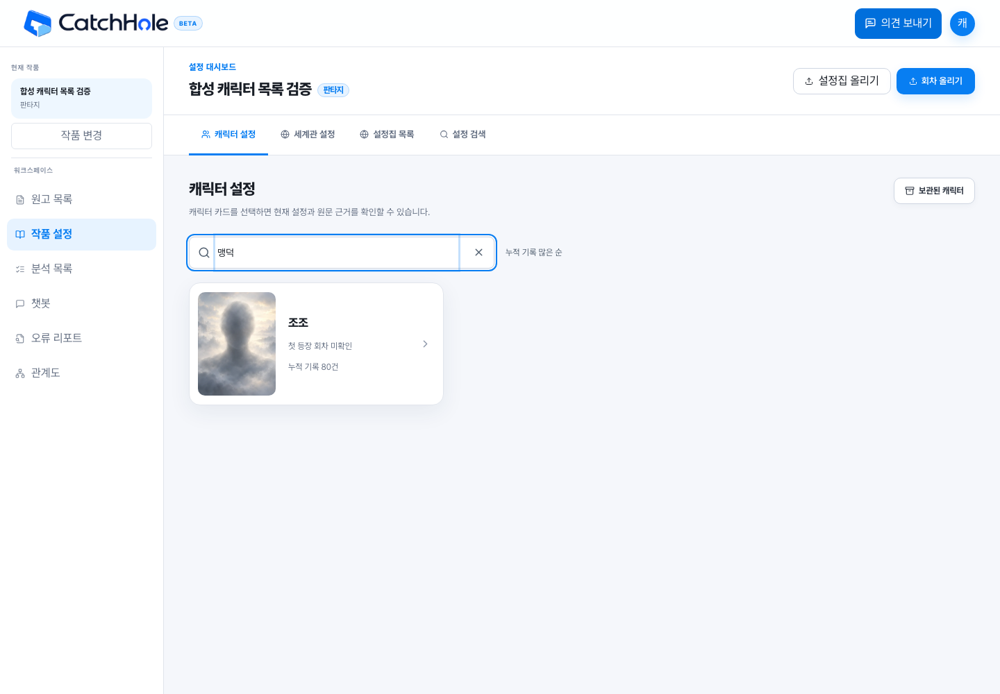
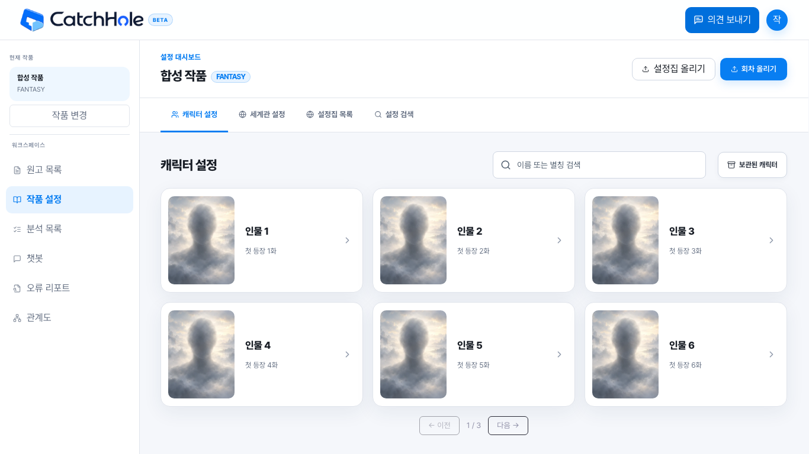

# 캐릭터 목록 검색 검증 (GH410)

## 확인 범위

2026-11-09, 별도 로컬 PostgreSQL/백엔드/프론트엔드에서 합성 데이터로 확인했다. 운영 계정·원고는 사용하지 않았고 운영 DB는 변경하지 않았다.

- 백엔드: 누적 Fact 수를 포함한 카드 projection, 확정 별칭 검색, 최대 24개 서버 페이지.
- 브라우저: 실제 로그인으로 받은 access token을 기존 저장소에 보관하고 HttpOnly refreshToken 쿠키 발행을 확인했다.
- 합성 인물 15명/Fact 1,725건에서 첫 인물 150건, 뒤 페이지의 조조 80건을 저장하고 `맹덕` 검색으로 조조 한 명을 확인했다. 서버의 `recordCount=80`과 화면 `누적 기록 80건`이 일치했다.
- 화면 크기로 계산한 요청 `page=0&size=6`과 `query=맹덕` 응답 200을 확인했다. 카드 목록은 `profile`·이력을 반환하지 않으며 상세 요청은 카드를 열 때 발생했다.
- 1440px 데스크톱/320px 모바일에서 검색·상세 열기·닫기·검색어 유지와 가로 넘침 없음을 확인했다.




## 자동 검증

```sh
CATCHHOLE_E2E_PORT=18412 npx playwright test e2e/character-directory.spec.ts e2e/character-search-link.spec.ts --workers=2
npm run lint
npm run build
npm run check:unused
```

목록 E2E 4건과 기존 인물 연결 검색 E2E 9건이 통과했다. 한글 조합, 검색 변경의 페이지 초기화, 별칭·특수문자 요청, 빈 결과, 새로고침·뒤로가기를 포함한다. lint 오류는 없으며 기존 두 파일의 Fast Refresh 경고가 남는다. Knip은 변경하지 않은 `e2e/episode-source-list.ts`, `scripts/analysis-list-benchmark.mjs` 두 파일을 미사용으로 보고하므로 통과로 표기하지 않는다.

백엔드 `CharacterCatalogPostgresIntegrationTest`는 실제 PostgreSQL의 초기 집계, 일괄 추가·중복 삽입·내용 수정·이동·삭제·롤백·동시 추가를 검증한다. 합성 인물 2,000명/이력 200,000건에서 기본 목록의 집계 인덱스 사용과 Fact 조회·별도 정렬 없음, 검색 결과 24개만 반환, WorkCharacter 엔티티 미로딩을 확인한다. 이 결과는 운영 응답 시간의 실측값은 아니다.

## 배포 순서

Backend GH410의 V121 및 API를 먼저 적용한 뒤 프론트엔드를 배포한다. 마이그레이션의 초기 집계·인덱스 생성 중 쓰기 잠금이 발생하므로 운영 적용은 별도 일정에서 수행한다. 이 PR에서는 배포하지 않는다. 별칭은 작가가 확정 연결한 인물 발견 이름만 포함하며 임의의 프로필 본문을 이름으로 추정하지 않는다.

## 후속 화면 간소화

위 초기 캡처 이후, 카드의 누적 기록 수와 제목 아래 설명을 제거했다. 누적 기록순은 서버 기본 정렬로 유지한다. 제목·검색·보관함은 데스크톱 한 줄로 배치하고 헤더 아래 간격은 16px로 줄였다. 760px 이하에서는 검색만 다음 줄 전체 너비에 표시한다.

합성 인물 fixture의 브라우저 검증에서 1366×768과 1280×800 모두 카드 두 줄 및 페이지 버튼이 화면 안에 들어오고, 실제 표시 카드 수와 서버 요청 size가 일치했다. 320px 모바일에서도 가로 넘침 없이 이름·별칭 검색과 초기화가 동작했다. 기존 검색 4건과 배치 회귀 2건, build/lint를 확인했다(lint는 기존 Fast Refresh 경고 2건).




