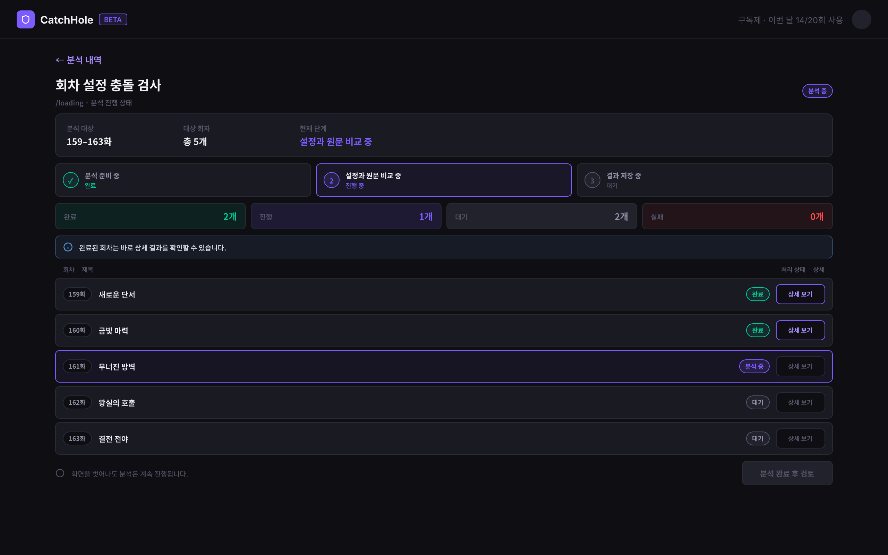
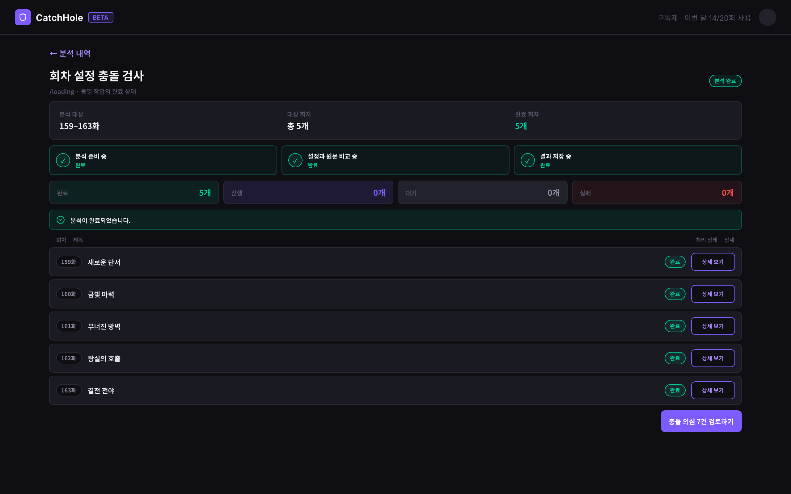
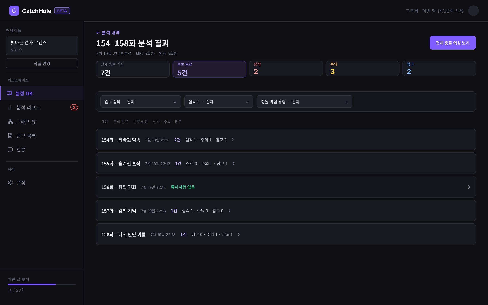
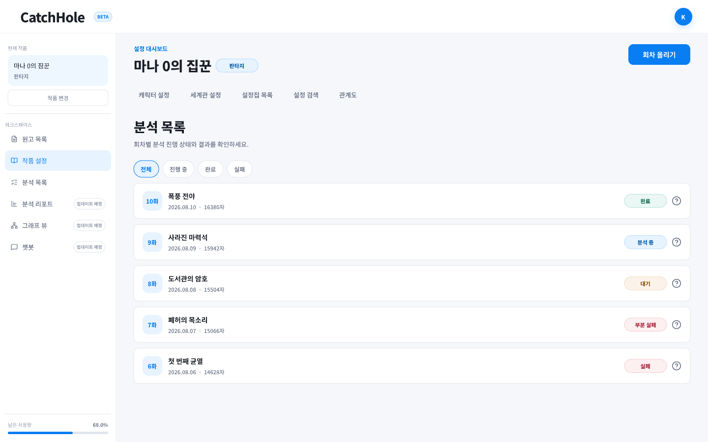

# 데이터 요구사항 — Analysis(분석)

[← 전체 인덱스](./README.md)

> 이 문서는 `SETTING_EXTRACTION`·`EPISODE_VALIDATION`을 함께 보여주는 업로드 배치별 분석 목록과 `EPISODE_VALIDATION`의 진행 상태·충돌 의심 결과 조회 흐름을 정의한다. 현재 Java BE에는 `AnalysisJob` 생성·목록·상세 조회와 작업 상태 전이 계약이 있고, Python Worker에는 설정 추출 흐름이 구현되어 있다. 회차별 검증 진행 상태와 충돌 의심 결과 저장·조회 API는 후속 구현이 필요하다.
>
> 충돌 의심 결과의 유형·심각도·원문 근거 방향은 [catchhole-backend-java #64](https://github.com/catchhole-soma/catchhole-backend-java/issues/64)를 참고하되, 아래 문서에서는 사용자 화면에 필요한 계약만 다룬다.

> **2026-10-28 · #300:** 신규 오류 리포트의 기준은 [충돌 의심 상세 리포트](#충돌-의심-상세-리포트-sepisodevalidationreport)의 단일 회차 검토안이다. 기존 설정 추출의 작업·재시도·검토 계약과 구분한다. 아래 진행/완료/분석 목록 절에 남아 있는 과거 검증 연결안은 이 화면안의 오류 검사·작가 검토 후 추출/확정·회차 전체 보류·부분 결과 공개·재검수 정책보다 우선하지 않으며, 각 화면을 검토할 때 연결을 갱신한다.

## MVP 분석 흐름

1. **최초 원고 분석**
   - 설정 후보 추출 → [설정 검토](./character.md#설정-검토-ssettingreview) → 설정 DB 등록
   - `기존 설정 구축` 흐름이다. 신규 회차 검수는 첫 회차라도 설정집·직접 입력 설정 등 비교 자료가 있으면 가능하고, 비교 자료가 전혀 없으면 설정 구축을 안내한다.
2. **신규 회차 검수 계획 — #300**
   - 등록된 마지막 회차 뒤에 추가하는 단일 회차를 검사한다. 원고 저장 → 오류 검사·작가 검토/수정/재검수 → 최종 원고 설정 추출·비교 → 확정 순서다. 두 검사 정상 완료·설정 검사 3유형 합계와 오탈자 제안 모두 0건은 자동 추출, 항목이 있었다면 설정 모두 충돌 아님·오탈자 확인 완료·수정 대기 없음 뒤 별도 검토 완료 버튼으로 시작한다. 검토 전에는 추출 Job·설정 후보가 없다. 실패·일부 중단·미판단·수정 필요가 남으면 추출하지 않는다.
   - 업로드 진행/분석 목록 → [충돌 의심 상세 리포트](#충돌-의심-상세-리포트-sepisodevalidationreport). 의심 0건과 일부 중단도 결과를 연다. 연결 화면의 상세 변경은 후속 검토한다.
3. **실패한 분석 다시 시도**
   - 회차별 Job은 독립적으로 성공·실패하며, 한 회차 실패가 다른 회차 결과나 상태를 바꾸지 않는다.
   - 기존 실패 Job을 되살리지 않고 서버가 확인한 실패 회차만 새 Job으로 재시도한다.
4. **분석 작업 다시 확인**
   - 사이드 메뉴의 [분석 목록](#분석-목록-analysislist)에서 회차별 작업을 `UploadBatch` 단위로 집계해 확인한다.
   - 대기·진행 중 묶음을 선택하면 같은 `analysisJobIds`의 진행 화면으로 돌아가 폴링을 재개한다.
   - 모든 Job이 완료되면 결과 또는 설정 후보 검토를 열고, 실패가 있으면 실패 회차만 재시도한다.

> **기존 설정 추출의 작업·검토 정책** — 신규 오류 리포트에 같은 완료·재시도 제한을 그대로 적용하지 않는다.
> - 하나의 업로드 묶음은 회차마다 하나씩 생성된 `analysisJobIds` 목록을 사용한다. `UploadBatch`는 출처·화면 문맥이고 실행 원자 단위는 단일 회차 Job이다.
> - 진행 상세는 Job별 `PENDING`/`RUNNING`/`SUCCEEDED`/`FAILED`를 사용하고, 분석 목록은 서버가 집계한 배치 상태의 `PARTIALLY_FAILED`를 그대로 사용한다. FE가 별도 부분 실패 enum이나 상태를 만들어 추측하지 않는다.
> - 성공한 회차의 결과와 `ANALYZED` 상태는 다른 회차가 실패해도 유지한다.
> - 전체 결과 화면은 현재 묶음의 모든 회차가 성공했을 때만 활성화하되, 개별 Job의 성공 이력은 지우지 않는다.
> - 일반 분석의 `분석 다시 시도`는 서버가 확인한 실패 회차만 새 Job으로 생성하고 기존 실패·성공 Job은 이력으로 유지한다. GH180 순차 누적 분석은 동일 Job을 재개할 수 있으므로 응답으로 상세 캐시를 갱신하고 현재 Job을 재조회한다.
> - 순차 누적 분석의 실행 상태는 `analysisRun`으로 구분한다. 같은 실행·세대에서 앞 회차가 실패하거나 `INCOMPLETE`이면 뒤 `PENDING`은 `앞 회차 재개 대기`이며 재개를 막는 활성 작업으로 세지 않는다. `SUCCEEDED+INCOMPLETE`도 비교 미완료다. `INVALIDATED`이면 원고 목록 확인 또는 해당 업로드의 현재 회차 전체를 새로 분석하는 범위·사용량 확인을 제공한다. 기존 실행의 재개·후보 검토·자동 재분석은 하지 않는다. 생성 모드와 진행 UI 상세는 [업로드 계약](upload.md#gh180-다회차-분석-방식)을 따른다.
> - 실제 진행률을 정확히 계산할 수 없으므로 가짜 퍼센트는 표시하거나 저장하지 않는다.
> - 분석 화면을 벗어나도 서버 작업은 취소되지 않는다.
> - 분석 목록은 성공 결과만 모아 놓은 화면이 아니라, 사용자가 실행한 `SETTING_EXTRACTION`·`EPISODE_VALIDATION` 작업의 진행·부분 실패·실패·검토 필요·완료 상태를 업로드 묶음별로 확인하는 진입점이다.
> - 충돌 의심 결과는 확정 오류가 아니다. 화면에서는 `오류`보다 `충돌 의심`, `검토 필요` 표현을 우선 사용한다.
> - 원고는 화면에서 직접 수정하지 않는다. 회차 파일 교체 후 사용자가 요청하는 재분석은 해당 회차의 `SETTING_EXTRACTION`으로 실행하며, 충돌 검수용 `EPISODE_VALIDATION`과 구분한다.
> - Job·Episode의 상세 실패 문자열은 개발·운영 진단 정보로 취급하며 사용자 화면에 원문을 표시하지 않는다. 화면은 실패 상태, 간단한 사용자용 안내와 재시도 액션을 제공한다.
> - 비동기 Job의 `failureCode=AI_TOKEN_QUOTA_EXHAUSTED`에서도 전역 사용량·연락 안내 모달을 연다. 같은 배치의 현재 Job이 모두 종료된 뒤 1차 추출 전 실패는 단일·전체·일부 실패 문구와 재시도를, 1차 추출 뒤 중단은 보존 결과와 남은 비교 재개를 안내하며 내부 URL과 `Client error 409` 원문은 표시하지 않는다.
> - `tokenInterruptedAfterExtraction=true`는 전체 회차 실패가 아니라 1차 추출 뒤 세계관 비교 일부 중단이다. 완료된 추출·비교를 보존하고 정확한 중단 건수와 `남은 비교 확인`을 표시하며 전체 분석 재시도 버튼을 제공하지 않는다. 단, 현재 대상 회차가 `ARCHIVED`이면 보존 결과 진입보다 이용 불가 상태를 우선하고 검토 이동도 제공하지 않는다.

## 목차

- [분석 목록 (AnalysisList)](#분석-목록-analysislist)
- [분석 진행 중 (S4LoadingRunning)](#분석-진행-중-s4loadingrunning)
- [분석 완료 (S4LoadingCompleted)](#분석-완료-s4loadingcompleted)
- [충돌 의심 상세 리포트 (SEpisodeValidationReport)](#충돌-의심-상세-리포트-sepisodevalidationreport)

---

<a id="분석-진행-s4loading"></a>

## 분석 진행 중 (S4LoadingRunning)

**URL**: `/loading?workId={workId}&analysisJobIds={commaSeparatedAnalysisJobIds}`



신규 회차의 오류 검사 작업 진행 상태를 확인하는 화면이다. 오류 검사·작가 검토가 설정 추출보다 먼저이며 아래 과거 세부 진행안은 GH300 계약으로 연결을 갱신한다. 업로드 내부의 설정 추출 진행 상태는 [회차 업로드의 분석 진행](./upload.md#5-분석-진행)을 사용하고, 이 화면은 확정 설정과 신규 회차를 비교하는 오류 탐지 단계에 사용한다. 분석 작업 생성 직후뿐 아니라 [분석 목록](#분석-목록-analysislist)에서 대기·진행 중 작업을 선택해 다시 진입할 수 있다.

> **화면 레이아웃·이동 정책**
> - 분석 진행 화면은 설정 대시보드의 하위 탭이 아닌 독립 작업 상세 화면으로 표시한다.
> - 좌측 대시보드 사이드바를 표시하지 않고 상단에 `← 분석 목록`을 제공한다.
> - `← 분석 목록`은 `/dashboard?workId={workId}&nav=analyses`로 이동하며, 화면을 벗어나도 서버 분석은 계속된다.
> - 같은 실행 묶음에 다시 진입하면 URL의 모든 `analysisJobIds`로 최신 상태를 조회하고 폴링을 재개한다.

> **회차별 분석 작업의 현재 단계 표시 정책**
> - `currentStep`은 해당 단일 회차 Job이 현재 어떤 처리를 수행하고 있는지 나타낸다.
> - Python의 공통 `AnalysisStep` 8종을 이 화면에 그대로 적용하지 않는다. `CHUNKING`, `PREPROCESSING`, `EMBEDDING`, `SETTING_EXTRACTION`은 설정 후보 추출 과정에서 사용하는 단계이며, 오류 검사가 설정 추출을 선행 실행한다고 전제하지 않는다. 필요한 원고 읽기·분할은 후보 생성 없는 검사 준비로 처리한다.
> - `EPISODE_VALIDATION` 구현 시 기존 enum 중 필요한 단계만 사용한다는 전제의 권장 표시값은 다음과 같다.
> - `LOADING` → `분석 준비 중`
> - `VALIDATION` → `설정과 원문 비교 중`
> - `PERSISTING` → `결과 저장 중`
> - `DONE` → `분석 완료`
> - 알 수 없는 값 또는 `null` → 상위 `status`가 `RUNNING`이면 `분석 진행 중`, `PENDING`이면 `분석 대기 중`

> **대상 회차별 처리 상태 표시 정책**
> - 각 회차 카드는 해당 회차 `AnalysisJob.status`, `currentStep`, 단일 `Episode.status`를 함께 사용한다.
> - Job `PENDING` → `대기`, `RUNNING` → `분석 중`, `SUCCEEDED` → `완료`, `FAILED` → `실패`
> - 일부 Job이 실패해도 다른 `PENDING`/`RUNNING` Job의 polling을 계속한다.
> - 실패 재시도 버튼은 현재 묶음의 활성 Job이 모두 종료된 뒤 활성화한다.

**1. 화면에 표시할 데이터**

- `← 분석 목록`
- 현재 작품명
- 분석 작업 요약
  - 분석 유형: `회차 설정 충돌 검사`
  - 대상 회차 시작·종료 번호와 총 회차 수
  - 작업 상태와 현재 사용자용 단계 문구
  - 완료·진행·대기·실패 회차 수
- 회차별 처리 목록
  - 회차 번호와 제목
  - 처리 상태
  - 현재 단계 또는 실패 상태
- 전체 작업이 아직 진행 중임을 알리는 안내
- 현재 Job이 모두 `SUCCEEDED`가 되기 전에는 비활성화된 `분석 결과 확인` 버튼

**2. 사용자 액션**

- 화면 진입 시 모든 작업 상세 조회
- Job 중 하나라도 `PENDING` 또는 `RUNNING`인 동안 2~3초 간격으로 상태 폴링
- 브라우저 탭이 비활성화되면 폴링을 중단하거나 주기를 늦추고, 탭 복귀 시 즉시 최신 상태 조회
- 실패한 회차의 상태와 사용자용 재시도 안내 확인
- 화면 이탈 → 분석은 계속 진행
- `분석 목록` 선택 → [분석 목록](#분석-목록-analysislist)으로 이동
- 같은 `analysisJobIds`로 다시 진입 → 최신 진행 상태 복원
- 모든 현재 Job이 `SUCCEEDED`이면 폴링을 중단하고, URL 이동 없이 같은 화면에 [분석 완료](#분석-완료-s4loadingcompleted) 상태를 표시한다. 현재 Episode 상태가 분석 완료 당시와 다르면 완료 상태를 되돌리지 않고 원고 변경 여부 확인과 필요 시 재분석 안내를 함께 표시한다.
- 활성 Job이 없고 하나 이상 `FAILED`이면 `분석 다시 시도` 선택
  - 기존 실패 작업은 실패 이력으로 유지
  - 각 실패 Job의 재시도 API로 서버가 확인한 실패 회차 Job만 생성
  - 추적 이력의 전체 `analysisJobIds`는 유지
  - 현재 polling 목록에서는 재시도 대상 실패 ID만 새 ID로 교체하고 기존 성공·복구 불가 `currentAnalysisJobIds`는 유지

**3. 화면 전환 식별자**

- 현재 작품: `workId`
- 현재 분석 작업들: `analysisJobIds`
- 분석 대상 묶음: `batchId`
- 준비된 분석 결과 묶음: `reportId`
- 분석 목록 이동: `/dashboard?workId={workId}&nav=analyses`
- 재시도 성공 후 이동 예시: `/loading?workId={workId}&analysisJobIds={newAnalysisJobIds}`

**4. 데이터 없음 / 실패 표시**

- 작업 상세 조회 중 로딩
- `PENDING`이고 `currentStep`이 없으면 `분석을 기다리고 있습니다.` 표시
- 분석 대상 회차가 0개이면 `분석할 회차를 찾지 못했습니다.` 표시와 원고 목록 이동 제공
- 작업 조회 404이면 `분석 작업을 찾을 수 없습니다.` 표시
- 상태 조회 일시 실패 시 마지막으로 성공한 화면 데이터를 유지하고 `상태를 새로 불러오지 못했습니다.`와 다시 시도 제공
- 활성 Job이 없고 하나 이상 `FAILED`일 때
  - `일부 회차 분석에 실패했습니다.` 표시
  - 실패가 발생한 회차와 간단한 사용자용 안내 표시
  - LLM 응답 검증 오류, 내부 식별자 등 상세 실패 원문은 표시하지 않음
  - 완료된 회차 상태와 결과는 유지하되 전체 `분석 결과 확인`은 아직 제공하지 않음
  - `분석 다시 시도`, `분석 목록으로 돌아가기`, `원고 목록으로 이동` 제공
- 회차가 완료되었지만 결과 저장이 아직 끝나지 않았으면 `결과를 정리하고 있습니다.` 표시 후 다음 폴링에서 갱신

**5. 화면 데이터 요구사항**

**5-1. BE → FE 제공 데이터 요구사항 — 분석 작업 기본 정보**

진행 화면은 Java BE의 `AnalysisJobProgressResponse[]`를 사용한다. 기존 상세 응답의 큰 상태 JSON·원문·결과 요약을 상태 확인용으로 읽지 않는다. 작품 제목은 기존 작품 조회와 선택 문맥을 사용하고 batch 범위는 URL/생성 응답으로 유지한다.

| 데이터 의미 | 현재 필드 | 화면 사용 |
| --- | --- | --- |
| 작업·단일 회차 식별자 | `id`, `episodeId` | 현재/이력·재시도 대상 연결 |
| 작업 유형과 상태 | `jobType`, `status` | 진행·실패·완료·이동 판단 |
| 반영 방식과 완료 기록 | `reviewMode`, `automaticAppliedAt` | 자동 저장 마무리 확인 |
| 누적 실행 | `analysisRun` | 실행/세대/순서·선행 실패·봉인·무효화 판단 |
| 공개 실패 분류 | `failureCode`, `tokenInterruptedAfterExtraction` | 사용량 중단과 일반 실패 분리 |
| 고정 대상 메타데이터 | `episodes` | ID·번호·제목·현재 상태·변경 시각 |

```http
GET /api/v1/works/{workId}/analysis-jobs/progress?analysisJobIds={comma-separated-UUIDs}
GET /api/v1/works/{workId}/world-setting-candidates/progress?batchId={batchId}
```

작업은 중복 제거 전 1~100개를 요청하며 서버는 최초 입력 순서로 반환한다. 없는/다른 작품 작업이 섞이면 전체를 거절한다. 긴 이력은 100개씩 순차 요청하고 모든 묶음이 성공해야 반영한다. 세계관 응답은 `pendingComparisonCount`, `processingComparisonCount`, `tokenInterruptedComparisonCount` 세 수치뿐이다. 기존 `GET /analysis-jobs/{analysisJobId}`는 다른 상세 소비자를 위해 유지한다.

재개 성공 응답의 새 ID는 후속 상태 GET 전에 추적/현재 목록과 URL에 보존한다. `analysisRun.journalStatus=INVALIDATED`여도 Job 상태가 PENDING/RUNNING이면 종료를 관측할 때까지 조회 대상이며, terminal 상태가 확인된 뒤 멈춘다. RUNNING은 3초, 무효화로 차단된 PENDING은 30초로 확인하고 focus/reconnect·수동 재조회도 같은 대상 규칙을 따른다.

**5-2. BE → FE 제공 데이터 요구사항 — 회차별 진행 정보**

현재 진행 요약 응답의 `episodes`에는 해당 Job의 단일 회차 ID·번호·제목·`Episode.status`가 포함된다. FE는 고정 대상 응답을 회차 번호순으로 합치며 다른 Job의 상태를 복제하지 않는다. 검수 결과 식별자는 후속 리포트 계약에서 추가한다.

| 데이터 의미 | 형태·필수성 | 값 없음·조건 |
| --- | --- | --- |
| 대상 회차 전체 수 | Job 목록 길이·필수 | 생성 대상이 없으면 API가 Job을 만들지 않음 |
| 상태별 회차 수 | FE의 Job 상태 집계·필수 | 없는 상태는 `0` |
| 회차 식별자·번호·제목 | 각 응답 `episodes[]`·필수 | 제목이 없으면 `null` |
| 회차별 분석 상태 | Job `status`와 Episode `status`·필수 | 작업 상태와 처리 단계를 구분 |
| 회차별 현재 단계 | `Episode.status`·필수 | 자유 문구인 `currentStep`에서 단계를 추측하지 않음 |
| 회차별 실패 분류 | `failureCode`·선택 | 실패가 아니면 `null`; 원시 오류는 화면에 표시하지 않음 |
| 전체 결과 식별자 | 단일 값·조건부 필수 | `SUCCEEDED`이면 필수, 그 외 상태에서는 `null` |

**5-3. FE → BE 전달 데이터 요구사항**

- 작업 상세·회차 목록 조회: `workId`, `analysisJobIds`
- 실패 작업 재시도: 각 기존 실패 `analysisJobId`
- FE는 작업 상태, 단계, 충돌 건수를 임의로 계산하거나 변경하지 않는다.
- 재시도 요청이 성공하면 새 `analysisJobIds` 목록을 응답받는다.

**6. BE와 협의할 범위·상태값**

- 현재 Python Worker가 `jobType=EPISODE_VALIDATION`을 실제 분기 처리하도록 구현할 범위
- 검증 작업의 `currentStep` 계약으로 공통 `AnalysisStep` 중 `LOADING`/`VALIDATION`/`PERSISTING`/`DONE`만 재사용할지, 검증 전용 단계 enum을 별도로 정의할지
- 동일 재시도 요청의 중복 생성 방지를 위한 idempotency 기준과 이전 작업·새 작업 연결 방식
- 원인별 사용자 안내가 필요할 때 상세 문자열이 아닌 안정적인 실패 식별값을 별도로 제공하는 계약

---

## 분석 완료 (S4LoadingCompleted)

**URL**: `/loading?workId={workId}&analysisJobIds={commaSeparatedAnalysisJobIds}`



분석 진행 화면과 별도 URL·API를 사용하는 화면이 아니라, 같은 `/loading` 컴포넌트가 폴링 응답에 따라 표시하는 완료 UI 상태다. 현재 `analysisJobIds`의 모든 Job과 대상 회차가 성공하고 결과가 준비되면 이 상태로 바꾸고 폴링을 중단한다. 자동으로 다른 화면으로 이동하지 않으며 실패 Job이 있으면 이 완료 상태로 전환하지 않는다.

**1. 화면에 표시할 데이터**

- `← 분석 목록`
- `분석이 완료되었습니다.` 완료 안내
- 분석 대상 회차 범위와 총 회차 수
- 완료 회차 수
- 전체 충돌 의심 건수
- 심각도별 집계
  - `HIGH` → `심각`
  - `MEDIUM` → `주의`
  - `LOW` → `참고`
- 충돌 의심이 1건 이상이면 `충돌 의심 N건 검토하기` 주요 버튼
- 충돌 의심이 0건이면 `이번 분석에서 충돌 의심 항목을 찾지 못했습니다.` 완료 메시지
- `분석 목록으로 돌아가기` 보조 버튼
- `원고 목록으로 이동` 보조 버튼

**2. 사용자 액션**

- `충돌 의심 N건 검토하기` → [충돌 의심 상세 리포트](#충돌-의심-상세-리포트-sepisodevalidationreport)의 전체 회차 모드로 이동
- `분석 목록으로 돌아가기` → [분석 목록](#분석-목록-analysislist)으로 이동
- `원고 목록으로 이동` → 현재 작품의 원고 목록으로 이동
- 브라우저 새로고침·재진입 → 완료 데이터 복원

**3. 화면 전환 식별자**

- 현재 작품: `workId`
- 완료된 작업들: `analysisJobIds`
- 전체 결과: `reportId`
- 충돌 의심 검토 이동: `/episode-validation-report?workId={workId}&reportId={reportId}`
- 분석 목록 이동: `/dashboard?workId={workId}&nav=analyses`
- 원고 목록 이동: 현재 작품의 원고 목록 URL과 `workId`

**4. 데이터 없음 / 실패 표시**

- 결과 집계 조회 중 로딩
- 충돌 의심 결과가 0건이면
  - `이번 분석에서 충돌 의심 항목을 찾지 못했습니다.`
  - 충돌 검토 버튼 대신 `분석 목록으로 돌아가기`를 주요 후속 액션으로 제공
- `SUCCEEDED`인데 `reportId`가 없으면 정상적인 준비 중 상태로 취급하지 않고 `분석 결과를 불러오지 못했습니다.` 표시와 상태 다시 조회 제공
- 결과 조회 실패 시 완료 작업 정보는 유지하고 다시 시도 제공
- 결과 생성 이후 대상 회차가 삭제되었으면 과거 분석 당시 회차 번호·제목을 표시하고 현재 삭제된 회차임을 안내

**5. 화면 데이터 요구사항**

**5-1. BE → FE 제공 데이터 요구사항**

| 데이터 의미 | 형태·필수성 | 값 없음·조건 |
| --- | --- | --- |
| 분석 작업 식별자 | 회차별 목록·필수 | 없음 |
| 작업 완료 상태·완료 시각 | Job별 값·필수 | 모든 Job 완료 전 이 화면을 표시하지 않음 |
| 전체 결과 식별자 | 단일 값·필수 | `SUCCEEDED` 응답에 반드시 포함 |
| 대상·완료 회차 수 | 0 이상의 정수·필수 | 완료 화면에서는 두 값이 같아야 함 |
| 전체 충돌 의심 건수 | 0 이상의 정수·필수 | 없으면 `0` |
| 심각도별 집계 | 단계별 정수·필수 | 없는 단계는 `0` |
| 분석 기준 표시 정보 | 단일 값·필수 | 설정 기준과 원고 버전 추적에 사용 |

완료 화면은 진행 화면과 같은 회차별 분석 작업 상세 응답들을 재사용하며, 충돌 의심 상세를 열 수 있는 `reportId`와 전체 집계만 추가로 사용한다.

**5-2. FE → BE 전달 데이터 요구사항**

- 완료 결과 조회: `workId`, `analysisJobIds`
- 충돌 의심 상세 조회: `workId`, `reportId`

**6. BE와 협의할 범위·상태값**

- 완료 화면의 전체 집계를 분석 완료 시 저장할지 조회 시 계산할지
- 분석 기준 표시를 위한 확정 설정 버전·원고 버전의 구체적인 응답 형식

---

> **MVP 이후 분석 결과 대시보드 고도화**
> - MVP에서는 별도의 `분석 묶음 회차별 결과` 중간 화면을 제공하지 않는다.
> - 완료 화면과 분석 목록에서 `reportId`의 [충돌 의심 상세 리포트](#충돌-의심-상세-리포트-sepisodevalidationreport)로 바로 이동한다.
> - 이후 전체 결과 대시보드를 추가할 때는 충돌 유형 분포, 캐릭터별 충돌 추세, 이전 분석 대비 변화처럼 여러 회차와 분석 이력을 종합해야 의미가 있는 정보를 제공한다.



---

<a id="분석-목록-analysislist"></a>

## 분석 목록 (AnalysisList)

> **Theme V2 파일럿**: 업로드 묶음을 밝은 카드로 표시하고 상태는 Primary Blue에 합치지 않고 진행·주의·실패·완료 의미 색상을 유지한다. 서버 페이지네이션과 각 상태별 후속 액션 계약은 변경하지 않는다.

**URL**: `/dashboard?workId={workId}&nav=analyses&analysisPage={1 이상의 정수}`



모바일: [분석 목록](../screens/Pu7UQ.png)

사이드 메뉴의 `분석 목록`에서 같은 작품의 분석을 `UploadBatch` 단위로 조회하는 화면이다. 한 번에 함께 올린 회차들의 Job과 설정 후보 검토 상태를 한 카드로 집계하며, `SETTING_EXTRACTION`과 `EPISODE_VALIDATION`이 같은 배치에 있으면 목적별 하위 요약은 유지하되 카드 액션은 배치 상태에 맞는 버튼 하나만 표시한다.

> **목록·보존 정책**
> - 서버 페이지네이션은 한 페이지 10개이며, 배치의 최근 분석 요청 시각 내림차순과 배치 ID 내림차순을 사용한다.
> - 배치 상태는 `IN_PROGRESS`·`PARTIALLY_FAILED`·`FAILED`·`CANCELED`·`REVIEW_REQUIRED`·`COMPLETED`를 사용한다. 순차 분석의 선행 실패·저장 미완료에 막힌 후행 대기는 진행 중으로 세지 않는다. 완료된 앞 회차가 있으면 일부 중단, 없으면 실패, 무효화는 취소로 안내하며 원본 Job 상태를 수정하지 않는다.
> - 재시도 전 실패 Job은 이력으로 유지하되 목록의 현재 상태·개수·`currentAnalysisJobIds`는 회차별 최신 유효 Job을 기준으로 집계한다.
> - 완료·실패 분석 묶음을 덮어쓰거나 삭제하지 않으며, 사용자가 이력을 삭제하는 기능은 MVP에서 제공하지 않는다.
> - `UploadBatch`는 업로드 출처와 목록 카드 단위이고 실제 실행·재시도 단위는 회차별 `AnalysisJob`이다.
> - `worldSettingTokenInterruptedCandidateCount > 0`이어도 배치가 `IN_PROGRESS`이면 최종 건수가 확정될 때까지 `분석 중`·`진행 보기`를 유지한다. 모든 현재 Job이 종료된 뒤 `세계관 비교 일부 중단`과 최종 건수를 알리고 `candidateType=world` 설정 검토로 연결한다. 같은 조회에서 여러 배치가 함께 종료되면 새 중단 건수를 합산해 한 모달로 안내한다.

**1. 화면에 표시할 데이터**

- 분석 배치 목록
  - 대상 회차 시작·종료 번호와 서로 다른 회차 수
  - 배치 상태: 분석 중·일부 분석 중단·분석 실패·분석 취소·분석 완료
  - 분석 완료 후 미확정 후보가 있으면 `분석 완료 · N개 확인 가능` — 캐릭터와 세계관 대기 수의 합이며 회차 실패가 아니다.
  - 분석 목적별 `SETTING_EXTRACTION`/`EPISODE_VALIDATION` 사용자용 명칭
  - 목적별 전체·대기·진행·성공·실패 Job 수
  - 설정 후보 전체 수, 검토 완료 수와 검토 대기 수
  - 사용량 부족으로 중단된 세계관 비교 수와 재개 가능 여부
  - 최근 활동 시각
- 한 페이지 10개의 서버 페이지네이션

**2. 사용자 액션**

- 각 배치 카드는 현재 상태에 맞는 액션 버튼 하나만 표시
- `IN_PROGRESS` 배치의 `진행 보기` → 진행 중인 목적의 `currentAnalysisJobIds`로 업로드 분석 진행 화면을 열고 폴링 재개
- `PARTIALLY_FAILED` 또는 `FAILED` 배치의 `실패 확인` → 실패한 목적의 현재 작업으로 같은 화면을 열어 실패 회차 확인·재시도. 세계관 비교 중단이 함께 있으면 일반 실패 복구를 먼저 제공한다.
- 일반 실패 복구가 남지 않고 세계관 비교 중단 후보가 있는 배치의 `남은 비교 확인` → `/setting-review?candidateType=world`로 이동해 보존 결과와 일괄 재개 액션 확인
- `REVIEW_REQUIRED` 배치의 `결과 보기` → `PENDING_REVIEW` 기본 필터로 [설정 검토](./character.md#설정-검토-ssettingreview)에 바로 이동
- `COMPLETED` 배치의 `결과 보기` → `ALL` 필터로 설정 검토 결과를 읽기 전용 조회
- `IN_PROGRESS` 배치가 있으면 화면 활성 상태에서 10초 간격으로 목록을 갱신하고, 모두 종료되면 자동 갱신 중단
- 이전·다음 페이지 이동

> **후속 계약**
> 현재 `REVIEW_REQUIRED`는 배치 전체의 `pendingCandidateCount`로만 결정되고,
> `jobGroups[].status`에는 후보 검토 상태가 포함되지 않는다. 따라서 두 분석 목적이
> 같은 배치에 함께 있으면 프론트만으로 검토 후 이어갈 정확한 `jobType`을 식별할 수 없다.
> Backend가 `reviewJobType` 또는 목적별 미검토 후보 수를 제공하도록 계약을 보강한 뒤,
> 분석 목록의 고정 우선순위를 해당 값 기반 선택으로 교체한다.

**3. 화면 전환 식별자**

- 현재 작품: `workId`
- 현재 목록 페이지: `analysisPage={1 이상의 정수}`. 값이 없으면 첫 페이지
- API 페이지: `page={0 이상의 정수}&size=10`
- 진행·실패 화면: `/episode-upload?workId={workId}&batchId={batchId}&analysisJobIds={currentAnalysisJobIds}&currentAnalysisJobIds={currentAnalysisJobIds}&jobType={jobType}`
- 검토 필요 결과: `/setting-review?workId={workId}&batchId={batchId}&jobType={jobType}`
- 검토 완료 결과: `/setting-review?workId={workId}&batchId={batchId}&jobType={jobType}&reviewStatus=ALL`

**4. 데이터 없음 / 실패 표시**

- 분석 배치 목록 조회 중 로딩
- 이력이 없으면 `아직 요청한 분석이 없습니다.`와 업로드 후 표시된다는 안내
- 목록 조회 실패 시 `분석 목록을 불러오지 못했습니다.`와 다시 불러오기 제공
- 이미 표시한 목록의 자동 갱신만 실패하면 기존 카드를 유지하고 최신 상태를 불러오지 못했다는 비차단 안내와 다시 불러오기를 제공
- 대상 회차 번호가 없으면 `대상 회차 정보 없음`, 시각이 없거나 해석할 수 없으면 `—`
- 목적별 현재 Job ID가 없으면 해당 진행·실패·결과 액션을 비활성화
- 과거 결과의 대상 회차가 현재 삭제되었어도 이력 자체는 유지한다.

**5. 화면 데이터 요구사항**

```http
GET /api/v1/works/{workId}/analysis-jobs/batches?page={page}&size=10
```

**5-1. BE → FE 제공 데이터 요구사항 — 배치 요약**

| 데이터 의미 | 현재 필드 | 화면 사용 |
| --- | --- | --- |
| 업로드 묶음 | `batchId`, `uploadType` | 카드 식별과 업로드 문맥 |
| 배치 집계 상태 | `status` | 진행·부분 실패·실패·검토 필요·완료 표시 |
| 대상 회차 범위·수 | `episodeStartNo`, `episodeEndNo`, `episodeCount` | 카드 대상 요약 |
| 후보 검토 집계 | `totalCandidateCount`, `reviewedCandidateCount`, `pendingCandidateCount` | 검토 진행과 `REVIEW_REQUIRED` 액션 |
| 토큰 부분 중단 | `worldSettingTokenInterruptedCandidateCount`, `canResumeTokenInterruptedWorldSettingComparisons` | 전체 실패와 구분한 중단 건수·세계관 검토 이동 |
| 분석 목적별 집계 | `jobGroups[]` | 목적별 상태·개수 요약과 진행·실패 시 이동 대상 선택 |
| 분석 요청·활동 시각 | `firstRequestedAt`, `lastRequestedAt`, `lastActivityAt` | 최근 활동 표시와 최근 분석 요청 기준 서버 정렬 |

`jobGroups[]`는 `jobType`, 목적별 집계 `status`, `totalJobCount`, `pendingJobCount`, `runningJobCount`, `succeededJobCount`, `failedJobCount`, `currentAnalysisJobIds`, `lastActivityAt`을 제공한다.

**5-2. BE → FE 제공 데이터 요구사항 — 서버 페이지**

응답은 공통 `PageResponse<AnalysisBatchSummaryResponse>`의 `content`, `page`, `size`, `totalElements`, `totalPages`, `hasNext`를 사용한다. FE가 전체 Job을 내려받아 임의로 10개씩 자르지 않는다.

**5-3. FE → BE 전달 데이터 요구사항**

- 배치 목록 조회: `workId`, 0부터 시작하는 `page`, `size=10`
- 진행·실패 재진입: 응답의 `batchId`, 선택한 목적의 `jobType`, `currentAnalysisJobIds`
- 설정 후보 결과: 응답의 `batchId`와 해당 `jobType`, 완료 결과이면 `reviewStatus=ALL`
- FE는 과거 실패 Job을 현재 Job으로 되살리거나 상태·후보 집계를 다시 계산하지 않는다.

**6. BE와 협의할 범위·상태값**

- 업로드 묶음과 별개의 분석 실행 이력이 필요해질 때 실행 ID를 추가하는 정책
- 분석 이력의 보존 기간과 작품 soft delete·hard delete 시 함께 처리하는 정책
- 대기·진행 중 배치의 목록 갱신 주기와 서버 부하 기준
- 완료된 `EPISODE_VALIDATION` 결과 식별자와 충돌 의심 상세 화면 연결 계약

---

<a id="회차-검사-결과-sepisodevalidationreport"></a>
<a id="오류-리포트-s5report"></a>
<a id="현재-회차별-분석-리포트-s5reportcurrent"></a>
<a id="분석-묶음-회차별-리포트-s5reportresult"></a>

## 충돌 의심 상세 리포트 (SEpisodeValidationReport)

**화면명:** 오류 리포트 · **명세 상태:** 2026-10-28 오류 검사 우선 정책 반영안 · **관련 이슈:** [#300](https://github.com/catchhole-soma/catchhole-backend-java/issues/300)

**예정 URL:** `/episode-validation-report?workId={workId}&reportId={reportId}`. 현재 이 경로는 작품 선택으로 이동하며 리포트는 아직 구현되지 않았다.

작가가 **새 회차 한 편**의 설정 충돌·충돌 의심·추가 확인 필요 결과를 근거와 함께 읽고, 판단을 남기거나 원고·설정을 고친 뒤 재검수하는 화면이다. [합의한 제품 기획](../planning/gh-300-error-report-product-brief.md)을 기준으로 이 절의 과거 다회차·캐릭터 전용·재검수 미지원 안을 대체한다. 업로드·분석 목록·설정 관리 화면은 여기서 필요한 연결만 정의하고 각각의 전체 명세는 별도로 검토한다.

**AI 결과 세 유형:** 설정 검사 결과는 `설정 충돌 / 충돌 의심 / 추가 확인 필요`의 세 유형이다. 설정 충돌은 같은 대상·시점·조건에서 양립할 수 없는 내용이 직접 근거로 확인된 경우, 충돌 의심은 기존 상태와 어긋나 보이나 변화·예외를 확인하지 못한 경우, 추가 확인 필요는 대상·시점·해석이 불명확해 비교 판단이 어려운 경우다. 세 유형 모두 시스템 판단으로 작가가 `충돌 아님`으로 정정할 수 있으며 영향 등급 `심각 / 주의 / 참고`와 별개다. 검색 횟수나 검색 결과 없음만으로 충돌 의심을 설정 충돌로 높이지 않는다. 실행 미완료·자료 조회 실패는 추가 확인 필요가 아닌 검사 미완료다. 모든 유형의 미검토 항목은 추출을 보류한다. 아래 이전 제목은 기존 링크 호환을 위해 유지하며 화면 표시명은 오류 리포트다.

**확정 정책과 이번 화면안의 구분**

- 확정: 마지막 회차 뒤에 추가하는 단일 회차, 캐릭터·세계관 설정 충돌, 오류 검사·작가 검토 후 설정 추출/확정, 애매한 항목의 사유·영향 세 등급, 판단 변경/초기화, 최신 회차의 수정 후 재검수, 과거 요약과 부분 결과 공개. 두 검사 정상 완료·설정 검사 3유형 합계와 오탈자 제안 모두 0건은 자동 추출, 항목이 있었다면 설정 모두 충돌 아님·오탈자 확인 완료·수정 대기 없음 뒤 별도 `검토 완료 후 설정 추출` 버튼을 사용한다. 같은 대상·같은 충돌 원인은 묶고 원고의 모든 위치를 표시한다. 검토 미완료·실패·일부 중단이면 해당 회차 설정 추출 전체를 보류한다.
- 이번 화면안: 아래 영역 배치·버튼 위치, 기본 `검토 필요` 필터와 원문 순서 정렬, 20개씩 보기, 저장 뒤 선택 유지, 과거 요약 전용 보기. 실행 중에는 발견한 항목부터 읽기 전용으로 표시하고 정상 완료/중단 뒤 판단 저장을 허용한다. 중단 재시도 중에는 다시 읽기 전용이다. 중단 재시도는 최신 회차로 한정한다. 원고 교체 후에는 새 원고를 먼저 검사하며 검토가 끝난 뒤 처음 후보를 추출한다. 이미 확정된 회차의 진단 재검수는 새 추출·중복 확정·자동 롤백을 하지 않는다. 제품 구현 완료를 뜻하지 않는다.
- 서사 개연성 평가, 다회차 검수, 과거 원고 변경의 여러 후속 회차 영향 검사는 제외한다. 원문 자동 편집·설정/서사 재작성·공유/내보내기·작품 전체 통계·일괄 판단은 넣지 않는다. 이후 사용자 요청으로 명확한 오탈자의 짧은 교정 제안만 좁은 추가 범위로 포함했다.
- 추가 합의: 같은 원고 버전에서 오탈자를 설정 충돌 질문 생성/검색/판정과 독립 병렬 검사한다. 설정 질문이 0개여도 전체 원고를 검사하고 별도 모델 설정을 사용한다. 오탈자 범위·세 판단의 의미·파일 교체 후 재검사는 확정했다. 화면 배치·API enum/HTTP 필드는 제안이고 오탈자 초기 모델은 사용자 지정 **6.1 Terra**, 추론은 **low**(사용자 표현 lite를 낮은 추론으로 해석)이며 품질 수치·처리 시간 한도는 미정이다. 오탈자 미검토·수정 대기·실패·일부 중단·재시도 실패는 설정 추출을 보류한다. 같은 입력의 성공 결과를 보존하고 미완료 범위만 재시도하며 검사 생략 우회는 제공하지 않는다. 의도한 표현은 그대로 둘 수 있고 모든 제안을 실제 수정할 의무는 없다. 같은 신규 회차 내부 모순 검사는 첫 버전에서 제외한다. 현재 회차 문맥은 과거 확정 설정·앞선 원문과 비교할 때 회상·대상·조건·예외를 해석하는 용도로 읽으며, 내부 모순만을 새 의심 항목으로 표시하지 않는다.
- 아래의 0건 자동 추출·완료 버튼 조건은 두 검사 모두의 정상 완료와 작가 검토를 함께 확인한다. 설정 항목은 충돌 아님, 오탈자 항목은 원문 유지로 검토를 해소하며 각 판단의 의미를 구별한다. 실제 enum/HTTP 필드는 후속 계약이다. [질문 생성·누락 방지 상세안](../planning/gh-300-validation-question-planning.md)의 세부 질문/보완 방식은 구현 제안이다. #303 코드에 병렬 검사나 화면이 구현됐다는 뜻은 아니다.

**1. 화면에 표시할 데이터**

**화면 구성**

| 영역 | 작가가 볼 정보 | 연결할 행동 |
| --- | --- | --- |
| R1 회차와 검사 상태 | 작품·회차·검사 시각/상태·원고 유효성, 검토/설정 추출 미시작·진행·실패, 이후 설정 확정 상태·사유 | 분석 목록·이력·진행 보기, 조건 충족 시 검토 완료 후 설정 추출 |
| R2 검사 기준과 범위 | 대상 원고, 비교한 앞선 회차·설정집·직접 입력 설정, 검사 기준 시점, 검사하지 못한 범위·사유 | 기준 펼치기, 중단된 검사 다시 시도 |
| R3 결과 요약과 필터 | 설정 충돌·오탈자의 분류별 건수/검사 상태. 설정 검사의 AI 결과 유형·작가 판단·등급·대상 필터 | 분류·조건 변경, 필터 초기화 |
| R4 설정 검사 항목 목록 | 대상명·설정명, AI 결과 유형, 판단 이유 한 줄, 영향 등급, 작가 판단 | 항목 선택, 페이지 이동 |
| R5 선택 항목과 근거 | 무엇이 맞지 않는지, 비교 기준과 이번 원고의 모든 발생 위치, 양쪽 출처·인용, 애매한 이유 | 근거 펼치기, 전체 원문, 대상 설정 보기 |
| R6 작가 판단과 수정 | 저장된 판단, 판단 변경 행동, 원고 파일 변경·설정 정보 정정, 수정 후 재검수 필요 안내 | 판단 저장·되돌리기, 기존 수정 화면 이동, 재검수 |
| R8 오탈자 결과 | 오탈자 분류·원문과 정확한 위치·짧은 교정 제안·작가 판단·별도 검사 상태/미검사 범위 | 원문 위치 확인, 수정 필요/원문 유지/검토 필요로 되돌리기. 원문 자동 편집 없음 |
| R7 이전 검수 요약 | 이전 검수 시각·종료 상태·의심 항목 건수, 당시 집계임을 표시 | 이력 펼치기/접기, 최신 결과로 돌아가기 |

큰 화면은 R1~R3 아래에 목록과 상세를 나란히 놓는다. 작은 화면은 목록에서 항목을 열면 상세로 전환하고 `← 목록으로`로 돌아온다. R7은 기본 접힘이다. 완료 비율·작품 점수·월별 통계는 표시하지 않는다.

**회차 문맥과 검사 기준**

- 한 결과는 대상 회차 하나와 한 번의 검수에 속한다. 회차 선택/전체 회차 필터는 없다. 최초 회차도 설정집·직접 입력 설정 등 비교 자료가 있으면 진입할 수 있다.
- 기본 안내는 `기존 확정 설정과 비교해 이번 회차를 검사했어요.`다. 아직 미확정인 회차의 검사 중에는 `오류 검토를 마친 뒤 이번 회차의 설정을 추출해요.`로 안내한다. 이미 확정한 뒤 수정 원고를 재검수하면 `이전 원고의 설정은 확정했어요. 이번 재검수는 검사 결과만 제공해요.`로 구분한다. 기준을 펼치면 실제 사용한 회차·설정집 리비전·직접 입력 설정과 시점, 이후 적용한 작가 정정 여부를 읽는다. “등록된 앞선 원고 전부를 확인함”처럼 검색 범위를 과장하지 않는다.
- 검사에 사용한 값은 `비교 기준`, 대상은 `이번 원고`로 표시한다. 현재 설정 관리의 값과 다를 수 있으며 현재값으로 비교 기준을 덮어쓰지 않는다.
- 오류 검사·작가 검토·설정 추출·확정 상태를 구분한다. 검토 전에는 `설정 추출 전`이며 후보가 준비됐다고 표시하지 않는다. 두 검사 정상 완료·설정 검사 3유형 합계와 오탈자 제안 모두 0건이면 자동 추출을 시작한다. 항목이 있었다면 설정 전부 충돌 아님·오탈자 확인 완료·수정 대기 없음 뒤 별도 완료 버튼으로 추출한다. 추출 뒤 후보 조건까지 통과해야 확정 완료다. 미판단·수정 필요·검사 실패/일부 중단에는 `오류 검토가 끝나지 않아 설정 추출을 보류했어요.`와 이유를 표시한다. 진단 재검수의 과거 확정 사실과 일반 설정 구축의 자동 반영은 별도로 유지한다.
- 미완료 신규 검수의 검토·설정 추출·확정이 끝나기 전 다음 회차 등록을 막고 해당 리포트로 안내한다. 과거 데이터·경합 등으로 이미 후속 회차가 있는 결과는 조회를 유지하되 서버 자격에 따라 최신 회차만 재검수하도록 안내한다. 첫 버전에는 별도 검수 포기나 미완료 검사를 건너뛰고 진행하는 동선을 추가하지 않는다. 화면을 나가도 검사는 취소되지 않고 저장된 결과·판단을 유지한다. 복귀해 검토를 이어가거나 중단된 검사를 재시도한다.

**목록·집계와 필터**

- 설정 검사 세 유형별 건수·합계와 오탈자 건수·검사 상태는 별도다. 설정 검사 항목 0건이어도 오탈자가 있거나 진행/실패할 수 있다. 하나의 0건/완료로 합치거나 FE가 설정 추출 허가를 계산하지 않는다.
- 설정 검사 전체 항목 수는 `설정 충돌 + 충돌 의심 + 추가 확인 필요`의 합계다. 항목마다 하나의 AI 결과 유형을 갖고 추가 확인 필요를 중복 배지로 합산하지 않는다. 같은 대상·같은 충돌 원인은 묶고 반복 위치 수는 별도로 표시한다. 원인이 다르면 별도 항목이며 미검사 구간은 세 유형 건수에 넣지 않는다.
- 설정 충돌의 검토 필요 + 수정 필요 + 충돌 아님 = 해당 분기의 전체 표시 가능 항목 수다. 오탈자는 별도로 검토 필요 + 수정 필요 + 원문 유지 = 전체 오탈자 항목 수로 집계한다. 원문 유지한 항목을 삭제하거나 제안 0건으로 바꾸지 않는다. 구체적 배치는 화면안이다. 오탈자 확인 완료·수정 대기 없음이 전체 검토 완료의 조건이라는 점은 확정했다. 집계는 필터·페이지와 무관한 서버 값이다. 조회 중/실패는 `—`이며 0건으로 대체하지 않는다.
- 기본은 `검토 필요`만, 나머지는 전체다. 필터는 AI 결과 유형(설정 충돌/충돌 의심/추가 확인 필요), 작가 판단, 등급(심각/주의/참고), 대상(캐릭터/세계관)이다. 나이·능력·아이템 등 설정 세부 분야는 항목에 표시하고, 그 분야의 필터는 별도로 정한다.
- 목록은 각 항목의 첫 등장 위치 순서, 위치 미확인은 뒤, 같은 위치는 안정적인 항목 순서로 표시한다. 한 페이지 20개와 필터 적용 결과 수를 제공한다. 필터 변경은 첫 페이지로 이동한다.
- 선택한 항목이 없으면 큰 화면은 첫 항목을, 작은 화면은 목록을 기본으로 연다. 판단 저장 직후에는 저장된 상세를 유지해 바로 정정할 수 있게 한다. 필터에서 빠진 항목은 `이 항목은 현재 필터에서 제외됐어요.`와 `다음 항목`을 보여주며, 필터/페이지를 직접 바꿀 때 새 목록으로 선택을 갱신한다.
- 미검토 0건은 `표시된 항목의 검토를 마쳤어요.`와 전체 보기로 안내한다. 수정 완료나 검사 완료라는 의미로 바꾸지 않으며 미검사 범위가 있으면 그 안내도 남긴다.

**상세의 정보 순서와 예시**

1. 대상 종류·이름·설정명, AI 결과 유형, 판단 이유 제목, 영향 등급, 작가 판단.
2. `비교 기준`과 `이번 원고`의 짧은 내용, 비교한 시점·조건.
3. 왜 해당 AI 결과로 판단했는지 직접 불일치 근거, 확인하지 못한 변화·예외, 불명확한 대상·시점·해석을 유형에 맞게 설명한다. 시간 경과·회상·수리·재획득 등 정상적인 변화도 확인한다.
4. `추가 확인 필요`는 독립 AI 결과 유형이며 구체적 사유를 표시한다. “확신이 낮음”만 적거나 충돌 의심 위에 중복 배지로 붙이지 않는다.
5. 양쪽 근거를 펼치면 출처와 실제 인용을 바로 읽고 주변 문맥·전체 원문으로 이어진다. 여러 근거와 같은 충돌이 반복된 모든 원고 위치를 첫 인용 하나로 축약하지 않는다. 위치별 문맥으로 이동할 수 있어야 한다.
6. 작가 판단, 원고/설정 수정 이동. 수정 이동은 `수정 필요` 판단 저장을 선행 조건으로 요구하지 않는다.

| 표시 | 의미·예시 |
| --- | --- |
| 심각 | 설정 차이가 현재 장면 행동·사건 성립 조건에 직접 영향. 사용할 수 없다고 명시된 능력으로 사건을 해결하거나 소품 색이 통과·탈출 필수 조건인 경우 |
| 주의 | 사건 성립에 직접 영향 없이 인물의 소속·관계·배경 이해를 바꾸는 차이 |
| 참고 | 현재 장면의 부수적 묘사 차이. 행동·사건 성립에 쓰이지 않는 소품 색 차이 |


중요한 인물·설정이라는 이유만으로 등급을 높이지 않는다. 같은 원인·같은 영향의 반복은 횟수와 모든 위치로 표시하고 횟수만으로 승격하지 않는다. 다른 위치에서 실제 사건 영향이 커지면 그 근거를 표시해 재판단한다.

AI 결과 유형 `추가 확인 필요`와 영향 등급 `심각`을 함께 표시할 수 있다. 세 결과 유형을 등급이나 오류 확률로 바꾸지 않는다. 작가가 판단해도 AI의 원래 결과 유형과 사유는 보존한다. 기존 DB에 없는 새 내용 자체는 의심/작가 확인 항목이 아니다. 새 인물 등장을 단독으로 문제 삼지 않되, 세계관 기존 규칙과 실제 충돌할 수 있으면 별도 검사한다. 자료 조회 실패는 검사 미완료이고, 가명/대상 식별의 모호함 때문에 실제 충돌 판단이 달라지는 경우에만 구체적 사유와 함께 추가 확인을 표시한다.

출처는 회차·설정집·직접 입력 설정을 구분한다. 직접 입력 설정은 원문을 만들어 붙이지 않고 저장한 내용과 기준 시점을 보여준다. 유효한 인용이 있지만 위치가 없으면 인용만 표시한다. 현재 회차 원문이 검사 당시와 다르면 이를 알리고, 현재 원문을 검사 당시 근거처럼 열거나 옛 위치로 강조하지 않는다.

**비교 기준과 과거 원문이 다를 때:** 대상·시점·문맥을 확인해도 기준이 불확실하면 AI 결과를 `추가 확인 필요`, 사유를 `비교 기준과 원문이 다름`으로 표시하고 DB 값·실제 원문을 함께 보여준다. DB 왼손 상실·원문 왼손 장갑 상실처럼 기준 오류가 의심되는 경우 신규 원고를 설정 충돌로 단정하지 않는다. 작가 직접 정정은 대상·항목·적용 시점이 명확한 범위에서 우선 기준으로 사용하고 범위 불명확은 추가 확인 필요로 안내한다. 자동 확정/일반 확정됨 표시로 직접 정정을 추정하지 않으며 원문·DB 자동 덮어쓰기는 없다. 정상 서사 시점 차이는 무조건 불일치가 아니고 필수 자료 읽기 실패는 검사 미완료로 안내한다.

**오탈자 범위·표시:** 문자 오타·맞춤법·띄어쓰기·분명한 문자/조사의 중복·누락을 검사한다. 허용 표기, 의도적 반복·말더듬·방언, 문체 통일·윤문, 추측에 의한 단어·문장 보충은 제외한다. 고유명사 표기 차이 자체는 첫 버전에서 제외하며 이름 주변의 일반 오타는 검사한다. 새 이름·별칭의 불확실성을 설정 검사로 자동 이관하지 않는다. 해당 원문·정확한 위치·짧은 교정 제안과 이유를 보여준다. 설정 충돌의 양쪽 근거/영향 등급을 오탈자에 억지로 요구하지 않는다. 실행 중 결과는 읽기 전용이라는 원칙을 유지한다.

**오탈자 판단·수정:** 항목별 `수정 필요 / 원문 유지 / 검토 필요로 되돌리기`를 제공한다. `원문 유지`만 현재 원고의 해당 항목 검토를 해소하며 작품 전체 예외 사전에 등록하지 않는다. `수정 필요`는 판단만 저장하고 추출 보류를 유지한다. 외부 수정→기존 파일 교체→새 원고 재검사로 확인하며 원문 자동 수정이나 `수정 완료` 체크만으로 해제하지 않는다. 새 원고에는 이전 판단을 자동 승계하지 않고 같은 입력 재시도에는 변경 없는 성공 결과·판단을 보존하고, 새 근거·발생 위치 등으로 판단 내용이 바뀐 항목만 재검토한다. 마지막 판단 저장만으로 추출하지 않고 기존 명시적 완료 버튼을 사용한다. 행동 의미는 사용자 합의이며 아래 배치·API enum/HTTP 필드는 제안이다.

**2. 사용자 액션**

아래 “가능”은 서버가 해당 결과·원고·기준에 대해 허용한 경우다. RUNNING에서는 발견된 결과만 읽고 판단을 저장하지 않는다. COMPLETED 또는 PARTIAL/FAILED로 실행이 끝난 뒤 읽을 수 있는 항목의 판단을 허용하며, retry로 RUNNING에 돌아가면 다시 잠근다. 중단 결과의 판단 저장은 추출 보류를 해제하지 않는다. 불가하면 가까운 위치에 이유를 표시하고, 로딩 중인 권한·최신 회차 여부를 허용으로 추측하지 않는다.

| ID | 액션 | 실행 조건·성공 후 변화 | 실패·취소 시 |
| --- | --- | --- | --- |
| A1 | `← 분석 목록` | 원래 작품·분석 목록 페이지로 복귀. 직접 주소 진입은 해당 작품 첫 페이지 | 검사·판단 완료를 요구하지 않음. 이탈로 서버 검사를 취소하지 않음 |
| A2 | 항목·필터·페이지 선택 | 해당 목록/상세와 URL 선택을 갱신. 필터·전체 집계를 구분 | 실패 영역만 재조회, 마지막으로 읽은 내용은 출처·필터와 함께 유지 |
| A3 | `원문 근거` 펼치기 | 선택한 근거의 인용·주변 문맥을 조회. 여러 출처를 구분 | 실패 영역만 다시 불러오기. 삭제·파기는 재조회 실패와 구분 |
| A4 | `전체 원문 보기` | 실제 출처·버전·위치로 읽기 전용 원문을 열고 리포트로 복귀 | 과거 원문을 현재 원문으로 대체하지 않음. 불가 사유와 사용 가능한 출처만 안내 |
| A5 | `대상 설정 보기` | 연결된 캐릭터/세계관 상세를 열고 돌아옴 | 미연결·삭제된 대상은 링크 잠금. 이름으로 임의 연결하지 않음 |
| A6 | `수정 필요로 표시` | 설정 검사 항목의 작가 판단만 저장 | 저장 중 중복 클릭 잠금. 실패 시 기존 판단·선택 유지 |
| A7 | `충돌 아님으로 표시` | 설정 검사 항목의 작가 판단만 저장. 세 AI 결과 유형 모두 사용 | A6과 같음. 목록에서 영구 삭제하지 않음 |
| A8 | `검토 필요로 되돌리기` | 판단한 설정 검사 항목을 미검토로 변경. A6↔A7 변경도 가능 | 원고·설정·AI 결과는 되돌리지 않음 |
| A9 | `원고 파일 변경` | 최신 대상 회차의 기존 파일 교체 흐름으로 이동. 성공 후 같은 리포트에서 변경 사실·재검수 안내 | 취소는 변경 없음. 실패는 파일 변경 화면의 입력·리포트 복귀 문맥 유지 |
| A10 | `설정 정보 정정` | 근거에서 잘못 저장된 항목을 기존 설정 관리에서 수정. 정정 대상과 리포트 문맥을 연결 | 저장 실패와 “저장됐지만 재검수 기준 연결 미확인”을 구분. 임의로 정정 반영 완료 처리하지 않음 |
| A11 | `수정 내용으로 재검수` | 최신 회차, 적용 가능한 원고 변경/설정 정정, 진행 중 검사 없음, 비교 기준 확보. 새 검수 시작 후 새 실행으로 이동 | 시작 결과가 불명확하면 실행 여부 확인. 재클릭으로 새 검수를 중복 생성하지 않음 |
| A12 | `중단된 검사 다시 시도` | 같은 원고·비교 기준의 미검사 범위를 서버가 재시도 가능하다고 제공할 때 | 입력/기준이 바뀌면 재시도 잠금, 최신 회차의 새 재검수 경로 안내 |
| A13 | `검사 이력` | 이전 검수의 시각·상태·당시 의심 건수를 펼침. 최신 결과로 돌아올 때 선택 복원 | 이력 실패는 현재 결과를 가리지 않음. 과거 원문 상세 보관을 전제하지 않음 |
| A14 | `진행 보기` / 실패 영역의 `다시 불러오기` | 기존 업로드 진행으로 이동하거나 표시 정보만 재조회 | 조회만으로 검사·설정 반영·판단 저장을 실행하지 않음 |
| A15 | `검토 완료 후 설정 추출` | 아직 미확정 회차의 두 검사가 모두 정상 완료·유효하고 설정 검사 세 유형의 모든 항목을 충돌 아님으로 판단했으며 오탈자 확인 완료·수정 대기 없음인 경우. 서버가 원고·기준·두 검사 coverage·전체 판단을 재확인한 뒤 추출 작업 하나를 시작 | 중복 요청은 같은 작업. 미검사·미판단·수정 필요·입력 변경이면 시작하지 않고 이유 표시. 시작 여부 불명은 조회 후 복구 |

오탈자 행동은 다음과 같다.

| ID | 액션 | 실행 조건·성공 후 변화 | 실패·취소 시 |
| --- | --- | --- | --- |
| A16 | `수정 필요` | 판단만 저장. 추출 보류를 유지하고 기존 파일 교체·새 검사로 연결 | 원문 쓰기 없음. 저장 실패 시 기존 판단·선택 유지 |
| A17 | `원문 유지` | 현재 원고의 해당 항목 검토만 해소. 제안/AI 사유는 보존 | 작품 예외 사전 등록·새 원고 판단 승계·자동 추출 없음. 저장 실패 시 기존 판단 유지 |
| A18 | `검토 필요로 되돌리기` | 해당 오탈자 항목을 미검토로 변경해 추출 보류. A16↔A17 변경 가능 | 원문·AI 제안은 변경하지 않음. 저장 실패 시 기존 판단 유지 |

설정 항목은 A6/A7, 오탈자는 A16/A17의 두 판단 버튼과 각 되돌리기로 구성하는 화면안이다. 현재 판단은 선택됨으로 표시하며 같은 상태의 중복 저장은 하지 않는다. 저장 성공 후 최신 상세·목록·집계를 함께 반영한다. 저장 결과 불명은 재조회로 확인하고, 다른 창의 변경이 있으면 최신 판단을 보여 준 뒤 사용자가 다시 선택한다. 자동 덮어쓰기는 하지 않는다.

`충돌 아님` 또는 `원문 유지` 판단 저장은 설정 추출·확정 명령이 아니다. 마지막 판단을 저장해도 추출하지 않으며 A15에서 별도로 시작한다. 두 검사 정상 완료·설정 검사 3유형 합계와 오탈자 제안 모두 0건일 때만 서버가 자동으로 추출을 시작한다. 원고·기준이 바뀌었거나 미판단·수정 필요·미검사가 남으면 완료 버튼을 잠근다. 검토 종료 이후의 추출 실패/후보 확인 필요는 별도 상태로 표시하고, 이미 확정한 뒤 판단을 되돌려도 확정 설정을 자동 롤백하지 않는다.

**수정과 재검수의 두 흐름**

| 상황 | 사용자가 하는 일 | 돌아온 리포트 |
| --- | --- | --- |
| 20화에서 검이 파괴됐는데 아직 미확정인 101화에서 설명 없이 사용 | 외부에서 101화를 수정 → 같은 101화 파일 교체 → 리포트로 돌아오기 → 수정 내용으로 재검수 | 옛 원문은 기존 파기 정책 적용. 새 원고를 먼저 재검사. 검토 종료 뒤 최종 원고의 설정을 처음 추출 |
| 20화는 칼집 파괴인데 캐치홀이 검 파괴로 잘못 저장 | 리포트의 해당 설정 → 기존 설정 관리에서 정정 → 리포트로 돌아오기 → 수정 내용으로 재검수 | 어떤 기존 설정 오류를 바로잡았는지 확인. 101화의 자동 반영값을 과거 기준에 섞지 않음 |

- 파일 교체 저장만으로 AI 작업을 시작하지 않는다. 기존 원고 목록의 `재분석`은 설정 재추출이며 오류 `재검수`와 다른 행동이다.
- 아직 설정을 확정하지 않은 회차의 원고 교체 후 `재검수`는 새 원고를 먼저 검사한다. 검토 중에는 아직 설정 후보가 없으므로 수정 전 후보의 교체/재추출을 선행하지 않는다. 사용자가 일반 `재분석`을 먼저 실행할 필요도 없고 그 경로로 검토를 우회하지 못한다. 검토 종료 뒤 추출하는 원고가 검사한 최종 버전과 같은지 서버가 확인한다.
- 이미 설정을 확정한 회차의 재검수는 새 후보를 추출하지 않고 오류 결과만 새로 만든다. 이전 확정 기록과 새 검사 결과를 구분하고 `설정 확정` 행동은 제공하지 않는다. 기존 확정을 중복 실행하거나 자동으로 되돌리지 않으며, 현재 설정을 수정할 필요가 있으면 기존 설정 편집·원고 재분석의 수동 검토 경로를 사용한다. 기존 일반 원고 재분석 정책은 유지한다.
- 원고가 같고 기존 설정만 정정했어도 새 기준으로 오류를 재검사한다. 설정 추출을 먼저 실행하거나 추출 결과를 재사용하는 단계는 없다. 같은 검사 중단 재시도는 원고·기준이 같아야 하며 후보 세대는 요구하지 않는다. 검토 종료 이후 생긴 후보의 수정/입력 변경은 별도의 확정 유효성 검사를 거친다.
- 설정 수정 화면에는 리포트에서 비교한 설정과 현재 저장값이 다를 수 있음을 전달한다. 정정할 항목·현재값·검사 기준의 대응이 확인된 경우에만 정정 결과를 재검수에 연결한다. 현재 설정 전체를 다시 읽거나 수동 수정 표시 하나로 과거 기준 정정이라고 판단하지 않는다.
- 수정 화면의 저장 성공/취소 뒤 `오류 리포트로 돌아가기`를 제공한다. 복귀만으로 새 검수는 시작하지 않는다. 저장 성공과 기준 연결 여부는 서버에서 다시 확인한다.
- 재검수 시작 전에 같은 회차 한 편이라는 대상, 적용할 원고 변경/설정 정정 요약, 새 결과가 모두 검토 필요로 시작함을 보여준다. 별도 다단계 확인창은 늘리지 않는다. 사용량 안내는 확정된 공통 계약을 따른다.
- 재검수 수락 후 최신 실행을 기본으로 연다. 실행 중에는 진행 상태를 표시하고 이전 결과는 시각·건수 요약으로만 분리한다. 새 검수가 실패해도 이전 결과를 새 검사 성공처럼 표시하지 않는다.
- 중단 재시도는 같은 원고·기준의 미검사 범위를 처리하며 새 단서가 영향을 주는 기존 항목도 재평가할 수 있다. 같은 입력 재시도에서 내용이 바뀌지 않은 항목의 판단은 유지한다. 새로운 근거·발생 위치 등 판단에 영향을 주는 내용이 바뀌면 해당 항목만 `검토 필요`로 되돌리고 변경 이유를 보여준다. 이전 판단은 변경 전 항목의 이력으로 보존하며 현재 판단으로 승계하지 않는다. 재검토가 남으면 설정 추출을 보류한다. 단순 표시 순서·형식 변경이나 의미가 같은 중복 근거만으로 재검토를 요구하지 않는다. 새로 확인된 항목도 검토 필요다. 원고·기준 자체가 바뀌면 새 검수로 구분한다.
- 첫 버전은 현재 가장 마지막 회차만 재검수·중단 재시도가 가능하다. 미완료 신규 검수가 있을 때 다음 회차 등록은 서버에서 막는다. 과거 데이터 등에서 후속 회차 등록과 요청이 겹치면 서버 판단을 따르고, 원고·기준이 고정된 채 이미 실행 중인 검사는 그 시작 기준으로 마친다.

**3. 화면 전환 식별자**

아래는 화면 복원에 필요한 의미와 URL 초안이다. API 경로·필드/enum 확정이 아니며 실제 계약은 협의 후 Swagger를 따른다.

| 문맥 | 필요한 식별 정보·보존 규칙 |
| --- | --- |
| 결과 직접 진입 | 작품 `workId`, 단일 검수 결과 `reportId`. 결과가 소유한 회차·검수 실행과 일치해야 함 |
| 회차의 최신 결과 진입 | 작품·회차로 서버가 가리키는 최신 검수를 확인하고 그 결과 주소로 이동. 브라우저가 시각/번호로 추측하지 않음 |
| 목록 상태 | `reviewStatus`, `severity`, `subjectType`, `resultType`, 1-based `page`, 고정 `size=20`. 후속 API/URL 제안명 `resultType`은 `CONFLICT`, `SUSPECTED_CONFLICT`, `NEEDS_CONTEXT` 중 하나이며 생략/전체는 모든 AI 결과 유형. 작가 판단 필터의 전체 선택은 명시해 기본 검토 필요와 구분 |
| 항목·근거 선택 | `findingId`, 선택 근거 식별자와 근거 영역. 파기된 항목/근거는 선택 해제·이유 표시 |
| 분석 목록 복귀 | 작품, `analysisPage`, 진입한 배치. 없으면 `/dashboard?workId={workId}&nav=analyses` |
| 원고 교체 이동 | 같은 `episodeId`, 리포트·선택·필터 복귀 문맥. 회차 번호/제목만으로 교체 대상 결정 금지 |
| 캐릭터 정정 이동 | `/dashboard?workId={workId}&nav=settingDB&tab=characters&modal=char-detail&charId={characterId}`와 정정할 설정 항목·원래 기준·복귀 문맥 |
| 세계관 정정 이동 | `/dashboard?workId={workId}&nav=settingDB&tab=worldsettings&settingId={settingId}`와 정정할 속성·원래 기준·복귀 문맥 |
| 회차 원문 | 실제 `episodeId`와 근거 위치·검사 당시 원문 식별 정보. 현재 원문 조회만 가능하면 버전 일치 여부를 먼저 확인 |
| 설정집 원문 | `settingBookId`와 검사에 사용한 `revisionId`. 최신 리비전으로 조용히 교체하지 않음 |
| 검수 이력 | 보고 있는 회차, 펼친 이력 여부. 이전 결과 주소 직접 진입은 해당 요약과 최신 결과 이동 제공 |

- 새로고침·뒤로가기에서 필터·항목·열린 근거를 복원한다. 같은 화면 복귀의 스크롤·초점은 클라이언트가 보존하되 원문·인용·설정값을 URL에 넣지 않는다.
- 원고 교체 대상 지정, 특정 설정 편집과 리포트 복귀 문맥은 **추가해야 할 연결**이다. 위 기존 주소가 모든 연결을 이미 지원한다는 뜻은 아니다.
- 유효한 항목 직접 주소는 필터와 무관하게 상세를 열고 `현재 필터에 없는 항목`으로 안내한다. 조회되지 않는 항목이면 이유를 표시하고 목록 선택으로 복귀한다.
- 잘못된 필터/페이지는 허용 범위로 정규화한다. 다른 작품·권한 없는 결과를 URL 보정으로 열지 않는다.

**4. 데이터 없음 / 실패 표시**

검사 실행 상태, 결과 유효성, 작가 검토, 설정 추출, 설정 확정은 서로 다른 값이다. 검토 전에는 추출 미시작이며 일부 설정만 먼저 추출/확정하지 않는다. 검사 성공은 추출 성공이나 확정 성공이 아니다. 이미 확정된 회차의 진단 재검수는 과거 확정 사실을 미확정으로 바꾸지 않는다.

보류 사유는 `확인할 내용이 있어요`와 `아직 검사를 마치지 못했어요`를 구분한다. 검토 전에는 미판단/수정 필요 또는 기준/검사 실패로 추출이 보류된다. 검토 뒤 추출·비교 실패/후보 확인 필요는 확정 보류로 표시한다. 내부 enum을 화면에 그대로 쓰거나 처리 실패를 작가의 내용 판단만으로 해제하지 않는다.

| 상태 | 화면·문구 초안 | 가능한 다음 행동 |
| --- | --- | --- |
| 최초 조회 | 화면 구조 로딩, 건수는 미표시 | 분석 목록 복귀 |
| 검사 대기/진행 | `설정 충돌을 확인하고 있어요.` 실제 단계만 표시. 가짜 진행률 없음 | 진행 보기·목록 복귀. 실행 중 게시 내용은 읽기 전용 |
| 두 검사 정상 완료·설정 검사 3유형 합계·오탈자 제안 모두 0건 | `확인한 범위에서 충돌 의심 항목과 오탈자 제안을 찾지 못했어요.`와 `이번 회차의 설정을 추출하고 있어요.`. 실제 추출/확정 상태별 안내 | 별도 완료 클릭 불필요. 기준·이력·진행 상태 확인 |
| 정상 완료·항목 있음 | 목록·상세·판단과 `확인이 필요한 내용이 있어 설정 추출을 보류했어요.` | 근거·모든 발생 위치 보기, 판단, 수정. 판단 저장만으로 추출하지 않음 |
| 일부 중단·항목 있음 | `일부 구간의 검사를 마치지 못했어요.` 완료된 항목과 미검사 범위·사유를 함께 표시 | 게시된 유효 항목 판단, 중단 재시도 |
| 일부 중단·설정 검사 항목 0건 | `확인한 구간에서는 설정 검사 항목이 없지만, 아직 검사하지 못한 구간이 있어요.`와 설정 추출 보류 | 미검사 범위·재시도 |
| 결과 없이 실패 | `검사를 마치지 못했어요.` 사용자용 이유 | 허용된 재시도, 진행/목록 보기 |
| 기준 확보 불가 | `비교할 기준을 준비하지 못했어요.` 자료 없음과 준비 실패 구분 | 실제 자료가 없으면 기존 설정 구축, 준비 실패면 가능한 재시도 |
| 필터 0건 | `조건에 맞는 항목이 없어요.` 전체 검사 0건과 구분 | 필터 초기화 |
| 판단을 모두 남김 | `표시된 항목의 검토를 마쳤어요.`. 수정 필요·미검사·입력 변경 사유 유지 | 두 검사 정상 완료+설정 전체 충돌 아님+오탈자 확인 완료·수정 대기 없음+입력 유효 시 A15 제공. 수정 필요가 있으면 수정/재검수 |
| 검토 종료 후 추출/확정 실패 | 검사·검토 결과는 유지하고 실제 단계의 실패 안내. 원고/기준 변경이면 재검사 필요 | 서버 허용 범위의 추출/확정 재시도 또는 재검수. 검사 성공을 설정 저장 성공으로 표시하지 않음 |
| 조회 갱신 실패 | 마지막 성공값과 최신 상태 확인 실패 표시 | 해당 영역 다시 불러오기. 유효성 확인이 필요한 쓰기 행동 잠금 |
| 원고 교체·관련 기준 정정 | `원고 또는 비교한 설정이 바뀌었어요. 수정 내용을 반영해 다시 검수해 주세요.` | 유효성에 따라 이전 결과 읽기 전용, 최신 회차 재검수 |
| 원문·근거 파기 | `원문이 변경되거나 삭제되어 당시 근거를 볼 수 없어요.` | 사용 가능한 결과 요약, 현재 원고/최신 결과 이동 |
| 미완료 검수 상태에서 다음 회차 등록 | `이 회차의 검토와 설정 저장을 마친 뒤 다음 회차를 등록할 수 있어요.` | 해당 리포트로 이동. 모든 업로드 모드에서 서버가 같은 제한 적용 |
| 재검수 진행/실패 | 새 검사 상태·확인된 부분 결과와 이전 검수 요약 분리 | 새 검사의 상태에 따른 복구. 이전 건수를 새 결과로 사용하지 않음 |
| 판단 저장 실패/동시 변경 | 기존 판단과 선택 유지. 변경된 최신 판단을 알려 재선택 | 최신 상태 확인 후 다시 저장 |
| 근거 위치만 없음 | 유효한 인용은 표시, 위치 강조 생략 | 가능한 출처의 전체 원문 보기 |
| 근거 일부 조회 실패 | 상세 나머지는 유지, 해당 근거 영역만 오류 | 그 근거 다시 불러오기 |
| 삭제·보관된 대상/권한 없음 | 읽을 수 있는 이력 범위를 서버가 제한. 삭제된 본문은 표시하지 않음 | 분석 목록 복귀 또는 로그인 후 원래 결과 확인 |

미검사 범위는 의심 항목 생성 전 계획/검색 실패로 검사하지 못한 구간도 포함한다. 정확한 구간을 산출하지 못하면 `검사하지 못한 범위를 특정할 수 없어요.`로 표시하고 0구간·전체 검사로 추정하지 않는다.

원문 파기 정책은 인용뿐 아니라 복사된 원문·관련 설명·캐시에도 적용한다. 서버가 허용한 요약만 유지하고 FE는 파기된 내용을 브라우저 저장소·이전 응답으로 다시 보여주지 않는다. 단순 일시적 조회 실패와 영구 파기는 구분한다.

상태가 겹치면 권한·삭제/파기 제한을 먼저 적용하고, 결과 유효성, 실행 상태, 필터 상태 순서로 표시한다. 파기 때문에 읽을 수 있는 항목이 없어진 경우를 정상 검사 0건으로 안내하지 않는다.

**작은 화면·접근성**

- 768px 이하에서는 필터를 이름 있는 선택 메뉴로 압축하고, 목록→상세→목록으로 이동한다. 최소 320px에서 긴 설정명·인용문·44px 주요 버튼이 잘리지 않도록 한다.
- 양쪽 근거는 비교 기준→이번 원고 순서로 쌓고, AI 결과 유형·영향 등급·선택은 글자와 표시를 함께 사용한다. 색만으로 의미를 구분하지 않는다.
- 키보드로 항목 선택, 근거 펼치기, 판단과 복귀가 가능해야 한다. 상세 진입은 제목, 복귀는 원래 목록 항목으로 초점을 돌린다. 사라진 항목은 목록 제목으로 복귀한다.
- 자동 갱신으로 읽던 위치·선택·초점을 바꾸지 않는다. 저장 중·성공·실패는 보조 기술에도 알리고, 고정 행동 영역이 마지막 인용이나 버튼을 가리지 않게 한다.

**5. 화면 데이터 요구사항**

**5-1. BE → FE 제공 데이터 요구사항**

아래 묶음은 화면의 사용 의미이며 API/DTO 경계를 강제하지 않는다. 목록은 요약을, 선택 상세·근거·이력은 필요할 때 읽는다. 목록 집계를 위해 모든 원문·상세를 조회하지 않는다.

**최초 화면과 실행·유효성**

| 데이터 의미 | 형태·필수성 | 값 없음·조건 |
| --- | --- | --- |
| 작품·회차·검수 결과·실행 식별 정보 | 단일 값 각각 필수 | 회차 제목만 선택 가능. 다른 작품/회차의 결과를 섞지 않음 |
| 회차 번호·제목과 최신 회차 여부 | 번호·판정 필수, 제목 선택 | 제목 없음은 번호만 표시. 최신 여부 미확인은 재검수 허용 아님 |
| 해당 회차의 최신 검수와 현재 활성 실행 | 식별 정보·조건부 | 실행 없음은 명시. 과거 주소와 새 검사 진행을 구분 |
| 검수 목적과 확정 연결 | `reportMode` 필수 | 최초/미확정 재검수는 `BEFORE_CONFIRMATION`, 이미 확정한 회차의 결과 전용 재검수는 `DIAGNOSTIC_ONLY`. 내부 이름은 화면에 노출하지 않음 |
| 검토 후 추출 작업·후보 세대·내용 해시 | 조건부 식별 정보 | BEFORE_CONFIRMATION도 검토 종료 전 extractionJobId/candidateGeneration/digest 없음. 추출 시작/후보 준비 뒤 단계별 생성. 검사 실행에는 요구하지 않음. DIAGNOSTIC_ONLY는 새 추출/후보 없음 |
| 이전 설정 확정 기록 | `previousApplicationReceipt`, 조건부 필수 | `DIAGNOSTIC_ONLY`에서 이전 확정 시점·처리 결과를 연결. 새 원고를 확정했다는 뜻으로 표시하지 않음 |
| 병렬 검사 분류별 상태·집계·coverage | 설정 충돌/오탈자 각각 필수 | 한 분기 미완료를 다른 분기 0건으로 숨기지 않음. 오탈자 미검토·수정 대기·실패/일부 중단은 추출 보류. 두 분기의 정상 완료·작가 검토를 서버가 함께 확인 |
| 검사 실행 상태와 시작·종료 시각 | 상태·시작 필수, 종료 조건부 | 대기/진행/완료/일부 중단/실패를 구분. 종료 전 시각은 없음 |
| 작가 검토·설정 추출·후보 준비·확정 상태와 보류 사유 | 상태 필수, 단계별 식별자 조건부 | 추출 미시작을 실패로 표시하지 않음. 검사 0건만으로 FE가 추출/확정 완료 추정 금지 |
| 검토 종료 허가의 검사·원고·기준 버전과 이후 추출 연결 | 단계별 조건부 식별 정보 | 서버가 전체 검사/판단과 현재 입력을 검증. 검토 전 후보 digest 없음. 추출 이후 후보와 최종 원고 일치도 확인 |
| 대상 원고와 비교 기준 식별 정보·사용자용 요약 | 단일 원고·기준 묶음 필수 | 준비 실패면 식별 불가 사유. 현재 설정을 대신 보내지 않음 |
| 실제 비교 자료의 종류·범위·기준 시점 | 목록·필수 | 회차/설정집 리비전/직접 입력 구분. 빈 목록은 자료 없음과 실패 사유를 함께 제공 |
| 검사 범위·누락 구간·사유·범위 특정 가능 여부 | 범위 상태 필수, 구간 목록 조건부 | 특정 불가와 빈 목록(누락 없음)을 구분 |
| 결과 유효성·원고/근거 변경·파기 상태 | 상태·사유 필수 | 정상 자동 반영만으로 무효화하지 않음 |
| 행동별 가능 여부·불가 사유 | 판단/수정 이동/재시도/재검수/검토 완료·추출 시작 각각 필수 | 현재 페이지의 판단 개수만으로 계산하지 않음. DIAGNOSTIC_ONLY는 검토 종료에 따른 추출/확정 불가 |
| 전체·AI 결과 세 유형별·작가 판단별·등급별 건수 | 0 이상 정수 각각 필수 | 0은 확인된 없음, 미조회/실패는 값 없음. 동일 검수 범위 기준 |
| 응답 기준 시점·변경 확인 정보 | 단일 값·필수 | 화면 갱신·저장 충돌 판단에 사용 |

**목록과 선택 상세**

| 데이터 의미 | 형태·필수성 | 값 없음·조건 |
| --- | --- | --- |
| 필터 결과 수·페이지·전체 페이지·항목 목록 | 정수/목록·필수 | 항목 없음은 빈 목록, 범위를 벗어난 페이지는 보정 가능한 정보 |
| 오탈자 결과 분류·원문 위치·짧은 교정 제안·작가 판단 | 오탈자 항목에 조건부 | 검토 필요/수정 필요/원문 유지의 의미는 합의. 실제 enum/필드는 후속 계약. 원문 유지도 원래 제안·사유를 보존하고 원문/작품 예외 사전 쓰기 없음 |
| 항목 식별자·대상 종류·설정 표시명·의심 제목 | 항목별 필수 | 미연결 인물은 이름 표기만 가능, 등록 ID를 만들지 않음 |
| 대상 인물/세계관 식별자·표시명·정정할 항목 | 항목별 조건부 | 실제 연결 없음/삭제/정정 불가를 구분 |
| 영향 등급·판정 이유·작가 판단·변경 시각 | 항목별 필수, 미판단 시 변경 시각 선택 | 설정 검사 항목의 판단은 검토 필요/수정 필요/충돌 아님 의미. 오탈자는 별도 원문 유지 판단 사용. 실제 저장 enum은 협의 |
| AI 결과 유형과 구체적 판단 사유 | 세 유형 중 하나·사유 필수 | 설정 충돌/충돌 의심/추가 확인 필요. 실제 enum/필드명은 후속 API 제안이며 단순 불확실성 boolean으로 축약하지 않음 |
| 이번 원고/비교 기준 표시값·시점·조건 | 상세 필수, 일부 값 조건부 | 미정·비교 불가·실제 값 없음의 이유 구분. 표시값을 FE가 원문에서 재생성하지 않음 |
| 항목 순서·묶음 기준·대상 원고의 모든 발생 위치 | 안정적인 순서/대상·원인 필수, 위치 목록 조건부 | 같은 대상·원인만 묶고 첫 위치로 정렬. 반복 위치 수와 항목 수 구분. 위치 없으면 임의 강조 금지 |
| 양쪽 근거 목록·역할·조회 가능 상태 | 상세 목록 각각 필수 | 빈 목록은 출처 없음/파기/직접 입력 등의 이유 제공 |
| 항목의 현재 저장 버전·판단 변경 가능 여부 | 단일 값·필수 | 동시 변경과 읽기 전용 결과를 구분 |

**근거를 펼쳤을 때**

| 데이터 의미 | 형태·필수성 | 값 없음·조건 |
| --- | --- | --- |
| 근거 식별 정보·비교 기준/이번 원고 역할 | 근거별 필수 | 다른 항목·검수 근거를 섞지 않음 |
| 출처 종류·출처 식별자·표시명·당시 버전 | 근거별 필수 | 회차는 번호, 설정집은 리비전, 직접 입력은 저장 기준 표시 |
| 인용문·주변 문맥·위치 | 사용 가능한 출처에 한해 조건부 | 위치 없음은 강조 생략. 직접 입력에는 원문 요구 안 함 |
| 현재 원문과 일치 여부·전체 원문 이용 가능 여부 | 근거별 필수 | 파기/변경/일시 조회 실패를 구분. 이전 원문을 최신으로 대체하지 않음 |

**수정·재검수·이력 후 확보할 최신 정보**

| 데이터 의미 | 형태·필수성 | 값 없음·조건 |
| --- | --- | --- |
| 판단 저장 후 최신 항목·버전·전체 집계 | 작업 후 필수 | 저장 응답 또는 재조회로 확보. 일부 조회 실패를 저장 실패로 단정하지 않음 |
| 원고 교체 결과와 현재 원고 식별 정보 | 교체 복귀 시 조건부 | 취소/실패/성공 구분. 서버에 저장되지 않은 파일은 수정 완료 아님 |
| 정정한 설정·원래 기준·저장된 정정과 적용 가능 여부 | 설정 정정 시 조건부 | 현재값 저장 성공과 기준 연결 성공을 구분. 연결 불가 사유 필요 |
| 실행 수락 여부·현재 실행·현재 결과·재시도 범위 | 검사 시작/재시도 후 필수 | 응답 유실 시 이미 시작된 실행을 확인할 정보 필요 |
| 이전 검수 요약 목록 | 이력 열 때 필수 | 시각·상태·당시 의심/등급별 건수, 빈 목록은 최초 검사 |
| 이력에서 상세를 제공하지 않는 사유 | 조건부 | 첫 버전 요약 전용/원문 파기 등. 이전 인용 보관을 요구하지 않음 |

**5-2. FE → BE 전달 데이터 요구사항**

| 사용자 의도 | 전달할 데이터 의미·형태 | 검증·경계 |
| --- | --- | --- |
| 특정 결과/최신 결과 읽기 | 작품과 결과 또는 대상 회차 식별자·단일 값 | 소유권·회차 대응은 서버 검증 |
| 목록 보기 | 결과 식별자, 선택 필터·페이지·크기 | 허용된 필터·양의 페이지, 서버가 전체 범위 필터링 |
| 상세·근거 보기 | 결과·항목·선택 근거·출처 버전 식별자 | 최신 원문으로 자동 치환 요청하지 않음 |
| 판단 저장·변경·되돌리기 | 항목 식별자, 목표 판단, 사용자가 본 항목/결과의 변경 확인 정보 | 저장된 설정/오탈자 분류별 허용 판단을 서버가 검증. 원문 유지가 다른 항목·작품 예외 사전에 적용되지 않으며 다른 값·원문·근거 수정은 포함하지 않음 |
| 원고 교체 | 기존 파일 교체 화면에서 같은 회차 식별자와 수정 파일 | 기존 형식·분량·원문 파기 계약 재사용. 리포트에서 별도 업로드 API 설계 안 함 |
| 설정 정보 정정 | 기존 편집의 대상·수정값·변경 확인 정보와, 바로잡는 기준 설정/검수 문맥 | 새 회차 자동 반영값과 정정의 출처를 구분. 임의의 전체 기준 수정값을 FE가 조립하지 않음 |
| 중단 재시도 | 중단 검수 식별자, 표시한 원고·기준의 변경 확인 정보, 중단 재시도 의도 | 서버가 미검사 범위·최신 회차·중복 실행 검사. 클라이언트가 완료 구간 재판정 요청 안 함 |
| 수정 후 재검수 | 대상 회차·이전 검수, 저장된 원고 변경/설정 정정 식별 정보, 명시적 새 검수 의도 | 실행 직전 최신 회차·자료·원고·기준·진행 작업 확인. 이전 판단 전송/이월 안 함 |
| 전 항목 충돌 아님 후 검토 완료·추출 시작 | 보고 있는 report/원고/기준의 변경 확인 정보, 명시적 완료 의도·멱등 키 | 서버가 전체 정상 완료·모든 판단·현재 원고/기준을 확인하고 Job 하나 생성. client의 검토 완료 주장이나 판단 저장으로 대체 금지 |
| 이력 요약 조회 | 작품·회차 식별자와 요약 페이지 문맥 | 원문/과거 상세 복제 요구 안 함 |

필터 외 초점·스크롤·펼침 상태와 복귀 UI는 FE 상태다. 서버에 보내는 정정 문맥은 권한·자료 일치 검증의 입력이지 임의 기준을 승인하는 권한이 아니다.

**6. BE와 협의할 범위·상태값**

제품 정책을 다시 고르는 목록이 아니라, 위 화면을 구현하기 위해 확정할 데이터 계약이다. 확정하면 5-1/5-2로 옮긴다.

2026-10-27 기존 코드 조사에 따른 [구현 계획](../planning/gh-300-error-report-implementation-plan.md)과 [검사 기준 설계](../planning/gh-300-validation-baseline-design.md)를 작성했다. 2026-10-28 사용자가 승인한 `오류 검사·작가 검토 후 설정 추출` 순서로 다시 수정했다. 아래 데이터 계약과 보류 해제 UI의 구체적인 표현은 구현 설계안이며, 검사·확정 병행을 전제로 해석하지 않는다.

| 항목 | 화면이 요구하는 결과 | 협의할 구체 사항 |
| --- | --- | --- |
| 오탈자 병렬 검사 추가 | 독립 실행·별도 분류/상태/건수·원문 위치·짧은 교정 제안 | 검사 범위·수정 필요/원문 유지/되돌리기 의미·실제 파일 교체 후 새 검사로 확인은 합의. UI 배치·API enum/HTTP 필드는 제안. 초기 오탈자 모델은 사용자 지정 **6.1 Terra**, 추론 low(사용자 표현 lite를 낮은 추론으로 해석). 품질 수치·처리 시간 한도는 미정 |
| 반영 전 기준과 작가 정정 | 대상 회차 자동 반영을 제외하고, 원고는 맞으나 잘못 저장된 기준을 정정해 재검수 | 기존 Fact/세계관 이력·직접 수정과 기준 항목을 연결하는 방식. 현재값 저장과 기준 정정의 원자성·복구 |
| 실행·결과의 구분 | 한 회차의 최신 검사, 부분 결과, 같은 검사 재시도, 새 재검수·과거 요약 | 식별 관계·상태값·결과 게시 시점, 중단 재시도 시 변경 없는 항목·판단 유지, 변경 항목의 재검토·변경 이유·이전 판단 이력, 중복 시작 확인 |
| 검토 후 설정 추출·확정 | 두 검사 정상 완료·각각 0건은 자동 추출. 항목이 있었다면 설정 전 항목 충돌 아님·오탈자 확인 완료·수정 대기 없음 뒤 별도 완료 버튼, 나머지는 추출 보류. 추출 뒤 후보 조건 검증 | 검토 종료 receipt와 Job 원자 생성·멱등, 일반 분석 우회 차단, 최종 원고 연결, 이후 후보 확정 gate/원자 반영 |
| 결과 유효성·파기 | 수정 후 읽기 전용, 파기 내용 제거, 요약 이력만 유지 | 변경/보관/삭제 유형별 표시 가능한 데이터, 파생 설명·캐시 처리, 이력 요약 보존 기간 |
| 캐릭터·세계관 유형과 등급 | 대상/설정 표시명, AI 결과 세 유형·영향 등급·구체적 사유의 독립 제공 | [#64](https://github.com/catchhole-soma/catchhole-backend-java/issues/64) 확장 분류·장르 표시명·경계 사례. 유형별 고정 등급 금지 |
| 근거·미검사 범위 | 실제 검사 버전과 양쪽 근거, 계획 이전 실패까지 포함한 누락 표시 | 회차/설정집/직접 입력 식별, 위치 규칙, 범위 특정 불가 표현 |
| 행동 허용·동시 변경 | 최신 회차만 검사, 판단 변경, 진행 중 중복·낡은 쓰기 방지 | 행동별 가능 여부·사유, 저장 버전, 요청 경합과 재조회 정보 |
| 진입·수정·복귀 연결 | 업로드/목록에서 0건·부분 결과도 열기, 수정 후 같은 리포트 복귀 | 기존 배치 요약에 제공할 검수 정보, 원고/설정 편집의 정정 문맥 전달, 사용량 계약 |

**디자인 기준과 재사용 범위**

현재 [Theme V2](../../src/styles/theme-v2.css)·[Clear Blue 검토 패턴](../review-clear-blue.md)의 밝은 배경, 흰 표면, 진한 본문, 파란 선택 강조를 따른다. 공통 상단·제목·버튼·값 비교·근거 펼침을 재사용하되, 설정 후보의 일괄 확정/자동 반영 액션을 오류 판단으로 가져오지 않는다. 비교는 수정 전후가 아니므로 빨강/초록 −/+로 실제 변경을 암시하지 않는다.

옛 Pencil [SFZkR](../screens/SFZkR.png)는 목록·상세·근거 기능 참고이며 색상·월간 통계·다회차 정책은 이식하지 않는다. 현재 검토 프레임 GEwV9·la0t2는 시각 참고, 실제 동작은 현재 코드와 위 명세가 기준이다. 사용자 요청에 따라 [Pencil 디자인 초안 7개](../planning/gh-300-error-report-design-draft.md)를 작성했으며 배치·상태 표현을 검토 중이다. 제품 구현·디자인 최종 승인을 뜻하지 않는다.

| 기능 | 현재 재사용 가능 | 추가할 내용 |
| --- | --- | --- |
| 화면 공통 표현 | `ui-v2`, `review-ui/ReviewPrimitives.tsx`, 검토 반응형 패턴 | 리포트의 목록·상세·상태·판단 표현 |
| 원고 수정 | 기존 회차 파일 교체·형식 검증 | 리포트에서 같은 회차 지정·복귀, 새 오류 재검수 |
| 설정 정정 | 캐릭터/세계관 상세·설정 편집 | 잘못된 기준 항목과 정정 연결, 특정 항목 이동·복귀 |
| 근거 읽기 | 기존 원문 reader·근거 펼침 | 검사 버전 일치/파기 처리와 리포트 복귀 |
| 업로드·분석 목록 | 기존 진행/요약·복귀 패턴 | 검사·작가 검토→추출→확정의 상태·사유, 다음 회차 등록 차단, 결과 식별자·0건/부분 결과 진입 |
| 오류 결과 저장·조회 | 기존 설정 후보 API로 대체 불가 | 결과·근거·판단·이력·중단 재시도·재검수 계약 |

**명세 검토 시 확인할 시나리오**

| 시나리오 | 기대 결과 |
| --- | --- |
| 검사 진행/실패/일부 중단 | 설정 추출 미시작·후보 없음. 발견 항목은 진행 중 읽기 전용, 중단 뒤 판단 가능하나 추출 보류 유지 |
| 두 검사 정상 완료·설정 검사 3유형 합계 0건·오탈자 제안 0건 | 서버가 자동으로 최종 원고의 설정 추출 시작. 이후 후보/버전 검증 후 확정. 실제 단계 완료 전 완료 표시 금지 |
| 설정 검사 세 유형 중 미검토 항목 한 개 이상 | 작가 검토 전 해당 회차 설정 추출 전체 보류. 같은 원인은 묶고 모든 원고 위치 표시 |
| 동일 소품 색 차이·반복 | 부수적 묘사는 참고, 통과·탈출의 필수 조건이면 영향 근거로 심각 가능. 같은 원인·영향의 반복 횟수만으로 등급 변경 없음. 모든 위치 표시 |
| 추가 확인 필요·심각 | 독립 AI 결과 유형과 영향 등급·구체적 사유·작가 판단을 함께 확인 |
| 직접 생일 불일치 / 손 상실 후 양손 사용 / 대상 식별 모호 | 각각 설정 충돌 / 충돌 의심 / 추가 확인 필요로 구분. 검색 횟수·검색 결과 없음만으로 설정 충돌 승격 없음 |
| 모든 의심 항목 판단 완료, 일부 검사 누락 | 판단 저장 완료와 미검사 안내가 함께 남고 추출 불가 |
| 판단 변경·검토 필요로 되돌림 | 원고/설정/AI 결과 변경 없이 판단·집계만 갱신 |
| 미확정 최신 원고 파일 교체 | 옛 원문 파기·검토 허가 무효화·재검수 필요. 명시적 요청으로 새 원고를 먼저 검사하고 검토 종료 뒤 처음 후보 추출. 파일 저장만으로 AI 실행 안 함 |
| 이미 확정한 최신 회차의 재검수 | 새 후보를 추출하지 않고 오류 결과만 갱신. 후보 세대/내용 해시는 null, 이전 확정 기록 연결, 확정 행동 없음. 현재 설정 수정은 기존 편집/수동 검토 경로 |
| 설정 모두 충돌 아님·오탈자 확인 완료 | 판단만 저장. 두 검사 정상 완료·수정 대기 없음·원고/기준 유효성 확인 후 별도 검토 완료 후 설정 추출 버튼으로 시작 |
| 오탈자 원문 유지·되돌리기 | 현재 원고 항목만 해소/미검토 전환. 원문·작품 예외 사전 쓰기 0, 마지막 판단 저장만으로 추출 0. 새 원고에는 판단 자동 승계 없음 |
| 오탈자 수정 필요·수정 완료 체크 주장 | 판단만 저장·추출 보류 유지. 외부 수정→기존 파일 교체→새 원고 두 검사 전에는 해제 불가 |
| 고유명사 표기 차이와 이름 주변 일반 오타 | 이름 표기 차이 자체는 제외하고 설정 검사로 자동 이관하지 않음. 이름 주변 일반 오타만 검사 |
| 오탈자만 미검토/수정 대기 또는 실패/일부 중단 | 설정 검사 성공이어도 추출 보류. 의도한 표현 유지 뒤 확인 완료 가능. 같은 입력 성공 결과 보존·미완료 범위 재시도 |
| DB와 근거 원문이 다르고 추가 확인 후에도 기준 불확실 | 추가 확인 필요·비교 기준과 원문이 다름, 양쪽 내용 표시. 신규 원고를 설정 충돌로 단정하지 않음 |
| 명시적 작가 정정 / 범위 불명확 / 자동 확정값 | 대상·항목·적용 시점이 분명한 직접 정정만 그 범위에서 우선 적용. 범위 불명확은 추가 확인 필요, 자동 확정 플래그만으로 정정 추정 금지 |
| 잘못 추출된 설정 정정 | 정정 기준 연결 확인, 대상 회차 자동 반영값은 비교 기준에서 제외 |
| 중단 재시도와 새 재검수 | 전자는 변경 없는 판단 유지·새 근거/위치로 바뀐 항목만 재검토, 후자는 새 항목 모두 검토 필요 |
| 새 검수 실패·과거 주소 접근 | 새 실패를 드러내고 과거 건수는 요약 이력으로만 표시 |
| 다음 회차 추가·동시 저장·근거 삭제 | 미완료 검수의 검토·추출·확정 전 다음 회차 등록 차단, 최신 판단 확인, 파기된 내용 재노출 방지 |
| 좁은 화면·직접 주소·뒤로가기 | 목록/상세/근거·필터·초점 복원, 320px 주요 행동 접근 |


### GH180 기존 설정 구축의 자동 반영 완료 기준

아래는 기존 설정 구축 계약이다. GH300 신규 검수의 검토 전 추출 차단·다음 회차 등록 제한을 대체하지 않는다.

다회차와 단일 자동 반영은 각 회차의 분석과 정상 설정 저장까지 완료되어야 성공으로 취급한다. Front는 `SUCCEEDED`·ordered 실행의 `SEALED`·자동 모드의 `automaticAppliedAt`을 함께 확인한다. 서버 배치 집계와 성공 숫자에도 같은 기준을 적용한다. 저장 완료가 확인되지 않으면 완료 화면이나 계속 진행 중인 상태로 오인하지 않게 중단 안내를 표시한다. 재개 가능한 미완료는 기존 재개 액션을 사용하며 임의의 재개 API를 추가하지 않는다.

다음 회차는 앞 회차의 저장 결과를 참고하며 보류 후보가 남아 있어도 계속된다. 결과의 기본 대기 목록에는 남은 항목만 표시한다. 목록의 `REVIEW_REQUIRED`는 `분석 완료 · N개 확인 가능`으로 안내하며 사용자가 지금 모두 확정해야 분석이 끝나는 것으로 표현하지 않는다. 수동 분석과 실제 검토 화면의 완료 조건은 유지한다. 목록 응답에는 반영 방식이 없으므로 프론트가 자동 저장 여부나 개수를 추측하지 않는다.

자동 저장을 마친 회차의 보류 후보는 서버가 `manualReviewAvailable=true`로 허용한 경우에만 `직접 확인해서 반영`을 제공한다. 개별 비교가 실패하거나 재비교가 필요한 후보도 이 경로를 사용하며, 해당 후보의 AI 재비교를 자동 요청하지 않는다. 비교 실패 상태는 그대로 보존하고 사람이 확인한 내용을 별도로 저장한다. 수동 확인 가능한 미처리 실패 후보는 `검토 필요`와 `자동 비교를 마치지 못해 대상과 내용을 확인해 주세요.`로 안내하며 완료로 표시하지 않는다. 사용량 부족, 수동 확인 불가 실패, 실제 회차 분석 중단과 후속 대기는 기존 안내·재개 조건을 유지한다. 값의 입력 형식을 알 수 없어 수정이 잠긴 경우에는 원문 확인·후보 제외만 안내한다.

- 캐릭터는 값을 명시적으로 저장한 뒤 묶음 확정에서 해당 후보에만 `applyEditedValue=true`와 `APPLY_PROPOSAL`을 보낸다. 같은 값을 다시 저장해 확인할 수 있으며 화면을 새로 열면 다시 확인하도록 한다.
- 세계관은 직접 저장한 최종 반영안이 있는 후보만 묶음 확정을 허용한다. 단순히 편집창을 열거나 임시 입력한 것만으로 확정 가능 상태가 되지 않는다.
- 이 허용 필드가 없거나 거짓인 기존 실패 후보는 원래의 재비교 흐름을 유지한다. 처리 중인 후보의 확인 권한을 Front가 임의로 추정하지 않는다.

2026-09-11: 자동 완료 후 캐릭터 검토와 ordered 세계관 수정·연결 모달/그룹 확정 영역에는 앞 회차 설정 변경이 진행 중인 뒤 회차를 중단할 수 있다는 안내를 제공한다. 추가 확인 클릭이나 mutation 동작 변경은 없다. **분석 중 수정 예약과 종료 후 자동 반영은 아직 제공하지 않는다.** 연결 선택과 비교 분량 때문에 자동 보류된 후보는 각각 `연결할 대상 확인`·`비교할 내용 확인`으로 표시하며 내부 코드나 개발자 용어를 안내 문장에 노출하지 않는다.
