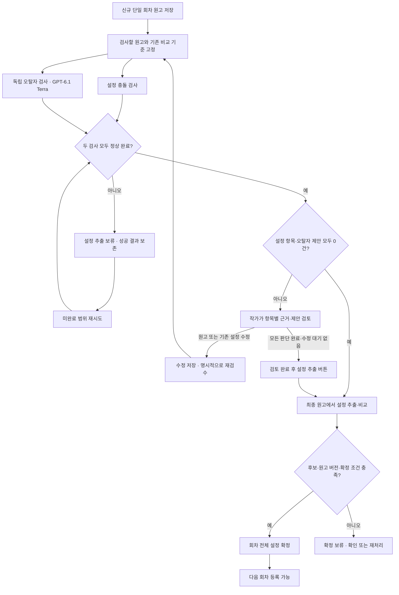

# 신규 회차 오류 리포트 — 지금까지 정한 전체 흐름

> **최신 진행(2026-10-28):** #303은 [PR #317](https://github.com/catchhole-soma/catchhole-backend-java/pull/317)로 main에 머지됐다(31c5e3c). 최신 통합 테스트 3,838 실행 통과·237 skip·실패 0, 필수 PostgreSQL 12/12·HTTP/H2 32/32, Astra xhigh 검토 및 CI 성공. #306은 머지 기준의 별도 Backend·AI worktree에서 구현 중이다. 아래 이전 로컬 기록은 당시 이력이다.

2026-10-28 · [#300](https://github.com/catchhole-soma/catchhole-backend-java/issues/300) · 기반 구현 [#303](https://github.com/catchhole-soma/catchhole-backend-java/issues/303)

이 문서는 흩어진 합의와 구현안을 한 번에 읽기 위한 통합본이다. **사용자 합의**, **구체적인 구현 제안**, **이미 구현한 범위**를 구분한다. 구현 제안을 새로운 사용자 합의로 취급하지 않는다.

## 구현 단위 — 2026-10-28 확정

후속 작업은 #306 설정 충돌 검사 → #309 오탈자 검사 → #310 실행·재검수 → #312 작가 검토·설정 추출/확정 → #314 화면·전체 연결 검증의 **5개 이슈**로 진행한다. [통합 목록과 선행 관계](gh-300-error-report-issue-breakdown.md)를 따른다. 기존 #303 기반은 별도이며 로컬 검증 완료·main/PR/배포 전이다. 통합으로 닫힌 이슈는 구현 완료가 아니다. 각 이슈에서 구현·테스트·Astra 검토를 진행한다.

## 1. 초기 모델·추론 강도와 LLM 수

**사용자는 네 검사 역할 모두 GPT‑6.1 Terra로 시작하도록 선택했다.** 공식 모델 ID는 `gpt-6.1-terra`다. [OpenAI 공식 모델 문서](https://developers.openai.com/api/docs/models/gpt-6.1-terra)에서 `low/medium/high` 지원을 확인했다. 오탈자의 사용자 표현 **lite는 가벼운 추론이라는 뜻으로 해석해 지원 값 low로 대응**했으며 `lite` 자체를 API 값으로 사용하지 않는다.

| 분기 | LLM 역할 | 하는 일 | 모델 | 추론 강도 |
| --- | --- | --- | --- | --- |
| 설정 검사 | 질문 생성 | 기존 설정과 비교할 사실·행동 전제·조건을 찾음 | GPT‑6.1 Terra | **medium** |
| 설정 검사 | 독립적인 누락 보완 | 원고와 관련 기존 설정을 다시 대조해 빠진 질문을 보충 | GPT‑6.1 Terra | **high** |
| 설정 검사 | 근거 기반 판정 | DB·원문 근거와 변화·예외를 확인해 결과·사유를 만듦 | GPT‑6.1 Terra | **medium** |
| 오탈자 검사 | 오탈자 검사 | 같은 원고를 별도로 읽고 짧은 교정 제안·이유를 만듦 | GPT‑6.1 Terra | **low** — 사용자 표현 lite를 대응 |

- **역할 네 개, 검사 모델 종류 하나**다. 같은 모델을 역할별 프롬프트·추론 강도로 호출한다. 독립 실행·상태·재시도 관리는 유지한다.
- 한 회차에 네 번만 호출한다는 뜻은 아니다. 원고 구간, 질문 묶음, 추가 근거 확인, 재시도에 따라 호출 횟수가 달라진다. 정확한 배치와 최대 호출 횟수는 아직 정하지 않았다.
- DB 조회·키워드 검색·알려진 원문 위치와 주변 문맥 읽기는 코드가 수행한다. 의미 검색에 사용하는 **임베딩 모델은 이번 검사 LLM 선택 범위 밖**이다. 검색 목적/검색어의 생성·보완은 질문 생성·판정 역할 안에 둘 수 있다.
- 검토 뒤의 **설정 추출·대상 식별·비교**는 기존 설정 반영 단계다. 이번 결정은 그 단계의 모델 변경을 뜻하지 않는다.
- 계정 사용 가능 여부·서비스 통합·실제 원고 품질은 아직 실행으로 확인하지 않았다. 초기 선택 전에 평가를 통과해야 한다는 조건은 없다.
- 개발 작업의 `6.1-sol/max 구현 · Astra/xhigh 검토` 선택과 제품 검사 모델 선택은 별개다.

## 2. 첫 버전 범위 — 합의

| 항목 | 정한 내용 |
| --- | --- |
| 진입 | 회차 업로드의 `신규 회차 검수` |
| 대상 | 마지막 회차 뒤에 추가하는 **단일 신규 회차** |
| 설정 검사 | 캐릭터·세계관 모두, 기존 확정 설정과 앞선 원문을 대조 |
| 오탈자 | 설정 검사와 독립적으로 병렬 실행 |
| 같은 신규 회차 내부 모순 | **첫 버전 제외**. 현재 원고 앞뒤 문맥은 대상·회상·조건 해석에 사용 |
| 첫 회차 | 설정집·직접 입력 설정 등 비교 자료가 있으면 허용. 자료가 전혀 없으면 기존 설정 구축 안내 |
| 수정·재검수 | 가장 마지막 회차의 원고 교체, 잘못 저장한 기존 설정 정정 후 재검수 |
| 다음 회차 | 현재 회차의 검토·설정 추출·확정이 끝난 뒤 등록 |
| 디자인 | 현재 캐릭터·세계관 설정 확정 화면과 통일. 옛 오류 리포트 스타일을 그대로 사용하지 않음 |

서사 개연성 평가, 다회차·중간 삽입 검수, 과거 원고 수정이 이후 회차에 미친 영향 검사는 첫 범위에 포함하지 않는다. 리포트 안에서 원고 편집기를 새로 만들지 않고 기존 파일 교체와 설정 관리 화면을 이용한다. 일괄 판단·공유·내보내기·통계 대시보드는 현 구현안의 제외 제안이며 별도 확정 기능으로 늘리지 않는다.

## 3. 전체 처리 순서 — 합의

**작가 검토가 끝나기 전에는 설정 추출 작업이나 설정 후보를 만들지 않는다.** 질문 생성에서 잠시 읽어낸 인물·사실·질문은 검사 기록이며, 확정할 설정 후보가 아니다. 검사 과정에서 새 캐릭터·세계관 설정을 자동 등록하거나 기존 설정을 덮어쓰지 않는다.

101화를 검사한다면 101화 원고와 그 이전의 비교 자료를 구분한다. ‘비교 기준 고정’은 검사 도중 다른 편집으로 기준이 바뀌어 결과가 섞이지 않도록 검사에 사용한 자료의 값·버전을 묶는다는 뜻이다. 기준이나 원고가 바뀌면 옛 결과로 추출을 허가하지 않고 변경된 원고/기준으로 새 검사한다. 원고만 교체했고 비교 기준은 여전히 유효하다면 그 기준을 재사용할 수 있다.

## 4. 설정 질문을 만드는 방법 — 구현 제안

질문은 원고에서 **구체적인 사실, 행동에 필요한 조건, 변화·금지·제약, 대상·시점·조건의 확인**이 필요한 곳에서 만든다. 모든 동작에 상식적인 질문을 끝없이 붙이지 않는다.

| 확인 대상 | 질문 예시 |
| --- | --- |
| 인물의 정체·신체·상태 | 이 인물이 이 장면에서 양손을 사용할 수 있는가? |
| 능력·자원·사용 조건 | 이 능력은 해당 장소나 조건에서도 사용할 수 있는가? |
| 물건·장소·접근 조건 | 이 인물이 해당 물건을 보유하거나 장소에 들어갈 수 있는가? |
| 관계·소속 | 현재 장면에서 이 관계·소속이 기존 기록과 맞는가? |
| 시간·수량·순서 | 같은 시점의 나이·날짜·보유 수량과 양립하는가? |
| 세계관 규칙·예외 | 이 행동에 적용되는 세계관 규칙과 예외는 무엇인가? |

대사·독백도 읽되 거짓말·추측·비유를 곧바로 세계의 사실로 확정하지 않는다. 명확한 새 인물·새 내용이 DB에 없다는 이유만으로 오류나 필수 확인 항목을 만들지 않는다.

누락을 줄이는 방법은 다음을 조합하는 안이다. 완전한 누락 방지를 보장하는 것은 아니다.

1. **새 원고 전체를 구간별로 읽는다.** 구간 사이 문맥을 겹쳐 읽고 원문 위치를 유지한다. 요약만 보고 질문을 만들지 않는다.
2. **읽은 범위를 기록한다.** 질문 생성 완료, 검사할 내용 없음과 그 이유, 미처리를 구별한다. 응답 잘림·실패·미처리를 질문 0개로 바꾸지 않는다.
3. **독립적으로 다시 찾는다.** 첫 질문 목록만 검토하지 않고 원고·관련 기준에서 별도로 질문을 찾아 합친다.
4. **기존 설정에서도 거꾸로 확인한다.** 원고의 등장 대상·별칭·관계를 넓게 파악하고 해당 인물의 상태·제약, 관련 조직·종족·장소 규칙, 공통 세계관 규칙을 조회한다. 한 프롬프트에 전체 설정을 넣지 않고 필요한 범위를 나눠 읽는다.
5. **새 단서가 생기면 질문을 보충한다.** 검색 중 발견한 변화·조건이 기존 판단에 영향을 주면 후속 확인을 연결한다. 같은 대상·사유의 중복은 묶되 모든 원문 위치를 보존한다.

예를 들어 ‘민수가 검을 휘둘렀다’에서 무기 관련 질문만 만들어졌더라도, 민수의 기존 설정을 읽는 과정에서 ‘왼손 상실’을 발견하면 행동과 신체 상태를 대조할 질문을 보완할 수 있다. 기존 설정 선택도 초기 질문에 나온 속성만으로 제한하지 않는다. 다만 어떤 설정이 관련 있는지 고르는 과정 자체의 누락 가능성은 실제 원고로 확인해야 한다.

## 5. DB·RAG로 근거를 찾는 방법

구체적인 조회 순서·검색어 조합은 구현 제안이다. **충분한 근거가 있으면 추가 검색을 생략**, **필요한 변화·예외까지 확인**, **검색 실패를 정상으로 처리하지 않음**은 합의한 정책이다.

1. 질문에 원문 위치, 대상, 비교할 속성·규칙, 서사 시점, 적용 조건을 연결한다.
2. 고정한 비교 기준에서 DB 설정·관련 이력·조건을 읽는다. 연결된 과거 근거가 필요하면 알려진 위치를 직접 읽는다.
3. DB와 이미 확보한 근거로 대상·시점·조건까지 충분히 해결되면 추가 검색 없이 판단한다. 단순히 문자열 값이 같다는 이유만으로 끝내지 않는다.
4. 부족하면 허용된 과거 원문에서 키워드·의미 검색을 수행하고 관련 구간과 앞뒤 문맥을 읽는다.
5. 충돌을 지지하는 근거뿐 아니라 정상적인 변화·예외·회상·다른 대상일 가능성도 확인한 뒤 판정한다.

**과거 원문 전체를 검색 대상으로 삼는 것은 RAG 검색 범위라는 뜻이다.** 모든 과거 원고를 매 질문마다 LLM에 넣어 풀스캔하지 않는다. DB에 연결된 회차에만 검색을 한정하지도 않는다. 허용된 앞선 회차·설정집 안에서 찾은 관련 구간을 읽으며 다른 작품·후속 회차를 섞지 않는다. 현재 신규 원고는 별도의 검사 대상/문맥으로 읽는다. 발행 회차 순서와 이야기 속 시점도 구별한다.

예: ‘민수가 양손으로 검을 쥐었다’ → DB에서 왼손 상실 확인 → 필요하면 과거 원문에서 회복·의수 등 정상 설명을 검색 → 현재 장면이 회상인지 확인 → 의수 사용 조건이 맞으면 정상, 해소 근거를 찾지 못하면 충돌 의심, 시점 자체가 불분명하면 추가 확인 필요. 필요한 검색이 실패하면 검사 미완료다.

같은 자료 버전의 조회 결과는 질문 사이에 재사용할 수 있다. 재사용해도 질문별로 확인해야 할 시점·조건까지 자동 해결됐다고 처리하지 않는다. 원문 위치·인용·허용 출처는 서버가 확인한다.

## 6. 질문별 확인을 마쳤다고 보는 네 기준 — 합의

1. **비교 근거와 문맥을 확인했다.** 같은 대상·사실·시점·조건인지 살폈다.
2. **필요한 변화·예외를 확인했다.** 회복·재획득·회상처럼 해당 의심을 설명할 수 있는 근거를 확인했다.
3. **판정을 바꿀 새 단서를 미처리로 남기지 않았다.** 치료받았다는 단서를 발견했다면 필요한 후속 확인을 이어갔다.
4. **필수 검색과 원문 읽기가 정상 종료했다.** 조회 실패·응답 잘림·한도 때문에 못 읽은 범위가 남으면 미완료다.

필요한 자료를 읽었지만 원문 의미가 모호한 경우와 자료를 읽지 못한 경우를 구별한다. 모든 가상 예외의 부재를 증명할 의무는 없다. 질문 하나의 종료, 전체 검사 완료, 작가 검토 완료는 각각 다르다. 검색 횟수·시간 한도는 실제 원고를 평가하며 정한다.

## 7. 리포트의 분류와 영향 등급 — 합의

| AI 결과 | 의미 | 예시 |
| --- | --- | --- |
| **설정 충돌** | 같은 대상·시점·조건에서 양립 불가능한 사실을 직접 근거로 확인 | 같은 인물·달력의 생일이 3월 2일과 4월 8일로 사실 서술됨 |
| **충돌 의심** | 기존 상태와 어긋나 보이며 필요한 확인 후에도 변화·예외를 찾지 못함 | 손 상실 뒤 양손을 쓰는데 회복·의수 근거가 발견되지 않음 |
| **추가 확인 필요** | 필요한 읽기 후에도 대상·시점·해석이 불명확 | 같은 검인지 다른 검인지, 현재 장면인지 회상인지 불분명 |

세 유형 모두 작가가 `충돌 아님`으로 정정할 수 있는 시스템 판단이다. 검색 횟수가 많거나 결과가 없다는 이유로 ‘설정 충돌’로 승격하지 않는다. 정상으로 해결된 질문은 오류 항목으로 보여주지 않는다. 실행 실패는 ‘추가 확인 필요’가 아니라 별도의 검사 미완료다.

| 영향 등급 | 기준 |
| --- | --- |
| **심각** | 현재 장면의 행동·사건 성립에 직접 영향 |
| **주의** | 사건 성립을 직접 막지는 않지만 인물 관계·소속·배경 이해에 영향 |
| **참고** | 현재 장면의 부수적 묘사 차이 |

등급은 오류일 확률이 아니다. 중요한 인물이라는 이유나 반복 횟수만으로 올리지 않는다. 소품 색도 통과·탈출의 필수 조건이라면 심각할 수 있다. 같은 대상·같은 충돌 원인은 하나로 묶고 모든 위치를 보여준다. 다른 위치에서 영향이 달라지면 실제 근거로 재판단한다.

항목에는 이번 원고·비교 근거·각 위치, 결과 유형, 영향 등급, 판정 사유, 애매한 이유, 작가 판단이 필요하다. 표시 배치·세부 API 이름은 후속 설계다.

### DB와 과거 원문이 다르면

- 대상·시점·문맥을 확인해도 기준이 불확실하면 **추가 확인 필요 — 비교 기준과 원문이 다름**으로 양쪽을 보여준다. 예: DB는 ‘왼손 상실’, 근거 원문은 ‘왼손 장갑 상실’.
- 작가가 명시적으로 직접 정정했고 대상·속성·적용 시점이 분명하면 그 범위에서 정정값을 우선한다. 일반적인 승인·자동 확정을 직접 정정과 같게 취급하지 않는다.
- 기준이 불확실한데 신규 원고를 충돌로 단정하거나 검사기가 DB·원문을 자동 수정하지 않는다. 정정의 적용 범위가 불명확하면 추가 확인 필요로 남긴다.

## 8. 오탈자 범위와 검토 — 합의

| 포함 | 제외 |
| --- | --- |
| 문자 오타·맞춤법: 됬다→됐다 | 윤문·문체·말투 통일·문장 전체 재작성 |
| 띄어쓰기: 할수 있다→할 수 있다 | 허용 표기, 의도적 반복·말더듬·방언의 일괄 교정 |
| 분명한 문자·조사 중복/누락: 문을을→문을 | 빠진 단어·문장 의미의 추측 보충 |
| 이름 주변의 일반 오타 | 고유명사 표기 차이 자체; 이를 설정 오류로 자동 이관하는 동작 |

원고 전체를 독립적으로 검사하고 **정확한 원문 위치·원문·짧은 교정 제안·이유**를 보여준다. 설정 질문이 0개라고 오탈자 검사를 생략하지 않는다. 원문을 자동으로 고치지 않는다.

- `원문 유지`: 현재 원고의 해당 항목을 확인한 것으로 처리. 다른 위치·다음 회차·작품 전체 예외 사전에 자동 적용하지 않는다.
- `수정 필요`: 수정할 항목으로 표시하고 추출 보류. 외부에서 고친 파일을 교체하고 다시 검사해야 한다. 선택 자체가 원고를 수정하지 않는다.
- `검토 필요로 되돌리기`: 판단을 미검토 상태로 돌린다. 판단 사이 변경도 허용한다.

작가가 의도한 표현은 유지할 수 있다. 모든 제안을 실제 수정해서 0건으로 만들 의무는 없다. ‘수정 완료’ 체크만으로 파일 교체·재검수를 건너뛰는 기능은 만들지 않는다.

## 9. 검토·수정·실패·설정 추출 조건 — 합의

| 상태 | 처리 |
| --- | --- |
| 검사 진행 중 | 발견 항목부터 읽기 전용 표시 |
| 검사 정상 완료 또는 중단 | 작가 판단 저장 가능. 중단 후 재시도 중에는 다시 읽기 전용 |
| 두 검사 정상 완료 + 미검사 범위 없음 + 설정 세 유형/오탈자 모두 0건 | 현재 원고·기준이 유효하면 **자동 설정 추출** |
| 항목이 있었고 모든 설정 항목이 `충돌 아님`, 오탈자는 모두 확인·수정 대기 없음 | 두 검사 정상 완료·현재 원고/기준 확인 후 **검토 완료 후 설정 추출** 버튼 |
| 미검토·수정 필요·일부 중단·실패·오래된 원고/기준 | 설정 추출 보류. 마지막 판단 저장만으로 추출하지 않음 |
| 같은 입력의 실패 재시도 | 변경 없는 성공 결과·판단 보존. 새 근거·발생 위치 등으로 바뀐 항목만 다시 검토하고 이전 판단은 이력 보존 |
| 원고 교체 또는 기존 설정 정정 | 변경된 원고·기준으로 새 검사를 명시적으로 시작. 이전 판단/추출 허가 자동 승계 없음 |
| 검토 후 설정 추출 완료 | 기존 후보·버전·확정 조건을 추가 확인한 뒤 회차 전체 확정. 추출 성공만으로 확정을 보장하지 않음 |

같은 입력 재시도에서 내용이 바뀌지 않은 항목의 판단은 유지한다. 새로운 근거·발생 위치 등 판단에 영향을 주는 내용이 바뀌면 해당 항목만 `검토 필요`로 되돌리고 변경 이유를 보여준다. 이전 판단은 변경 전 항목의 이력으로 보존하며 현재 판단으로 승계하지 않는다. 재검토가 남으면 설정 추출을 보류한다. 단순 표시 순서·형식 변경이나 의미가 같은 중복 근거만으로 재검토를 요구하지 않는다.

설정 항목도 `수정 필요 / 충돌 아님 / 검토 필요로 되돌리기`와 판단 변경을 지원한다. 원고는 기존 파일 교체, 잘못 저장된 설정은 기존 설정 관리 화면에서 고친다. 저장·복귀만으로 재검수를 자동 실행하지 않는다.

최신 결과를 기본으로 표시하고 이전 검사 시각·건수는 이력으로 남긴다. 과거 원문 복사본을 영구 보관한다는 결정은 아니다. 이미 설정 반영이 끝난 마지막 회차의 진단 재검수는 새 추출·중복 확정·기존 반영 자동 철회를 하지 않는다.

화면을 나가도 서버 검사는 취소되지 않고 저장된 결과·판단으로 돌아와 이어갈 수 있다. 미완료 검사를 건너뛰고 다음 회차를 진행하는 동선을 별도로 추가하지 않는다. 기존 설정 구축 선택으로도 다음 회차 등록 제한을 우회하지 못하게 한다. 기존 파일 삭제 정책을 바꾸는 결정은 아니다.

## 10. 구현된 부분과 앞으로 할 부분

**#303 로컬 구현 완료 범위:** 새 원고의 검수 접수·비교 기준 확보, 검토 전 설정 추출 작업/후보 생성 차단, 기존 추출 경로의 우회 방지와 관련 테스트. 실제 오류를 찾는 LLM·검색 파이프라인과 검토 뒤 추출을 여는 기능까지 구현된 것은 아니다. 테스트 완료 기록은 [구현 계획의 Task 1](gh-300-error-report-implementation-plan.md#task-1-검토-전-설정-추출-차단검수-접수검사-기준-확보)에 있으며 이번 통합 문서 작성에서 다시 실행하지 않았다. main 반영·배포 완료도 아니다.

남은 구현 순서는 기존 계획과 같다.

1. 원고·기존 설정 정정 후 재검수 접수와 이전 결과 무효화.
2. 고정 기준의 DB·RAG 조회, 질문 생성·누락 보완·판정, Terra 오탈자 분기.
3. 검사 작업 실행·진행 상태·결과 저장·부분 실패 재시도.
4. 작가 판단 저장, 자동/명시적 검토 완료, 서버의 설정 추출 허가.
5. 검토 후 기존 추출·비교 재사용, 확정 조건 확인과 회차 전체 반영.
6. 업로드·리포트·수정/재검수·다음 회차 제한 화면 연결과 현재 디자인 적용.
7. 실제 원고 품질 확인 및 전체 흐름 통합 검증.

**아직 정하지 않은 것:** 역할별 호출 묶음·구간 크기 같은 구현값, 실제 원고에서 측정할 검색/시간/사용량 한도와 품질 수치, 일부 화면 배치·API 세부 계약. 초기 모델 선택을 평가 뒤로 미룰 필요는 없으며 미응답 평가 질문을 새로운 합의나 출시 조건으로 만들지 않는다.

기존 AI 클라이언트는 호출별 모델 지정이 가능하지만, 현재 제품이 이미 Terra로 오탈자를 검사한다는 뜻은 아니다. 이번 작업에서는 기획 문서만 정리했으며 코드·환경 설정·실제 모델 호출·이슈·Pencil은 변경하지 않았다.

**초기 평가 방향 — 사용자 합의:** 선택한 Terra 모델과 역할별 추론 강도를 유지하고, 기대 결과를 정한 소수의 충돌·정상·모호한 사례로 실제 동작을 확인한다. 설정 오류를 놓치거나 잘못 지적하면 질문 생성·근거 검색·판정 중 원인을 찾아 보완한다. 초기 작업에 모델 간 비교·순위 실험을 넣지 않으며, 심각한 오류 한 건 누락만으로 모델 채택을 보류하는 기준은 합의하지 않았다. 오탈자는 간단한 맞춤법·띄어쓰기·명백한 오타를 찾고 고유명사·의도한 표현을 건드리지 않는지 기본 예시로 확인한다. 개발 중 평가 사례와 결과는 작업자가 정리하고 작품 해석이 필요한 부분을 함께 확인한다. 모든 실제 원고나 내부 질문을 사람이 전수 검토하는 흐름은 아니며, 실제 서비스에서 작가는 리포트에 게시된 항목만 검토한다.

## 상세 문서

- [단계별 입출력 설계안 — 질문·조회·근거·판정](gh-300-validation-stage-contracts.md)

- [제품 기획](gh-300-error-report-product-brief.md)
- [구현 계획](gh-300-error-report-implementation-plan.md)
- [검사 기준·추출 차단 설계](gh-300-validation-baseline-design.md)
- [질문 생성·누락 보완 제안](gh-300-validation-question-planning.md)
- [DB·RAG 조회와 판정 기준](gh-300-validation-evidence-retrieval.md)
- [오탈자 범위·작가 검토](gh-300-typo-review-policy.md)
- [화면 명세](../data-requirements/analysis.md#충돌-의심-상세-리포트-sepisodevalidationreport)
- [Pencil 초안·최종 디자인 방향](gh-300-error-report-design-draft.md)
