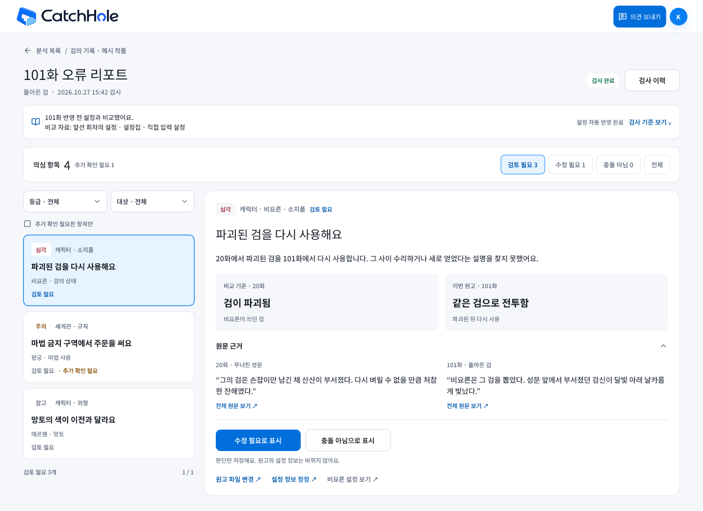

# 신규 회차 오류 리포트 Pencil 초안

2026-10-27 · [이슈 #300](https://github.com/catchhole-soma/catchhole-backend-java/issues/300) · 디자인 검토용 예시 데이터

[합의한 기획](gh-300-error-report-product-brief.md)과 [화면 명세](../data-requirements/analysis.md#충돌-의심-상세-리포트-sepisodevalidationreport)를 현재 캐치홀 Theme V2·Clear Blue 스타일로 옮긴 첫 초안이다. 왼쪽에서 의심 항목을 고르고 오른쪽에서 비교 내용·양쪽 근거·판단을 읽는다. 작은 화면에서는 목록과 상세를 나눈다.

**2026-10-28 정책 변경 — 시안 갱신 대기:** 최신 순서는 `오류 검사·작가 검토/수정/재검수 → 최종 원고 설정 추출·비교 → 확정`이다. 검토 전에는 설정 추출 작업과 후보가 없다. 두 검사 정상 완료·설정 검사 3유형 합계·오탈자 제안 모두 0건은 자동 추출, 항목이 있었다면 설정 모두 충돌 아님·오탈자 확인 완료·수정 대기 없음 뒤 별도 `검토 완료 후 설정 추출` 버튼을 사용한다. 아래 PNG/Pencil은 초기 병행안의 캡처이므로 상태 문구는 최신 동작 명세가 아니다. 이번 변경은 문서만 수정했고 `.pen`/PNG는 배치·스타일 참고로 유지한다.

편집 원본은 같은 worktree의 [design/catchhole.pen](../../design/catchhole.pen)이다. 기본 프레임 이름은 `Draft / GH300 / Error Report / Desktop / Review`, 노드 ID는 `sDtUe`다. 기존 시안·공유 컴포넌트를 바꾸지 않고 새 초안 프레임으로 추가했다.

## 기본 화면

상단에서 회차·검사 상태·비교 기준을 확인하고, 검토 상태와 등급·대상으로 목록을 좁힌다. 의심 항목을 선택하면 비교 기준과 이번 원고, 실제 인용을 읽고 `수정 필요` 또는 `충돌 아님`으로 표시한다. 원고 파일 변경과 설정 정보 정정은 판단 저장과 별도 행동이다.

## 상태별 초안

| 순서 | 화면 | 확인할 흐름 | Pencil 노드 |
| --- | --- | --- | --- |
| 1 | [기본 검토](../screens/gh300/sDtUe.png) | 목록 선택 → 비교 기준·이번 원고 → 양쪽 인용 → 판단 | `sDtUe` |
| 2 | [애매한 세계관 충돌](../screens/gh300/ebnfV.png) | 초기 캡처의 애매함 예시. 최신안에서는 별도 AI 결과 유형 `추가 확인 필요`와 영향 등급·구체적 사유 표시 | `ebnfV` |
| 3 | [판단 저장과 되돌리기](../screens/gh300/GJa1U.png) | 저장 후 필터에서 빠져도 상세 유지 → 판단 변경/검토 필요로 되돌리기 | `GJa1U` |
| 4 | [검사 일부 중단](../screens/gh300/QT3AS.png) | 확인된 결과 + 미검사 범위 → 중단된 검사 다시 시도 | `QT3AS` |
| 5 | [원고 교체 후 재검수](../screens/gh300/PEh6v.png) | 수정 파일 확인 → 명시적 재검수. 파기된 인용 대신 이전 검수 요약만 표시 | `PEh6v` |
| 6 | [모바일 목록](../screens/gh300/FmAlB.png) | 390px에서 선택 메뉴·목록 중심으로 탐색 | `FmAlB` |
| 7 | [모바일 상세](../screens/gh300/QhduF.png) | 비교·근거 세로 배치 → 판단 → 기존 수정 화면 이동·목록 복귀 | `QhduF` |

## 반영한 디자인 기준

- 현재 캐치홀의 실제 심볼·워드마크 이미지, 밝은 배경·흰 표면·파란 선택 강조를 사용한다.
- 최신 디자인에서는 AI 결과 `설정 충돌 / 충돌 의심 / 추가 확인 필요`, 영향 등급, 작가 판단을 별도 축으로 표시한다. 추가 확인 필요를 다른 결과 위의 중복 배지로만 처리하지 않는다. 구체적 사유는 항목 안에, 검사 중단은 상단 안내로 구분한다. 세 유형 모두 작가가 충돌 아님으로 정정할 수 있다.
- `비교 기준 / 이번 원고`는 실제 수정 전후가 아니므로 빨강/초록 삭제·추가 표시를 사용하지 않는다.
- 검사 기준을 여는 행동은 `검사 기준 보기`로 명시한다. 비교 자료를 표시할 때 앞선 원고 전체를 정독한 것처럼 표현하지 않는다. 초기 시안의 설정 자동 반영 완료 상태는 아래 변경 목록에 따라 교체한다.
- 예시의 인물·작품·원고·파일명·건수는 디자인 검토용이며 실제 검사 결과가 아니다.

## 초안 검토 결과와 최종 디자인 기준

2026-10-27 최초 사용자 검토에서 초안의 배치·스타일에 대한 수정 요청은 없었다. 이후 오류 검사·검토 후 추출로 순서가 변경됐으므로 목록·상세·근거의 기본 구조를 유지하면서 확정 상태·보류 이유·연결 행동을 갱신한다. 최종 디자인은 실제 캐치홀의 캐릭터·세계관 설정 확정 화면(`/setting-review`)과 최대한 통일한다.

기준 구현은 [캐릭터 설정 검토](../../src/app/components/catchhole/characterreview/CharacterSettingReview.tsx)와 [세계관 설정 검토](../../src/app/components/catchhole/worldsetting/WorldSettingReview.tsx)이며, [공통 검토 컴포넌트](../../src/app/components/catchhole/review-ui/ReviewPrimitives.tsx)와 [Clear Blue 스타일](../../src/styles/review-clear-blue.css)을 함께 참고한다.

- 두 기존 화면을 함께 기준으로 삼고 제목·필터·목록 선택·상세 패널의 표현을 맞춘다.
- 색상·글꼴·글자 크기·간격·테두리·모서리와 버튼·상태 표시·원문 근거 표현을 같은 기준으로 정리한다.
- 데스크톱과 모바일에서 기존 검토 화면의 조작 방식을 따르되, 오류 리포트의 `수정 필요 / 충돌 아님` 판단과 `비교 기준 / 이번 원고`의 의미를 유지한다. 판단 저장을 설정 확정으로 표현하거나 단순 비교를 수정 전후 diff로 바꾸지 않는다.
- 최종 시안 검토 때 캐릭터 확정·세계관 확정·오류 리포트 화면을 나란히 비교한다. 이번 피드백은 초안 방향에 대한 동의이며 기능 구현 완료나 최종 디자인 확정을 뜻하지 않는다.

## 실제 화면 2026-10-30

#314 V1에서 로컬 Java·일회용 PostgreSQL·실제 AI Worker에 연결한 실제 화면을 [`docs/screens/gh314/`](../screens/gh314/)에 1440×900·390×844로 캡처했다. 위 초안 PNG(`docs/screens/gh300/`)는 정책 변경 전 기록으로 보존하고, 상태 문구·배치의 최신 기준은 이 캡처다. 리포트는 `/setting-review`와 같은 Theme V2·Clear Blue 카드·선택 카드·근거 펼침을 사용한다.

| 상태 | 캡처 |
| --- | --- |
| 업로드 `신규 회차 검수`·다음 회차 차단·확정 뒤 허용 | `upload-validation-intake-desktop`, `upload-next-episode-blocked-{desktop,mobile}`, `upload-after-applied-desktop` |
| 검사 중(읽기 전용)·일부 중단·재시도 중 | `report-validating-desktop`, `report-partial-no-findings-desktop`, `report-retry-running-readonly-desktop` |
| 항목 있음 목록·상세(모바일 목록→상세→판단) | `report-findings-desktop`, `report-finding-detail-desktop`, `report-findings-{status,list}-mobile`, `report-finding-{detail,judgment}-mobile` |
| 판단 저장 뒤(수정 필요·충돌 아님), 모두 판단했지만 검사 미완료라 추출 잠금 | `report-judgment-saved-desktop`, `report-judgment-not-conflict-desktop`, `report-all-judged-execution-incomplete-desktop` |
| 원고 파일 변경 → 복귀 → 무효 → 재검수 확인 → 새 report | `report-replace-file-modal-desktop`, `manuscripts-replaced-return-desktop`, `report-invalidated-{desktop,mobile}`, `report-recheck-confirm-desktop`, `report-recheck-started-desktop` |
| 0건 자동 추출 → 확정 완료, 확정 뒤 진단 재검수 | `report-auto-applied-{desktop,mobile}`, `report-diagnostic-recheck-{desktop,mobile}` |
| 분석 목록 카드·원고 목록 배지 | `analysis-list-{applied,awaiting-review}-desktop`, `analysis-list-awaiting-review-mobile`, `manuscripts-stage-badges-desktop`, `manuscripts-awaiting-review-{desktop,mobile}` |

확정 보류(APPLICATION_HELD) 화면은 이번 실제 실행에서 보류가 발생하지 않아 캡처하지 못했다(목 API Playwright로만 확인). Pencil 반영은 `design/PENCIL_MIGRATION.md`의 GH314 항목대로 대기다.

## 확인 범위와 남은 작업

### 오류 검사 우선 정책 반영 목록

- 설정 충돌은 직접 양립 불가 근거, 충돌 의심은 변화·예외 미확인, 추가 확인 필요는 대상·시점·해석 모호를 뜻한다. 검색 횟수나 결과 없음으로 승격하지 않으며 자료 조회 실패는 검사 미완료로 표시한다.
- 검사/작가 검토 중에는 `설정 추출 전`, 의심·미판단·수정 필요/실패/부분 중단에는 `오류 검토가 끝나지 않아 설정 추출을 보류했어요.`와 이유를 표시한다. 후보 준비/설정 자동 반영 완료를 함께 표시하지 않는다.
- 설정 충돌·오탈자 두 검사 정상 완료·설정 검사 3유형 합계와 오탈자 제안 모두 0건일 때 자동 추출로 전환하고 추출→후보 확인/확정의 실제 상태를 표시한다. 검사 완료를 설정 확정 완료로 표현하지 않는다.
- 두 검사 정상 완료·설정 전 항목 충돌 아님·오탈자 확인 완료·수정 대기 없음 뒤 별도 `검토 완료 후 설정 추출` 버튼을 제공한다. 의도한 표현 유지가 가능하고 오탈자 제안을 전부 수정하도록 강제하지 않는다. 오탈자 미검토·수정 대기·실패/일부 중단에는 추출 보류를 표시한다. 오탈자는 수정 필요/원문 유지/검토 필요로 되돌리기를 사용한다. 원문 유지만 현재 항목을 해소하고 수정 필요는 파일 교체·새 검사로 확인한다. 원문 자동 편집·수정 완료 체크 우회·작품 예외 사전 등록·새 원고 판단 승계는 없다. enum/HTTP 필드·구체 배치는 후속 제안이다. 판단 저장은 추출/확정 명령이 아니다. 후보 검토가 필요할 때의 기존 설정 화면 연결은 추출 뒤에 배치한다.
- 원고/설정 수정 뒤에는 `수정 내용 재검사 → 검토 종료 → 최종 원고 추출`을 안내한다. 진단 재검수는 기존 확정 사실과 이번 결과만 구분하고 새 추출/확정 행동을 표시하지 않는다.
- 같은 원고·기준의 중단 재시도는 결과·판단을 유지하며 후보 세대를 요구하지 않는다. 변경된 원고/기준의 재검사는 판단을 초기화한다.
- 실행 중 발견 항목의 읽기 전용, 정상 완료/중단 뒤 판단, 재시도 중 다시 잠금을 표현한다. 다음 회차 업로드에는 미완료 검수의 처리 완료를 기다리는 안내와 해당 리포트 연결이 필요하다.
- 오탈자는 문자 오타·맞춤법·띄어쓰기·분명한 문자/조사 중복·누락에 한정한다. 허용 표기·의도적 반복/말더듬·방언·문체 통일·윤문·추측 보충·고유명사 표기 차이는 제외하고 이름 주변 일반 오타만 검사한다. 이름 차이를 설정 검사로 자동 이관하지 않는다.
- 영향 등급은 현재 장면의 행동·사건 성립 조건에 직접 영향을 주면 심각, 직접 영향 없이 소속·관계·배경 이해가 달라지면 주의, 부수적 묘사면 참고다. 중요한 인물·설정이나 반복 횟수만으로 올리지 않는다. 소품 색도 통과·탈출 필수 조건이면 그 근거를 표시한다. AI 결과 유형과 별도 축으로 유지한다.
- 같은 대상·같은 충돌 원인은 한 항목에 묶고 원고의 모든 발생 위치로 이동할 수 있게 한다. 같은 원인·영향의 반복은 등급을 유지하고, 다른 위치에서 실제 사건 영향이 커지면 그 근거로 재판단한다. 반복 위치 수와 의심 항목 수를 구별한다. DB에 없다는 이유만으로 새 인물/새 설정에 확인 경고를 붙이지 않는다.

초기 7개 프레임은 캡처와 당시 Pencil 레이아웃 검사에서 잘림 경고가 없었으며 주요 본문·보조 문구·파란 버튼의 색상 대비도 확인했다. 이 검증은 정책 변경 후 시안 갱신 검증을 대신하지 않는다. 모바일 초안은 390px이며 실제 제품의 320px·키보드 동작은 구현 시 검증한다.

Pencil이 `Pretendard`를 지원하지 않아 이번 초안은 `Noto Sans KR`을 사용했다. 실제 제품의 `Pretendard Variable`을 바꾸는 결정은 아니다. 폰트 적용에 따른 정확한 줄바꿈·높이는 구현 시 다시 확인한다.

현재는 정적인 디자인 초안이다. 버튼의 실제 저장·조회·재검수는 구현되지 않았으며 화면 명세 전체의 모든 예외 상태를 각각 시안으로 만든 것은 아니다. [기존 코드에 근거한 구현 계획](gh-300-error-report-implementation-plan.md)과 새 오류 검사 우선 정책에 맞춰 위 시안 변경 목록을 적용한 뒤 다시 검증한다.
