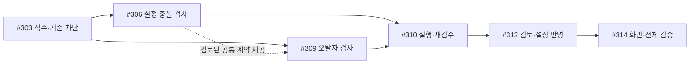

# 신규 회차 오류 리포트 구현 계획

> **최신 진행(2026-10-28):** #303은 [PR #317](https://github.com/catchhole-soma/catchhole-backend-java/pull/317)로 main에 머지됐다(31c5e3c). 최신 통합 테스트 3,838 실행 통과·237 skip·실패 0, 필수 PostgreSQL 12/12·HTTP/H2 32/32, Astra xhigh 검토 및 CI 성공. #306은 머지 기준의 별도 Backend·AI worktree에서 Sol max 로컬 구현·테스트·Astra xhigh 전체/수정 검토를 마쳤다. AI 4,555 pass/134 skip, Backend 3,844 pass/248 skip 및 bootJar 성공, 필수 실제 PG/HTTP 별도 실행 통과다. Critical/Important는 없고 비차단 Minor 1개를 기록했다. #306은 Backend PR318(5b77f97)·AI PR99(22ea1dc)로 main 머지 완료했으며 최종 CI 성공과 merge tree 일치를 확인했다. 지정한 #309 채팅에도 최신 main 통합·검증·머지까지 진행하도록 사용자 승인을 전달했다. 사용자 승인으로 검토된 공통 v2 계약을 전달해 #309도 별도 채팅·워크트리에서 시작했다. #306 전체 완료를 기다릴 필요는 없으며 두 검사기를 검증한 뒤 #310에서 연결한다. 아래 이전 로컬 기록은 당시 이력이다.

> **For agentic workers:** REQUIRED SUB-SKILL: Use superpowers:subagent-driven-development or superpowers:executing-plans to implement this plan task-by-task. Steps use checkbox syntax. #303의 흐름 전환 구현은 2026-10-28 사용자 요청으로 승인됐다. 후속 Task는 계획이며 별도 구현 완료를 뜻하지 않는다. 사용자 요청 없이 커밋·push하지 않는다.

**Goal:** 단일 신규 회차의 오류 검사·작가 검토를 먼저 끝내고, 최종 원고에서만 설정을 추출·비교·확정한다. 검토 전에는 설정 추출 작업과 후보를 생성하지 않는다.

**Architecture:** Java가 추출 Job 없이 원고·검사 기준을 고정하고 Python은 원고 자체의 확인할 주장 → DB·과거 원문 근거 조회 → 판단을 수행한다. Java가 전체 검사·작가 판단·현재 원고/기준을 검증해 검토 종료를 기록한 뒤 기존 추출·비교 Job을 생성한다. 후보 준비 뒤에는 별도 사전 검증과 회차 전체 원자 확정 coordinator를 적용한다. 검토 전 추출 차단과 추출 후 확정 조건을 분리한다.

**Tech Stack:** 현행 Java 21/Spring Boot 4.0.6/JPA/Flyway/PostgreSQL·pgvector, Python 3.11+/Pydantic/기존 Worker·LLM client, React 18/TypeScript/TanStack Query/생성 SDK/Playwright. 새 orchestration 프레임워크나 프론트 테스트 프레임워크를 도입하지 않는다.

**Spec:** [제품 기획](gh-300-error-report-product-brief.md), [상세 화면 명세](../data-requirements/analysis.md#충돌-의심-상세-리포트-sepisodevalidationreport), [검사 기준 설계](gh-300-validation-baseline-design.md), [Pencil 초안과 최종 디자인 기준](gh-300-error-report-design-draft.md), [DB·원문 근거 조회 설계](gh-300-validation-evidence-retrieval.md), [오탈자 범위·검토 정책](gh-300-typo-review-policy.md).

수정일: 2026-10-28. 사용자 결정에 따라 후보 선추출안을 **오류 검사·작가 검토 후 설정 추출**로 대체했다. #303의 로컬 구현을 이 순서로 전환하고 테스트·Astra 최종 검토를 완료했다. 이 문서의 후속 이름·API·상한은 구현 제안이며 Task 2~8은 아직 미구현이다. 커밋·PR·배포는 수행하지 않았다.

## 현재 구현 단위 — 2026-10-28 사용자 승인

후속 11개 이슈를 **5개**로 통합했다. [이슈 묶음·선행 관계](gh-300-error-report-issue-breakdown.md)가 현재 실행 순서다.

1. #306 — 설정 충돌 검사: 검사 자료·질문 생성·누락 보완·DB/RAG 검색·판정.
2. #309 — 독립 오탈자 검사.
3. #310 — 검사 실행·결과 저장·수정 후 재검수·부분 재시도.
4. #312 — 리포트 API·작가 검토·설정 추출·회차 전체 확정.
5. #314 — 오류 리포트 화면·업로드/수정 동선·다음 회차 제한·전체 연결 검증.

#303은 별도 기반이며 PR #317로 main에 머지됐다. #306과 #309는 검토된 공통 계약을 공유해 별도 워크트리에서 병렬 진행한다. 각 기능은 6.1 Sol/max 구현·테스트·Astra/xhigh 검토를 독립적으로 마친다. 아래 Task 1~8은 기술 내용 구분이며 개별 이슈나 구현 순서를 뜻하지 않는다.

## Global Constraints

- 마지막 회차 뒤에 새로 추가하는 단일 회차만 지원한다. 첫 회차는 설정집/직접 입력 기준이 있어야 하며, 다회차·중간 삽입 검사는 제외한다.
- **원고 저장 → 오류 검사 → 작가 검토·수정/재검수 → 설정 추출·비교 → 설정 확정/보류** 순서다. 두 검사 모두 정상 완료·누락 없음·설정 검사 3유형 합계 0건·오탈자 제안 0건이면 자동 추출한다. 항목이 있었다면 설정 전 항목 NOT_CONFLICT·오탈자 작가 확인 완료·수정 대기 없음 뒤 별도 `검토 완료 후 설정 추출` 요청으로 시작한다. 두 방식은 사용자 합의다.
- 미판단·수정 필요·기준/검사 실패·일부 중단이면 회차 전체 설정 추출을 보류한다. 검토 전에는 추출 Job·후보·현재값·확정 Fact·출처 연결·신규 대상·서사시점 쓰기 모두 금지한다. 기존 설정 구축 모드는 유지한다.
- 설정 충돌은 캐릭터·세계관을 포함한다. 추가 합의한 오탈자는 같은 원고 fingerprint로 독립 병렬 검사하며 별도 모델 설정을 지원한다. 설정 질문 0개여도 전체 원고 오탈자 검사를 생략하지 않는다. 오탈자 초기 모델은 사용자 지정 **6.1 Terra**, 추론은 **low**(사용자 표현 lite를 낮은 추론으로 해석)다. 품질 수치·처리 시간 한도는 아직 정하지 않았다. 문자 오타·맞춤법·띄어쓰기·분명한 문자/조사의 중복·누락을 검사한다. 허용 표기, 의도적 반복·말더듬·방언, 문체 통일·윤문, 추측에 의한 단어·문장 보충은 제외한다. 고유명사 표기 차이 자체는 첫 버전에서 제외하며 이름 주변의 일반 오타는 검사한다. 새 이름·별칭의 불확실성을 설정 검사로 자동 이관하지 않는다.
- 서사 개연성, 원문 자동 편집, 설정/서사 재작성, 과거 원고 변경의 후속 영향 검사, 공유·내보내기·일괄 판단은 제외한다. 짧은 오탈자 교정 제안만 기존 AI 수정문 제외 정책의 좁은 추가 범위다. 같은 신규 회차 내부 모순 검사는 첫 버전에서 제외한다. 질문·검색·판정은 과거 확정 설정/앞선 원문과의 비교를 대상으로 한다. 현재 회차의 앞뒤 문맥으로 회상·대상·조건·예외를 해석하는 것은 유지하되 내부 모순만의 finding을 만들지 않는다.
- 오탈자 미검토 제안·수정 대기·실패·일부 중단·재시도 실패는 추출을 보류한다. 같은 입력의 성공 결과를 보존하고 미완료 범위만 재시도하며 검사 생략 우회는 제공하지 않는다. 의도한 표현은 유지할 수 있어 모든 제안을 수정해 없앨 의무는 없다. 판단 의미와 수정 확인 흐름은 확정했다. 항목별 `수정 필요 / 원문 유지 / 검토 필요로 되돌리기`를 제공한다. `원문 유지`만 현재 원고의 해당 항목 검토를 해소하며 작품 전체 예외 사전에 등록하지 않는다. `수정 필요`는 판단만 저장하고 추출 보류를 유지한다. 외부 수정→기존 파일 교체→새 원고 재검사로 확인하며 원문 자동 수정이나 `수정 완료` 체크만으로 해제하지 않는다. 새 원고에는 이전 판단을 자동 승계하지 않고 같은 입력 재시도에는 변경 없는 성공 결과·판단을 보존하고, 새 근거·발생 위치 등으로 판단 내용이 바뀐 항목만 재검토한다. 마지막 판단 저장만으로 추출하지 않고 기존 명시적 완료 버튼을 사용한다. 화면 배치·API enum/HTTP 필드는 후속 구현 제안이다. 두 검사 결과·coverage·실패를 별도 관리하며 #303 코드 범위는 변경하지 않는다.
- 설정 검사 결과는 `설정 충돌 / 충돌 의심 / 추가 확인 필요`의 세 유형이다. 설정 충돌은 같은 대상·시점·조건에서 양립할 수 없는 내용이 직접 근거로 확인된 경우, 충돌 의심은 기존 상태와 어긋나 보이나 변화·예외를 확인하지 못한 경우, 추가 확인 필요는 대상·시점·해석이 불명확해 비교 판단이 어려운 경우다. 세 유형 모두 시스템 판단으로 작가가 `충돌 아님`으로 정정할 수 있으며 영향 등급 `심각 / 주의 / 참고`와 별개다. 검색 횟수나 검색 결과 없음만으로 충돌 의심을 설정 충돌로 높이지 않는다. 실행 미완료·자료 조회 실패는 추가 확인 필요가 아닌 검사 미완료다. API enum/필드명은 후속 설계 제안이다.
- DB와 과거 원문의 대상·시점·문맥을 확인해도 비교 기준이 불확실하면 `추가 확인 필요 — 비교 기준과 원문이 다름`으로 양쪽을 표시한다. 작가 직접 정정은 대상·항목·적용 시점이 명확한 범위에서 우선 기준으로 사용하며, 범위 불명확은 추가 확인 필요다. 자동 확정/일반 확정됨 플래그만으로 명시적 정정을 추정하지 않는다. 서사 시점 차이만으로 불일치 처리하거나 원문·DB를 자동 덮어쓰지 않는다. 필수 읽기 실패는 미완료로 남긴다.
- 영향 등급 합의: 심각은 설정 차이가 현재 장면의 행동·사건 성립 조건에 직접 영향을 주는 경우다. 중요한 인물·설정이라는 이유만으로 올리지 않는다. 주의는 사건 성립에 직접 영향 없이 인물의 소속·관계·배경 이해를 바꾸는 차이, 참고는 현재 장면의 부수적 묘사 차이다. 소품 색 차이도 통과·탈출의 필수 조건이면 그 영향 근거로 심각할 수 있다. 같은 원인·같은 영향의 반복 횟수만으로 등급을 올리지 않고 횟수와 모든 위치를 표시한다. 다른 위치에서 실제 사건 영향이 커지면 해당 근거로 재판단한다. AI 결과 세 유형과 영향 등급은 독립이다.
- 영향 등급 `심각 / 주의 / 참고`와 AI 결과 유형을 구분한다. `수정 필요 / 충돌 아님 / 검토 필요` 판단 저장 자체는 설정 확정을 실행하지 않는다.
- 같은 검사 재시도는 report·저장된 계획·변경 없는 성공 항목과 판단을 유지한다. 새 근거·발생 위치 등으로 판단 내용이 바뀐 항목만 검토 필요로 전환하고 이전 판단은 당시 revision 이력으로 보존한다. 표시 순서·형식·의미가 같은 중복 근거만으로 재검토시키지 않는다. 원고/기준 변경 후 새 검사는 판단 초기화. 검사 재시도에 후보 세대를 요구하지 않는다. 과거 결과는 시각·상태·건수 요약만 제공한다.
- 미확정 원고 변경 후에는 새 원고를 다시 검사한다. 검토가 끝난 최종 원고에서 처음 후보를 추출한다. 이미 확정된 회차의 진단 재검수는 추출·중복 확정·자동 철회를 하지 않는다.
- 기존 DB에 없는 새 내용 자체는 충돌/작가 확인 항목이 아니다. 기존 세계관 규칙과 실제 충돌할 수 있으면 별도로 검사하고, 자료 조회 실패는 미검사로 기록한다. 같은 대상·같은 충돌 원인은 한 항목에 묶되 원고의 모든 위치를 표시한다. 원인이 다르면 별도 항목이다.
- 기존 파일 교체·설정 편집을 재사용한다. 과거 기준만 별도로 수정하는 추가 편집 모드는 이번 핵심 구현에서 제외한다.
- 최종 UI는 캐릭터·세계관 설정 확정 화면의 Theme V2/Clear Blue와 통일한다. 비교는 `비교 기준 / 이번 원고`, 최소 320px·모바일 주요 조작 44px를 따른다.
- 같은 대상·원인의 반복은 한 항목과 모든 원고 위치로 표시한다. 실행 중 항목은 읽기 전용이며 정상 완료/중단 뒤 판단 가능하다. 재시도 실행 중에는 다시 읽기 전용이고 PARTIAL에서 판단 완료해도 추출은 보류한다.
- 미완료 신규 검수가 있으면 해당 회차의 검토·추출·확정 완료 전 다음 회차 등록을 서버에서 막는다. 검수 외 모드로 우회하지 못한다. 첫 버전에는 별도 검수 포기나 미완료 검사를 건너뛰고 진행하는 동선을 추가하지 않는다. 화면을 나가도 검사는 취소되지 않고 저장된 결과·판단을 유지한다. 복귀해 검토를 이어가거나 중단된 검사를 재시도한다.
- 원문 파기는 복사본·설명·검사 checkpoint에도 적용한다. 원고·인용·설정값을 브라우저 영구 저장소에 저장하지 않는다.
- 서버 통신은 OpenAPI 생성 SDK와 기존 인증·사용량 계약을 사용한다. 실제 API·PostgreSQL 검증과 mock 검증을 구분한다.

## Review Focus

1. **검토 전 추출 우회:** 추출 Job 없는 report도 generic create/reanalysis/retry/claim을 차단한다. Task 1의 `admissionStoresBaselineButDoesNotCreateExtractionJobOrCandidates`, `genericCreationRemainsBlockedWhenBaselineReady`, `workerCannotStartExtractionBeforeErrorReviewCompletes`에서 DB Job·후보·확정 쓰기 0을 검증한다.
2. **가짜 검토 완료·중복 추출:** 일부/실패/미판단/수정 필요/오래된 source로 추출하지 않는다. Task 4의 `incompleteReviewCannotCreateExtraction`, `duplicateReviewCompletionCreatesOneJob`로 검증한다.
3. **본문 삭제 중 늦은 응답:** 교체·파기된 본문이 기준 정규화·AI 게시·추출/확정으로 복원되지 않는다. Task 2/4의 source 경합 테스트에서 고정한다.
4. **0건과 검사 누락:** 계획·검색 실패·예산 종료를 정상 0건으로 표시하지 않는다. Task 3/6의 coverage 테스트에서 새 내용/불확실성/미검사를 구별한다.
5. **검토한 원고와 실제 추출·확정 원고의 일치:** 입력 변경 후 옛 검토 종료 기록으로 추출/확정하지 않는다. Task 4의 generation/source/CAS, 두 도메인 원자성·멱등과 기존 설정 구축 회귀로 검증한다.

## 1. 조사 기준과 재사용 결론

| 저장소 | 조사 기준 | 주의 |
| --- | --- | --- |
| Front | `65fcf6f17e4ef5d907e3305b0f03189e23b97a83`, `codex/gh-300-error-report-spec` worktree | 기획·명세·Pencil 변경이 있는 현재 작업 위치 |
| Backend | 초기 조사 `5df3a8e...`; #303 worktree 기준 `4b68365aff7ca58265f43bab0c7f08a276765371` | `feat/gh-303-validation-staging`, `output/gh-303-validation-staging/worktrees/backend`에서 기존 로컬 구현을 수정. 원래 main checkout은 작업하지 않음 |
| AI | `90793acfd1b17a4bde6e756542e674c7d6da76f7`, `codex/world-comparison-reference-domain`, clean | `origin/main=b315c1146d0dad342626a6d8f3280b91016ea515`. 이번에 인용한 Worker·검색·설정 도구·청킹·계량 파일은 두 기준 사이 변경 없음. 기존 작업 브랜치에서 구현하지 않는다. |

**기존 화면의 비활성 버튼을 켜는 작업만으로 구현할 수 없다.** Front의 `SEpisodeUpload.tsx:1013`은 `SETTING_EXTRACTION`을 생성하고, `App.tsx:251`은 리포트 경로를 `/works`로 보낸다. AI의 `EPISODE_VALIDATION`도 enum만 있으며 기존 Worker는 추출만 실행한다.

| 기능 | 재사용 | 수정·확장 | 신규 |
| --- | --- | --- | --- |
| 반영 전 설정 | Java 캐릭터/세계관 state mapper·현재/이력 캡처 | 추출 claim 의존을 제거하고 Job 없는 검수 접수에서 고정 입력·출처 저장 | 독립 baseline·정정 revision·조회 |
| 추출과 확정 | 기존 추출·비교·provisional journal·확정 mutation | 검토 종료 뒤에만 Job 생성, 전체 후보 사전 검증·우회 차단 | 검토 종료 기록·추출 시작 coordinator·회차 전체 적용 gate |
| 설정·근거 조회 | `settingtool` 값 해석·원문 검증 규칙 | 같은 응답 의미를 고정 기준 조회에 적용 | baseline 전용 조회 adapter. live 도구 endpoint를 그대로 호출하지 않음 |
| 회차 검색 | AI keyword/vector/direct/neighbors·근거 중복 제거 | 모든 검색에 고정 출처 목록과 버전 조건 추가 | baseline 검색 scope/repository |
| 검사 판단 | 기존 LLM client·schema 검증·사용량 계량 | 목적별 예약·관측·실행 예산 | 새 원고 planner, validator/judge, coverage·부분 복구 |
| 작업 실행 | claim·lease·heartbeat·멱등·정산 패턴 | 후보 없는 검사 실행, 검토 종료→추출 생성, 단계별 목록/metrics | validation Worker·검토/추출/확정 coordinator |
| 파일 교체 | `S1Dashboard.tsx:682`, 기존 서버 교체·파기 | 회차 지정·리포트 복귀·기준 보존 | 별도 오류 재검수 시작 |
| 설정 정정 | 기존 설정 편집 입력 UI | 저장한 정정과 기준 연결, 기존 report·검토 허가 무효화 | 정정 receipt·재검수 입력 갱신 |
| 리포트 화면 | `ui-v2`, `ReviewPrimitives`, 원문 reader·인용 패턴 | 새 evidence DTO adapter·버전 검증 | 목록·상세·판단·이력·중단 안내 |
| 업로드·목록 | 단일 파일 감지, 진행 조회, 배치 서버 페이지 | 신규 검수 자격·독립 상태·report 진입 | 리포트 전용 조회/mutation·URL 상태 |

현재 `SettingCandidate`와 추출 비교 prompt는 **검토 종료 후** 설정을 준비할 때 재사용한다. 오류 검사는 원고 planner/judge가 담당하며 설정 후보·기존 비교 결과를 선행 입력으로 요구하지 않는다. report는 원고 fingerprint와 baseline revision/hash에 묶는다. 검토 이후에 생성한 추출 Job/후보 세대가 그 최종 원고와 일치하는지는 별도로 검증한다. 이미 확정된 회차의 진단 재검수는 아래 `DIAGNOSTIC_ONLY` 계약을 따른다.

기존 `completeAnalysisJob`의 두 `applyAutomatically` contributor가 확정 지점이다. 그러나 캐릭터는 적격 후보만, 세계관은 적격 그룹만 반영하며 일부 오류를 보류하므로 그대로 호출하면 회차 전체 보류를 보장하지 못한다. 전체 후보 사전검증과 예외를 삼키지 않는 원자적 적용 경로가 필요하다. `reviewMode=MANUAL`만으로 전환하면 검토 전 추출을 막을 수 없다. report 기반 추출 시작 허가와 추출 후 applicationPolicy/확정 gate를 구분한다.

기존 [#66](https://github.com/catchhole-soma/catchhole-backend-java/issues/66)은 후보 기반·캐릭터 중심 검색, [#64](https://github.com/catchhole-soma/catchhole-backend-java/issues/64)는 과거 오류 유형 제안이다. 현재 GH300의 원고 계획 우선·세계관 포함·오탈자만 짧은 교정 제안 허용 범위는 #306/#309/#310/#312/#314에 반영했다. #64·#66은 기존 참고 이슈이며 이들의 원래 범위를 현재 구현 계약으로 사용하지 않는다. 기존 담당·상태는 변경하지 않았다.

## 2. 먼저 구현할 오류 검사 우선 흐름

세부 트랜잭션은 [검사 기준·검토 후 추출 설계](gh-300-validation-baseline-design.md)에 모았다.

1. **접수·기준 고정:** 101화 원고와 report·기준·출처 manifest를 저장한다. 추출 Job과 후보는 만들지 않는다.
2. **오류 검사:** 같은 원고에서 설정 충돌과 오탈자를 독립 병렬 검사한다. 설정 충돌은 원고의 주장/상황을 계획하고 기존 DB 설정·과거 원문을 검색해 판정한다. 두 검사 각각 모든 구간의 처리/미처리를 기록한다.
3. **작가 검토·수정:** 설정 충돌·충돌 의심·추가 확인 필요의 근거와 이유를 보여준다. 원고나 기존 설정을 고쳤으면 새 입력을 재검사한다. 검토 중에는 추출하지 않는다.
4. **검토 종료→추출:** 두 검사 모두 정상 완료하고 설정 검사 3유형 합계·오탈자 제안이 모두 0건이면 자동 시작한다. 항목이 있었다면 설정 전 항목 NOT_CONFLICT·오탈자 작가 확인 완료·수정 대기 없음 뒤 별도 `검토 완료 후 설정 추출` 행동으로 시작한다. 서버가 결과/판단/원고/기준을 검증하고 종료 기록과 추출 Job을 원자적으로 연결한다.
5. **최종 원고 설정 준비·확정:** 기존 추출·비교를 실행한 뒤 후보와 입력/현재값을 다시 검증하고 캐릭터·세계관을 함께 확정한다. 후보 품질 실패나 입력 변경은 전체 확정 보류다.

#303은 1번과 4번 전의 추출 우회 차단 기반이다. 오류 Worker·findings·검토 종료 요청·추출 허용은 후속 Task 3~5다. 검토가 끝났다고 주장하는 client flag나 테스트용 공개 API를 #303에 넣지 않는다. APPLIED 회차의 진단 재검수는 오류 결과만 갱신하며 새 추출/확정을 하지 않는다.

## 3. 공통 계약 초안

### 핵심 이름과 상태

`baselineId/revision/hash`는 검사 기준, `reportId/version`은 해당 원고·기준의 검사/판단 기록이다. `reviewCompletionReceipt`는 서버가 유효한 전체 검사와 판단을 확인한 검토 종료 기록이다. `extractionJobId`와 `candidateGeneration`은 이 기록 이후에만 생성하고, `candidateSetDigest`는 이후 후보 준비 때 만든다. `applicationReceipt`는 최종 확정 기록이다. 검사 claim에 후보 세대/digest를 요구하지 않는다.

`BEFORE_CONFIRMATION`은 최초/미확정 재검수다. 검사와 검토가 끝나기 전 추출 Job/후보 세대/digest는 null이다. `DIAGNOSTIC_ONLY`는 APPLIED 최신 회차의 결과만 갱신하며 previousApplicationReceipt로 이전 확정 사실을 연결한다. 이 모드에는 새 추출·확정 허가가 없다. 서버가 실제 확정 기록으로 모드를 결정한다.

| 축 | 제안 값/의미 |
| --- | --- |
| 기준 준비 | `PENDING / READY / FAILED / INVALIDATED`; 세부 읽기/index 상태와 구분 |
| 검수 실행 | `WAITING_BASELINE / QUEUED / RUNNING / COMPLETED / PARTIAL / FAILED` |
| 검토 종료 gate | `WAITING_VALIDATION / HELD_REVIEW / HELD_INCOMPLETE / RECHECK_REQUIRED / COMPLETED` |
| 설정 추출 | `NOT_STARTED / PENDING / RUNNING / SUCCEEDED / FAILED` — 검토 종료 전 NOT_STARTED |
| 설정 확정 gate | `WAITING_EXTRACTION / HELD_REVIEW / HELD_INCOMPLETE / RECHECK_REQUIRED / READY / APPLYING / APPLIED` |
| 결과 유효성 | `CURRENT / STALE_TARGET / STALE_BASELINE / SOURCE_UNAVAILABLE / PURGED` |
| AI 판단 | 제안 enum `CONFLICT / SUSPECTED_CONFLICT / NEEDS_CONTEXT / NO_CONFLICT` — 앞 세 값을 각각 `설정 충돌 / 충돌 의심 / 추가 확인 필요`로 게시. 사용자 합의는 세 표시 의미이며 실제 enum은 후속 계약 |
| 영향 등급 | `HIGH / MEDIUM / LOW` → `심각 / 주의 / 참고`; 불확실성 사유 별도 |
| 설정 항목 작가 판단 | `PENDING / NEEDS_FIX / NOT_CONFLICT` → `검토 필요 / 수정 필요 / 충돌 아님` |
| 오탈자 항목 작가 판단 | 제안 enum `PENDING / NEEDS_FIX / KEEP_ORIGINAL` → `검토 필요 / 수정 필요 / 원문 유지`. 사용자 합의는 행동 의미이며 enum/HTTP 필드는 후속 계약 |
| coverage | segment/check별 `PENDING / COMPLETED / UNPROCESSED`, 원문 구간·사유·범위 특정 가능 여부 |

상태 이름은 후속 API 제안이며 실제 #303 DTO는 Backend OpenAPI를 따른다. `COMPLETED`는 입력 범위 처리 완료이며 모든 오류를 찾았다는 보증이 아니다. planner가 성공했지만 주장이 없는 segment도 처리 기록을 남긴다. `NEEDS_CONTEXT`는 의미상 애매한 판단이며 도구 장애·예산 종료는 `UNPROCESSED`다. 일부 성공+실패는 PARTIAL, 전부 실패는 FAILED, 전부 성공은 findings 0개여도 COMPLETED다.

기존 DB에 없는 새 내용은 그 자체로 finding을 만들지 않는다. 새 인물이라도 세계관 기존 규칙과 실제 충돌하면 검사하며, 식별 모호성 때문에 충돌 판단이 달라지는 경우에만 그 사유를 표시한다. 같은 대상·같은 충돌 원인은 하나의 finding group에 묶고 원고의 모든 occurrence/근거 위치를 보존한다. 서로 다른 원인은 별도 항목이며, 그룹화로 coverage/check 완료 기록을 합치거나 누락하지 않는다.

추출 이후에는 후보 매칭·schema·비교 미완료를 확정 보류로 표현한다. 추출 성공과 확정 완료는 다르고, 검사 전에는 존재하지 않는 추출 작업을 실패로 표시하지 않는다. DIAGNOSTIC_ONLY의 새 검사 상태와 과거 확정 상태는 분리한다.

### Java 공개 API 제안

공통 prefix는 `/api/v1/works/{workId}`. 기존 응답 envelope·페이지 규칙을 따른다. 아래 operationId를 Front 생성 SDK의 기준으로 삼고 상세 타입은 Java DTO→OpenAPI로 배포한다.

| operationId | 경로 | 입력/출력의 핵심 |
| --- | --- | --- |
| `getEpisodeValidationEligibility` | `GET /episodes/{episodeId}/validation-eligibility` | 신규/최신 여부, 비교 자료, 허용 여부·사유, 현재 targetFingerprint, latestReportId/activeReportId. 본문 조회 없이 복구 가능하며 접수 검증을 대신하지 않음 |
| `startEpisodeValidation` | `POST /episode-validations` | batchId, episodeId, expected source hash/key/version, idempotencyKey → reportId/baselineId·대기 상태. extractionJobId/candidateGeneration/digest는 null |
| `getEpisodeValidationStaging` | `GET /episode-validations/{reportId}` | #303 접수·기준·추출 미시작 상태 조회. 아래 상세 report API는 후속 |
| `getValidationReport` | `GET /validation-reports/{reportId}` | 검사·작가 검토·추출·확정 상태, 기준·집계·보류 사유·허용 행동·version. 추출 이전 후보 식별자 없음 |
| `listValidationFindings` | `GET /validation-reports/{reportId}/findings` | reviewStatus/severity/subjectType/resultType/page/size → 요약 페이지, 기본 20. resultType은 후속 API 제안명이며 `CONFLICT`, `SUSPECTED_CONFLICT`, `NEEDS_CONTEXT` 중 하나로 필터. 생략/전체는 모든 유형 |
| `getValidationFinding` | `GET /validation-reports/{reportId}/findings/{findingId}` | 양쪽 비교·의심/불확실성 사유·근거 참조·판단·version |
| `getValidationEvidence` | `GET /validation-reports/{reportId}/evidence/{evidenceId}` | 실제 검증된 인용·code point offset·출처·이용 상태 |
| `updateValidationJudgment` | `PATCH /validation-reports/{reportId}/findings/{findingId}/judgment` | judgment, expectedVersion → 최신 항목·집계. 서버에 저장된 설정/오탈자 분류별 허용 판단을 검증하며 enum/HTTP 필드는 제안. 원고/설정/예외 사전 변경 없음 |
| `retryValidationReport` | `POST /validation-reports/{reportId}/retry` | expectedVersion, idempotencyKey → 같은 report와 현재 Job |
| `recheckEpisodeValidation` | `POST /validation-reports/{reportId}/rechecks` | expectedTargetFingerprint, expectedCorrectionRevision, idempotencyKey → 새 reportId |
| `getValidationCorrectionContext` | `GET /validation-reports/{reportId}/baseline-entries/{entryId}/correction-context` | 기존 편집의 대상·경로·현재 version, 기준 entry/hash/revision·연결 가능 여부 |
| 기존 설정 편집의 검수 문맥 확장 | 기존 캐릭터/세계관 수정 경로 | 선택한 항목 저장과 기준 정정 연결을 원자 검증 → correctionId/revision·재검수 필요 상태. baseline-only API 제외 |
| `completeValidationReview` | `POST /validation-reports/{reportId}/review-completion` | expectedReportVersion/expectedTargetFingerprint/expectedBaselineRevision, idempotencyKey → 검토 종료 receipt·extractionJobId. 서버 저장 검사·전체 판단을 검증하며 client 완료 주장만 받지 않음 |
| `retryValidationSettingsApplication` | `POST /validation-reports/{reportId}/settings-application/retry` | 서버 허용된 추출 세대/digest·report version, idempotencyKey → 확정 상태/receipt. 검사 검토 완료 API를 대체하지 않음 |
| `listEpisodeValidationHistory` | `GET /episodes/{episodeId}/validation-history` | 과거 시각·상태·건수 페이지. 과거 본문/인용 복제 없음 |

Frontend가 correctionIds나 이전 report의 판단 배열을 보내 기준을 구성하지 않는다. 서버가 저장한 최신 정정 revision과 최신 원고를 검증한다. 후속 targetFingerprint는 hash·저장본·버전을 묶은 불투명 토큰으로 제안한다. #303의 실제 접수는 기존 회차 상세의 expectedContentHash/expectedContentS3Key/expectedContentS3Version 필드를 사용한다. 두 계약을 이미 배포된 것으로 혼용하지 않고 후속 OpenAPI에서 이행한다. finding 상세에는 정정 가능한 baselineEntryId를 포함하고, 기존 설정 편집의 대상과 연결한다. 연결 불가한 과거 항목을 현재값에 임의 적용하지 않는다. 실행 중 결과·이전 결과·파기 결과의 판단 가능 여부는 서버가 제공한다.

시작·재시도·재검수의 idempotencyKey는 요청 전에 만들고 완료 확인까지 인증 세대/작품/회차/행동별로 sessionStorage에 ID만 보존한다. 응답 유실 뒤에는 eligibility의 active/latest report를 먼저 확인하고 같은 키로 재전송한다. 같은 키에 다른 입력을 보내면 409다. 로그아웃 때 키를 정리하며 서버의 접수 기록이 최종 기준이다.

### AI 내부 계약

[단계별 입출력 설계안](gh-300-validation-stage-contracts.md)에 질문 카드·누락 보완 기록·조회 요청/결과·근거 묶음·후속 확인/판정·오탈자 결과의 필드와 소유자를 구체화했다. 이 타입/필드 이름은 구현 제안이다. 모델이 만든 의미 판단과 서버가 확인하는 실제 실행/출처 상태를 분리한다.

`ValidationInputV1`은 contractVersion, reportMode, report/job/lease 식별자, target fingerprint, baselineId/revision/effectiveHash/manifestHash, previousApplicationReceipt, coverage checkpoint, 실행 예산을 가진다. 검수 입력은 candidateGeneration/candidateSetDigest를 요구하지 않으며 그 필드로 검사 claim을 잠그지 않는다. previousApplicationReceipt는 DIAGNOSTIC_ONLY에서 필수다. trusted worker scope에서 회원·작품·기준을 고정하고 LLM 인자에 SQL·회원 ID·S3 key·임의 baseline 선택을 허용하지 않는다. 자료별 `SourceReadiness={textStatus,keywordStatus,vectorStatus,limitations}`는 기준 정규화 상태와 별도로 제공한다.

`ValidationRunResult`는 findings, coverage, 실패 코드와 사용한 source receipt를 반환한다. finding은 안정적인 checkId/그룹 참조, 대상 종류/참조, AI 결과 유형(세 유형 중 하나), 충돌 원인, 영향 등급, 구체적 판단 사유, 비교 설명, 모든 target occurrence와 baseline 근거 참조를 가진다. Java가 lease·작품·target·기준·출처 유효성을 재검증한 후 게시한다. 날조 인용이나 다른 source receipt는 저장하지 않는다.

중간 저장은 `ValidationProgressSink.publish(ValidationProgressEvent) -> PublishReceipt`로 Worker client에 위임한다. 이벤트는 segment 계획 저장, check 판단 저장, 미처리 범위 기록으로 구분한다. 계획 이벤트는 `publishPlan(jobId, lease, segmentId, inputDigest, plan) -> StoredPlanReceipt`를 호출하여 plan hash와 서버 checkId를 원자적으로 저장한 뒤 판단한다. 같은 입력에 다른 계획이 재전송되면 기존 계획을 반환하거나 명시적 충돌로 처리하며 덮어쓰지 않는다. 재실행은 저장된 계획·성공 check를 읽고 실패/미실행 부분만 처리한다. `NO_CONFLICT`도 check 완료로 저장하되 finding은 만들지 않는다. 전체 run 반환까지 메모리에만 결과를 모으지 않는다.

실행 예산은 질문별 검색·embedding·응답 복구와 전체 원고의 토큰·호출·시간을 구별해 관리하고 모든 재시도 비용을 포함한다. 구체적인 횟수와 한도는 합의대로 실제 사례 측정으로 정한다. 앞선 2라운드/1회 등의 예시값을 확정 계약이나 완료 판정으로 사용하지 않는다. 필수 확인을 못 한 채 실행 한도에 도달하면 미완료로 기록한다.

## 4. 파일 구조와 작업 순서

Backend 경로의 `B/`는 `src/main/java/org/monitoring/catchholebackend/`, `BT/`는 같은 패키지의 `src/test/java/org/monitoring/catchholebackend/`를 뜻한다. 이 문서에 쓰인 새 파일명·Interface는 제안이며 기존 파일과 구별했다. #303은 미배포 `V89__add_validation_staging.sql`을 사용한다. 이번 로컬 전환에서는 이 migration과 entity/PG 검증을 함께 맞춘다. 공유 환경에 적용된 migration은 변경하지 않고 다음 미사용 번호를 사용한다.

### Task 1. 검토 전 설정 추출 차단·검수 접수·검사 기준 확보

**통합 구현 이슈:** #303 기반.

**구현 이슈:** [#303](https://github.com/catchhole-soma/catchhole-backend-java/issues/303), #300의 하위 이슈. 기존 후보 선추출 로컬 구현을 전환한다. 실제 오류 Worker·검토 완료/추출 허용은 이 Task 밖이며 Task 2~8의 후속 범위는 #306/#309/#310/#312/#314로 이슈화·통합했다.

**로컬 완료 기록 (2026-10-28):** 6.1-sol/max 구현, Astra/xhigh 문서·코드 최종 승인. 신규 통합 30/30·실제 격리 PostgreSQL 12/12 통과, 전체 `test bootJar` 성공(실행 3,717개 전부 통과·실패 0·skip 236 별도). 초기 전체 검사에서 발견한 설정집 목록 nullable 처리와 리뷰에서 찾은 이전 회차 비교 완료의 기준 무효화·목록 변경 시각을 수정한 뒤 재검증했다. 임시 DB 정리 완료. 아래 체크는 로컬 구현 완료이며 main 반영·배포 완료가 아니다. 상세 기록은 Backend `.superpowers/sdd/gh-300-error-report-implementation-plan/error-first/report.md`, 실제 계약·수동 확인은 `docs/episode-validation-staging.md`에 있다.

**Files**

- Modify: `B/domain/validation/service/{EpisodeValidationService,ValidationBaselineService}.java`, `entity/ValidationReport.java`, `dto/response/ValidationStagingResponse.java`, 관련 repository/type/event.
- Modify: `src/main/resources/db/migration/V89__add_validation_staging.sql` — 검수 report·원고 fingerprint·기준/출처만 저장. 추출 Job/후보 연결 컬럼과 applicationPolicy 컬럼 자체를 만들지 않음.
- Modify: `B/domain/analysis/service/{AnalysisJobServiceImpl,AnalysisRunStateServiceImpl,AnalysisJobWorkerServiceImpl}.java`와 claim/eligibility, `B/domain/episode`·upload의 접수 자격/교체/목록, batch summary·metrics.
- Modify: `B/domain/work/repository/WorkPurgeDataRepository.java`, 원문/설정집 파기 연결, `AGENTS.md`, `docs/episode-validation-staging.md`.
- Test: `BT/domain/validation/{ErrorFirstValidationIntegrationTest,ErrorFirstValidationPostgresIntegrationTest}.java` 및 기존 일반 추출/목록/파기 테스트.

**Interfaces:** `EpisodeValidationService.start(memberId, workId, ValidationStartRequest) -> ValidationStagingResponse`; `get(memberId, workId, reportId) -> ValidationStagingResponse`. 접수는 report/baseline만 만들고 추출 Job/후보 연결을 저장하지 않는다. 기준 캡처는 report·episode와 확정 상태 입력을 사용하며 extractionJob을 요구하지 않는다. 아래는 후속 제안이 아니라 현재 #303 응답과 저장 계약이다.

| 현재 `ValidationStagingResponse` 필드 | #303 응답 의미 |
| --- | --- |
| `reportId`, `baselineId`, `batchId`, `episodeId` | 접수 식별자. baselineId는 reportId와 같음 |
| `validationJobId`, `extractionJobId`, `candidateGeneration`, `candidateDigest` | 모두 null. 대응하는 추출 Job/후보 연결 컬럼도 V89에 없음 |
| `extractionStatus`, `candidateStatus`, `errorReviewStatus` | 모두 `NOT_STARTED` |
| `baselineStatus` | `PENDING / READY / FAILED / INVALIDATED` |
| `status` (`ValidationReportStatus`), `holdReason` | 준비 중 `PREPARING_BASELINE`, 정상 접수 `WAITING_FOR_ERROR_REVIEW`, 기준 실패 `HELD_INCOMPLETE`, 교체/무효화 `INVALIDATED`와 사유 |
| `confirmedStateHash`, `baselineHash` | 고정한 확정 상태/검사 기준의 해시. 파기 시 제거 |
| `sourcePreparationStatus` | `NOT_PREPARED`. 기준 READY를 원문·검색·검사 완료로 표시하지 않음 |

과거 `applicationStatus`, `applicationPolicy`, `reviewMode`, `analysisMode`, `inputStateHash` 응답은 제거했다. 앞 3절의 검토 완료/추출/확정 모델은 이 DTO에 이미 구현된 상태가 아닌 후속 계약이다.

- [x] `admissionStoresBaselineButDoesNotCreateExtractionJobOrCandidates`, `workerCannotStartExtractionBeforeErrorReviewCompletes`, `genericCreationRemainsBlockedWhenBaselineReady`, `duplicateAdmissionKeepsFrozenBaselineAndIds`, `replacementBeforeExtractionInvalidatesCopiesAndKeepsOriginalBatch`와 기존 일반 추출 회귀 테스트 작성. DB extraction Job/후보/확정 쓰기 0, 추출 식별자 null, Worker가 실행할 작업 없음, 동일 입력 ID 재사용을 검증한다.
- [x] `./gradlew test --tests '*ErrorFirstValidationIntegrationTest'`로 실패를 확인하고 로그를 보존한다. 실제 PostgreSQL 검증은 새 격리 DB의 `GH303_ERROR_FIRST_POSTGRES_JDBC_URL`을 지정하고 `./gradlew test --tests '*ErrorFirstValidationPostgresIntegrationTest'`로 따로 실행한다. 환경 미설정에 따른 skip을 통과로 계산하지 않는다.
- [x] 접수에서 Job·candidateGeneration·ordered journal 생성을 제거한다. 신규 단일 최신 회차·hash/key/version·소유권·멱등 검증은 유지한다. report가 추출 Job 없이 조회/목록 집계돼야 한다.
- [x] Work 잠금 아래 기존 확정 현재값/캐릭터 이력·세계관 과거/삭제/history-only 확정 이력·허용 출처를 고정한다. Job claim 없이 저장된 seed만 정규화하며 필요한 출처 준비는 별도다. baseline READY만으로 추출을 시작하지 않는다.
- [x] 일반 create/reanalysis/retry/claim은 extractionJob 존재 여부가 아닌 미검토 report를 확인한다. 어떤 public/internal 일반 경로도 추출 Job·후보·새 대상·Fact/history-only·서사시점을 생성/변경하지 못하도록 기존 apply guard와 함께 검증한다. 임의 승인 flag/API를 추가하지 않는다.
- [x] 미시작 report는 원고 파일 교체를 추출 실행 중으로 오인해 막지 않는다. 교체/출처 파기 시 즉시 무효화·복사본 정리, 늦은 정규화 거절, Work/회원 삭제 그래프를 유지한다. 새 report 재검수·검토 종료 연결은 후속이다.
- [x] focused 테스트 뒤 격리 PostgreSQL에서 Flyway/JPA validate·제약·동시성·파기를 검증한다. 일반 추출·retry·목록 회귀와 전체 테스트/bootJar를 수행하고 skip을 통과와 분리한다. #303 종료 시에도 실제 오류 검사·추출 허용 기능은 아직 없다고 문서화한다.

### Task 2. 원고·설정 정정과 재검수 접수·무효화 기반

**통합 구현 이슈:** #310 실행·재검수.

**선행 조건/완료 경계:** #303 기반과 #306/#309 검사기가 준비된 뒤 #310에서 Task 4의 실행·영속화 부분과 함께 구현한다. 아래는 재검수 접수 세부 단계의 경계다. 이 Task는 정정 저장·새 기준/report의 재검수 접수·원고/기준 무효화까지만 완료한다. 아직 없는 check/finding/판단·검토 완료 기록·Worker retry/게시·추출 허용을 만들어 시험하지 않는다. 결과·인용·실행 재시도 연결은 같은 #310의 Task 4 부분에서 검증하고, 작가 판단·추출 허가는 #312, 전체 화면 연결은 #314에서 검증한다.

**Files**

- Create: `B/domain/validation/entity/ValidationCorrection.java`, `service/{ValidationCorrectionService,ValidationRecheckService}.java`, `processor/{ValidationSourceGuard,ValidationSourceInvalidation}.java`와 repository/DTO, 후속 migration.
- Modify: `B/domain/character/service/CharacterServiceImpl.java`, `B/domain/worldsetting/service/WorldSettingServiceImpl.java`의 기존 단일 항목 수정/검수 문맥 연결.
- Modify: `B/domain/episode/processor/EpisodeSourcePurgeProcessor.java`, `B/domain/upload/service/SettingBookServiceImpl.java`, `B/domain/work/repository/WorkPurgeDataRepository.java`.
- Test: `BT/domain/validation/{ValidationCorrectionIntegrationTest,ValidationRecheckIntegrationTest,ValidationSourcePurgeIntegrationTest}.java`.

**Interfaces:** `correctSettingAndLinkBaseline(memberId, workId, baselineId, entryId, CurrentSettingCorrectionCommand) -> CorrectionReceipt`; `recheck(memberId, workId, reportId, RecheckCommand) -> ValidationStagingResponse`; `invalidateSource(sourceFingerprint) -> void`. command는 기존 편집의 실제 변경값·현재 항목 version·기준 entry hash/revision을 검증한다. 별도 baseline-only 저장은 제외한다. 재검수 응답은 새 report의 검사 대기 상태이며 추출 식별자는 없다. #303의 회차별 report 1개 제약은 후속 migration에서 이력/현재 report 조회와 함께 확장한다.

- [ ] `changedManuscriptCreatesNewReportWithoutExtraction`, `baselineCorrectionCreatesNewBaselineRevision`, `oldReportIsInvalidatedOnSourceChange`, `recheckAdmissionIsIdempotent`, `purgeDuringMaterializationCannotRestoreText` 작성. 새 report/source/baseline의 일치·새 입력 접수 멱등·추출 Job/후보 0·옛 report/기준 무효화와 복사본 제거를 검증한다. 아직 생성하지 않은 finding/판단/검토 완료 기록은 테스트 fixture로 요구하지 않는다.
- [ ] `./gradlew test --tests '*ValidationCorrection*' --tests '*ValidationRecheck*' --tests '*ValidationSourcePurge*'`로 실패 확인.
- [ ] 기존 설정 편집에서 저장한 변경과 기준 정정을 원자적으로 연결한다. 캐릭터 전체 PUT를 무검증 재호출하지 않고 현재 항목 CAS를 추가한다. 연결 불가·동시 변경은 입력을 유지하고 409로 반환한다. 일반 수정만으로 기준 정정을 추정하지 않는다.
- [ ] 미확정 원고 교체/기준 정정 뒤 명시적 재검수 요청을 새 원고·기준의 report로 접수한다. 파일/설정 저장만으로 검사나 추출을 시작하지 않는다. 이 Task의 응답은 검사 대기이며 실제 Worker 실행·같은 run retry는 Task 4가 연결한다. 새 report는 과거 결과/판단을 복제하지 않으며 새 finding의 판단 초기값은 Task 5가 검증한다.
- [ ] 원고·기준 변경을 옛 report/기준의 무효화로 기록하고 변경·파기된 출처에 의존하는 옛 seed/entry/source 복사본을 정리한다. Task 1에서 막는 추출 우회가 계속 차단되는지 확인한다. 같은 테스트와 `*EpisodeSourcePurgeProcessorIntegrationTest` 실행, PostgreSQL에서 수정/정정/파기/정규화 경합을 검증한다. 이후 추가되는 인용·설명·checkpoint·검토 허가의 무효화/늦은 게시 차단은 Task 4/5/8의 연결 검증 책임이다.

### Task 3. 고정 기준 조회와 AI 검수 파이프라인

**통합 구현 이슈:** #306 설정 검사 + #309 오탈자.

**합의한 질문 종료 기준:** 비교 근거·문맥 확인, 필요한 변화·예외 확인, 새 필수 단서 미처리 없음, 필수 검색·읽기 정상 종료의 네 기준을 적용한다. 검색 횟수·시간 한도는 실제 원고 평가로 정하며 임의 수치를 합의값으로 넣지 않는다. 질문별 종료는 전체 coverage와 작가 검토 완료를 대체하지 않는다.

질문 생성·누락 보완은 [설정 충돌 질문 생성·누락 방지 상세안](gh-300-validation-question-planning.md)의 제안을 기준으로 상세화한다. 원고 기반 6개 기능군(인물 상태·능력·물건·관계/소속·시간/수량·세계관)의 구체적 사실/행동 전제/변화·금지/대상·시점·조건에서 질문을 만든다. 임시 질문 기록은 설정 후보가 아니다. 전체 문단/문장 ID와 겹치는 장면 문맥, 규칙 단서, 원문·기준에서 독립적으로 다시 찾는 검토, 기존 설정 제약에서 거꾸로 찾는 검사를 조합하는 안이다. 초기 질문/대상 목록에만 의존해 검토하면 누락을 그대로 반복하므로 원문에서 독립적으로 시작한다. 이 세부 설계 전체를 사용자 확정 정책으로 표시하지 않는다. DB와 확보한 근거로 동일 대상·시점·조건과 필요한 확인이 충분하면 추가 검색을 생략하는 것은 합의했다. 값이 같다는 이유만으로 종료하지 않고 차이·변화·예외가 불명확하면 과거 원문을 조회한다.

**Files**

- Create Java: `B/domain/validation/service/{ValidationBaselineQueryService,ValidationSourceReader}.java`, DTO. 서버가 정한 읽기 scope를 주입받아 순수 조회/출처 검증을 구현한다. 실제 validation Job lease와 내부 HTTP 인증 연결은 Task 4에서 추가한다.
- Create AI: `app/schemas/episode_validation.py`, `app/clients/validation_baseline_client.py`, `app/retrieval/validation_search_repository.py`, `app/retrieval/validation_book_search.py`, `app/analysis/episode_validation.py`, `episode_validation_planner.py`, `episode_validation_coverage.py`, `episode_validation_judge.py`, `episode_validation_typo.py`, `app/llm/prompts/episode_validation_{plan,coverage,judge,typo}.md`. 역할 모듈/파일 분리는 제안이며 실제 입출력 의미는 단계별 설계안을 따른다.
- Modify AI: `app/retrieval/search.py`, `search_contracts.py`, `search_repository.py`의 repository 주입 경로. 공통 grounding을 이동할 경우 `app/retrieval/grounding.py`와 기존 chatbot import·회귀 테스트를 함께 수정한다.
- Modify AI: `app/llm/openai_client.py`와 역할 설정 연결. 현 client는 호출별 모델 지정은 가능하지만 추론 강도는 인스턴스 설정이다. 기존 기본 동작을 유지하는 호출별 불변 추론 옵션으로 medium/high/medium/low를 전달하고, 실제 요청·입력 토큰 계산 경로가 같은 옵션을 사용하도록 검증한다. 공유 client 속성을 병렬 작업 중 변경하지 않는다.
- Test AI: `tests/test_episode_validation_{baseline,pipeline,grounding,search_postgres}.py`; Test Java: `BT/domain/validation/ValidationBaselineQueryIntegrationTest.java`.

**선행 조건/완료 경계:** #303 기반을 확인한 뒤 #306에서 설정 검사를, #309에서 오탈자를 구현한다. 공통 계약 준비 후 #306과 #309는 별도 워크트리에서 병렬 구현하며 Task 2는 #310에서 함께 연결한다. 서비스/AI 파이프라인을 고정 scope·progress sink fixture로 검증한다. 검수 Job claim, 실제 lease 인증, check/finding 영속 게시, retry 통합은 Task 4 책임이다.

**모델 연결 계획:** 사용자는 네 검사 역할 모두 **GPT‑6.1 Terra**로 시작하도록 선택했다. 공식 모델 ID는 `gpt-6.1-terra`이며 추론 강도는 **질문 생성 `medium` · 독립적인 누락 보완 `high` · 근거 판정 `medium` · 오탈자 `low`**로 기록한다. 오탈자의 사용자 표현 `lite`는 가벼운 추론이라는 뜻으로 해석해 지원 값 `low`로 대응했다. [OpenAI 모델 문서](https://developers.openai.com/api/docs/models/gpt-6.1-terra)에서 모델 ID와 `low/medium/high` 지원을 확인했다. 모델 종류는 검사 단계에서 하나이며, 역할별 추론 강도·프롬프트·실행 상태는 구분한다. 호출 횟수는 원고 구간·질문 묶음·후속 확인·재시도에 따라 달라지며 아직 확정하지 않았다. 임베딩과 검토 후 기존 설정 추출 모델은 이번 네 역할의 선택 범위 밖이다. 계정 사용 가능 여부·서비스 통합·실제 원고 품질은 미검증이며 평가를 초기 선택의 선행 조건으로 두지 않는다. 이 변경은 구현 계획이며 코드·환경 설정·실제 호출은 변경하지 않는다. 역할마다 모델과 추론 강도를 명시해 공통 기본값에 의해 덮이지 않도록 연결한다.

**오탈자 분기:** 설정 질문 생성·검색·판정과 독립적으로 같은 원고를 읽는다. 별도 역할 설정(같은 Terra, 오탈자는 low)/실행 상태/원문 구간 coverage/결과 분류를 사용하고 원문 위치와 짧은 교정 제안만 게시한다. 검사 범위는 문자 오타·맞춤법·띄어쓰기·분명한 문자/조사 중복·누락이다. 허용 표기·의도적 반복·말더듬·방언·문체 통일·윤문·추측 보충·고유명사 표기 차이를 제외하고 이름 주변 일반 오타는 검사한다. 제외한 이름 차이를 설정 검사로 자동 이관하지 않는다. 원문 쓰기는 금지하고 후속 Worker/리포트 연결에서도 이 분리를 유지한다.

**Interfaces:** `query(scope, ValidationBaselineQuery) -> ValidationBaselineResponse`; `readValidationSource(scope, sourceRef) -> VerifiedFrozenSource`; `plan(segment, catalog) -> ValidationPlanV1`; `judge(check, evidence) -> ValidationDecision`; `run(ValidationInputV1, progressSink) -> ValidationRunResult`. `VerifiedFrozenSource`는 source receipt·본문·Unicode 위치를 포함하며 모델에 내부 저장소 키를 전달하지 않는다.

단계별 계약에서는 `QuestionPlanInput/QuestionDraft`, `CoverageReviewInput/Result`, `LookupRequest/Result`, `EvidenceBundle`, `ValidationDecision(FOLLOW_UP|DECIDED)`, `TypoCheckInput/Result`를 제안한다. 실행 식별자/lease/기준은 서버가 소유하고 모델에는 필요한 원문·대상·근거 참조만 전달한다. 질문의 미처리 의무·원문 위치와 조회의 실제 성공/실패/잘림을 보존하며, 판정 초안의 완료 주장만으로 추출을 허가하지 않는다. 질문 보완/새 단서가 입력 의무를 바꾸면 새 revision으로 재평가하고 예전 완료를 집계하지 않는다.

- [ ] 질문 계획 테스트에 모든 문장/문단의 처리 기록, 장면 경계의 겹친 문맥, 주체·속성·시점·조건이 다른 질문의 잘못된 병합 금지와 모든 위치 보존, 최초 질문에서 빠진 사례를 독립 원문 검토/역방향 제약 검사로 찾는 경우를 포함한다. `NO_CHECK` 사유는 의미상 누락 없음의 증명이 아니며 parse/예산/구간 누락은 미완료로 남는지 검증한다.
- [ ] 정답 사례별 필요한 구체 질문을 기준으로 planner recall, 근거 검색 recall, 최종 judge를 따로 측정한다. “설정 충돌이 있는가” 같은 범용 질문 하나로 질문 생성 성공을 인정하지 않는다. 전 문장 처리 기록은 실행 누락을 찾는 장치이며 모든 의미의 포착을 보장하지 않는다. 임의의 정량 품질 목표는 합의된 기준으로 넣지 않는다.
- [ ] 명백한 문자 오타·맞춤법·띄어쓰기·문자/조사 중복·누락의 교정과 정확한 위치를 검증한다. 허용 표기·의도적 반복·말더듬·방언·문체 차이에는 제안을 만들지 않고 문장 의미를 추측해 보충하지 않는다. 고유명사 표기 차이만 있는 사례는 제외하고 이름 주변 일반 오타는 포함하며 설정 검사로 자동 이관하지 않는지 확인한다.
- [ ] 네 역할의 호출이 모두 `gpt-6.1-terra`를 사용하고 질문 생성 `medium`·누락 보완 `high`·근거 판정 `medium`·오탈자 `low`를 각각 전달하는지 검증한다. 병렬 실행에서도 다른 역할의 강도가 섞이거나 전역 기본값으로 덮이지 않도록 확인한다. 사용자 표현 `lite`를 API 요청 값으로 전송하지 않는다. 이 항목은 후속 구현 검증 계획이며 실제 호출 결과가 아니다.
- [ ] 오탈자 분기는 설정 질문 0개/생성 실패에도 같은 원고 전체를 독립 처리하고 모델 설정·사용량·coverage를 구별하는지 검증한다. 고유명사/방언/문체 보존, 정확한 위치, 짧은 교정 제안, 원문 쓰기 0, 원고 교체 후 늦은 결과 거절을 포함한다. 두 분기를 합친 추출 허가·재시도 보존 테스트는 Worker/검토 기록이 생기는 Task 4, 실제 판단 API와의 통합은 Task 5에서 검증한다.
- [ ] 직접 근거가 있는 동일 인물·달력의 생일 불일치→설정 충돌, 손 상실 후 양손 사용·회복/의수 미확인→충돌 의심, 대상/시점/해석 모호→추가 확인 필요를 구별한다. 세 유형과 영향 등급은 독립이며 검색 횟수/검색 결과 없음만으로 승격하지 않는다. 자료 조회 실패는 NEEDS_CONTEXT가 아닌 UNPROCESSED다. 세 유형 각각 미검토일 때 추출 0개는 Task 4/5에서 검증한다.
- [ ] DB 왼손 상실·근거 원문 왼손 장갑 상실의 기준 불확실성은 양쪽 표시+NEEDS_CONTEXT 제안 값으로 처리하고 신규 원고의 CONFLICT로 단정하지 않는지 검증한다. 명시적 작가 정정의 대상·항목·적용 시점 안에서만 우선 적용하고 범위 불명확은 추가 확인 필요, 자동 확정/일반 확정 플래그만 있는 값은 명시적 정정으로 승격하지 않음을 확인한다. 정상 시점 차이·필수 원문 읽기 실패·원문/DB 자동 쓰기 0도 각각 검증한다.
- [ ] 검색별 source 경계, 첫 회차+미분석 설정집, 빈 회차 범위, planner 실패+finding 0개, 수리/재획득, 세계관 조건, 날조 인용·Unicode 위치를 테스트한다. 기존 DB에 없는 새 인물만으로 finding을 만들지 않는 경우, 실제 세계관 규칙 충돌, 자료 조회 실패와 식별 애매함의 구분, 같은 원인 묶음의 모든 원고 위치 보존도 검증한다. `new20Hash/101/102 ∉ priorEvidence`, `someSuccess + failure + zeroFindings => PARTIAL`, `allFailed => FAILED`, `allSuccess + zeroFindings => COMPLETED`, `unavailableTool != NEEDS_CONTEXT`를 검증한다.
- [ ] `python -m pytest tests/test_episode_validation_baseline.py tests/test_episode_validation_pipeline.py tests/test_episode_validation_grounding.py`로 실패 확인.
- [ ] 신규 원고·과거 원문 읽기/분할/index 준비를 기존 SETTING_EXTRACTION Worker와 분리한다. 설정 후보를 생성하는 추출을 준비 단계로 호출하지 않는다. read-only 원고 읽기와 순수 `split_episode_into_chunks` 사용, 모든 segment coverage 기록, 기준 한정 DB→직접/키워드→필요한 벡터 조회, 판단·정확한 근거 검증 구현. 원고·설정·인용 안의 지시문은 자료로 처리하고 허용된 읽기 도구만 호출한다. 다른 작품 조회·기준 변경을 유도하는 원고 fixture도 범위를 바꾸지 않는지 검증한다. 기존 `EpisodeS3ChunkingService.replace_chunks_from_s3_content`는 삭제/재저장을 하므로 호출하지 않는다.
- [ ] 미분석 설정집도 고정 revision·hash·현재 보관/파기 상태를 검증한 `ValidationSourceReader`로 읽고, `app/retrieval/chunking.py`의 순수 splitter로 메모리 안에서 분할하여 직접/키워드·인접 근거를 찾는다. `SETTING_BOOK` 근거 union에 revision·실제 offset·referenceTimeKind/referenceEpisodeNo를 유지한다. 분석 Job 소유 `setting_book_chunks`나 새 추출을 요구하지 않는다. 읽기/문맥 예산 초과는 미검사로 기록하고 새 책 vector 인덱스를 만들지 않는다.
- [ ] `firstEpisodeWithUnanalysedBookUsesRawRevision`, `bookReadLimitOrFailureIsUnprocessed`, `bookRevisionChangesCannotSubstituteCurrentText`, `unextractedRepairEpisodeIsSearchable`, `rawTargetCanValidateWithoutExtractionJob`, `sourceIndexFailureKeepsOtherFindings`를 추가한다. 검사 준비 중 SETTING_EXTRACTION 호출·후보 쓰기 0을 검증한다. 직접/키워드 근거가 충분하면 vector 미준비만으로 실패시키지 않으며, 확인에 필요한 원문이 없으면 NO_CONFLICT로 종결하지 않는다.
- [ ] 새 테스트와 `test_retrieval_search_service.py`, `test_retrieval_search_evidence.py`, `test_chat_hybrid_grounding.py`, `test_setting_tools_client.py`, `test_json_response.py` 회귀 실행. 신규 PostgreSQL 검색 테스트에서 manifest 조건이 rank/limit/neighbor 확장 전에 적용되는지 검증한다.

### Task 4. 검수 Worker·검토 종료 후 추출·회차 전체 확정

**통합 구현 이슈:** #310 실행·영속화 + #312 검토·추출·확정.

**선행 조건/완료 경계:** #310에서 Task 2와 함께 Worker·check/finding/evidence·재시도를 완성한다. #312에서 Task 5와 함께 작가 판단 API·검토 종료·추출·전체 확정을 완성한다. #310 완료 시에도 추출을 허용하지 않으며 #312 완료 기준에는 실제 판단 API 통합 검증이 포함된다.

**Files**

- Create Java: `B/domain/validation/service/{ValidationWorkerService,ValidationReviewCompletionService,ValidationExtractionStartService,ValidationSettingsApplicationService}.java`, `processor/{ValidationReviewGate,ValidationApplicationGate}.java`, `controller/{ValidationWorkerController,ValidationBaselineWorkerController}.java`, `entity/{ValidationCheckUnit,ValidationFinding,ValidationEvidence,ValidationReviewCompletion}.java`, repository/후속 migration.
- Modify Java: analysis claim/payload/lease 분기, `B/domain/analysis/repository/AnalysisJobEligibility.java`, `B/domain/aitoken/type/AiTokenPurpose.java`, 캐릭터 `SettingCandidateServiceImpl`/`SettingCandidatePromotionServiceImpl`와 세계관 `WorldSettingCandidateServiceImpl`의 확정·승격 경로.
- Create AI: `app/worker/episode_validation_worker.py`; Modify: `scripts/run_analysis_worker.py`, `app/clients/spring_worker_client.py`, `app/usage/metering.py`, `app/core/config.py`, worker kind 설정.
- Test: `BT/domain/validation/{ValidationWorkerIntegrationTest,ValidationApplicationGateIntegrationTest,ValidationApplicationPostgresIntegrationTest}.java`, AI `tests/test_episode_validation_worker.py`.

**Interfaces:** `claimValidationJob(capabilities) -> ValidationInputV1?`; `publishPlan(jobId, lease, segmentId, inputDigest, plan) -> StoredPlanReceipt`; `publishUnit(jobId, lease, checkId, result) -> PublishReceipt`; `completeValidation(jobId, lease, coverage) -> report`; `retry(reportId, expectedVersion, idempotencyKey) -> currentJob`; `completeReview(reportId, expectedReportVersion, idempotencyKey, serverTrigger) -> ReviewCompletionReceipt`; `startExtraction(reviewCompletionReceipt) -> AnalysisJob`; `evaluate(ValidationApplicationContext) -> ApplicationDecision`; `applyIfEligible(extractionJobId, generation, reviewCompletionReceipt) -> ApplicationReceipt`. serverTrigger는 두 검사 정상 완료·설정 검사 3유형 합계·오탈자 제안 모두 0건의 자동 종료, 또는 설정 전체 NOT_CONFLICT·오탈자 확인 완료·수정 대기 없음의 명시적 종료를 Java가 검증해 정한다.

- [ ] `zeroFindingsAutoStartsExtraction`, `allNotConflictNeedsExplicitCompletion`, `incompleteReviewCannotCreateExtraction`, `staleSourceCannotCreateExtraction`, `duplicateReviewCompletionCreatesOneJob`, `zeroFindingsButInvalidCandidateDoesNotApply`, `manualConfirmCannotBypassGate`, `worldFailureRollsBackCharacterWrites`, `duplicateApplyReturnsSameReceipt` 작성. 검토 전 Job/후보/확정 쓰기 0, 허용 후 Job 1개, 적용 실패 후 두 도메인 원상태, generation별 receipt 1개를 검증한다.
- [ ] Worker 테스트에 동일 run 재시도의 저장 계획/성공 unit 유지, lease 만료·파기 뒤 게시 차단, 중복 unit 억제, 계획 저장 후 crash 복구를 포함한다. 저장된 계획 재claim 시 planner 호출 0, 완료 NO_CONFLICT의 judge 호출 0을 검증한다.
- [ ] `./gradlew test --tests '*ValidationWorker*' --tests '*ValidationApplication*'`와 `python -m pytest tests/test_episode_validation_worker.py`로 실패 확인.
- [ ] Task 3 조회/원문 API를 실제 검수 Job의 내부 인증·lease·작품 scope에 묶고 다른 작품/만료 lease의 접근을 거절한다. Task 2 무효화가 check/finding/evidence/checkpoint까지 전파되도록 연결한다. `oldReviewCannotStartExtraction`, `purgeRejectsLateFindingPublication`로 이제 존재하는 검토 종료 기록/게시 API의 차단을 검증한다.
- [ ] 두 reportMode 모두 기준·대상 원고·출처 준비로 검수 claim을 판단하며 후보 세대/준비를 요구하지 않는다. BEFORE_CONFIRMATION 검사/검토 중에는 추출 NOT_STARTED를 유지한다. DIAGNOSTIC_ONLY에는 새 추출 gate를 만들지 않는다. generic create/retry 우회를 차단하고 기존 lease·계량·부분 게시 패턴을 재사용한다.
- [ ] `diagnosticRecheckWithNewSourceHasNoCandidateGeneration`과 `diagnosticReportCannotConfirmSettings`로 APPLIED 후 원고 v2가 이전 후보 v1에 묶이지 않으며 신규 추출·확정·자동 철회를 실행하지 않음을 검증한다.
- [ ] review gate는 두 분기 모두 유효한 COMPLETED/누락 없음/동일 source·baseline·현재 version을 검사한다. 자동 경로는 설정 검사 3유형 합계 0건과 오탈자 제안 0건, 명시 경로는 설정 전 항목 NOT_CONFLICT·오탈자 확인 완료·수정 대기 없음과 별도 완료 행동을 요구한다. 검토 종료 기록과 추출 Job을 원자적으로 생성하고 후보 세대는 이때 처음 만든다. 후보 매칭·schema·비교는 이후 extraction/application gate에서 확인하며 추출 전 검토 조건에 섞지 않는다.
- [ ] 설정 분기 성공만으로 추출되지 않음, 오탈자 미검토/수정 대기/실패/일부 중단/재시도 실패 시 Job 0개, 두 분기 모두 0건일 때 Job 1개를 검증한다. 의도한 표현을 유지한 항목이 있어도 검토 완료·수정 대기 해소 후 명시 요청으로 Job 1개이며 제안 삭제/실제 수정은 강제하지 않는다. 같은 입력 재시도는 성공 분기/구간과 변경 없는 항목의 판단을 보존하고 미완료 범위·새 단서로 영향을 받은 질문을 처리하며 검사 생략 우회·원고 변경 후 옛 허가 재사용을 거절한다. Task 4는 저장된 판단 fixture, Task 5는 실제 판단 API로 검증한다.
- [ ] Work 잠금 아래 전체 후보 적용 계획을 사전검증하고 캐릭터·세계관 확정을 한 트랜잭션으로 수행한다. 기존 contributor의 일부 성공/오류 흡수를 사용하지 않는다. 어떤 도메인 쓰기라도 실패하면 전부 rollback한다. source·candidateGeneration·적용 version을 재검증하고 generation별 unique receipt로 중복 적용을 막는다.
- [ ] 개별/그룹 confirm·신규 대상 생성·Fact 승격·history-only 확정·자동 contributor에 중앙 gate를 적용한다. 기존 isAutomaticApplicationPending이 SUCCEEDED 이후 false인 것만으로 편집/확정을 허용하지 않는다. 검토 종료 뒤에도 원고·기준·후보의 의미가 바뀌면 관련 report/확정 gate를 RECHECK_REQUIRED로 만든다. legacy와 일반 설정 구축은 기존 policy대로 처리한다.
- [ ] 새 테스트, PostgreSQL 동시 적용/부분 실패/응답 유실, 기존 worker/계량/heartbeat/자동 확정 회귀 실행. 검사 완료·검토 종료·추출 완료·설정 확정의 metrics를 분리하고 사용자 ID·원문을 label에 넣지 않는다.

### Task 5. 리포트 조회·판단·이력 API

**통합 구현 이슈:** #312 작가 검토·설정 반영.

**선행 조건/완료 경계:** #310의 재검수·결과 모델을 사용하고 #312에서 Task 4의 검토 종료·추출·확정과 함께 구현한다. 실제 판단 저장·재시도·새 report·검토 종료를 같은 이슈의 완료 기준으로 검증한다.

**Files:** Create `B/domain/validation/controller/ValidationReportController.java`, `service/{ValidationReportService,ValidationJudgmentService}.java`, mapper/DTO; Modify 기존 `AnalysisBatchSummaryResponse`/batch mapper·summary 조회에 작은 검수 요약을 추가. Test `BT/domain/validation/ValidationReportApiIntegrationTest.java`.

**Interfaces:** 3절 operationId의 조회·판단·이력, `ValidationReportSummary`의 reportId/reportMode/status/validity/counts/reviewState/extractionState/candidateGeneration/candidateSetDigest/previousApplicationReceipt/applicationState/holdReasons/canCompleteReview/allowedActions. 세대·digest·확정 기록은 3절의 모드/준비 단계별 null 조건을 따른다. 기준 준비 실패에도 조회 가능한 report ID를 제공한다.

- [ ] 타 작품/다른 report의 finding·evidence 접근 거절, 기본 20개·서버 필터, 0건/partial 구분, judgment CAS·되돌리기, RUNNING 판단 거절/COMPLETED·PARTIAL 종료 뒤 판단 허용/재시도 RUNNING 재잠금, 과거 summary-only를 테스트한다. `decisionWrite != manuscriptWrite && decisionWrite != extractionStart && decisionWrite != settingsApply`, `pastReport.hasQuotes == false`를 검증한다.
- [ ] 오탈자 실제 판단 API에서 설정/오탈자 분류에 맞지 않는 판단을 거절하고, 원문 유지→해당 항목 해소·원문/예외 사전 쓰기 0, 수정 필요/되돌리기→추출 보류, 마지막 원문 유지 저장→추출 0을 검증한다. 수정 완료 주장만으로 허가하지 않고 파일 교체 후 새 report에서 판단 초기화·두 검사 재실행·옛 허가 거절을 확인한다. 같은 입력 retry는 변경 없는 성공 결과와 판단을 보존하고 새 근거로 바뀐 항목만 재검토한다. 유효한 두 검사와 모든 항목 검토 완료 후 명시 요청만 Job 1개를 만든다.
- [ ] 같은 입력 재시도로 새 충돌 근거·발생 위치가 추가되면 변경 항목의 활성 판단만 `PENDING`으로 전환하고 변경 이유·이전 판단 이력을 제공한다. 변경 없는 항목과 단순 정렬/형식/의미가 같은 중복 근거 추가는 판단을 보존한다. 옛 항목 revision의 판단 저장/검토 완료를 거절하고 변경 항목 재검토 전 추출 0건을 검증한다. 실제 테스트명·필드명은 구현 제안이며 기존 `sameRunRetryReusesChecksAndJudgments`는 변경 없는 성공 항목의 보존 사례로 유지한다.
- [ ] `lastJudgmentDoesNotStartExtraction`, `sameRunRetryReusesChecksAndJudgments`, `newReportFindingsStartPending`, `changedInputDoesNotInheritJudgments`를 실제 판단 API로 검증한다. retry 전후 저장된 성공 check/판단 유지, 새 report 판단 초기화, 마지막 판단 저장만으로 추출 0, 별도 완료 요청 후 Job 1개를 확인한다.
- [ ] `./gradlew test --tests '*ValidationReportApi*'`로 실패 확인 후 정의한 DTO/endpoint·허용 행동·사용자 메시지 구현. 미검사 범위 특정 불가는 0구간과 구별한다.
- [ ] 병렬 검사를 연결할 때 설정 충돌/오탈자 category·원문 위치·검사 상태/coverage·건수를 분리한다. 설정 충돌 0건을 전체 리포트 0건 또는 통합 추출 허가로 추정하지 않는다. 오탈자 미검토·수정 대기·실패/일부 중단은 canCompleteReview=false로 제공한다. 의도한 표현 유지 뒤 명시적 완료를 허용하되 마지막 항목 판단 저장으로 추출하지 않는다. `원문 유지`는 현재 원고 항목에만 적용하며 작품 예외 사전 쓰기·새 원고 판단 자동 승계가 없다. `수정 필요`는 실제 파일 교체·새 검사 전까지 보류하며 수정 완료 플래그로 우회할 수 없다. enum/HTTP 필드와 구체적 배치만 후속 제안이다.
- [ ] 같은 테스트 실행, 공식 OpenAPI 출력 검증, 새 DTO의 하위 호환 배치 요약을 확인한다. 검사·검토·추출·확정 요약을 구분하고 추출 Job이 없는 검수 대기를 실패/분석 완료로 변환하지 않는다. 기존 설정 구축의 완료 기준은 유지한다. 목록은 원문/모든 findings를 읽어 집계를 계산하지 않는다.

### Task 6. 오류 리포트 화면과 판단 흐름

**통합 구현 이슈:** #314 화면·전체 검증.

**Files**

- Create: `src/app/components/catchhole/SEpisodeValidationReport.tsx`, `validation/{ValidationFindingList,ValidationFindingDetail,ValidationEvidence,ValidationRunStatus,ValidationJudgment,ValidationHistory}.tsx`.
- Create: `src/app/hooks/useEpisodeValidationReport.ts`, `src/app/lib/validation-route.ts`; Modify `src/app/App.tsx`; 생성 `src/app/api/generated/*`는 생성기로만 변경.
- Test: `e2e/episode-validation-report.spec.ts`.

**Interfaces:** Task 5 생성 SDK, `useEpisodeValidationReport({workId, reportId})`; URL은 기존 명세의 filter/page/finding/evidence 문맥. 과거 report 직접 주소도 요약과 최신 결과 링크로 복원한다.

- [ ] Playwright에 정상/0건/부분 중단/애매함/판단 변경/409/파기/과거 이력/320px·키보드 시나리오 작성. 실행 중 발견 항목 읽기 전용·중단 뒤 판단 가능·재시도 시 다시 잠금, 같은 충돌 묶음의 모든 위치 표시, 의심 결과의 설정 추출 미시작, 두 검사 정상 완료·설정 검사 3유형 합계·오탈자 제안 모두 0건의 자동 추출, 설정 전 항목 NOT_CONFLICT와 오탈자 검토 완료 저장만으로 추출되지 않고 별도 완료 버튼으로 시작하는 경우, 이후 후보 자체의 확정 보류를 포함한다. `partialZero != completedZero`, pending 필터에서 판단한 항목이 빠져도 상세·undo 유지, 저장 실패 시 선택 유지 검증.
- [ ] 해당 spec 실패 확인 후 Backend 공식 OpenAPI로 `npm run api:generate`. 생성 query options와 work/report/source version 단위 cache를 사용해 구현한다.
- [ ] 공통 `ReviewPrimitives`의 neutral 비교·근거 펼침과 실제 BrandLogo를 재사용한다. 인용 DTO를 기존 character DTO로 위장하지 않고 전용 adapter로 표시한다. 현재 원고 reader는 source 일치가 확인된 경우에만 연다. 완료 report도 focus/reconnect와 열린 화면의 30초 요약 조회로 유효성을 재확인한다. 교체·파기·권한 변경 확인 시 관련 query를 취소하고 민감 payload를 제거하며 이전 세대의 늦은 응답은 폐기한다.
- [ ] `npm run test:e2e -- e2e/episode-validation-report.spec.ts`, `npm run typecheck`, `npm run lint`, `npm run build` 실행. 캐릭터·세계관 확정 화면과 실제 브라우저에서 나란히 비교하고 최종 Pencil/화면 명세에 반영한다.

### Task 7. 업로드·분석 목록·기존 편집·재검수 연결

**통합 구현 이슈:** #314 화면·사용 흐름 연결.

**Files:** Modify `src/app/components/catchhole/{SEpisodeUpload,AnalysisList,S1Dashboard,S2Editor}.tsx`, `character/CharacterDatabase.tsx`, `worldsetting/WorldSettingDatabase.tsx`; Create `src/app/hooks/useEpisodeValidationProgress.ts`, `validation/ValidationRecheck.tsx`. Test `e2e/episode-validation-upload.spec.ts`, `e2e/episode-validation-recheck.spec.ts`. Modify Java의 기존 회차 저장/업로드 접수 자격 경계에 미완료 검수의 다음 회차 등록 차단을 추가하고 `BT/domain/validation/ValidationNextEpisodeAdmissionIntegrationTest.java`로 검증한다.

**Interfaces:** Task 1/2/5 생성 SDK; `ValidationCorrectionContext={reportId,baselineId,entryId,expectedEntryHash,expectedCorrectionRevision}`; 복귀 문맥은 ID·필터·페이지만 유지한다. current 동시 변경 시 추가 expectedCurrentVersion은 서버 응답을 사용한다.

- [ ] 단일 신규 회차 자격, 0건 결과 진입, 검수 실패+설정 추출 미시작, 파일 교체 후 자동 호출 없음, correction receipt 없는 저장을 정정 완료로 취급하지 않음, 후속 회차 추가·중복 시작·늦은 응답 시나리오 작성. 시작 응답 유실 후 새로고침 복구, 교체 후 fingerprint 조회/접수 사이 재교체, 연결 불가 기준 항목의 정정 안내, 다른 탭에서 교체 후 복귀 시 옛 인용 제거도 포함한다.
- [ ] `pendingValidationBlocksNextEpisodeAcrossUploadModes`, `appliedValidationAllowsNextEpisode`, `nextEpisodeUploadAndReviewStartSerialize`를 작성한다. 검사/검토/추출/확정 미완료일 때 다음 회차 업로드의 DB 쓰기 0, 일반 설정 구축/다회차 요청 우회 거절, 완료 후 허용을 검증한다. 단순 버튼 비활성화로 대신하지 않는다.
- [ ] 두 새 spec 실패 확인 후 업로드/파일 교체 뒤 eligibility의 현재 fingerprint와 active/latest report를 조회하고 검수 선택을 전용 start endpoint로 연결한다. 본문 전체 GET으로 버전 정보를 보충하지 않는다. 기존 설정 구축 요청은 유지한다. 배치 요약에 report association이 있을 때만 리포트로 이동하고 legacy EPISODE_VALIDATION enum만으로 추측하지 않는다.
- [ ] 기존 교체·설정 편집 모달에 대상 식별/정정/복귀를 연결하고 미확정 원고 변경 뒤 명시적 재검수는 서버의 새 원고/기준 검사 흐름을 호출한다. 같은 입력 retry와 APPLIED 회차의 report-only 재검수는 분리한다. 기존 일반 원고 재분석의 SETTING_EXTRACTION+MANUAL을 새 검수 흐름으로 위장하지 않는다. 두 검사 정상 완료·설정 전 항목 NOT_CONFLICT·오탈자 확인 완료·수정 대기 없음 뒤 별도 완료 버튼은 completeValidationReview를 호출한다. 서버 검토 완료 뒤에만 추출하고 이후 후보 확인이 필요할 때 기존 설정 검토 화면으로 연결한다. 직접 후보 confirm으로 검사 검토를 우회하지 못한다. 저장 성공/취소/실패와 입력·초점 복귀를 보존한다.
- [ ] 새 spec과 `upload-policy`, `automatic-review`, `analysis-progress-summary`, `review-navigation-stability`, `manuscript-analysis-refresh` 회귀 실행. `npm run check:unused`, `npm run doctor`로 기존 진단과 신규 문제를 구분한다.

### Task 8. 연결 검증·판정 사례·공개 조건

**통합 구현 이슈:** #314 전체 연결·기본 사례 검증.

**초기 평가 방향 — 사용자 합의:** 선택한 Terra 모델과 역할별 추론 강도를 유지하고, 기대 결과를 정한 소수의 충돌·정상·모호한 사례로 실제 동작을 확인한다. 설정 오류를 놓치거나 잘못 지적하면 질문 생성·근거 검색·판정 중 원인을 찾아 보완한다. 초기 작업에 모델 간 비교·순위 실험을 넣지 않으며, 심각한 오류 한 건 누락만으로 모델 채택을 보류하는 기준은 합의하지 않았다. 오탈자는 간단한 맞춤법·띄어쓰기·명백한 오타를 찾고 고유명사·의도한 표현을 건드리지 않는지 기본 예시로 확인한다. 개발 중 평가 사례와 결과는 작업자가 정리하고 작품 해석이 필요한 부분을 함께 확인한다. 모든 실제 원고나 내부 질문을 사람이 전수 검토하는 흐름은 아니며, 실제 서비스에서 작가는 리포트에 게시된 항목만 검토한다.

**Files:** Create AI `tests/fixtures/episode_validation_cases.json`, `docs/episode-validation-evaluation.md`; Create Front `e2e/episode-validation-live.spec.ts`; Update 세 저장소 `AGENTS.md`/관련 계약, Front `docs/data-requirements/{upload,analysis,character,world-setting}.md`, `docs/screen-flow.md`, `design/PENCIL_MIGRATION.md`와 기존 Pencil 파일.

**Interfaces:** 앞선 공통 V1 계약. 테스트에는 합성 사례와 사용 허가된 실제 원고를 구분하고 원고 전문·운영 식별자를 공개 fixture로 복사하지 않는다.

- [ ] 아래 사례 각각에 충돌 여부/불확실성 사유/예상 영향 등급/필수 양쪽 근거/예외 설명을 작성한다. 유형별 고정 등급을 만들지 않는다. 중요한 인물·설정이라는 이유만으로 심각으로 승격하지 않음, 동일 소품 색 차이의 부수 묘사와 통과·탈출 필수 조건을 구별함, 같은 원인·영향의 반복 횟수만 늘려도 등급 유지, 다른 위치의 실제 사건 영향 증가에는 그 근거로 재판단함을 검증한다. 세 AI 결과 유형 각각에서 영향 등급이 독립적으로 결정되는지도 확인한다.
- [ ] 격리된 로컬 Java·PostgreSQL·AI와 사전 인증 테스트 계정으로 업로드→추출 없는 검사→판단/파일 교체·설정 정정/재검사→검토 종료→최종 원고 추출·비교→전체 확정/보류→파기까지 검증한다. 모델을 대체한 연결 테스트와 실제 모델 품질 결과를 별도로 기록한다.
- [ ] Task 2의 수정/무효화 → Task 4의 늦은 게시·검토 종료/추출 차단 → Task 5의 판단/retry를 실제 API와 DB로 연결한다. `oldReviewCannotStartExtraction`, `sameRunRetryReusesChecksAndJudgments`, `appliedReportRecheckDoesNotExtractOrApply`, `purgeRejectsLateFindingPublication`을 통해 새 모델이 모두 존재하는 상태의 회귀를 검증한다. 검토 이전 수정에는 후보가 없고 검토 이후 수정에는 옛 허가가 재사용되지 않는지 각각 확인한다.
- [ ] 실제 모델 평가의 원고·모델·prompt 버전·호출/비용 한도를 명시하고 허용된 범위에서 측정한다. planner 누락, 근거 검색 회수율, 인용 정확성, 충돌 precision/recall, 애매함의 사유, 등급 경계, 지연·비용을 기록한다.
- [ ] 잘못된 출처 사용·파기 자료 재노출·검토 전 추출·확정·부분 확정·옛 후보 세대 확정·중복 확정은 0건을 필수 조건으로 한다. 이는 출처·데이터·처리 순서의 기술 정합성 조건이며 모델의 심각한 오류 한 건 누락 시 채택 보류 정책을 뜻하지 않는다. 초기 모델 평가는 위 합의대로 기본 사례와 실패 원인 확인부터 진행한다. 별도의 수치형 품질·비용 합격선은 아직 정하지 않았으며 공개·배포는 별도 작업이다.

| 대표 사례 | 기대 판단 |
| --- | --- |
| 파괴된 검을 복구 설명 없이 사용 | 충돌 의심, 장면에 미치는 영향으로 등급 결정 |
| 중간 회차에 검 수리/재획득이 있음 | 정상 변화. 중간 근거를 찾았는지 확인 |
| 칼집 파괴를 검 파괴로 오추출 | 원문과 저장값의 차이 설명, 기준 정정 후 재검수 변화 확인 |
| 시간 경과에 따른 나이 증가·회상 속 나이 감소 | 같은 시점으로 오인한 충돌을 만들지 않음 |
| 디버프에 따른 스탯 감소·치료 후 상태 회복 | 정상 변화 근거 확인 |
| 궁전 내부 마법 금지, 앞마당에서 사용 | 적용 범위 불명확하면 구체적 사유와 함께 NEEDS_CONTEXT |
| 동명이인·별칭 또는 새로운 설정 | 대상/비교 자료 부재를 확정 오류로 만들지 않음 |
| 확인된 직접 입력 설정과 첫 회차가 충돌 | 직접 입력을 출처로 표시, 없는 원문 인용을 만들지 않음 |

## 5. 실행 순서와 완료 기준

현재 구현 순서는 **#303 머지 완료 → 검토된 공통 계약 기반 #306·#309 병렬 구현 → #310 → #312 → #314**다. [5개 통합 이슈 명세](gh-300-error-report-issue-breakdown.md)에 기존 Task 대응과 선행 관계를 기록했다. 각 이슈 안에서 세부 단계를 나누고 해당 기능 테스트와 검토를 마친 뒤 후속 연결 작업으로 진행한다.

#307·#308은 #306, #311은 #310, #313은 #312, #315·#316은 #314로 통합했다. 통합으로 닫힌 이슈는 구현 완료를 뜻하지 않는다. #303의 이전 로컬 검증 기록은 이력으로 유지한다. #306은 main 머지 완료, #309는 별도 채팅에서 최신 main 통합·검증·머지 진행 중이며 #310·#312·#314는 대기다.

위 도식은 구현 순서다. 실제 제품에서는 설정 검사와 오탈자 검사가 독립 병렬로 실행된다. #314는 전체 연결·선택 모델 기본 사례를 검증하며 각 이슈의 개별 테스트를 대신하지 않는다. 이번 정리는 구현·커밋·push·공개 배포를 포함하지 않는다.

후속 회차 접수는 2026-10-28 사용자 합의에 따라 미완료 검수 회차의 검토·추출·확정이 끝날 때까지 차단한다. 모든 업로드 경로의 서버 검증과 안내/복귀는 Task 7 범위이며 #303 기반 완료와 구분한다. 첫 버전에는 별도 검수 포기·미완료 검사 우회 동선을 추가하지 않는다. 화면 이탈은 서버 검사 취소가 아니며 저장된 결과·판단으로 복귀해 검토/중단 재시도를 이어간다. 기존 파일 삭제 정책은 이 결정으로 변경하지 않는다.

검증 실행 시 Java `./gradlew test`와 AI `python -m pytest`/`ruff check`는 변경 범위부터 실행하고 통합 전 전체 검사를 수행한다. PostgreSQL 전용 검사는 기존 disposable localhost DB 계약을 따르며 설정 누락으로 skip된 결과를 통과로 기록하지 않는다. Front는 저장소의 lint/typecheck/build/E2E/check:unused/doctor 기준을 따른다. 운영 DB·실제 사용자 원고·유료 모델의 무제한 호출을 기본 테스트로 사용하지 않는다.

## 6. 근거 코드

아래 링크는 조사한 커밋에 고정했다. 구현 시작 시 해당 파일의 후속 변경을 확인한다.

- Backend [반영 전 입력 고정](https://github.com/catchhole-soma/catchhole-backend-java/blob/5df3a8e94122169be5a866508da18a03c9164b84/src/main/java/org/monitoring/catchholebackend/domain/analysis/service/AnalysisRunStateServiceImpl.java#L183), [claim 잠금](https://github.com/catchhole-soma/catchhole-backend-java/blob/5df3a8e94122169be5a866508da18a03c9164b84/src/main/java/org/monitoring/catchholebackend/domain/analysis/repository/AnalysisJobClaimRepository.java#L17), [Worker 완료·실패](https://github.com/catchhole-soma/catchhole-backend-java/blob/5df3a8e94122169be5a866508da18a03c9164b84/src/main/java/org/monitoring/catchholebackend/domain/analysis/service/AnalysisJobWorkerServiceImpl.java#L212).
- Backend [캐릭터 캡처](https://github.com/catchhole-soma/catchhole-backend-java/blob/5df3a8e94122169be5a866508da18a03c9164b84/src/main/java/org/monitoring/catchholebackend/domain/character/service/CharacterAnalysisStateSource.java#L42), [세계관 캡처](https://github.com/catchhole-soma/catchhole-backend-java/blob/5df3a8e94122169be5a866508da18a03c9164b84/src/main/java/org/monitoring/catchholebackend/domain/worldsetting/service/WorldSettingAnalysisStateSource.java#L28).
- AI [추출 Worker](https://github.com/catchhole-soma/catchhole-backend-ai/blob/b315c1146d0dad342626a6d8f3280b91016ea515/app/worker/analysis_job_worker.py#L328), [검색 조건](https://github.com/catchhole-soma/catchhole-backend-ai/blob/b315c1146d0dad342626a6d8f3280b91016ea515/app/retrieval/search_repository.py#L20), [설정 도구 계약](https://github.com/catchhole-soma/catchhole-backend-ai/blob/b315c1146d0dad342626a6d8f3280b91016ea515/app/schemas/setting_tools.py#L84), [청크 교체의 쓰기 부작용](https://github.com/catchhole-soma/catchhole-backend-ai/blob/b315c1146d0dad342626a6d8f3280b91016ea515/app/services/episode_s3_chunking_service.py#L21).
- Front [업로드](../../src/app/components/catchhole/SEpisodeUpload.tsx), [분석 목록](../../src/app/components/catchhole/AnalysisList.tsx), [파일 교체·재분석](../../src/app/components/catchhole/S1Dashboard.tsx), [공통 검토 표현](../../src/app/components/catchhole/review-ui/ReviewPrimitives.tsx), [생성 SDK 설정](../../openapi-ts.config.ts).
