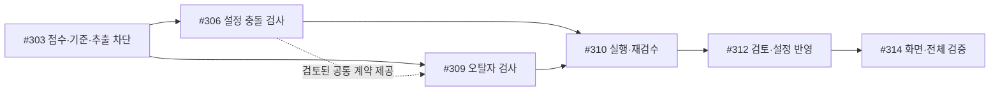

# 오류 리포트 구현 이슈 — 사용자 승인한 5개 묶음

> **최신 진행(2026-10-28):** #303은 [PR #317](https://github.com/catchhole-soma/catchhole-backend-java/pull/317)로 main에 머지됐다(31c5e3c). 최신 통합 테스트 3,838 실행 통과·237 skip·실패 0, 필수 PostgreSQL 12/12·HTTP/H2 32/32, Astra xhigh 검토 및 CI 성공. #306은 머지 기준의 별도 Backend·AI worktree에서 Sol max 로컬 구현·테스트·Astra xhigh 전체/수정 검토를 마쳤다. AI 4,555 pass/134 skip, Backend 3,844 pass/248 skip 및 bootJar 성공, 필수 실제 PG/HTTP 별도 실행 통과다. Critical/Important는 없고 비차단 Minor 1개를 기록했다. #306은 Backend PR318(5b77f97)·AI PR99(22ea1dc)로 main 머지 완료했으며 최종 CI 성공과 merge tree 일치를 확인했다. 지정한 #309 채팅에도 최신 main 통합·검증·머지까지 진행하도록 사용자 승인을 전달했다. 사용자 승인으로 검토된 공통 v2 계약을 전달해 #309도 별도 채팅·워크트리에서 시작했다. #306 전체 완료를 기다릴 필요는 없으며 두 검사기를 검증한 뒤 #310에서 연결한다. 아래 이전 로컬 기록은 당시 이력이다.

2026-10-28 · 상위 [#300](https://github.com/catchhole-soma/catchhole-backend-java/issues/300) · 기반 [#303](https://github.com/catchhole-soma/catchhole-backend-java/issues/303)

후속 11개 이슈를 5개 구현 단위로 통합했다. 기능 범위와 테스트 조건은 유지하며 세부 작업은 각 이슈 안에서 진행한다. #303은 별도 기반 이슈이며 후속 5개에 포함하지 않는다.

| 순서 | 구현 이슈 | 통합한 기존 이슈 |
| --- | --- | --- |
| 1 | [#306](https://github.com/catchhole-soma/catchhole-backend-java/issues/306) — 설정 충돌 검사 | [#306](https://github.com/catchhole-soma/catchhole-backend-java/issues/306) + [#307](https://github.com/catchhole-soma/catchhole-backend-java/issues/307) + [#308](https://github.com/catchhole-soma/catchhole-backend-java/issues/308) |
| 2 | [#309](https://github.com/catchhole-soma/catchhole-backend-java/issues/309) — 오탈자 검사 | [#309](https://github.com/catchhole-soma/catchhole-backend-java/issues/309) |
| 3 | [#310](https://github.com/catchhole-soma/catchhole-backend-java/issues/310) — 검사 실행·재검수 관리 | [#310](https://github.com/catchhole-soma/catchhole-backend-java/issues/310) + [#311](https://github.com/catchhole-soma/catchhole-backend-java/issues/311) |
| 4 | [#312](https://github.com/catchhole-soma/catchhole-backend-java/issues/312) — 작가 검토·설정 추출·확정 | [#312](https://github.com/catchhole-soma/catchhole-backend-java/issues/312) + [#313](https://github.com/catchhole-soma/catchhole-backend-java/issues/313) |
| 5 | [#314](https://github.com/catchhole-soma/catchhole-backend-java/issues/314) — 오류 리포트 화면·사용 흐름 연결·전체 검증 | [#314](https://github.com/catchhole-soma/catchhole-backend-java/issues/314) + [#315](https://github.com/catchhole-soma/catchhole-backend-java/issues/315) + [#316](https://github.com/catchhole-soma/catchhole-backend-java/issues/316) |

## 구현 순서와 선행 관계

사용자 승인으로 #306과 #309는 검토된 공통 자료·계약을 공유하고 별도 워크트리에서 병렬 구현한다. 점선은 공통 계약 제공을 뜻하며 #306 전체 완료를 기다리는 의존성이 아니다. 각 검사기의 테스트·Astra 검토를 마친 뒤 #310에서 실제 실행·저장·재시도 흐름에 연결한다. 제품 실행 시에도 두 검사는 독립 병렬이다.

구현 모델은 6.1 Sol/max, 검토는 Astra/xhigh다. 하나의 이슈 안에 여러 세부 단계·커밋을 둘 수 있다. 마지막 #314의 전체 검증과 별개로 모든 이슈에서 해당 기능의 테스트를 수행한다.

## 기존 구현 계획과 대응

| 기존 계획 영역 | 현재 실행 이슈 |
| --- | --- |
| Task 1 — 접수·검사 기준·검토 전 추출 차단 | #303 |
| Task 2 — 수정·재검수·무효화 | #310 |
| Task 3 — 검사 자료·질문·검색·판정 | #306 |
| Task 3 — 오탈자 분기 | #309 |
| Task 4 — Worker·결과 저장·부분 재시도 | #310 |
| Task 4 — 검토 종료·추출·회차 전체 확정 | #312 |
| Task 5 — 리포트·작가 판단 API | #312 |
| Task 6~8 — 화면·사용 흐름·전체 연결/기본 사례 검증 | #314 |

기존 Task 번호는 기술 내용을 찾기 위한 구분이다. 실제 작업 단위·선행 관계는 위 5개 통합 이슈를 따른다.

## 통합 처리와 현재 상태

- #307·#308 → #306, #311 → #310, #313 → #312, #315·#316 → #314.
- 통합된 6개에는 이동 안내와 기존 본문을 보존하고 닫았다. 구현 완료가 아니며 요구사항·완료 기준·진행 상태는 통합 대상에서 관리한다.
- #300의 하위 작업은 #303과 후속 5개다. 닫힌 이슈를 선행 조건으로 남기지 않는다.
- #303은 PR #317로 main에 머지됐다. #306은 main 머지 완료, #309는 별도 채팅에서 최신 main 통합·검증·머지 진행 중이며 #310·#312·#314는 대기다.
- #309 시작 지시는 사용자가 지정한 채팅 `01a18259-ec32-7c22-91e3-c8f34602efba`에 전달했다. 공통 코드는 검토한 스냅샷으로 전달하며 변경 시 추가 전달한다.
- #306·#309의 로컬 구현 진행은 각 이슈의 커밋·PR·머지·배포 완료를 뜻하지 않는다. Pencil 초안은 최신 처리 순서 반영 전이다.

