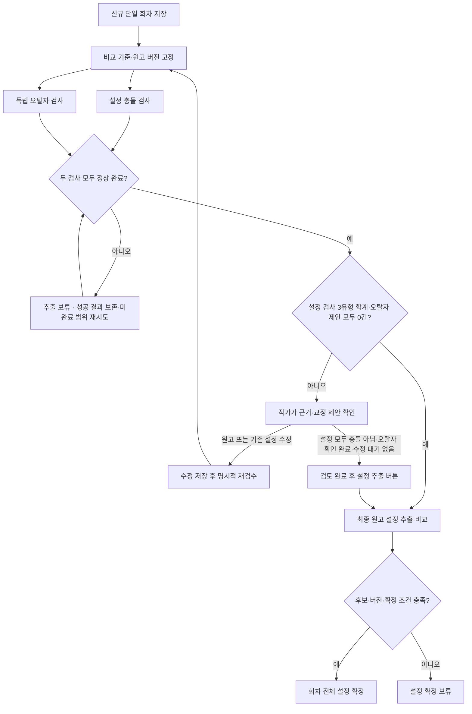

# 새 회차 오류 리포트 제품 기획

작성일: 2026-10-27 · 관련 이슈: [#300](https://github.com/catchhole-soma/catchhole-backend-java/issues/300)

새 회차를 올린 작가가 기존 설정·앞선 원문과 맞지 않을 수 있는 내용을 확인하고, 근거를 읽어 수정이 필요한지 판단하는 기능이다. 먼저 검사 목적과 사용자 흐름을 정한 뒤 화면 명세를 작성하고, 그 명세를 현재 캐치홀 디자인으로 시각화한다.

상태: **2026-10-28 사용자 결정 반영 — 오류 검사·작가 검토를 끝낸 뒤 설정 추출**. 새 회차 원고와 비교 기준을 먼저 저장한다. 원고 자체를 검사하고 필요한 수정·재검수를 마친 뒤, 최종 원고에서 설정을 추출·비교하고 확정한다. 검토가 끝나기 전에는 설정 추출 작업과 설정 후보를 만들지 않는다. 이 결정이 앞선 후보 선추출안과 검사·자동 반영 병행안을 대체한다. 아래의 ‘제안’과 후속 확인 항목은 확정 정책과 구분한다.

## 1. 정해진 방향

- **검사 진입:** 회차 업로드 화면의 분석 유형에서 `신규 회차 검수`를 선택하는 흐름을 오류 리포트 진입점으로 사용한다. 기존 `기존 설정 구축` 선택과 구분한다.
- **업로드 범위:** 첫 버전의 신규 회차 검수는 등록된 마지막 회차 뒤에 새로 추가하는 단일 회차만 지원한다. 다회차 업로드와 중간 누락 회차 추가의 오류 검사는 첫 버전에서 제외한다.
- **첫 회차 검수:** 이전 회차가 없어도 설정집이나 직접 입력한 설정 등 비교 자료가 있으면 검수를 허용한다. 비교 자료가 전혀 없으면 먼저 `기존 설정 구축`을 안내한다. 자료가 있다는 사실만으로 모든 항목을 판단할 수 있다고 표시하지 않는다.
- **첫 버전의 오류 범위:** 캐릭터 설정과 세계관 설정을 모두 포함해, 기존 설정·원문 근거와 대조할 수 있는 설정 충돌부터 시작한다. 행동 동기 부족, 감정 변화나 사건 전개의 자연스러움 같은 서사적 개연성 평가는 첫 버전에서 제외한다. 세부 유형과 분류 방식은 추가로 결정한다.
- **검사 방식:** 설정 충돌은 LLM이 확인할 내용을 계획하고 DB·원문 검색으로 근거를 모은 뒤 판정한다. 질문 생성 기준과 누락 보완 방법은 [설정 충돌 질문 생성·누락 방지 상세안](gh-300-validation-question-planning.md)의 구현 제안으로 구체화한다. 화면에는 내부 처리 방식 대신 검사 상태와 결과를 보여준다.
- **질문별 확인 완료:** 비교 근거·문맥 확인, 필요한 변화·예외 확인, 새 필수 단서 미처리 없음, 필수 검색·원문 읽기 정상 종료의 네 기준을 따른다. 의미가 모호한 것과 필요한 조회를 실행하지 못한 것을 구분한다. 검색 횟수·시간 한도는 실제 원고 평가로 정한다. 질문 하나의 종료만으로 전체 검사나 작가 검토가 완료되지는 않는다.
- **오탈자 병렬 검사:** 같은 원고 버전을 설정 충돌 검사와 독립적으로 검사한다. 설정 확인 질문이 0개여도 오탈자는 원고 전체를 검사하며 별도 모델 설정을 사용한다. 결과는 오탈자 분류·원문 위치·짧은 교정 제안으로 표시한다. 고유명사·방언·문체를 자동으로 오류 확정하거나 원문을 자동 편집하지 않는다. 오탈자 초기 모델은 사용자 지정 **6.1 Terra**, 추론은 **low**(사용자 표현 lite를 낮은 추론으로 해석)다. 품질 수치·처리 시간 한도는 아직 정하지 않았다.
- **초기 모델과 역할:** 사용자는 네 검사 역할 모두 **GPT‑6.1 Terra**로 시작하도록 선택했다. 공식 모델 ID는 `gpt-6.1-terra`이며 추론 강도는 **질문 생성 `medium` · 독립적인 누락 보완 `high` · 근거 판정 `medium` · 오탈자 `low`**로 기록한다. 오탈자의 사용자 표현 `lite`는 가벼운 추론이라는 뜻으로 해석해 지원 값 `low`로 대응했다. [OpenAI 모델 문서](https://developers.openai.com/api/docs/models/gpt-6.1-terra)에서 모델 ID와 `low/medium/high` 지원을 확인했다. 모델 종류는 검사 단계에서 하나이며, 역할별 추론 강도·프롬프트·실행 상태는 구분한다. 호출 횟수는 원고 구간·질문 묶음·후속 확인·재시도에 따라 달라지며 아직 확정하지 않았다. 임베딩과 검토 후 기존 설정 추출 모델은 이번 네 역할의 선택 범위 밖이다. 계정 사용 가능 여부·서비스 통합·실제 원고 품질은 미검증이며 평가를 초기 선택의 선행 조건으로 두지 않는다.
- **오탈자 범위:** 문자 오타·맞춤법·띄어쓰기·분명한 문자/조사의 중복·누락을 검사한다. 허용 표기, 의도적 반복·말더듬·방언, 문체 통일·윤문, 추측에 의한 단어·문장 보충은 제외한다. 고유명사 표기 차이 자체는 첫 버전에서 제외하며 이름 주변의 일반 오타는 검사한다. 새 이름·별칭의 불확실성을 설정 검사로 자동 이관하지 않는다.
- **오탈자 판단·수정:** 항목별 `수정 필요 / 원문 유지 / 검토 필요로 되돌리기`를 제공한다. `원문 유지`만 현재 원고의 해당 항목 검토를 해소하며 작품 전체 예외 사전에 등록하지 않는다. `수정 필요`는 판단만 저장하고 추출 보류를 유지한다. 외부 수정→기존 파일 교체→새 원고 재검사로 확인하며 원문 자동 수정이나 `수정 완료` 체크만으로 해제하지 않는다. 새 원고에는 이전 판단을 자동 승계하지 않고 같은 입력 재시도에는 변경 없는 성공 결과·판단을 보존하고, 새 근거·발생 위치 등으로 판단 내용이 바뀐 항목만 재검토한다. 마지막 판단 저장만으로 추출하지 않고 기존 명시적 완료 버튼을 사용한다. 화면 배치와 API enum/HTTP 필드는 구현 제안이다. [오탈자 범위·검토 정책](gh-300-typo-review-policy.md)을 따른다.
- **설정 반영과의 관계:** `신규 회차 검수`에서는 원고 저장 → 오류 검사 → 작가 검토·필요한 수정/재검수 → 설정 추출·비교 → 설정 확정 순서로 진행한다. 설정 충돌·오탈자 두 검사가 모두 정상 완료되고 미검사 범위 없이 설정 검사 3유형 합계 0건·오탈자 제안 0건이면 자동 추출한다. 항목이 있었다면 두 검사 정상 완료 후 설정 전 항목이 `충돌 아님`이고 오탈자 작가 확인을 마쳐 수정 대기가 없으면 별도 `검토 완료 후 설정 추출` 버튼으로 시작한다. 추출 뒤에도 기존 후보 확정 조건을 충족해야 회차 전체를 확정한다. 검토 전에는 설정 후보·확정 설정·확정 이력·새 인물/세계관 대상을 생성·변경하지 않는다. 검수를 선택하지 않은 `기존 설정 구축`의 동작은 유지한다.
- **보류 단위:** 설정 검사 세 유형 중 어느 항목이나 오탈자 제안의 검토가 남아 있거나 수정 대기가 있으면 해당 회차의 캐릭터·세계관 설정 추출 전체를 보류한다. 어느 검사든 실패·일부 중단·재시도 실패이거나 기준 준비 실패이면 추출을 시작하지 않는다. 같은 입력의 성공 결과는 보존하고 미완료 범위를 재시도하며 오탈자 검사 없이 진행하는 우회는 제공하지 않는다. 설정 추출 이후의 후보 품질·확정 조건 미충족도 회차 전체 확정 보류로 처리한다.
- **재시도 후 변경 항목 검토:** 같은 입력 재시도에서 내용이 바뀌지 않은 항목의 판단은 유지한다. 새로운 근거·발생 위치 등 판단에 영향을 주는 내용이 바뀌면 해당 항목만 `검토 필요`로 되돌리고 변경 이유를 보여준다. 이전 판단은 변경 전 항목의 이력으로 보존하며 현재 판단으로 승계하지 않는다. 재검토가 남으면 설정 추출을 보류한다. 단순 표시 순서·형식 변경이나 의미가 같은 중복 근거만으로 재검토를 요구하지 않는다.
- **작가 판단 정정:** 저장한 `수정 필요`와 `충돌 아님` 판단을 나중에 변경하거나 `검토 필요`로 되돌릴 수 있다. 판단 변경은 원고·설정 수정이나 AI 재검사를 실행하지 않는다.
- **AI 결과 세 유형:** 설정 검사 결과는 `설정 충돌 / 충돌 의심 / 추가 확인 필요`의 세 유형이다. 설정 충돌은 같은 대상·시점·조건에서 양립할 수 없는 내용이 직접 근거로 확인된 경우, 충돌 의심은 기존 상태와 어긋나 보이나 변화·예외를 확인하지 못한 경우, 추가 확인 필요는 대상·시점·해석이 불명확해 비교 판단이 어려운 경우다. 세 유형 모두 시스템 판단으로 작가가 `충돌 아님`으로 정정할 수 있으며 영향 등급 `심각 / 주의 / 참고`와 별개다. 검색 횟수나 검색 결과 없음만으로 충돌 의심을 설정 충돌로 높이지 않는다. 실행 미완료·자료 조회 실패는 추가 확인 필요가 아닌 검사 미완료다.
- **비교 기준과 원문이 다를 때:** 대상·시점·문맥을 추가 확인해도 기준이 불확실하면 신규 원고를 설정 충돌로 단정하지 않고 `추가 확인 필요 — 비교 기준과 원문이 다름`으로 양쪽 내용을 보여준다. 예를 들어 DB는 왼손 상실, 근거 원문은 왼손 장갑 상실인 경우다. 작가의 직접 정정은 대상·항목·적용 시점이 분명할 때 그 범위에서 기준으로 우선 사용하고, 범위가 불명확하면 추가 확인 필요로 둔다. 자동 확정이나 일반 확정됨 표시만으로 직접 정정으로 취급하지 않는다. 서사 시점 차이는 곧바로 불일치가 아니며, 필수 자료 읽기 실패는 검사 미완료다. 원문·DB를 자동으로 덮어쓰지 않는다.
- **등급:** `심각 / 주의 / 참고`를 충돌이 작품에 미치는 영향의 기준으로 사용한다. AI 결과 세 유형은 영향 등급과 별도로 표시한다. 등급은 오류일 확률을 뜻하지 않으며, 유형만으로 고정하지 않고 해당 장면의 영향을 함께 본다.
- **수정 후 재검수:** 가장 마지막 회차의 원고를 수정한 뒤 그 회차를 다시 검수하는 경우와, 원고는 맞는데 잘못 추출·저장된 설정 정보를 작가가 바로잡은 뒤 그 정정을 반영해 가장 마지막 회차를 다시 검수하는 경우를 모두 지원한다. 이후 회차가 등록되어 과거 회차가 된 원고의 재검수로 범위를 넓히지 않는다.
- **수정 동선:** 원고는 작가가 외부에서 고친 파일로 같은 회차의 기존 파일 교체 기능을 사용한다. 잘못 저장된 설정 정보는 기존 설정 관리 화면에서 값을 정정한다. 리포트에서 수정할 위치로 이동하고 재검수로 돌아오는 연결을 제공한다. 첫 버전에서 리포트 안의 원고 편집기를 새로 만들지 않는다.
- **과거 원고 변경의 영향 검사:** 과거 원고 자체를 고친 결과가 여러 회차에 미친 영향을 검사하는 기능은 후속으로 둔다. 기존 원고 수정 기능 자체를 금지하는 의미는 아니다.
- **재검수 결과·이력:** 재검수 후 최신 결과를 기본으로 보여주고 이전 검수의 시각·건수는 이력으로 남긴다. 새 결과의 작가 판단은 `검토 필요`부터 시작하며 이전 판단을 자동 적용하지 않는다. 이전 원문·인용의 버전 보관을 약속하는 정책은 아니다.
- **진행 중 결과:** 발견된 항목부터 읽기 전용으로 보여준다. 정상 완료 또는 중단 뒤 판단을 저장할 수 있고, 중단 재시도를 시작하면 다시 읽기 전용이다. 일부 중단에서 판단을 모두 저장해도 설정 추출은 보류한다.
- **같은 충돌 반복:** 같은 대상·같은 충돌 원인은 한 항목으로 묶고 해당 원고의 모든 발생 위치를 보여준다. 다른 원인은 별도 항목이다.
- **다음 회차 등록:** 검수 중인 101화의 처리(검토·설정 추출·확정)가 끝난 뒤 102화를 등록한다. 기존 설정 구축 선택으로 이 제한을 우회하지 못하게 한다. 첫 버전에는 별도 검수 포기나 미완료 검사를 건너뛰고 진행하는 동선을 추가하지 않는다. 화면을 나가도 검사는 취소되지 않고 저장된 결과·판단을 유지한다. 복귀해 검토를 이어가거나 중단된 검사를 재시도한다.
- **검사 도중 중단:** 이미 확인한 결과는 보여주되, 검사하지 못한 범위와 재시도 안내를 함께 제공한다. 일부 검사 결과를 전체 완료로 표시하지 않는다.
- **디자인 기준:** 옛 오류 리포트의 색상·스타일을 가져오지 않고 현재 캐치홀의 Theme V2·Clear Blue 검토 화면을 따른다.

**추가 범위와 미확정 경계:** 오탈자 검사도 정상 완료하고 작가 확인·수정 대기를 해소해야 설정 추출을 허용한다. 작가는 의도한 표현을 그대로 둘 수 있으며 모든 제안을 실제 수정해 0건으로 만드는 의무는 없다. 오탈자 범위·세 판단의 의미·파일 교체 후 재검사는 확정했다. 화면 배치·API enum/HTTP 필드는 제안이고 오탈자 초기 모델은 사용자 지정 **6.1 Terra**, 추론은 **low**(사용자 표현 lite를 낮은 추론으로 해석)이며 품질 수치·처리 시간 한도는 미정이다. 같은 신규 회차 내부의 모순 검사는 첫 버전에서 제외한다. 과거 확정 설정·앞선 원문과 비교하며, 현재 회차의 앞뒤 문맥은 회상·대상·조건·예외를 해석하는 데 사용한다. 내부 모순만으로 새 의심 항목을 만들지 않는다. #303 코드는 추출 없는 접수·기준 확보 단계 그대로이며 새 검사 기능을 구현했다는 뜻은 아니다.

## 2. 사용자가 얻을 결과 제안

| 결과 | 작가에게 보여줄 내용 | 의미 |
| --- | --- | --- |
| 오탈자 | 분류, 해당 원문과 위치, 짧은 교정 제안 | 설정 충돌과 별도 결과다. 명확한 오탈자 교정 제안만 추가하며 문체·설정·서사를 다시 쓰지 않는다. |
| 설정 충돌 | 같은 대상·시점·조건의 양립 불가 내용을 확인한 직접 근거 | 같은 인물·달력의 생일을 3월 2일과 4월 8일로 사실 서술한 경우. 시스템 판단이며 작가 정정 가능. |
| 충돌 의심 | 기존 상태와 어긋나는 내용과 확인하지 못한 변화·예외 | 손을 잃은 인물이 양손을 쓰지만 회복·의수 근거를 찾지 못한 경우. 검색 실패나 검색 결과 없음만으로 설정 충돌로 높이지 않음. |
| 추가 확인 필요 | 비교 대상·시점·해석의 불명확한 부분과 구체적 사유 | 이번 검이 과거에 파괴된 검과 같은 물건인지 불명확한 경우. 자료 조회 실패와 구별. |
| 검사 일부 누락 | 실행 중단 등으로 실제 검사하지 못한 원고 구간과 이유, 재시도 안내 | 이미 확인한 결과와 함께 표시한다. 판단이 애매한 항목과 다른 처리 상태이며 전체 완료로 표시하지 않는다. |
| 확인한 범위에서 설정 검사 항목 없음 | 검사 범위·기준과 세 유형 합계 0건 | 모든 오류가 없다는 보증은 아니다. 일부 검사라면 확인하지 못한 범위를 함께 표시한다. |

단순한 값 차이만으로 의심 항목을 만들지 않는다. 예를 들어 나이가 달라졌다면 시간 경과·회상, 아이템을 다시 썼다면 수리·재획득처럼 정상적인 설명이 있는지 함께 확인한다.

### 설정 충돌 등급의 기본 기준

| 등급 | 기준 | 예시 |
| --- | --- | --- |
| 심각 | 설정 차이가 현재 장면의 행동·사건 성립 조건에 직접 영향 | 사용할 수 없다고 명시된 능력으로 사건을 해결함. 소품 색이 통과·탈출의 필수 조건이면 색 차이도 포함 가능 |
| 주의 | 사건 성립에 직접 영향 없이 인물 소속·관계·배경 이해를 바꾸는 차이 | 같은 시점의 소속·관계가 달라 인물의 배경을 다르게 이해하게 됨 |
| 참고 | 현재 장면의 부수적 묘사 차이 | 행동·사건 성립에 쓰이지 않는 소품의 색이나 재질이 달라짐 |

중요한 인물·설정이라는 이유만으로 등급을 높이지 않는다. 같은 원인·같은 영향은 반복 횟수만으로 승격하지 않고 횟수·모든 위치를 보여준다. 다른 위치에서 실제 사건 영향이 커지면 그 근거로 재판단한다.

위 의미와 세 단계는 사용자 합의다. 유형별 세부 판정 사례와 경계는 후속으로 보완한다. `추가 확인 필요 · 심각`처럼 AI 결과 유형과 영향 등급을 함께 표현하고 구체적 사유를 제공한다. 추가 확인 필요는 충돌 의심에 덧붙이는 중복 표식이 아닌 별도 결과 유형이다.

## 3. 기본 사용자 흐름

1. 작가가 회차 업로드에서 `신규 회차 검수`를 선택하고 새 회차 한 편을 저장한다.
2. 기존 확정 설정·이력과 앞선 원문 출처를 검사 기준으로 고정한다. **이 단계에서는 설정 추출 작업이나 후보를 만들지 않는다.**
3. 같은 새 원고에서 설정 충돌과 오탈자를 독립 병렬 검사한다. 설정 충돌은 확인할 주장을 찾고 기존 설정·과거 원문을 조회한다. 세부 LLM 계획·검색 순서는 구현 제안이며, 설정 후보를 검사 입력으로 요구하지 않는 원칙은 확정이다.
4. 결과에서 설정 충돌·충돌 의심·추가 확인 필요와 오탈자 제안을 구분해 확인한다. 이번 원고·비교 근거·시점·조건과 애매한 이유를 함께 보여주고, 미검사 범위는 별도 안내한다.
5. 두 검사를 모두 정상 완료했고 설정 검사 3유형 합계와 오탈자 제안이 각각 0건이면 **별도 클릭 없이 설정 추출을 시작**한다. 어느 검사든 일부 중단·실패이면 결과 0건이어도 추출하지 않는다.
6. 설정 항목은 `수정 필요` 또는 `충돌 아님`으로 판단한다. 오탈자 제안은 `수정 필요` 또는 `원문 유지`로 판단하고 `검토 필요`로 되돌릴 수 있다. 수정 필요는 실제 파일 교체·재검사 전까지 보류하며 원문 유지는 해당 항목만 해소한다. 두 검사가 모두 정상 완료되고 모든 설정 항목이 `충돌 아님`이며 오탈자 미검토·수정 대기가 없고 원고·기준이 유효하면 별도 **`검토 완료 후 설정 추출`** 버튼으로 진행한다. 마지막 판단 저장만으로 시작하지 않는다.
7. 최신 원고의 실수라면 외부에서 고친 파일을 기존 파일 교체로 반영한다. 기존에 잘못 저장한 설정이 원인이면 기존 설정 관리에서 정정한다. 변경 내용을 다시 검사하고 위 조건을 평가한다. 파일 교체/설정 저장만으로 재검수를 자동 시작하지 않는다.
8. 검토가 끝난 **최종 원고**에서 캐릭터·세계관 설정을 추출·비교한다. 후보 준비와 대상·값·동시 변경 검증을 통과하면 회차 전체를 확정한다. 실패하거나 확인이 필요한 후보가 있으면 확정을 보류한다.

아래 그림은 두 검사를 합친 검토·추출 동선이다. 같은 원고의 독립적인 오탈자 검사와 질문 생성 세부 흐름은 [설정 충돌 질문 생성·누락 방지 상세안](gh-300-validation-question-planning.md)을 따른다. 두 분기의 결과 건수·검사 상태를 각각 확인한 뒤 서버가 추출 허가를 판단한다.

**이 순서의 목적:** 101화의 오류를 고치는 동안 설정 후보는 아직 없다. 따라서 수정 전 원고에서 만든 후보를 버리거나 고친 후보와 맞추는 처리를 먼저 만들 필요가 없다. 오류 검사는 추출 후보가 아니라 원고 자체와 기존 설정·과거 원문으로 수행한다. 검토 완료 후 추출하는 원고가 검사한 최종 버전과 같은지는 서버가 다시 확인한다.

**판단 저장·검토 완료·설정 확정은 다른 행동이다.** `충돌 아님` 저장은 검토 완료 버튼을 사용할 조건을 만들고, 버튼은 추출을 시작한다. 설정 확정은 이후 후보가 준비된 다음에 일어난다. 설정 또는 오탈자의 수정 대기·미판단·미검사 범위가 남아 있으면 버튼을 허용하지 않는다. 보류 상태에서도 화면을 나갔다 돌아올 수 있다.

**추출 이후의 실패도 구분한다.** 검사를 통과했더라도 추출·비교가 실패하거나 후보 대상이 불명확하면 확정하지 않는다. 두 도메인의 적용 중 실패하면 일부만 남기지 않고 회차 단위로 되돌린다. 추출 중 원고·기준이 바뀌면 옛 검토 완료 기록을 그대로 사용하지 않는다.

### 수정 대상의 예시

1~100화가 등록돼 있고 새로 올린 101화를 검수하는 상황이다.

| 상황 | 실제 수정 대상 | 첫 버전 |
| --- | --- | --- |
| 20화에서 검이 파괴됐는데 101화에서 설명 없이 그 검을 사용함 | 최신 101화 원고를 고치고 101화를 재검수 | 지원 |
| 20화 원문은 칼집만 파괴됐는데 캐치홀이 검이 파괴됐다고 잘못 저장함 | 원고는 그대로 두고 잘못 저장된 설정 정보를 정정한 뒤 101화를 재검수 | 지원 |
| 작가가 20화 원문 자체를 ‘검 파괴’에서 ‘칼집 파괴’로 변경하려 함 | 과거 원고 변경이 21~101화의 내용에 미친 영향 검사 | 후속 |

두 번째 경우에는 기존 설정 관리에서 저장한 정정과 검사에 사용한 항목을 명시적으로 연결한다. 새 회차가 아직 확정되지 않았으므로 그 회차의 자동 반영값을 먼저 되돌릴 필요는 없다. 정정 후 기준·검사 결과를 새로 묶으며, 일반 현재값 수정 성공만으로 검사 기준 정정까지 완료됐다고 추정하지 않는다. 별도 리포트 전용 편집 화면은 만들지 않는다. 과거 기준만 따로 정정하는 추가 편집 모드는 이번 흐름의 선행 조건에서 제외하고 후속 검토로 둔다.

이미 한 번 확정한 최신 회차를 나중에 재검수하는 경우는 별도로 구분한다. 리포트 재검수만으로 기존 확정 내용을 자동 철회하거나 같은 후보를 다시 확정하지 않는다. 기존 원고·설정 수정/직접 검토 동선을 사용하고 새 보고서는 검사 결과를 갱신한다. 검토 완료 후 추출·확정하는 흐름은 아직 확정하지 않은 신규 회차에 적용한다.

## 4. 첫 버전 범위 제안

| 포함할 기능 | 화면 명세에서 정할 내용 |
| --- | --- |
| 회차별 결과와 재진입 | 작품·회차·검사 시각·검사 기준, 업로드/분석 목록에서 진입. 의심 0건이어도 결과를 열 수 있어야 한다. |
| 목록과 상세 | 대상·의심 이유·검토 상태, 필터·페이지·선택 복원. 단일 회차 검수에 맞춰 한 회차의 결과를 읽는다. |
| 양쪽 근거 확인 | 여러 인용과 주변 문맥, 실제 검사에 사용한 버전. 직접 입력 설정·설정집은 회차 원문과 구분한다. |
| 오탈자 결과 | 별도 분류·원문 위치·짧은 교정 제안. 설정 충돌 건수/상태와 구분하고 검사 실패·미검사 범위를 숨기지 않는다. |
| 작가 판단 저장 | 수정 필요/충돌 아님, 판단 변경·검토 필요로 되돌리기, 저장 중·실패·동시 변경. |
| 판단이 애매한 항목과 검사 범위 | 판단이 애매한 항목의 내용과 사유를 보여준다. 검사 완료/일부 검사/실패를 구분하고 실제 검사하지 못한 구간의 안내를 정한다. |
| 검토 후 추출·확정과 보류 | 검토 중·미판단·수정 필요·실패·부분 중단에서는 설정 추출 자체를 막는다. 추출 미시작/진행/실패와 이후 확정 상태를 구분한다. 0건 자동 시작과 항목 검토 후 명시적 시작을 제공한다. |
| 결과 변경·복구·재검수 | 최신 원고 수정 또는 잘못 저장된 설정 정보 정정 후 가장 마지막 회차의 재검수를 지원한다. 원고·근거가 바뀐 이전 결과, 삭제된 근거, 실패 재개와 수정 후 새 검사를 구분한다. |
| 재검수 이력 | 최신 결과를 기본으로 표시하고 과거 검수 시각·건수를 조회한다. 새 결과의 판단은 검토 필요로 시작한다. |
| 좁은 화면과 복귀 | 모바일 목록→상세→목록 복귀, 필터·선택·읽는 위치 유지, 키보드 접근과 상태 안내. |

첫 버전에서 **서사적 개연성 평가, 다회차 업로드의 오류 검사, 같은 신규 회차 내부 모순 검사를 제외**한다는 방향은 확정했다. **자동 원고 수정, 설정·서사를 다시 쓰는 AI 수정문, 리포트 항목의 일괄 판단, 공유·내보내기, 작품 전체 통계 대시보드**도 제외하는 안을 제안한다. 이후 사용자 요청으로 명확한 오탈자의 짧은 교정 제안만 좁은 추가 범위로 포함했다. 검사 통과 후 회차 전체의 설정을 확정하는 처리와 리포트 항목의 일괄 판단은 구분한다. 기존 Pencil에 있다는 이유로 포함하지 않는다.

캐릭터와 세계관 설정을 모두 검사한다는 범위는 확정했다. 나이·레벨/수치·스킬·아이템·상태와 세계관의 규칙·장소·조직 설정을 어떤 세부 유형으로 분류할지는 [#64](https://github.com/catchhole-soma/catchhole-backend-java/issues/64)와 맞춰 결정한다. 시간 순서·지칭 대상 문제의 취급은 별도로 검토하며, 세계관 충돌을 무리하게 기존 캐릭터 다섯 유형에 끼워 넣지 않는다.

**초기 평가 방향 — 사용자 합의:** 선택한 Terra 모델과 역할별 추론 강도를 유지하고, 기대 결과를 정한 소수의 충돌·정상·모호한 사례로 실제 동작을 확인한다. 설정 오류를 놓치거나 잘못 지적하면 질문 생성·근거 검색·판정 중 원인을 찾아 보완한다. 초기 작업에 모델 간 비교·순위 실험을 넣지 않으며, 심각한 오류 한 건 누락만으로 모델 채택을 보류하는 기준은 합의하지 않았다. 오탈자는 간단한 맞춤법·띄어쓰기·명백한 오타를 찾고 고유명사·의도한 표현을 건드리지 않는지 기본 예시로 확인한다. 개발 중 평가 사례와 결과는 작업자가 정리하고 작품 해석이 필요한 부분을 함께 확인한다. 모든 실제 원고나 내부 질문을 사람이 전수 검토하는 흐름은 아니며, 실제 서비스에서 작가는 리포트에 게시된 항목만 검토한다.

## 5. 화면 명세에서 구체화할 내용

주요 제품 선택은 위에 반영했다. 오탈자 범위·판단·수정 확인 흐름은 확정했다. 구체적 화면 배치·API enum/HTTP 필드는 후속 제안이며 오탈자 초기 모델은 사용자 지정 **6.1 Terra**, 추론은 **low**(사용자 표현 lite를 낮은 추론으로 해석)다. 품질 수치·처리 시간 한도는 아직 정하지 않았다. 다음 항목은 합의한 범위 안에서 기능을 빠짐없이 표현하기 위한 세부 작업이다. 화면 명세 작성 중 제품 범위를 바꾸는 선택이 새로 드러나면 별도로 논의한다.

| 우선순위 | 항목 | 구체화할 내용 |
| --- | --- | --- |
| 1 | 검토 후 추출과 수정 후 재검수 | 전체 검사·작가 검토 완료가 추출 시작 조건이다. 파일 교체/설정 정정 뒤에는 후보 없이 다시 검사한다. 0건 자동 추출, 항목 검토 후 명시적 추출, 이후 후보 준비·원자 확정을 연결한다. 이미 확정된 회차의 재검수는 중복 확정하지 않는다. |
| 2 | 결과·검토 표현 | 캐릭터·세계관의 세부 분류, AI 결과 세 유형의 구체적 사유·작가 액션, 등급별 사례·경계를 정리한다. |
| 3 | 결과 이력과 중단 | 최신 결과·이전 검수 요약의 전환, 이전 판단의 자동 이월 금지, 일부 검사 결과·미검사 범위·재시도 조건을 명시한다. |
| 4 | 예외와 접근성 | 근거 변경·파기, 권한·조회·저장 실패, 동시 변경, 선택·필터·페이지 복원, 모바일·키보드 동작을 정리한다. |

2026-10-28 후속 합의: 미완료 신규 검수가 있으면 해당 회차의 검토·설정 추출·확정이 끝날 때까지 다음 회차 등록을 막는다. 서버가 모든 등록 경로에서 검증하고, 화면에는 보류 사유와 해당 리포트 이동을 제공한다. #303의 이번 기반 구현에 포함됐다는 뜻은 아니며 후속 업로드 연결 작업의 완료 기준이다. 별도 검수 포기·미완료 검사 우회 동선은 첫 버전에 추가하지 않으며 필수 미결정 사항으로 두지 않는다. 화면 이탈 후 저장된 결과로 돌아와 검토/재시도를 이어간다. 기존 파일 삭제 기능이나 삭제 정책을 바꾸는 결정은 아니다.

## 6. 화면 명세로 옮길 기준

이 기획을 기준으로 오류 리포트 상세 `SEpisodeValidationReport` 한 화면의 [화면 명세 검토안](../data-requirements/analysis.md#충돌-의심-상세-리포트-sepisodevalidationreport)을 작성했다. [화면 명세 작성 규칙](../data-requirements/README.md)에 따라 아래 여섯 항목으로 정리하며, 화면 배치·문구·기본 동작 제안과 BE 협의 사항은 합의한 제품 정책과 구분한다.

1. 표시 데이터: 회차 문맥·검사 범위·충돌 의심·미확인 범위·선택 상세·근거·판단 상태.
2. 사용자 액션: 행동마다 실행 조건, 성공 후 변화, 실패 시 유지할 상태를 연결한다.
3. 화면 전환 식별자: 같은 결과와 필터·선택·페이지·근거를 복원한다.
4. 빈 상태와 실패: 완료 0건/일부 검사 0건/필터 0건, 진행·실패, 오래된 결과, 근거 삭제, 저장 충돌을 구분한다.
5. 데이터 요구사항: BE → FE 제공 정보와 FE → BE 전달 의도를 구분한다. API 경로·전체 DTO는 복제하지 않는다.
6. 미확정 사항: 결정되지 않은 정책은 남겨두고, 검토 결과에 따라 본문으로 옮긴다.

### 디자인 참고의 우선순위

- 현재 제품 기준은 [Theme V2](../../src/styles/theme-v2.css)와 [Clear Blue 검토 패턴](../review-clear-blue.md)이다. 흰 표면·밝은 배경·파란 선택 강조·공통 검토 컴포넌트를 따른다. 랜딩 전용 디자인 규칙을 확대 적용하지 않는다.
- Pencil `SFZkR`는 목록·상세·양쪽 근거의 기능 참고다. `i8TgH`의 통계·기간 필터·해결 완료는 별도 과거 제안이며 첫 버전 요구사항이 아니다.
- Pencil `GEwV9`·`la0t2`는 검토 화면 구도의 참고다. 세부 동작·문구·폰트·집계는 현재 코드와 다를 수 있어 실제 구현을 우선한다.
- 원고를 실제로 바꾼 것처럼 보이는 빨강/초록 변경 전후 표현 대신 `비교 기준`과 `이번 원고`를 비교한다.
- 현재 `/episode-validation-report`는 구현되어 있지 않다. 이 기획과 기존 시안을 배포 기능으로 소개하지 않는다.

## 작업 기록

- 작업 브랜치: `codex/gh-300-error-report-spec`
- 기준 커밋: `65fcf6f` — Front 원격 `main`, 2026-10-27 확인.
- 관련 기술 이슈: [#66](https://github.com/catchhole-soma/catchhole-backend-java/issues/66). 기존 SettingCandidate 중심 제안과 현재 LLM 검증 계획 방식의 차이는 화면·제품 방향 검토 뒤 기술 계획에서 조정한다.
- 제품 기획의 합의 정리와 상세 화면 명세 검토안을 작성했다. 이어진 사용자 요청으로 [Pencil 디자인 초안](gh-300-error-report-design-draft.md)을 만들었다. 화면·디자인 검토와 BE 협의는 진행 중이며 제품 구현은 후속 단계다.
- 2026-10-27 (이후 10-28 오류 검사 우선 결정으로 대체된 기록): 기존 Front·Backend·AI 코드를 조사한 [구현 계획](gh-300-error-report-implementation-plan.md)과 [검사 기준·확정 대기 설계](gh-300-validation-baseline-design.md)를 사용자 결정에 맞춰 수정했다. 기존 입력 캡처·후보 추출/비교를 재사용하고 오류 검사 후에만 회차 전체를 확정한다. 과거 기준만 정정하는 추가 모드와 병행 반영 후 복구 설계는 핵심 구현 범위에서 제외했다.

- 2026-10-28: 사용자 요청으로 오류 검사·작가 검토를 설정 추출보다 앞에 두었다. 후속 합의까지 포함해 두 검사 정상 완료·설정 검사 3유형 합계·오탈자 제안 모두 0건은 자동 추출, 항목이 있었다면 설정 전부 `충돌 아님`·오탈자 확인 완료·수정 대기 없음 뒤 별도 `검토 완료 후 설정 추출` 버튼을 사용한다. #303의 첫 구현 범위는 추출 없는 접수·기준 확보·우회 차단이며 실제 검수 Worker와 검토 완료 후 추출 연결은 후속이다. Pencil/PNG는 이번에 수정하지 않았다.
