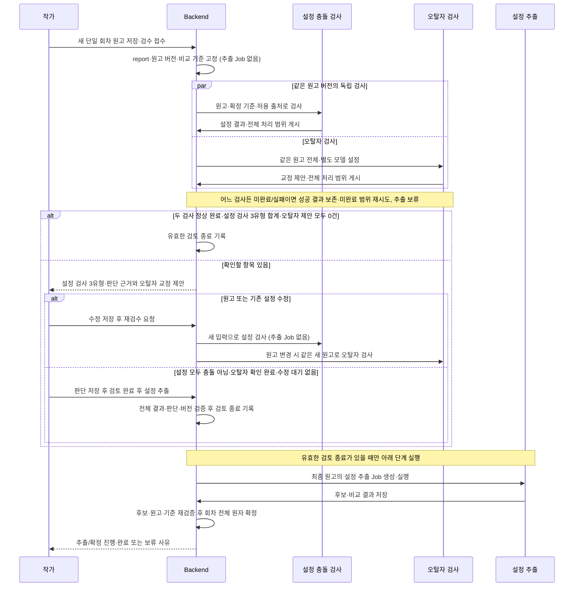

# 신규 회차 오류 검사 기준과 검토 후 설정 추출 설계

2026-10-28 · GH300 · #303 기반 구현과 후속 계약

**신규 회차 검수는 원고 저장 → 오류 검사 → 작가 검토·수정/재검수 → 설정 추출·비교 → 설정 확정 순서다.** 검토가 끝나기 전에는 설정 추출 작업과 설정 후보를 만들지 않는다. 기존 `기존 설정 구축`의 자동 반영은 유지한다. 이 정책은 앞선 후보 선추출안과 검사·자동 반영 병행안을 대체한다.

설정 충돌·오탈자 두 검사가 모두 정상 완료되고 설정 검사 3유형 항목과 오탈자 제안이 각각 0건이면 설정 추출을 자동 시작한다. 항목이 있었다면 설정 전 항목 `충돌 아님`·오탈자 작가 확인 완료·수정 대기 없음 뒤 별도 **`검토 완료 후 설정 추출`** 버튼을 눌러 시작한다. 원고나 비교 기준을 고쳤다면 수정 내용의 재검사가 먼저다. 일부 중단·실패·미검사 범위·미판단·`수정 필요`가 남아 있으면 추출하지 않는다. 이 두 시작 방식은 2026-10-28 사용자 합의다.

**AI 결과 분류:** 설정 검사 결과는 `설정 충돌 / 충돌 의심 / 추가 확인 필요`의 세 유형이다. 설정 충돌은 같은 대상·시점·조건에서 양립할 수 없는 내용이 직접 근거로 확인된 경우, 충돌 의심은 기존 상태와 어긋나 보이나 변화·예외를 확인하지 못한 경우, 추가 확인 필요는 대상·시점·해석이 불명확해 비교 판단이 어려운 경우다. 세 유형 모두 시스템 판단으로 작가가 `충돌 아님`으로 정정할 수 있으며 영향 등급 `심각 / 주의 / 참고`와 별개다. 검색 횟수나 검색 결과 없음만으로 충돌 의심을 설정 충돌로 높이지 않는다. 실행 미완료·자료 조회 실패는 추가 확인 필요가 아닌 검사 미완료다. 세 유형의 미검토 항목은 모두 추출을 막으며 자동 0건은 세 유형 합계 0건을 뜻한다. enum/필드명은 후속 설계 제안이다.

관련 문서: [제품 기획](gh-300-error-report-product-brief.md), [화면 명세](../data-requirements/analysis.md#충돌-의심-상세-리포트-sepisodevalidationreport), [구현 계획](gh-300-error-report-implementation-plan.md).

**오탈자 병렬 검사 추가:** 같은 대상 원고 fingerprint를 공유하되 설정 질문 생성·기준 검색·판정과 독립 실행하고 별도 모델 설정을 사용한다. 설정 질문이 0개여도 원고 전체 오탈자 검사는 수행한다. 결과에는 분류·원문 위치·짧은 교정 제안을 담고 원문 자동 편집이나 고유명사/방언/문체의 자동 오류 확정은 하지 않는다. 오탈자 초기 모델은 사용자 지정 **6.1 Terra**, 추론은 **low**(사용자 표현 lite를 낮은 추론으로 해석)다. 품질 수치·처리 시간 한도는 아직 정하지 않았다. 문자 오타·맞춤법·띄어쓰기·분명한 문자/조사의 중복·누락을 검사한다. 허용 표기, 의도적 반복·말더듬·방언, 문체 통일·윤문, 추측에 의한 단어·문장 보충은 제외한다. 고유명사 표기 차이 자체는 첫 버전에서 제외하며 이름 주변의 일반 오타는 검사한다. 새 이름·별칭의 불확실성을 설정 검사로 자동 이관하지 않는다.

오탈자 미검토·수정 대기·실패·일부 중단·재시도 실패도 추출을 막는다. 같은 입력의 성공 결과를 보존하고 미완료 범위를 재시도하며 검사 생략 우회는 제공하지 않는다. 의도한 표현은 유지할 수 있어 제안을 전부 실제 수정해 0건으로 만들 필요는 없다. 오탈자 판단·수정 흐름은 합의했다. 항목별 `수정 필요 / 원문 유지 / 검토 필요로 되돌리기`를 제공한다. `원문 유지`만 현재 원고의 해당 항목 검토를 해소하며 작품 전체 예외 사전에 등록하지 않는다. `수정 필요`는 판단만 저장하고 추출 보류를 유지한다. 외부 수정→기존 파일 교체→새 원고 재검사로 확인하며 원문 자동 수정이나 `수정 완료` 체크만으로 해제하지 않는다. 새 원고에는 이전 판단을 자동 승계하지 않고 같은 입력 재시도에는 변경 없는 성공 결과·판단을 보존하고, 새 근거·발생 위치 등으로 판단 내용이 바뀐 항목만 재검토한다. 마지막 판단 저장만으로 추출하지 않고 기존 명시적 완료 버튼을 사용한다. 화면 배치·API enum/HTTP 필드만 후속 제안이다. 검사 상태/coverage·결과 분류는 별도로 관리하고 서버가 두 분기의 완료 조건을 함께 확인한다. 같은 신규 회차 내부 모순 검사는 첫 버전에서 제외한다. 과거 확정 설정·앞선 원문과 비교하며, 현재 회차 문맥을 읽어 회상·대상·조건·예외를 해석하는 일은 유지한다. 현재 회차 내부 모순을 별도 finding으로 검출하지 않는다. 질문 생성과 누락 보완의 구체안은 [설정 충돌 질문 생성·누락 방지 상세안](gh-300-validation-question-planning.md)을 참조하며 #303 구현 범위를 확대하지 않는다.

**영향 등급 합의:** 심각은 설정 차이가 현재 장면의 행동·사건 성립 조건에 직접 영향을 주는 경우다. 중요한 인물·설정이라는 이유만으로 올리지 않는다. 주의는 사건 성립에 직접 영향 없이 인물의 소속·관계·배경 이해를 바꾸는 차이, 참고는 현재 장면의 부수적 묘사 차이다. 소품 색 차이도 통과·탈출의 필수 조건이면 그 영향 근거로 심각할 수 있다. 같은 원인·같은 영향의 반복 횟수만으로 등급을 올리지 않고 횟수와 모든 위치를 표시한다. 다른 위치에서 실제 사건 영향이 커지면 해당 근거로 재판단한다. AI 결과 세 유형과 영향 등급은 독립이다.

## 1. 기존 코드 재사용과 수정 경계

초기 조사는 Backend `5df3a8e94122169be5a866508da18a03c9164b84` 기준이다. #303 구현 worktree는 `4b68365aff7ca58265f43bab0c7f08a276765371`에서 시작했고 `domain/validation`과 미배포 V89를 추가했다. 이 절의 새 계약은 현재 구현 완료를 뜻하지 않는다.

| 현재 코드 | 재사용할 내용 | 오류 검사 우선으로 바꿀 내용 |
| --- | --- | --- |
| `AnalysisRunStateServiceImpl`와 캐릭터/세계관 state source | 확정 현재값·이력 캡처와 해시 의미 | 검사 기준 확보를 추출 Job 생성/첫 claim에서 분리. Job 없이 Work 잠금 아래 캡처 |
| `EpisodeValidationService`·`ValidationReport` | 단일 신규 최신 회차 자격, 원고 버전, 소유권·멱등 접수 | 접수 시 report·baseline만 저장. extractionJobId/candidateGeneration/digest는 없음 |
| `ValidationBaselineService` | seed 정규화, 출처 manifest, 파기·늦은 쓰기 차단 | 추출 완료 이벤트 없이 기준 준비. baseline READY만으로 추출 허용 금지 |
| 일반 분석 create/reanalysis/retry/claim | 기존 입력·실행 자격 검증 | 추출 Job이 없는 미검토 report도 조회해 일반 경로의 추출 우회 차단 |
| `AnalysisJobWorkerServiceImpl.completeAnalysisJob` | 추출·비교·journal 완료, 기존 후보 처리 | 검토 후 생성된 Job만 실행. 이후 전체 후보 사전 검증과 엄격한 원자 확정 연결은 후속 |
| `CharacterAnalysisStateSource` | 현재 slot·복수 출처·historyFacts·effectiveFromEpisodeNo | 모든 필요한 이력·출처를 캡처 시점에 고정하고 검수용으로 정규화 |
| `WorldSettingAnalysisStateSource`와 확정 후보 이력 | 현재 속성·버전·확정 근거 | 삭제 경로·과거·history-only 확정 이력까지 별도 projection으로 고정 |
| 기존 `settingtool`·검색 | 값 의미·인용 검증·검색 도구 | live 조회를 고정 baseline 조회로 바꾸고 정확한 출처 버전을 검색 전에 제한 |

현재 설정 조회 API는 임의 과거 회차 당시의 전체 상태 복원 API가 아니다. `episodeTo=100`만으로 101화 검사 입력을 일관되게 만들 수 없다. **기준 고정은 검사 당시 무엇을 비교했는지 설명하고 재시도·검토 종료·확정 시 변경을 감지하기 위한 장치**다. 101화를 먼저 반영했다가 되돌리기 위한 장치가 아니다.

## 2. 접수에서 최종 확정까지

1. **접수:** 단일 신규·최신 회차, 원고 버전, 소유권을 확인한다. Work 잠금 아래 report와 idempotencyKey를 기록하고 기존 확정 상태·이력·허용 출처를 고정한다. 추출 Job, 후보 세대, 추출 journal은 만들지 않는다. 같은 요청/같은 입력은 같은 report·baseline을 반환한다.
2. **기준 준비:** 저장된 seed를 정규화한다. 세계관 확정 이력의 값·경로·operation·시점·source와 캐릭터 과거 Fact의 확정/수동 출처 자격을 캡처 시점에 포함한다. 정규화 때 최신 설정을 읽어 누락 내용을 보충하지 않는다. 실패하면 report를 조회 가능한 보류 상태로 남긴다.
3. **오류 검사:** 대상 원고를 읽어 검사할 주장·상황을 계획하고, 고정 DB 설정과 과거 원문에서 근거·정상 변화의 설명을 찾아 판단한다. 설정 추출 후보나 candidate digest는 입력/claim 조건이 아니다. 판정별 근거와 segment/check 처리 범위를 저장한다. 전체 문장/문단 처리 기록, 원문에서 독립적으로 시작하는 재검토와 기존 제약의 역방향 검사로 빠진 질문을 보완하는 안을 사용한다. 질문 기록은 임시 검사용이며 설정 후보가 아니다. 처리 기록으로 실행 누락을 찾을 수 있어도 모든 의미를 포착했다고 보증하지 않는다. 신규/과거 원문 읽기·분할·필요한 index 준비는 SETTING_EXTRACTION Worker 없이 수행하며 후보 쓰기가 없다. 세부 검색 우선순위·횟수·예산은 후속 설계/평가 대상이다.
4. **작가 검토:** 두 검사 모두 정상 완료·설정 검사 3유형 합계와 오탈자 제안 모두 0건이면 자동 종료한다. 항목이 있었다면 설정 전 항목 `NOT_CONFLICT`·오탈자 작가 확인 완료·수정 대기 없음과 명시적인 검토 완료 요청이 필요하다. `NEEDS_FIX`·`PENDING`·누락·실패·오래된 입력이면 종료하지 않는다. 판단 저장은 원고/설정 변경이나 추출 실행과 별개다. 발견 항목은 실행 중에도 읽기 전용으로 제공하되 정상 종료/중단 뒤 판단 가능하다. 재시도를 시작하면 다시 읽기 전용이고 일부 중단에서 모두 판단해도 추출 보류다.
5. **추출 시작:** 서버가 report version·대상 원고 fingerprint·baseline revision/hash·출처 상태·현재 설정 변경을 다시 검증한 뒤 검토 완료 기록과 추출 Job을 원자적으로 연결한다. 클라이언트의 `reviewCompleted=true` 같은 값은 허가 증거가 아니다. 같은 완료 요청은 같은 Job을 돌려주며 중복 추출하지 않는다. 이때 처음 candidateGeneration을 만들고 검토한 최종 원고에 연결한다.
6. **추출 후 확정:** 기존 추출·대상 해소·비교를 재사용한다. 추출 성공만으로 확정하지 않고 전체 후보 준비·schema·대상 version·원고/기준 유효성·검토 완료 기록을 다시 확인한다. 캐릭터·세계관 적용 계획을 먼저 검증하고 한 트랜잭션으로 반영한다. 기존 contributor가 일부 그룹 실패를 삼키는 경로를 그대로 원자적 확정으로 사용하지 않는다. 실패하면 전체 rollback하고 같은 generation을 두 번 적용하지 않는다.

기준 저장에 새 LLM·embedding·장시간 원문 읽기를 넣지 않는다. 기존 character 캡처에는 근거 해석의 저장소 읽기가 있을 수 있으므로 모든 기존 I/O를 잠금 밖으로 옮겼다고 가정하지 않는다. 추가 원문 준비·검사는 잠금 밖에서 수행하고 게시·검토 종료·확정 때 다시 검증한다.

### #303이 이번에 제공할 범위

**검토 전 설정 추출 차단·검수 접수·검사 기준 확보**까지다. 접수/조회, 기준·출처 저장, Job 없는 report의 일반 추출 우회 차단, 목록의 검수 대기 표시, 교체·파기 무효화를 구현한다. baseline READY는 검사 완료도 검토 종료도 아니다. 실제 오류 검사 Worker·findings·판단/검토 완료 API·추출 시작 coordinator가 연결되기 전까지 추출은 계속 차단한다. 기반 테스트용 가짜 검토 완료 API를 제품에 제공하지 않는다.

현재 저장 모델/V89에는 추출 Job·후보 세대 연결 컬럼이 없다. `ValidationStagingResponse`의 validationJobId/extractionJobId/candidateGeneration/candidateDigest는 모두 null, extractionStatus/candidateStatus/errorReviewStatus는 NOT_STARTED다. status는 정상 접수 WAITING_FOR_ERROR_REVIEW, 기준 실패 HELD_INCOMPLETE, 원고 교체/무효화 INVALIDATED로 반환한다. 기준 해시는 confirmedStateHash/baselineHash이며 sourcePreparationStatus는 NOT_PREPARED다. 과거 applicationStatus/applicationPolicy 응답은 제거했다. 전체 필드와 후속 제안의 경계는 [구현 계획 Task 1](gh-300-error-report-implementation-plan.md#task-1-검토-전-설정-추출-차단검수-접수검사-기준-확보)에 정리했다.

### 상태를 나누는 이유

| 축 | 상태 의미 |
| --- | --- |
| 기준 | 준비 중 / READY / 실패 / 무효. READY는 고정 기준이 준비됐다는 뜻 |
| 오류 검사 | 대기 / 진행 / 정상 완료 / 일부 중단 / 실패 |
| 작가 검토 | 검사 대기 / 확인 필요 / 미완료 보류 / 재검사 필요 / 검토 종료 |
| 설정 추출 | 미시작 / 대기 / 진행 / 완료 / 실패. 검토 종료 전에는 항상 미시작 |
| 설정 확정 | 미시작 / 후보 확인 필요 / 처리 미완료 / 준비 완료 / 확정 중 / 확정 완료 |

문서의 사용자 의미와 실제 Java enum은 OpenAPI로 맞춘다. 검사 실패를 아직 시작하지도 않은 추출의 실패로 표시하지 않는다. 추출 뒤 후보 품질 문제와 검사 중 의심 항목도 구분한다. 일반 설정 구축의 완료/자동 반영 상태는 기존 경로를 유지한다.

## 3. 기준·검토 완료 기록·추출의 연결

아래 후속 명칭은 계약 제안이며 #303의 실제 저장 엔티티와 일대일 대응을 강제하지 않는다.

| 기록 | 핵심 정보와 불변 조건 |
| --- | --- |
| `ValidationBaseline` | work/target, capturedAt, schemaVersion, inputHash, manifestHash, revision, 준비 상태. originExtractionJobId를 요구하지 않음 |
| `ValidationBaselineEntry` | 대상·전체 설정 경로·값·CURRENT/HISTORICAL·시점·조건·sourceRefs. 확정 기준과 provisional 후보를 혼합하지 않음 |
| `ValidationBaselineSource` | 회차/설정집 실제 revision·hash/version·내부 저장소 식별 정보·readiness. 대상/후속 회차는 과거 근거에서 제외 |
| `ValidationCorrection` | baseline entry/hash/revision, 실제 기존 설정 수정 receipt·현재 version·출처. 편집 성공을 임의 기준 정정으로 추정하지 않음 |
| `ValidationReport` | reportMode, target fingerprint, baseline revision/hash, validationJobId, 실행/유효성/version·coverage·판단 집계. 검사 시 extractionJobId/candidateGeneration/digest 없음 |
| `ValidationReviewCompletion` | 유효한 report version·source·baseline·전체 coverage/판단을 서버가 확인한 종료 기록. 두 검사 정상 완료·각각 0건은 자동 종료, 항목이 있었다면 설정 전 항목 NOT_CONFLICT·오탈자 확인 완료·수정 대기 없음의 명시 종료. 추출 생성의 유일한 허가 근거 |
| `ValidationApplication` | 검토 종료 기록 이후 생성된 extractionJobId·candidateGeneration/digest와 후보 준비·확정 상태/receipt. 검토 전에는 후보 세대 없음 |
| `ValidationInputV1` | reportMode, report/job/lease, target fingerprint, baseline revision/hash·manifest, coverage checkpoint, 예산. candidateGeneration/digest 필드로 검수를 잠그지 않음 |

`BEFORE_CONFIRMATION`은 최초 검수와 아직 확정하지 않은 회차의 재검수다. 후보 없이 검사하며 검토 종료 뒤에만 추출 연결을 생성한다. `DIAGNOSTIC_ONLY`는 이미 확정한 최신 회차의 결과만 갱신한다. previousApplicationReceipt로 이전 확정 사실을 연결하고 새 추출·확정·자동 철회를 하지 않는다. 서버가 실제 확정 이력으로 모드를 정하며 클라이언트가 선택해 우회할 수 없다.

검토 후 생성한 후보에는 target fingerprint, 검토 완료 기록, baseline hash, 추출·비교 입력 버전을 연결한다. 추출 중 원고/기준이 바뀌면 결과를 보류하고 재검수한다. 이 보호는 **검토 이후** 변경에 대한 것이며, 오류 수정마다 사전 후보를 재추출하는 흐름을 다시 도입하는 것이 아니다.

출처 의존 관계는 seed·기준 항목·정정 설명·finding·인용·coverage/checkpoint, 이후 생성된 후보에 기록한다. 복사된 원문과 생성 설명도 파기 대상을 역추적한다. 회차·설정집 리비전·직접 입력을 구별하고 출처 없는 과거 Fact를 직접 입력으로 추측하지 않는다.

허용 원문 목록에는 기준 고정 시점의 **모든 앞선 활성 회차 fingerprint**와 고정 설정집 revision을 넣는다. 70화의 검 수리가 설정으로 추출되지 않았더라도 101화 검사에서 원문을 찾을 수 있어야 한다. baseline entry의 sourceRefs는 그중 직접 근거이고 target는 별도 검사 대상이다.

### 조회 규칙

- 구조화 값은 저장된 baseline에서 조회한다. live CURRENT 도구나 `updatedAt <= capturedAt`로 대체하지 않는다.
- source allowlist와 정확한 hash/version을 검색의 ranking/LIMIT 전에 적용한다. 직접·키워드·벡터·인접 청크·readiness·게시 전 검증이 같은 경계를 따른다.
- 고정 revision도 현재 권한·보관·파기 제한을 우회하지 못한다. 바뀐 원문을 최신본으로 치환하거나 파기한 옛 객체로 fallback하지 않는다.
- 미분석 설정집도 `ValidationSourceReader`로 실제 revision/hash/접근 상태를 확인하고 메모리 분할해 직접·키워드·인접 문맥으로 읽는다. revisionId·code point offset·referenceTimeKind/referenceEpisodeNo를 유지하고 가짜 회차·청크 ID를 만들지 않는다. 책의 선행 추출이나 새 vector 인덱스를 요구하지 않는다.
- `SourceReadiness`는 text/keyword/vector/limitations를 구분한다. 직접·키워드 근거가 충분하면 vector 미준비만으로 실패시키지 않지만, 필요한 원문을 못 읽은 check는 미검사다. 의미상 애매함이나 정상 0건으로 숨기지 않는다.
- 전체 기준을 한 LLM 호출에 넣지 않는다. 대상·경로·페이지·직접 근거 조회를 사용하고 조회 토큰을 baseline revision에 묶는다.

### DB와 과거 원문의 기준 충돌

사용자 합의: 대상·시점·문맥을 추가 확인해도 DB와 과거 원문 중 적용할 기준이 불확실하면 신규 원고를 설정 충돌로 단정하지 않는다. `추가 확인 필요 — 비교 기준과 원문이 다름`으로 DB 값과 원문 근거를 함께 표시한다. 예: DB의 왼손 상실과 원문의 왼손 장갑 상실. 서로 다른 서사 시점의 정상 변화는 단순 불일치로 만들지 않고 필수 자료 읽기 실패는 검사 미완료로 남긴다.

작가가 직접 정정한 대상·항목·적용 시점이 분명하면 그 범위에서 정정값을 기준으로 우선 사용한다. 범위가 불명확하면 추가 확인 필요이며, 자동 확정/일반 확정됨 플래그만으로 직접 정정을 추정하지 않는다. 직접 정정의 실제 저장 결과와 범위를 검사 기준에 연결하는 계약은 후속 구현 대상이다. 이 우선순위는 원문·DB 자동 덮어쓰기를 허용하지 않는다.

## 4. 원고·설정 수정과 재검수

### 아직 확정하지 않은 101화

원고 v1을 v2로 바꾸면 v1 report는 더 이상 추출 허가에 사용할 수 없다. **검토 전이므로 버릴 설정 후보나 수정할 새 설정은 없다.** 파일 저장 뒤 명시적인 재검수로 v2를 검사하고, 검토가 끝난 뒤 v2에서 처음 설정을 추출한다. 유효한 기준은 재사용할 수 있지만 기준도 달라졌으면 새 기준/revision을 사용한다. 기존 판단은 새 report로 이월하지 않는다.

기존 설정 오추출을 고칠 때는 기존 설정 편집의 실제 저장 결과를 `reportId + baselineId + entryId + expectedEntryHash/revision`과 연결한다. 캐릭터 전체 PUT에는 현재 항목 CAS를 추가하고 세계관 version·scope/path 대응도 유지한다. 대응 불명확·동시 변경이면 입력을 보존하고 409를 반환한다. 원고가 같아도 변경된 기준으로 오류 검사를 다시 하며, 이때도 설정 추출을 먼저 하지 않는다.

`BASELINE_ONLY`나 잘못된 과거 주장만 철회하는 별도 편집은 미합의 후속 범위다. 현재값과 오래된 잘못된 기준이 달라 기존 편집으로 해결할 수 없으면 보류 사유를 알려주며 임의의 과거 항목/다른 인물을 고치지 않는다.

### 이미 확정한 최신 회차

`DIAGNOSTIC_ONLY`는 새 오류 결과만 제공한다. previousApplicationReceipt를 연결하고 candidateGeneration/digest는 없다. 새 추출·검토 종료에 따른 추출·apply gate·중복 적용·자동 롤백을 실행하지 않으며 기존 APPLIED 기록을 진단 결과 때문에 보류로 바꾸지 않는다. 실제 현재 설정 변경은 기존 편집/직접 검토 동선을 사용한다.

| 행동 | 검사/추출 처리 |
| --- | --- |
| 같은 입력 중단 재시도 | 같은 report·저장된 계획/성공 check·판단 유지. 후보를 요구하지 않음 |
| 미확정 원고 교체 후 재검수 | 새 source·report, 판단 초기화. 검토 종료 전 추출 Job 0개 |
| 기존 설정 정정 후 재검수 | 새 baseline revision·report, 판단 초기화. 선행 설정 추출 없음 |
| 판단 저장/되돌리기 | 같은 report의 판단만 저장. 마지막 판단만으로 추출 시작하지 않음 |
| 설정 전 항목 NOT_CONFLICT·오탈자 확인 완료 후 검토 완료 | 두 검사 정상 완료·수정 대기 없음·전체 판단·입력 유효성 검증 후 같은 추출 Job을 멱등 생성 |
| 추출 중 원고/기준 외부 변경 | 기존 검토 허가를 재사용하지 않고 확정 보류·재검사 필요 |
| APPLIED 회차 재검수 | 진단 결과만 갱신, 새 추출·설정 적용 없음 |

## 5. 자격·실패·파기·동시 실행

- 업로드 당시 단일·마지막 활성 회차+1 관계를 서버가 기록한다. 지금 최신이라는 이유만으로 기존 회차나 교체 원고를 신규 최초 검수로 접수하지 않는다. 기존 접수 멱등 복구와 새 재검수는 구분한다.
- 미완료 신규 검수가 있으면 해당 회차의 검토·설정 추출·확정이 끝날 때까지 다음 회차 등록을 막는다. 모든 업로드 모드의 서버 자격에서 적용하는 Task 7 계약이며 #303에 구현됐다는 의미는 아니다. 첫 버전에는 별도 검수 포기나 미완료 검사를 건너뛰고 진행하는 동선을 추가하지 않는다. 화면을 나가도 검사는 취소되지 않고 저장된 결과·판단을 유지한다. 복귀해 검토를 이어가거나 중단된 검사를 재시도한다.
- 최초/새 재검수·사용자 중단 재시도는 최신 활성 회차만 허용한다. 실행 중 lease 복구/게시에는 고정 입력 유효성을 검사하고 후속 회차 유무만으로 기존 checkpoint를 파괴하지 않는다. 추출/확정 가능 여부는 최신 상태를 다시 검증한다.
- 첫 회차는 유효한 설정집/직접 입력 설정이 있어야 한다. 과거 회차 범위는 빈 집합이며 `episodeTo=0` 같은 가짜 범위를 만들지 않는다.
- 기준 실패는 조회 가능한 report와 보류 사유를 남긴다. 같은 seed 복구와 새 기준이 필요한 재검사를 구별하고 current fallback이나 영구 대기로 숨기지 않는다. baseline READY 이후에도 원문 미준비가 있으면 coverage에 남긴다.
- generic create/reanalysis/retry/claim은 **추출 Job이 없는 report까지** 검사해 미검토 회차의 추출을 막는다. 후보 confirm·신규 대상·Fact/history-only 승격·자동 contributor도 검토 완료/동일 추출 연결을 확인한다.
- 검토 종료/추출 생성과 최종 적용은 Work → 관련 report/Job/상태 → 설정 대상의 같은 잠금 순서를 사용하고 현재 입력/version을 확인한다. 검토 완료 기록과 Job은 원자적으로 묶고 응답 유실에 중복 생성하지 않는다.
- target 교체·선행 원문 변경/파기·설정집 변경은 관련 report를 무효화하고 복사한 seed/인용/설명/checkpoint를 정리한다. 무효화 뒤 늦은 정규화·AI 게시·추출 허가는 거절한다. 아직 접근 가능한 독립 과거 기준의 보존/재사용은 출처별 수명을 따르되 삭제된 자료를 복원하지 않는다.
- 작품·회원 삭제는 기존 coordinator에 새 저장소/파생 자료를 포함한다. 원문·인용·설정값을 브라우저 영구 저장소에 남기지 않는다.
- 입력 크기·예산 한도를 넘기면 자료를 조용히 잘라 정상 완료로 표시하지 않고 미검사/실패로 추출을 보류한다.

## 6. 먼저 통과시킬 검증

| 시나리오 | 필수 결과 |
| --- | --- |
| 검수 접수·기준 READY | report/baseline 존재, extraction Job·후보·generation 없음, 현재 설정 쓰기 0 |
| 검사 진행/미검토/NEEDS_FIX/부분/실패 | 추출 Job 생성·claim·후보 생성 0 |
| 검토 전 일반 create/reanalysis/retry/claim | 서버 차단. 설정 구축 일반 회귀는 기존대로 통과 |
| 두 검사 정상 완료·설정 검사 3유형 합계·오탈자 제안 모두 0건 | 유효성 검증 후 추출 자동 시작, 동일 요청 Job 1개 |
| 설정 전 항목 NOT_CONFLICT·오탈자 확인 완료·수정 대기 없음 | 아직 추출 0개. 명시적 검토 완료 요청 뒤에만 1개. 의도한 표현 유지 가능 |
| 오탈자 미검토/수정 대기/실패/일부 중단/재시도 실패 | 추출 0개. 같은 입력의 성공 결과 보존·미완료 범위 재시도, 검사 생략 우회 없음 |
| 원고 v1→v2/기존 설정 정정 | 옛 검토 허가 불가, 새 입력 재검사 전 추출 0개 |
| 추출 후 후보 비교 실패/대상 미확인 | 오류 검사 성공이어도 확정 보류 |
| 최종 적용 중 한 도메인 실패 | 두 도메인 rollback, 재전송 중복 확정 0 |
| APPLIED 회차 진단 재검수 | 후보 세대/digest 없음, 새 추출·gate 적용·롤백 0 |
| 첫 회차+미분석 책/직접 입력 | 실제 기준과 빈 회차 범위 사용, 설정 추출 선행 없음 |
| 20화 교체·인접 검색/파기 중 늦은 게시 | 다른 버전 혼합·삭제 본문 복원·늦은 추출 허가 0 |

#303에서는 첫 세 행과 기준·파기·일반 회귀를 먼저 고정한다. 실제 정상/판단 완료 후 추출 허용은 검수 Worker·검토 종료 coordinator의 후속 테스트에서 검증한다. 합성 fixture 테스트, 실제 PostgreSQL 검증, 실제 LLM 품질 평가는 서로 구분해 보고한다.
