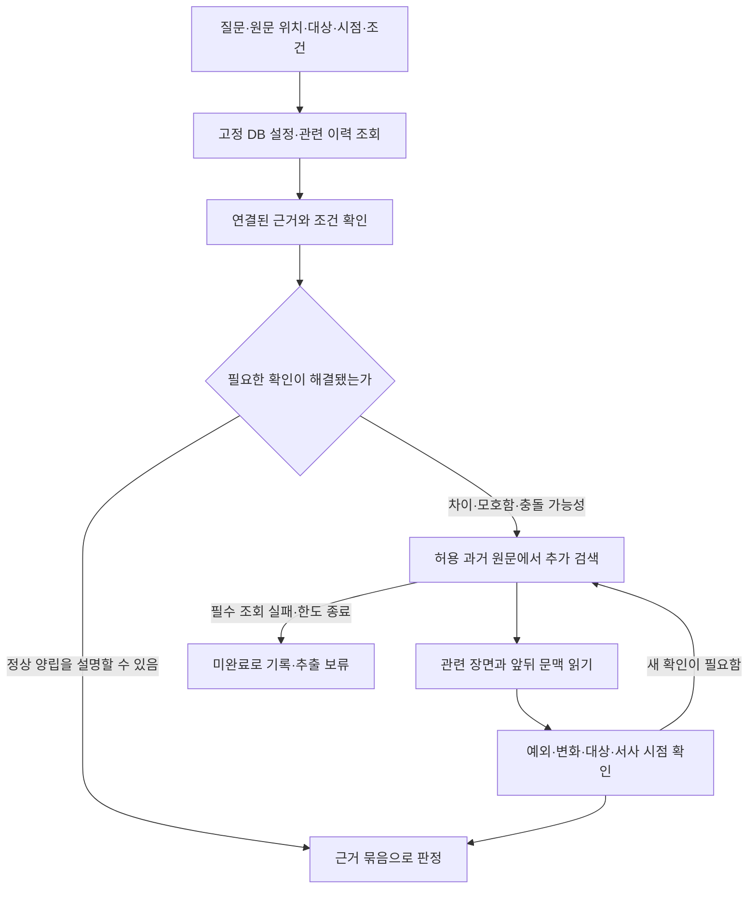

# 설정 충돌 검사 — DB·과거 원문 조회 흐름

2026-10-28 · GH300 · 조회 정책 일부 확정, 후속 구현 제안

관련 문서: [제품 기획](gh-300-error-report-product-brief.md), [질문 생성·누락 보완](gh-300-validation-question-planning.md), [고정 검사 기준](gh-300-validation-baseline-design.md), [구현 계획](gh-300-error-report-implementation-plan.md).

## 1. 합의와 제안의 경계

- 사용자 확정: **DB와 확보한 근거로 대상·시점·조건까지 확인됐으면 추가 원문 검색을 생략할 수 있다.** 모든 질문에서 원문/벡터 검색을 의무 실행하지 않는다. 값이 같다는 사실만으로 질문을 완료하지 않는다. 값 차이, 시점·변화·예외의 불명확함이 있으면 원문을 추가로 확인한다. DB에 반영되지 않은 변화가 누락될 여지는 남으며 평가해야 한다.
- 사용자 확정: AI 결과는 **설정 충돌 / 충돌 의심 / 추가 확인 필요**로 구분한다. 직접 비양립 근거, 변화·예외 미확인, 대상·시점·해석 모호함이 각 분류의 기준이다. 세 분류 모두 시스템 판단이며 작가가 `충돌 아님`으로 정정할 수 있다. 영향 등급 `심각 / 주의 / 참고`와 작가 판단은 별도로 유지한다.
- 사용자 확정: 질문별 확인 완료는 **비교 근거·문맥 확인 / 필요한 변화·예외 확인 / 새 필수 단서 미처리 없음 / 필수 검색·읽기 정상 종료**의 네 기준을 따른다. 검색 횟수·시간 한도는 실제 원고 평가로 정한다. 질문의 처리 완료와 전체 검사·작가 검토 완료는 별개다.
- 사용자 확정: DB와 과거 원문의 불일치를 추가 확인해도 비교 기준이 불확실하면 `추가 확인 필요 — 비교 기준과 원문이 다름`으로 양쪽을 보여준다. 작가의 명시적인 직접 정정은 대상·항목·적용 시점이 분명한 범위에서 기준으로 우선 사용하며, 그 범위가 불명확하면 추가 확인을 요청한다. 일반 확정 상태만으로 직접 정정을 추정하지 않는다.
- 기존 합의: 최신 단일 신규 회차와 과거 확정 설정·앞선 원문을 비교한다. 같은 신규 회차 내부 모순은 첫 버전에서 제외하되 현재 원고 문맥은 대상·시점·회상·조건 해석에 사용한다.
- 기존 합의: 설정 검사와 오탈자 검사 모두 정상 완료가 필요하다. 설정 결과 세 분류의 합계와 오탈자 제안이 모두 0건이면 자동 추출하고, 항목이 있었다면 설정 전부 `충돌 아님`·오탈자 확인 완료·수정 대기 없음 뒤 명시적 완료로 진행한다. 미검토/수정 대기가 있으면 추출을 보류하며, 오탈자는 의도한 표현을 유지할 수 있다. 검사 실패·일부 중단은 재시도하며 미완료 상태로 추출을 허용하지 않는다. 오탈자 행동은 항목별 수정 필요/원문 유지/검토 필요로 되돌리기로 확정했다. 원문 유지만 현재 항목을 해소하고 수정 필요는 파일 교체·새 검사 전까지 보류한다. 새 원고 판단 승계·작품 예외 사전 등록·원문 자동 편집·수정 완료 체크만의 해제는 없다. enum/HTTP 필드·화면 배치는 후속 제안이다.
- 오탈자 범위 합의: 문자 오타·맞춤법·띄어쓰기·분명한 문자/조사의 중복·누락을 검사한다. 허용 표기, 의도적 반복·말더듬·방언, 문체 통일·윤문, 추측에 의한 단어·문장 보충은 제외한다. 고유명사 표기 차이 자체는 첫 버전에서 제외하며 이름 주변의 일반 오타는 검사한다. 새 이름·별칭의 불확실성을 설정 검사로 자동 이관하지 않는다.
- 아래의 조회 단계·검색어 구성·근거 묶음·평가 사례는 구현 제안이다. #303의 접수·기준 확보·추출 차단 코드가 실제 검색/검사까지 구현한 것은 아니다. 이번 변경은 문서이며 코드·실제 모델 평가·Pencil 변경을 포함하지 않는다.

**영향 등급 합의:** 심각은 설정 차이가 현재 장면의 행동·사건 성립 조건에 직접 영향을 주는 경우다. 중요한 인물·설정이라는 이유만으로 올리지 않는다. 주의는 사건 성립에 직접 영향 없이 인물의 소속·관계·배경 이해를 바꾸는 차이, 참고는 현재 장면의 부수적 묘사 차이다. 소품 색 차이도 통과·탈출의 필수 조건이면 그 영향 근거로 심각할 수 있다. 같은 원인·같은 영향의 반복 횟수만으로 등급을 올리지 않고 횟수와 모든 위치를 표시한다. 다른 위치에서 실제 사건 영향이 커지면 해당 근거로 재판단한다. AI 결과 세 유형과 영향 등급은 독립이다.

## 2. 질문을 조회 계획으로 바꾸기

조회 요청/결과의 실제 실행 상태, 근거 묶음과 판정의 후속 확인 응답은 [단계별 입출력 설계안](gh-300-validation-stage-contracts.md#5-조회-요청-llm이-정하는-것과-코드가-정하는-것)에 구체화했다. 검색 결과 0개·필수 읽기 실패·순위 제한을 구별하며 구체적 필드명은 제안이다.

검사용 질문은 대상 원문 위치, 확인한 대상 또는 식별 후보, 비교할 속성/규칙, 서사 시점, 적용 조건, 확인 목적을 유지한다. 질문 문장 하나를 그대로 벡터 검색어로 보내는 것으로 전체 조회를 대체하지 않는다.

예시 원고: “민수는 양손으로 검을 쥐었다.”

| 확인 목적 | 첫 조회 | 필요한 경우 이어서 확인 |
| --- | --- | --- |
| 같은 민수인가 | 고정 기준의 이름·별칭·대상 정보 | 동명이인/대명사/장면 연결을 현재 원문에서 확인 |
| 이 장면에서 양손 사용이 가능한가 | 민수의 신체 상태와 관련 변화 이력 | 손 상실·회복·의수·보조 수단의 과거 원문 |
| 현재 장면인가 회상인가 | 현재 원문 앞뒤 문맥과 확보한 서사 시점 | 과거 사건 시점과의 관계를 확인할 원문 |

대상이 불분명하면 임의 ID로 확정하지 않는다. 가능한 대상을 구분해 읽고, 필요한 자료를 읽은 뒤에도 해석이 불분명하면 사유 있는 작가 검토 항목으로 남긴다. 검사용 기록을 신규 설정 후보로 저장하지 않는다.

## 3. 조회 흐름 제안

### 3.1 DB에서 비교할 값과 맥락을 찾는다

- 검사 시작 때 고정한 작품·기준 버전 안에서 대상·속성/규칙·값·관련 이력·출처를 읽는다. 현재 live 설정을 검사 기준 대신 읽지 않는다.
- 조건·예외·시간 정보도 함께 읽는다. 금지 규칙만 가져오고 허용 조건을 빼지 않는다.
- 회차 번호는 자료의 등록 순서이며 서사 시점과 같다고 가정하지 않는다. 현재값이나 출처 회차 필터만으로 과거 장면의 상태를 복원했다고 표시하지 않는다.
- 직접 입력/수동 정정된 확정 설정도 유효한 기준 유형이다. 연결 원문이 원래 없는 항목을 원문 읽기 실패와 동일하게 처리하지 않는다.

### 3.2 연결 근거는 직접 확인하고, 질문 해결 여부를 판단한다

- DB 항목에 연결된 원문이 판단에 필요하면 해당 출처·버전을 직접 읽는다. 이미 찾을 위치가 있는 근거를 매번 의미 검색으로 재발견하지 않는다.
- 동일 대상·시점·조건에서 원고와 설정이 양립하고 필수 확인이 끝났다면 추가 검색을 생략한다. 검색 결과가 있다는 사실이나 단순 문자열 일치만으로 종료하지 않는다.
- DB 내용이 없으면 그 사실만으로 정상/충돌/애매함을 결정하지 않는다. 실제 새 내용인지, 다른 표기인지, 원문에만 있는 과거 사실이 필요한지에 따라 추가 확인한다.

### 3.3 부족한 근거와 정상적인 설명을 과거 원문에서 찾는다

- 대상 이름·별칭과 확인할 사실을 이용한 키워드 검색으로 시작하고, 표현 차이·질문 미해결에 따라 의미 검색을 추가하는 안이다. 검색 순서/개수는 조정 가능한 구현값이다.
- 예: 부상 근거 검색은 “민수 왼손 상실”, 정상 변화 근거 검색은 “민수 손 회복”, “민수 의수”처럼 확인 목적을 나눈다. 실제 검색어는 원고와 확보한 정보에 맞춰 만들며 이 예시 목록을 고정된 완전 사전으로 사용하지 않는다.
- `설정 충돌` 또는 `충돌 의심`을 게시하기 전에는 해당 충돌을 설명할 수 있는 변화·예외·다른 대상·회상 등을 확인한다. 상실/금지 근거만 모으는 조회로 끝내지 않는다. 관련 확인 후에도 필수 대상·시점·조건 자체가 모호하면 `추가 확인 필요`로 구분한다.
- DB에 연결된 회차만 검색하지 않는다. 설정으로 추출되지 않은 회복 장면도 찾을 수 있도록 **고정 기준이 허용한 모든 앞선 원문**을 검색 후보로 둔다. 발행 회차가 뒤라는 이유만으로 서사적으로 나중 사건이라고 보거나 검색 하한을 고정하지 않는다.
- ‘모든 앞선 원문’은 RAG 검색의 허용 범위다. 과거 원고 전체를 매 질문마다 LLM에 넣어 풀스캔하는 뜻이 아니다. 연결 위치는 직접 읽고, 키워드/의미 검색에서 찾은 구간과 필요한 앞뒤 문맥을 LLM에 전달한다. 검색 후보 전체와 실제 읽은 범위를 구분해 기록한다.
- 허용 출처 조건은 검색 순위/개수 제한과 주변 문맥 확장 이전에 적용한다. 다른 작품, 대상 신규 회차, 후속 회차를 과거 근거에 섞지 않는다. 대상 신규 원문을 문맥으로 읽는 동작과 과거 근거 조회는 구분한다.
- 검색 hit만 판단에 넣지 않고 필요한 앞뒤 문맥을 읽는다. 실제 발생 서술인지, 인물의 거짓말/추측/가정인지, 같은 대상과 시점인지 확인한다.
- 벡터 색인이 준비되지 않았어도 직접·키워드 근거로 필요한 확인이 해결됐다면 그 이유만으로 실패시키지 않는다. 필요한 확인을 하지 못했다면 정상으로 종결하지 않는다.

### 3.4 모은 근거와 해결하지 못한 부분을 판정 단계에 전달한다

근거 묶음은 질문 ID, 대상 신규 원문과 위치, 비교한 DB 값/조건/이력, 각 과거 원문의 출처·버전·정확한 인용·위치, 정상 변화를 지지하는 근거, 남은 해석 문제, 필수 조회의 완료/실패 상태를 담는다. 근거의 실제 위치·허용 출처·현재 유효성은 서버가 검증한다.

**합의한 기준 불일치 처리:** DB와 원문이 달라 보이면 동일 대상·사실·시점인지, 발언/가정인지, 작가의 직접 정정인지부터 확인한다. 다음 두 정책을 적용한다.

- **비교 기준이 불확실한 경우:** 추가 확인을 마쳐도 DB와 과거 원문의 불일치가 남고 어느 기준을 적용할지 확실하지 않다면 `추가 확인 필요 — 비교 기준과 원문이 다름`으로 양쪽 근거를 보여준다. 예를 들어 DB의 ‘왼손 상실’과 근거 원문의 ‘왼손 장갑 상실’ 사이 불일치가 남는 경우다. 이 불확실한 기준만으로 이번 원고를 `설정 충돌`로 지적하거나 DB를 자동 수정하지 않는다.
- **작가가 의도적으로 직접 정정한 경우:** 정정 이력의 대상·항목·적용 시점이 분명하면 그 범위에서 정정 내용을 기준으로 우선 사용한다. 예를 들어 작가가 해당 시점의 눈 색을 파란색으로 정정했다면, 과거 원문에 초록색 표현이 남았다는 이유만으로 같은 기준 불일치를 되풀이해 지적하지 않는다. 적용 범위가 불분명하면 `추가 확인 필요`로 표시한다. 일반적인 승인/확정 플래그나 자동 반영을 명시적 직접 정정으로 해석하지 않는다.

서로 다른 서사 시점의 정상 변화는 단순 값 차이만으로 기준 불일치가 아니다. 원래 원문 출처가 없는 직접 입력 설정도 정상적인 기준 유형이다. 필요한 자료를 읽지 못한 상태는 위 정책으로 종료하지 않고 실행 미완료로 남긴다. 원문·확정 DB를 검사 과정에서 자동 덮어쓰지 않으며, 작가는 기존 설정 정정·원고 교체 동선을 사용한다. 이것이 모든 출처 유형에 대한 포괄적인 우선순위표를 확정한 것은 아니다.

## 4. 예시 결과

| 확보한 정보 | 처리 예시 |
| --- | --- |
| 기존 눈 색과 이번 묘사가 같고 대상·시점·조건이 해결됨 | 추가 원문 검색 없이 해당 질문 완료 가능 — 사용자 승인 정책 |
| 같은 인물·같은 달력 기준의 확정 생일이 3월 2일인데 이번 원고는 4월 8일이라고 사실로 서술. 관련 대상·조건·발언 방식에 모호함 없음 | `설정 충돌`. 양립 불가능한 두 근거와 같은 사실을 비교한다는 설명을 표시. 작가 판단으로 정정 가능 |
| 손 상실 근거 + 현재 장면 이전 의수 획득/사용 근거가 확인됨 | 정상 설명이 가능한지 판정. 의수 존재만으로 모든 사용 조건을 충족했다고 가정하지 않음 |
| 손 상실 근거 + 필요한 변화/예외 검색을 마쳤지만 해소 근거를 찾지 못함 | `충돌 의심`. 양쪽 근거와 ‘확인한 범위에서 해소 설명을 찾지 못함’을 제시. 회복이 절대 없다고 단정하지 않음 |
| 필요한 원문을 읽었지만 회상/대상의 해석이 불분명함 | `추가 확인 필요`. 무엇이 모호하고 어떤 판단에 영향을 주는지 설명 |
| DB의 손 상실과 연결 원문의 장갑 상실 사이 불일치를 확인했으나 기준을 확실히 정할 수 없음 | `추가 확인 필요 — 비교 기준과 원문이 다름`. 양쪽 근거를 표시하고 이 기준만으로 신규 원고를 충돌로 단정하지 않음 |
| 작가가 눈 색을 직접 정정했고 해당 대상·항목·장면에 적용되는 범위가 명확함 | 정정 내용을 비교 기준으로 사용. 과거 원문의 이전 값이 남았다는 이유만으로 기준 불일치를 반복 표시하지 않음 |
| 필요한 검색·원문 읽기가 실패하거나 한도 때문에 남음 | 실행 미완료. 정상 0건이나 `추가 확인 필요`로 바꾸지 않음 |
| 명확히 새 인물이며 과거 자료 조회는 정상, 적용 규칙과의 의심도 없음 | DB에 없는 사실만으로 오류/필수 작가 확인을 만들지 않음 |

세 분류는 화면에서 보이는 결과 유형이며 정상 종료와 실행 미완료는 그 밖의 처리 상태다. 의미가 모호하면 강한 분류로 올리지 않고, 검색 횟수나 해소 근거 미발견만으로 `충돌 의심`을 `설정 충돌`로 승격하지 않는다. 영향 등급은 별도로 판단한다. 작가 판단으로 AI의 원래 분류·사유를 덮어쓰지 않는다.

설정 검사 완료는 정해진 절차와 필수 조회를 마쳤다는 의미다. 검색 결과 0개는 사실의 부재를 입증하지 않으며, 의미상 누락이 없다는 보증도 아니다. 이 한계는 질문 생성·검색·판정 평가에서 따로 확인한다.

### 4.1 합의한 질문별 확인 완료 기준

사용자는 다음 네 기준을 승인했다. 질문마다 확인 결과와 판정에 영향을 주는 미해결 사항을 구분해 기록한다. 검색 횟수·시간 한도는 실제 원고로 평가하면서 정하며, 아래 조건을 임의 호출 횟수나 점수로 대체하지 않는다. 구체적인 기록 스키마·한도값은 후속 구현/평가 대상이다. 네 역할 모두 사용자 지정 6.1 Terra를 사용하며 질문 생성 medium·누락 보완 high·근거 판정 medium·오탈자 low(사용자 표현 lite를 낮은 추론으로 해석)로 기록한다. DB·키워드 조회는 코드가 수행하고 의미 검색의 임베딩은 이 판정 모델 선택과 구분한다.

1. **비교 근거와 문맥을 확인했다:** 직접 입력 설정을 포함한 유효한 기준과 이번 원문을 확보하고 대상·사실·서사 시점·조건을 살펴본다. 필요한 인용·위치·출처 버전도 확인한다. 필요한 읽기를 마쳐도 해석이 모호하다면 무엇이 남았고 왜 비교를 막는지 설명해 `추가 확인 필요`로 처리할 수 있다. 판정에 영향을 주지 않는 주변 정보까지 모두 해소할 필요는 없으며 근거가 없는 값 차이를 지어내지 않는다.
2. **필요한 변화·예외를 확인했다:** 이 작품의 근거에 맞는 확인을 수행한다. 손 사례의 회복·의수 검색, 현재 원고의 회상 확인 등이 해당한다. 이미 충분한 근거가 있으면 추가 검색을 생략한다. 가능한 모든 가상 예외의 부재를 증명할 의무로 만들지 않는다. 정상 수행한 검색의 미발견은 `충돌 의심`의 사유로 표시할 수 있으나 직접 모순의 증명으로 사용하지 않는다.
3. **판정을 바꿀 새 단서를 미처리로 남기지 않았다:** ‘치료받으러 갔다’처럼 회복 여부에 영향을 주는 단서를 찾으면 필요한 후속 확인을 이어간다. 읽을 자료가 있는데 아직 읽지 못했거나 필요한 검색이 남은 상태를 의미 모호함으로 종료하지 않는다. 관련 조회를 끝냈는데 원문 자체가 치료 결과를 밝히지 않았다면 그 불확실성을 근거와 함께 분류한다.
4. **필수 검색·원문 읽기가 정상적으로 끝났다:** 필요한 검색/읽기 실패·응답 잘림·실행 한도로 확인이 남으면 미완료다. 실패 없이 절차가 끝났다면 정상 종료 또는 세 결과 중 하나로 처리할 수 있다. 결과 분류 완료와 작가 검토 완료는 별개다.

한 질문이 이 네 기준을 충족해도 전체 질문·원문 처리 범위에 미완료가 남으면 전체 검사는 완료되지 않는다. `추가 확인 필요`는 필요한 자료를 읽고도 의미가 불분명한 경우이며, 필요한 자료를 읽지 못한 실행 미완료와 구분한다.

## 5. 검색 종료와 재사용

- 질문별로 무엇을 확인해야 하는지와 해결 여부를 기록한다. 정해진 호출 수를 채웠다고 충분한 근거를 확보한 것으로 처리하지 않는다.
- 새 근거가 새 조건을 만들면 후속 질문을 연결하고 영향을 받는 기존 질문을 다시 대기로 둔다. 동일 검색 반복만으로 진척을 표시하지 않는다.
- 필수 확인을 끝내기 전에 한도에 도달하면 미완료로 남긴다. 이미 끝난 항목은 보존한다. 구체적인 호출/시간/토큰 한도와 재시도 횟수는 평가 후 정한다.
- 같은 기준/원문 버전의 설정·이력·근거 조회 결과는 여러 질문에서 재사용할 수 있다. 질문별 시점·조건·필수 확인은 각각 유지한다. 넓은 검색 하나의 상위 결과를 여러 질문에 나눠 주는 것만으로 각 질문의 검색 완료를 인정하지 않는다.
- 원문 변경·출처 파기·기준 변경 시 관련 캐시와 옛 근거의 게시/검토 허가를 무효화한다. 원고 수정 후 옛 검토 허가로 설정 추출을 시작하지 않는다.

## 6. 기존 코드 재사용과 추가 작업

아래는 2026-10-28 기존 AI 코드의 읽기 전용 확인 결과다. 기존 기능이 검수 전용 연결을 이미 제공한다는 뜻은 아니다.

| 기존 구성 | 재사용할 역할 | 추가/주의 |
| --- | --- | --- |
| `app/schemas/setting_tools.py`의 FIND/CURRENT/HISTORY/EVIDENCE | 대상·설정·이력·직접 근거 조회의 개념과 계약 | CURRENT/FIND는 고정 과거 기준 조회가 아님. baseline 전용 조회 연결 필요 |
| `app/retrieval/search_repository.py`의 direct/keyword/vector | 알고 있는 청크, 키워드, 의미 근거 접근 | direct는 청크 ID 조회이며 정확 구절 검색 API가 아님. 허용 source manifest 필터 추가 필요 |
| 같은 파일의 neighbors | 찾은 장면 전후 문맥 | 기존 인접 청크 조회 범위는 제한됨. 필요한 추가 원문 읽기 계약은 후속 구현 |
| `app/retrieval/search.py` | 색인 준비 상태·검색 호출; 사용량을 계량하는 embedding client는 호출자가 주입 | 검수 기준 버전의 조회 scope 주입, 미준비와 필수 조회 실패 구분. 검색 모듈 자체가 사용량 예약/정산을 맡는다고 가정하지 않음 |
| `app/chatbot/hybrid.py`, `app/chatbot/client.py` | 출처/인용/Unicode 위치/receipt 검증 방식 | 기존 receipt는 챗봇 실행 전용. 검수 전용 출처 검증 연결 필요 |

조회 중 설정 추출 Job·후보·현재값을 만들지 않는다. 신규 원고/미분석 설정집 읽기는 후속 `ValidationSourceReader` 등 검수 전용 경로로 연결하며, 기존 추출 Worker를 검사 준비에 호출하지 않는다.

## 7. 구현 시 검증할 사례

- DB로 해결된 질문은 불필요한 추가 원문/벡터 조회를 생략하지만, 값만 같은 다른 대상·시점은 통과시키지 않음.
- 손 상실의 직접 근거를 찾은 뒤 DB에 미반영된 회복/의수 원문을 허용 과거 범위에서 발견함.
- 늦게 발행된 회상·대사 속 거짓말·예외 조건을 현재 사실로 잘못 적용하지 않음.
- 직접 입력 설정의 원문 부재와 실제 원문 읽기 실패를 구분함.
- DB와 원문 불일치에서 작가 직접 정정·시점·대상을 확인하고, 불확실한 기준은 양쪽 근거와 추가 확인 필요로 표시하며 확정값을 자동 수정하지 않음.
- 명시적 직접 정정은 대상·항목·적용 시점 범위에서 우선하며 범위 밖 또는 범위 불명확에 확대하지 않음. 자동 반영/일반 확정 플래그와 구별하고 직접 입력 설정의 원문 부재를 실패로 취급하지 않음.
- 직접 모순은 `설정 충돌`, 변화·예외 검색 미발견은 `충돌 의심`, 필수 대상/시점/해석 모호함은 `추가 확인 필요`로 구분함. 검색 횟수/미발견만으로 승격하지 않으며 영향 등급·작가 판단과 독립임.
- 정상 0건, 세 표시 결과, 필요한 조회의 실패/예산 종료를 구분함. 새로운 필수 단서가 있으면 후속 확인하고 미실행을 모호함으로 숨기지 않음.
- source 경계/버전/위치 검증, 같은 버전 조회 재사용, 변경·파기 뒤 늦은 결과 거절.
- 두 검사 정상 완료 전/설정 세 결과 중 미검토 항목 존재/오탈자 작가 검토 전 추출 0, 같은 입력 성공 항목 보존 재시도, 최종 원고 일치. 자동 경로는 세 결과 합계 0건과 오탈자 제안 0건을 함께 검증.

이 항목은 테스트 계획이며 실행 결과가 아니다. 모델·검색량·시간/비용 상한·실제 누락률은 아직 측정하지 않았다.
