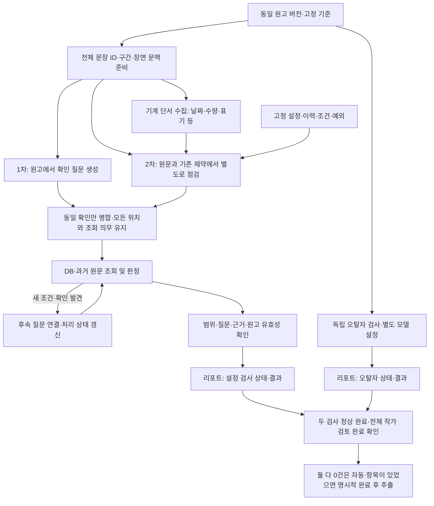

# 설정 충돌 검사 — 질문 생성 기준과 누락 보완 설계

2026-10-28 · GH300 · 설계 제안, 검사 코드 미구현

관련 문서: [제품 기획](gh-300-error-report-product-brief.md), [전체 구현 계획](gh-300-error-report-implementation-plan.md), [고정 검사 기준](gh-300-validation-baseline-design.md), [DB·원문 근거 조회 설계](gh-300-validation-evidence-retrieval.md), [오탈자 범위·검토 정책](gh-300-typo-review-policy.md).

## 1. 확정 사항과 이번 제안의 경계

- 신규 단일 최신 회차의 원고를 검사하고 작가 검토를 끝낸 뒤에만 설정 추출·비교·확정한다. 검사용 질문·문장 연결 기록은 확정용 설정 후보가 아니다.
- 오탈자는 같은 원고 버전에서 설정 충돌 검사와 **독립적으로 병렬 실행**하고 리포트에 함께 표시한다. 설정 질문이 0개여도 원문 전체의 오탈자 검사를 실행한다.
- 사용자는 네 검사 역할 모두 **GPT‑6.1 Terra**로 시작하도록 선택했다. 공식 모델 ID는 `gpt-6.1-terra`이며 추론 강도는 **질문 생성 `medium` · 독립적인 누락 보완 `high` · 근거 판정 `medium` · 오탈자 `low`**로 기록한다. 오탈자의 사용자 표현 `lite`는 가벼운 추론이라는 뜻으로 해석해 지원 값 `low`로 대응했다. [OpenAI 모델 문서](https://developers.openai.com/api/docs/models/gpt-6.1-terra)에서 모델 ID와 `low/medium/high` 지원을 확인했다. 모델 종류는 검사 단계에서 하나이며, 역할별 추론 강도·프롬프트·실행 상태는 구분한다. 호출 횟수는 원고 구간·질문 묶음·후속 확인·재시도에 따라 달라지며 아직 확정하지 않았다. 임베딩과 검토 후 기존 설정 추출 모델은 이번 네 역할의 선택 범위 밖이다. 계정 사용 가능 여부·서비스 통합·실제 원고 품질은 미검증이며 평가를 초기 선택의 선행 조건으로 두지 않는다.
- 질문 생성·독립적인 누락 보완·근거 기반 판정과 오탈자는 같은 Terra를 역할별 추론 강도로 호출한다. 역할은 네 개, 검사 모델 종류는 하나이며 한 회차의 호출 횟수는 고정하지 않았다. 세부 구간 분할·검색어·독립 점검 방식은 아래 구현 제안이다.
- 아래 질문 기준·검사 관점·기록 형식·테스트는 이번에 구체화한 구현 제안이다. 모두 이미 사용자 승인된 세부 계약으로 표시하지 않는다.
- **동일 신규 회차 내부의 설정 모순 검사는 첫 버전에서 제외한다.** 사용자가 제외로 확정했다. 과거 확정 설정·앞선 원문과의 비교 범위를 유지하며 101화 앞뒤만의 모순을 별도 finding으로 만들지 않는다. 현재 원고의 앞뒤 문맥을 읽어 회상·대상·조건·예외를 해석하는 일은 기존 설정과 비교할 때 여전히 필요하다.
- 사용자 확정: AI 결과는 **설정 충돌 / 충돌 의심 / 추가 확인 필요**로 구분한다. 동일 대상·시점·조건의 직접 비양립 근거, 변화·예외 미확인, 대상·시점·해석 모호함을 구별한다. 영향 등급 `심각 / 주의 / 참고`와 작가 판단은 각각 별도다. 세 결과 모두 작가가 `충돌 아님`으로 정정할 수 있다.
- 두 검사가 모두 정상 완료하고 설정 결과 세 분류의 합계와 오탈자 제안이 모두 0건이면 자동 추출한다. 항목이 있었다면 설정 전 항목 `NOT_CONFLICT`·오탈자 작가 확인 완료·수정 대기 없음 뒤 명시적 검토 완료로 진행한다. 의도한 표현은 유지할 수 있다. 오탈자 실패/일부 중단/재시도 실패는 추출 보류이며 검사 생략 우회는 제공하지 않는다.
- DB와 이미 확보한 근거로 동일 대상·시점·조건 및 필요한 확인이 충분하면 추가 검색을 생략한다. 값이 같다는 이유만으로 종료하지 않으며 값 차이·변화·예외가 불명확하면 과거 원문을 조회한다. 조회 순서·스키마 등 나머지 세부는 구현 제안이다.
- 질문별 확인 완료의 네 기준(비교 근거·문맥, 필요한 변화·예외, 새 필수 단서 미처리 없음, 필수 검색·읽기 정상 종료)은 합의했다. [조회 설계](gh-300-validation-evidence-retrieval.md)의 기준을 따르며 검색 횟수·시간 한도는 실제 원고로 평가한다. 질문별 종료와 전체 검사·작가 검토 완료는 구분한다.
- 오탈자 검사 범위·항목별 판단·파일 교체 후 재검사 흐름은 합의했다. 화면 배치·API enum/HTTP 필드는 제안이고 오탈자 초기 모델은 사용자 지정 **6.1 Terra**, 추론은 **low**(사용자 표현 lite를 낮은 추론으로 해석)다. 품질 수치·처리 시간 한도는 아직 정하지 않았다.
- #303의 접수·기준·추출 차단 코드는 변경하지 않는다. 이 문서는 후속 Task 3~8 설계이며 실제 LLM 실행·품질 평가·UI 구현 결과가 아니다.

**영향 등급 합의:** 심각은 설정 차이가 현재 장면의 행동·사건 성립 조건에 직접 영향을 주는 경우다. 중요한 인물·설정이라는 이유만으로 올리지 않는다. 주의는 사건 성립에 직접 영향 없이 인물의 소속·관계·배경 이해를 바꾸는 차이, 참고는 현재 장면의 부수적 묘사 차이다. 소품 색 차이도 통과·탈출의 필수 조건이면 그 영향 근거로 심각할 수 있다. 같은 원인·같은 영향의 반복 횟수만으로 등급을 올리지 않고 횟수와 모든 위치를 표시한다. 다른 위치에서 실제 사건 영향이 커지면 해당 근거로 재판단한다. AI 결과 세 유형과 영향 등급은 독립이다.

## 2. 질문을 만드는 기준

질문은 **원고에 실제로 적힌 내용과 기존 설정·원문을 비교하기 위해 필요한 확인**이어야 한다. 한 문장에서 여러 질문이 나올 수 있고, 여러 문장을 묶어 하나의 질문을 만들 수도 있다. 질문 문구보다 원문 위치·대상·속성·시점/조건·조회 목적이 중요하다.

### 생성 조건

| 조건 | 원고 예시 | 생성할 확인 |
| --- | --- | --- |
| 명시한 속성·상태·사실 | “민수의 눈은 푸른색이었다.” | 같은 인물의 기존 눈 색과 일치하는가? 변화·변장·시점 설명이 있는가? |
| 구체적인 행동의 전제 | “민수는 양손으로 검을 쥐었다.” | 이 시점에 양손을 사용할 수 있는가? 부상·회복·의수 등 관련 근거가 있는가? |
| 상태 변화·금지·사용 조건 | “마나를 전혀 쓰지 않고 순간이동했다.” | 이 능력의 사용 조건·적용 대상·예외와 양립하는가? |
| 대상·시간·조건을 연결해야 비교 가능 | “그는 그 검을 다시 들었다.” | 누구와 어떤 검인가? ‘다시’가 가리키는 사건과 현재 시점은 무엇인가? |

행동의 전제는 질문의 출발점이지 오류 증거가 아니다. ‘걷는다’는 모든 문장에 호흡·중력·생물학 질문을 무한 생성하지 않는다. 명시된 사실, 구체적인 수행 방식, 확인된 관련 제약을 우선한다. 평범한 행동도 기존 설정에 명확한 제한이 있으면 2차 검사에서 확인 대상으로 추가한다.

### 설정 범주

| 범주 | 확인 대상 | 경계 |
| --- | --- | --- |
| 인물 정체·상태 | 같은 인물 여부, 외형, 나이, 생사·부상 등 | 별칭·대명사·회상·변화 조건을 확인한다. 인물의 일반적인 감정·행동 동기 평가는 제외한다. |
| 능력·자격·사용 조건 | 사용할 수 있는 능력, 자원·도구·자격·제약 | 판타지 능력을 현실 상식만으로 금지하지 않고 작품 근거를 찾는다. |
| 물건·장소의 상태와 접근 | 동일 물건, 파괴·분실·봉인, 소유·사용·출입 제약 | 소유자가 다르거나 이동 설명이 없다는 사실만으로 불가능하다고 판정하지 않는다. |
| 관계·소속·역할 | 가족·계약·소속·직위 등 명시된 관계 | 대립·협력·감정 변화 자체를 설정 충돌로 확대하지 않는다. |
| 시간·수량·순서 | 나이·날짜·기간·명시된 수량과 사건 순서 | 같은 집단·사건·서사 시점을 확인한 뒤 비교한다. 현실 달력/산술의 적용 전제도 확인한다. |
| 세계관 규칙과 예외 | 가능한 행위, 종족·지역·도구·상황별 제한 | 조건과 예외를 떼어 낸 절대 규칙으로 바꾸지 않는다. |

서술·대사·독백·묘사는 모두 읽는다. ‘대사’나 ‘풍경 묘사’라는 이유로 문단 전체를 제외하지 않는다. 다만 발언·추측·거짓말·비유를 곧바로 세계의 사실로 확정하지 않고 서술 방식도 기록한다.

새 인물·새 설정이 DB에 없다는 사실만으로 오류/작가 확인 항목을 만들지 않는다. 비교할 기존 규칙과 실제 충돌할 가능성이 있으면 그 규칙을 확인한다. 질문 생성 단계에서는 낮은 확신만으로 필요한 확인을 버리지 않되, 내부 질문을 그대로 사용자 오류 항목으로 게시하지 않는다.

## 3. 검사용 질문 기록

필드의 생성 주체, 독립적인 누락 보완 결과, 병합·재시도 계약은 [단계별 입출력 설계안](gh-300-validation-stage-contracts.md#3-질문-생성이-받는-것과-반환하는-것)을 함께 따른다. 구체적 이름은 구현 제안이다.

다음은 후속 계약 제안이다. 이름·스키마는 구현 시 기존 규약에 맞추되 의미를 보존한다.

| 필드 | 내용 |
| --- | --- |
| `questionId`, `origin` | 질문 ID와 생성 경로: 원고 계획 / 단서 보완 / 기준 역방향 / 근거 후속 |
| `sourceFingerprint`, `baselineId/revision` | 검사 대상 원고와 고정 비교 기준 |
| `targetSpans` | 원고의 문장 ID·정확한 위치·인용. 원문 위치는 서버가 검증 |
| `subjectMentions`, `resolvedSubjectRefs` | 원문 표기와 확인된 대상 ID. 미해결이면 추측 ID를 만들지 않음 |
| `category`, `propertyOrRule` | 무엇을 비교할 것인지: 예를 들어 신체 상태 / 양손 사용 가능 여부 |
| `timeContext`, `conditions`, `assertionMode` | 현재/회상/미정, 적용 조건, 실제 서술/발언/가정 등 |
| `checkIntent`, `lookupIntents` | 답해야 할 구체적인 확인과 DB/원문에서 찾아야 할 정보 |
| `reason`, `parentQuestionId` | 왜 필요한지, 근거 조회 중 추가된 질문의 연결 |

예: “양손으로 검을 쥐었다”에 대해 대상 민수, 신체 상태, 현재 장면의 양손 사용 가능 여부, 손 부상·회복·보조 수단과 원문 시점 확인을 기록한다. “민수에게 오류가 있나?” 같은 범용 문장만 생성한 것은 필요한 질문을 만든 것으로 인정하지 않는다.

## 4. 누락을 보완하는 흐름

### 4.1 원고 처리 누락은 서버가 확인한다

- 서버가 원문 전체에 안정적인 문장 ID와 처리 구간을 부여한다. 핵심 처리 구간은 전체 원문을 덮고, 앞뒤 문맥은 겹쳐 제공한다. 문장 ID는 처리 기록용이며 실제 판단 단위는 장면·연속 문장일 수 있다.
- 원문을 요약한 내용만으로 질문을 만들지 않는다. 원문과 필요한 앞뒤 문맥을 제공하고 장면 경계를 넘는 대상·시점 연결도 유지한다.
- 각 핵심 구간에 `PLANNED`(질문 있음), `NO_CHECK`(해당 기준의 확인 없음과 간단한 사유), `UNPROCESSED`(실패/잘림/미실행)를 남긴다. `NO_CHECK`는 모델의 판단이며 의미상 완전성의 증명이 아니다. 2차 점검 대상에서 빼지 않는다.
- 응답 형식 오류·빠진 구간·출력 잘림은 명시적으로 재시도하고, 해결되지 않으면 부분 완료다. 질문 0개를 응답 실패의 기본값으로 사용하지 않는다.
- 질문 수/문맥 길이/예산 한도를 넘으면 분할 처리하거나 남은 범위를 기록한다. 상위 N개만 처리한 뒤 전체 완료로 표시하지 않는다.

### 4.2 기계 단서를 독립적으로 모은다

날짜·요일·수량과 단위, 반복된 고유 표기 등 규칙으로 찾을 수 있는 단서는 1차 LLM 출력과 별도로 모은다. 2차 점검은 이 단서가 적절한 질문에 연결됐는지 또는 비교가 불필요한지를 확인한다. 한글 수사·표기 변형도 평가 사례에 포함한다. 이 단서는 기존 설정·앞선 원문과 비교할 질문을 보완하기 위한 것이며, 같은 회차 안의 날짜·수량 모순을 별도 오류로 검출하는 범위로 확대하지 않는다.

단서가 있다는 이유로 무조건 질문이나 finding을 만들지 않는다. 같은 수량이라도 다른 집단일 수 있고, 유사한 이름도 다른 인물일 수 있다. 규칙은 원문 위치를 찾는 보조 수단이며 한국어의 모든 의미를 포착한다고 주장하지 않는다.

### 4.3 원문과 기존 설정에서 다시 시작한다

2차 점검은 1차 질문 목록을 보기 전에 원문과 고정 기준에서 확인 대상을 찾는다. 이후 두 결과를 대조한다. 단순히 “위 질문에 빠진 것이 없는지 검토해”라고 재질문하는 방식으로 대체하지 않는다. 이는 입력·관점을 분리한다는 뜻이며 두 검사의 오류가 통계적으로 독립이라는 뜻은 아니다.

- 1차가 고른 인물/물건 목록만 조회하지 않는다. 원문 표기·별칭·대명사 연결을 별도로 살피고, 작품 공통 규칙의 적용 가능성도 확인한다.
- 고정 기준의 관련 제약을 시간·조건·예외·출처와 함께 가져와 해당 원고 행동/서술과 대조한다. “왼손을 잃었다”와 “양손으로 검을 쥐었다”가 연결되면 1차가 검 상태만 질문했더라도 신체 상태 확인을 추가한다.
- 제약 후보의 선정 범위와 이유를 기록한다. `CHECKED`, 명시적인 `NOT_APPLICABLE`, `UNPROCESSED`를 구분한다. 예산 때문에 미룬 제약을 적용 대상 아님으로 바꾸지 않는다. 카탈로그가 잘리거나 예정한 제약을 확인하지 못하면 부분 완료로 남긴다.
- 거대한 설정 DB 전체를 한 번에 읽는 방식은 사용하지 않는다. 대상/규칙 카탈로그·별칭 조회·페이지 단위 접근을 사용한다. 관련 제약을 선택하는 과정 자체도 의미를 놓칠 수 있으므로 ‘모든 설정을 완전 대조했다’고 표현하지 않는다.
- DB에 누락된 과거 사실은 역방향 검사만으로 찾을 수 없다. 원고 기반 질문은 DB 값이 없어도 필요하면 과거 원문 검색으로 이어진다. 검색 범위는 고정된 허용 출처이며 대상/후속 회차를 과거 근거로 섞지 않는다.

첫 버전 제안은 이 두 검사 관점을 필수로 실행하는 것이다. 구간·조회 횟수에 따라 여러 호출이 필요하므로 LLM API 호출을 정확히 두 번으로 고정한다는 뜻은 아니다. 비용·시간 상한과 품질 개선 정도는 평가 후 정한다.

### 4.4 병합과 후속 확인에서 다시 누락시키지 않는다

- 같은 대상·속성/규칙·시점·조건을 확인하는 질문만 병합한다. 원래 질문 ID·모든 원문 위치·필수 조회 의무를 보존한다. 확인한 위치 하나를 이유로 다른 문맥의 위치까지 완료로 만들지 않는다.
- 대상 ID가 null이라는 이유로 서로 다른 새 인물을 합치지 않는다. 같은 대상을 가리킨다는 근거가 불충분하면 분리한다. 동일 질문 병합과 최종 리포트의 동일 원인 finding 묶음은 별도 처리다.
- 근거에서 새 조건·변화·다른 대상 가능성이 나오면 후속 질문을 연결한다. 영향을 받는 기존 질문은 다시 대기 상태로 두고 후속 확인이 끝날 때 함께 평가한다.
- 정해진 범위의 조회를 마치고 충돌/정상 변화/의미상 애매함을 설명할 수 있으면 종료한다. 같은 질문·같은 검색만 반복하는 것을 진척으로 세지 않는다. 필수 확인을 못 한 채 실행 한도에 도달하면 미검사로 남기며 정상으로 종결하지 않는다.

## 5. 한 질문의 처리 상태와 전체 검사 완료

| 질문 처리 결과 | 의미 | 실행 완료 집계 | 추출 연결 |
| --- | --- | --- | --- |
| 확인한 근거에서 충돌 없음 | 필요한 확인을 했고 적용 불가 또는 정상 변화 등을 설명할 수 있음 | 처리 완료·설정 검토 항목 없음 | 다른 질문/전체 범위와 함께 평가 |
| 설정 충돌 | 같은 대상·시점·조건에 대해 양립할 수 없는 내용이 직접 근거로 확인됨 | 처리 완료·작가 검토 항목 있음 | 검토 전 추출 보류 |
| 충돌 의심 | 기존 상태와 어긋나 보이나 관련 검색을 정상 수행해도 중간 변화·예외를 확인하지 못함 | 처리 완료·작가 검토 항목 있음 | 검토 전 추출 보류 |
| 추가 확인 필요 | 필요한 읽기/조회는 수행했지만 대상·시점·해석 등이 불분명해 충돌 여부를 판단하기 어려움 | 처리 완료·사유 있는 작가 검토 항목 있음 | 검토 전 추출 보류 |
| 미검사 | 도구 실패·필요한 원문 미확보·잘림·예산 종료 등으로 확인을 못 함 | 처리 미완료 | 정상 0건/전체 완료로 표시 금지 |

세 표시 결과는 시스템 판단이며 오류 확정 또는 오류 확률 등급이 아니다. `추가 확인 필요`를 다른 결과에 겹치는 보조 배지로만 취급하지 않는다. 영향 등급과 작가 판단은 별도로 유지한다. 검색 횟수를 늘렸거나 해소 근거를 못 찾았다는 이유만으로 `충돌 의심`을 `설정 충돌`로 승격하지 않는다. 내부 enum/필드명은 후속 계약 제안이며 이 문서에서 실행 코드를 추가하지 않는다.

**비교 기준 충돌의 처리 — 사용자 합의:** DB와 과거 원문이 다르면 대상·시점·문맥을 추가 확인한다. 그래도 적용 기준이 불확실하면 신규 원고를 설정 충돌로 단정하지 않고 `추가 확인 필요 — 비교 기준과 원문이 다름`으로 양쪽을 표시한다. DB 왼손 상실·근거 원문 왼손 장갑 상실이 예다. 작가 직접 정정은 대상·항목·적용 시점이 명확한 범위에서 우선 사용하고 범위가 불명확하면 추가 확인 필요로 둔다. 자동 확정/일반 확정됨 표시만으로 명시적 정정이라 추정하지 않는다. 서사 시점 차이를 무조건 불일치로 만들거나 원문·DB를 자동 덮어쓰지 않는다. 필수 자료 읽기 실패는 추가 확인 필요가 아닌 미완료다.

검색 결과 0개는 그 자체로 충돌·애매함·정상 중 어느 것의 증거도 아니다. 새 내용에 비교할 근거가 없는 경우와, 실제 충돌 판단에 필요한 자료를 확보하지 못한 경우를 구별한다. 필수 읽기/검색 실패는 `추가 확인 필요`로 바꾸지 않고 미검사로 남긴다.

설정 검사 `COMPLETED` 제안 조건은 다음 모두다.

1. 고정 원고의 모든 핵심 구간이 1차·2차 처리 기록에 포함되어 있다.
2. 정해진 카탈로그/제약 조회와 단서 점검에 미실행·잘림·실패가 남지 않았다.
3. 생성/병합/후속 질문의 조회 의무가 모두 처리됐고 미검사가 없다. `설정 충돌 / 충돌 의심 / 추가 확인 필요`는 처리 완료된 작가 검토 항목이며, 이 분류만으로 작가 검토까지 완료되는 것은 아니다.
4. 인용·원문 위치·허용 출처를 서버가 확인했고 결과 게시 시 원고와 비교 기준이 유효하다.

`COMPLETED`는 정해진 검사 절차가 끝났다는 뜻이지 모든 오류를 찾았다는 보증이 아니다. 설정 검사·오탈자 검사 모두 정상 완료해야 추출을 허용한다. 설정 결과 세 분류의 합계와 오탈자 제안이 모두 0건이면 자동 시작하고, 항목이 있었다면 설정 전 항목 NOT_CONFLICT·오탈자 확인 완료·수정 대기 없음 뒤 명시적 완료로 시작한다. 이 제품 조건은 합의했지만 실제 release 구현은 후속 Task 4/5 범위다.

## 6. 질문 생성 품질을 따로 검증한다

| 검증 층 | 주는 입력 | 확인할 결과 |
| --- | --- | --- |
| 질문 생성 | 원고·고정 기준/카탈로그 | 사람이 정한 충돌을 발견하는 데 필요한 질문과 원문 위치·조회 목적이 생성되는가? |
| 근거 검색 | 사람이 검증한 필요한 질문 | 해당 충돌/정상 변화를 판단할 원문을 찾는가? |
| 최종 판정 | 올바른 질문과 검증된 근거 묶음 | 설정 충돌·충돌 의심·추가 확인 필요와 정상 종료를 올바르게 구분하는가? |
| 전체 흐름 | 실제 원고와 허용 자료 | 어느 단계에서 누락/오탐이 생겼고 시간·비용은 얼마인가? |

질문의 개수나 정답 문구와의 문자열 일치율을 품질 지표로 삼지 않는다. 같은 의미의 질문도 인정하되, 대상·관련 속성·시점/조건·원문 위치·필요 조회가 충분한지 사례별로 확인한다. 일반적인 “설정에 문제가 있나?”만으로는 합격하지 않는다. LLM 평가만으로 공개 품질을 선언하지 않고 사람이 검토한 정답 사례와 경계 사례를 유지한다.

**초기 평가 방향 — 사용자 합의:** 선택한 Terra 모델과 역할별 추론 강도를 유지하고, 기대 결과를 정한 소수의 충돌·정상·모호한 사례로 실제 동작을 확인한다. 설정 오류를 놓치거나 잘못 지적하면 질문 생성·근거 검색·판정 중 원인을 찾아 보완한다. 초기 작업에 모델 간 비교·순위 실험을 넣지 않으며, 심각한 오류 한 건 누락만으로 모델 채택을 보류하는 기준은 합의하지 않았다. 오탈자는 간단한 맞춤법·띄어쓰기·명백한 오타를 찾고 고유명사·의도한 표현을 건드리지 않는지 기본 예시로 확인한다. 개발 중 평가 사례와 결과는 작업자가 정리하고 작품 해석이 필요한 부분을 함께 확인한다. 모든 실제 원고나 내부 질문을 사람이 전수 검토하는 흐름은 아니며, 실제 서비스에서 작가는 리포트에 게시된 항목만 검토한다.

대표 평가 사례:

- 이름이 직접 나온 경우와 별칭/대명사만 나온 경우, 서로 다른 인물이 유사한 이름인 경우.
- 양손 사용과 과거 손 상실, 회복/의수/회상이 실제로 있는 정상 대조 사례.
- 같은 인물·같은 달력의 생일 직접 모순은 `설정 충돌`, 손 회복 근거 검색 미발견은 `충돌 의심`, 현재/회상 해석 모호함은 `추가 확인 필요`로 구분하는 사례. 검색 실패를 세 번째 분류로 바꾸거나 검색 횟수로 첫 번째 분류로 승격하지 않는 사례.
- 세계관 금지 규칙과 명시된 예외·적용 대상·지역·기간이 다른 경우.
- 중요한 문장이 긴 원고의 중간이나 구간 경계에 있는 경우, 관련 문장이 멀리 떨어진 경우.
- 필요한 과거 사실이 DB에는 없고 원문에만 있는 경우.
- 대사 속 거짓말·추측·비유, 새 인물 등장, 일반 감정 묘사를 오류로 확대하지 않는 경우.
- 질문 0개인 정상 원문과 planner 실패/잘림 결과, 검색 실패, 예산 초과를 구분하는 경우.
- 의미상 애매함을 미검사와 구분하고, 새 보강 질문 때문에 완료된 질문이 재평가되는 경우.
- 병합된 질문에 서로 다른 시점/조건/새 인물이 섞이지 않고 모든 위치가 유지되는 경우.

질문 생성의 사례별 누락률, 유형별 누락, 정상 사례의 불필요한 확인/최종 오탐, 근거 검색 성공률, 판정 품질, 처리 시간·사용량을 따로 기록한다. 초기에는 선택한 전체 흐름의 기본 사례부터 확인한다. 1차 질문 생성과 누락 보완의 효과를 따로 비교하는 실험은 개선 필요가 드러날 때의 후속 제안이며 초기 필수 작업으로 두지 않는다. 모델/프롬프트를 바꿀 때는 고정된 미사용 평가 사례로 회귀를 확인한다. 수치 목표·공개 기준은 아직 미합의이며 임의의 정확도 수치를 약속하지 않는다.

## 7. 병렬 오탈자 검사와 남은 결정

오탈자는 설정 질문·검색 결과를 입력 전제 삼지 않는다. 같은 `sourceFingerprint`의 원문 전체를 별도로 검사하고, 독립 모델 설정·실행 상태·결과 건수·실패 사유를 보존한다. 원문 위치, 실제 표기, 짧은 교정 제안과 이유를 표시한다. 예: 일반 서술의 “잠겨 잇었다” → “잠겨 있었다”. 모델의 교정 제안을 원문에 자동 적용하지 않는다.

설정 결과 세 분류의 합계 0건과 오탈자 3건을 ‘오류 0건’으로 합치지 않는다. 세 분류 중 `설정 충돌`만 0건이라는 이유로 나머지 분류를 누락하지 않는다. 한쪽 실패를 다른 쪽 성공으로 숨기지 않으며, 원고 변경 뒤 두 검사 결과를 서로 다른 버전으로 조합하지 않는다. 오탈자 수정도 원고 버전을 바꾸므로 기존 검토 완료 기록을 새 원고의 허가로 그대로 재사용하지 않는다.

**합의한 추출 조건:** 두 검사 모두 정상 완료가 필요하다. 설정 결과 세 분류의 합계 0건과 오탈자 제안 0건이면 자동 추출한다. 항목이 있었다면 설정 전 항목 `NOT_CONFLICT`, 오탈자 작가 확인 완료와 수정 대기 없음 이후 기존의 명시적 검토 완료로 진행한다. 의도한 표현은 그대로 둘 수 있으며 제안을 반드시 전부 수정할 필요는 없다. 오탈자 실패·일부 중단·재시도 실패에는 추출을 보류하고 같은 입력의 성공 결과를 보존해 미완료 범위만 재시도한다. 오탈자 검사 없이 진행하는 우회는 제공하지 않는다. 원고 수정 후에는 새 검사가 필요하다.

**확정 범위:** 문자 오타·맞춤법·띄어쓰기·분명한 문자/조사의 중복·누락을 검사한다. 허용 표기, 의도적 반복·말더듬·방언, 문체 통일·윤문, 추측에 의한 단어·문장 보충은 제외한다. 고유명사 표기 차이 자체는 첫 버전에서 제외하며 이름 주변의 일반 오타는 검사한다. 새 이름·별칭의 불확실성을 설정 검사로 자동 이관하지 않는다.

**확정 판단·수정 흐름:** 항목별 `수정 필요 / 원문 유지 / 검토 필요로 되돌리기`를 제공한다. `원문 유지`만 현재 원고의 해당 항목 검토를 해소하며 작품 전체 예외 사전에 등록하지 않는다. `수정 필요`는 판단만 저장하고 추출 보류를 유지한다. 외부 수정→기존 파일 교체→새 원고 재검사로 확인하며 원문 자동 수정이나 `수정 완료` 체크만으로 해제하지 않는다. 새 원고에는 이전 판단을 자동 승계하지 않고 같은 입력 재시도에는 변경 없는 성공 결과·판단을 보존하고, 새 근거·발생 위치 등으로 판단 내용이 바뀐 항목만 재검토한다. 마지막 판단 저장만으로 추출하지 않고 기존 명시적 완료 버튼을 사용한다.

후속 작업은 화면 배치·API enum/HTTP 필드의 구체화와 선택한 **6.1 Terra**의 역할별 추론 강도 연결·품질/비용/시간 확인이다. 질문 생성 medium·누락 보완 high·근거 판정 medium·오탈자 low(lite를 낮은 추론으로 해석)로 기록했으며 품질 수치·처리 시간 한도는 아직 결정하지 않았다. 평가를 초기 모델 선택의 선행 조건으로 요구하지 않는다.

문서 검증은 범위/상태/출처/연결의 정합성 검토다. 실제 LLM 누락 감소나 오탈자 정확도 검증을 수행한 것으로 표시하지 않는다.
