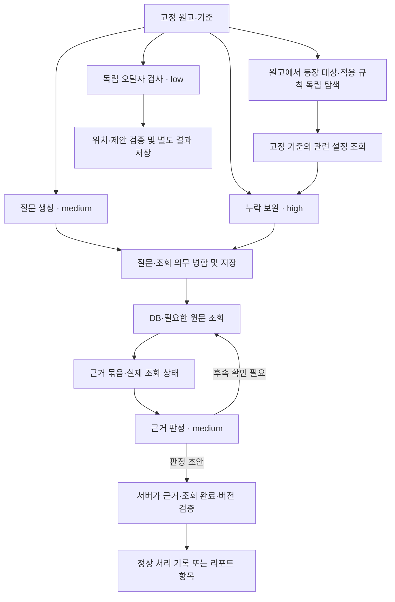

# 오류 검사 단계별 입출력 설계안

2026-10-28 · GH300 · 질문 생성 → 누락 보완 → DB·RAG 조회 → 근거 판정

**상태:** 사용자에게 설명할 구체적인 구현 제안이다. 합의한 제품 정책과 모델을 적용했으며, 아래 타입·필드·상태 이름을 구현 완료 또는 별도 사용자 확정 사항으로 취급하지 않는다. 실제 코드·API·DB 변경과 모델 호출은 이번 작업에 포함하지 않는다.

관련: [제품 기획](gh-300-error-report-product-brief.md), [전체 결정](gh-300-error-report-decision-summary.md), [구현 계획](gh-300-error-report-implementation-plan.md), [질문 생성](gh-300-validation-question-planning.md), [근거 조회](gh-300-validation-evidence-retrieval.md), [오탈자 정책](gh-300-typo-review-policy.md).

## 1. 설계의 중심

단계 사이에 **질문 카드 → 조회 요청 → 근거 묶음 → 판정 결과**를 전달한다. 질문 문장이나 최종 답변만 넘기지 않고, 원문 위치·대상·시점·확인 의무·실제 조회 상태를 함께 유지한다. 그래야 ‘검색 실패’를 ‘오류 없음’으로 오인하지 않고 누락된 단계를 찾아 재시도할 수 있다.

기존 계획의 Java 검수 접수/기준 관리, Python 검사 실행, Java 결과 검증/게시 경계를 유지한다. 질문 카드의 사실·대상은 검사에 필요한 임시 기록이며 설정 후보가 아니다. 검토 종료 전 설정 추출·후보·새 인물/세계관 등록을 하지 않는다.

### 설계 방식의 선택

합의된 단계 구분에 맞춰 기존 조회 모듈을 검수용 데이터 계약으로 연결하는 안을 제안한다. 긴 자연어 대화만 전달하면 재시도·원문 버전·누락 범위 검증이 어렵고, 별도 에이전트 서비스들을 만드는 방식은 현재 규모에서 추가 경계만 늘린다. 역할별 구조화 응답과 기존 Worker를 이용한다. 이 세부 연결 방식은 작성자의 구현 제안이다.

| 단계 | 실행 주체 | 모델 / 추론 | 다음 단계에 넘기는 핵심 |
| --- | --- | --- | --- |
| 원고·비교 기준 준비 | 서버·Worker | 없음 | 원고 구간, 기준 버전, 허용 출처, 준비 상태 |
| 질문 생성 | LLM | Terra / medium | 원문 위치가 붙은 질문 초안 |
| 독립적인 누락 보완 | LLM + 기준 조회 코드 | Terra / high | 원고·기존 설정에서 별도로 찾은 질문과 점검 범위 |
| 질문 병합·저장 | 서버·Worker | 추가 역할 없음 | 중복 관계·조회 의무를 보존한 검사 질문 |
| DB·RAG 조회 | 코드, 검색어/목적은 계획·판정 역할이 작성 | 검색 자체는 판정 LLM 아님 | DB 값·원문·조회 결과·미확인 의무 |
| 근거 판정·후속 요청 | LLM | Terra / medium | 추가 확인 요청 또는 판정 초안 |
| 결과 검증·게시 | 서버 | 없음 | 작가에게 보일 항목 또는 정상 처리 기록 |
| 독립 오탈자 검사 | LLM + 원문 검증 코드 | Terra / low | 위치·원문·짧은 제안·이유 |

모델 ID는 모두 `gpt-6.1-terra`다. 오탈자의 사용자 표현 lite는 낮은 추론이라는 뜻으로 해석해 low로 기록했다. 모델·추론 선택 근거는 [전체 결정 1절](gh-300-error-report-decision-summary.md#1-초기-모델추론-강도와-llm-수)에 있다. 역할 수가 회차당 호출 횟수는 아니며 임베딩과 검토 후 설정 추출 모델은 이번 선택 범위 밖이다.

## 2. 모든 단계에 붙는 실행 정보

기존 구현 계획의 `ValidationInputV1`을 상위 실행 계약으로 유지한다. 아래는 그 안에서 누가 값을 정하고 무엇을 모델에게 보여줄지 구체화한 것이다.

| 데이터 | 소유자 / 용도 |
| --- | --- |
| `contractVersion`, `reportId`, `jobId`, lease, 실행 세대 | 서버가 발급·검증. 모델이 생성하거나 변경하지 않음 |
| `reportMode`, 이전 확정 기록 | 서버가 최초 검수와 확정 후 진단을 구분. 진단은 추출·중복 확정 허가 없음 |
| `targetFingerprint` | 검사할 원고의 실제 버전. 원고 교체 뒤 늦게 온 결과를 차단 |
| `baselineId/revision/effectiveHash/manifestHash` | 검사 기준과 허용 출처 묶음. 현재 DB를 임의로 대신 읽지 않음 |
| `segmentId`, `inputDigest`, 역할·프롬프트·스키마 버전 | 어떤 입력으로 어떤 역할을 실행했는지 식별. 의미 있는 입력 변경 시 옛 성공 결과 재사용 금지 |
| 준비 상태·남은 실행 예산·처리 기록 | Worker가 관리. 실제 호출/읽기 결과로 갱신하고 모델의 ‘완료’ 주장으로 대체하지 않음 |

이 실행 정보 전체를 프롬프트에 복사하지 않는다. 모델은 필요한 원고와 `T1` 같은 원문 참조, `S1` 같은 대상 참조, `F1/E1` 같은 근거 참조를 받는다. 회원 ID·SQL·S3 저장소 키·임의 작품/기준 선택 권한은 주지 않는다. 이 문서의 짧은 참조들은 합성 예시이며 실데이터 ID가 아니다.

원문 참조에는 source kind, 정확한 버전, 문장/구간 ID, 실제 인용과 위치를 연결한다. 회차·설정집·작가 직접 입력을 구별한다. 직접 입력 설정에는 없는 원문을 만들지 않는다. 위치는 고정 원고의 Unicode code point 기준 `[start, end)`를 사용하고 화면이 사용하는 문자열 위치로 변환할 책임을 명시한다. 반복된 같은 문장은 구간 ID와 위치로 구별한다.

## 3. 질문 생성이 받는 것과 반환하는 것

**입력 제안 `QuestionPlanInput`:** 원고 구간의 실제 텍스트와 문장/위치 참조, 해석에 필요한 앞뒤 문맥, 고정 기준에서 읽은 식별용 이름·별칭 카탈로그, 합의한 검사 범위. 카탈로그는 식별 보조이며 그 목록에 없는 대상이나 규칙을 검사에서 버리지 않는다. 필수 문맥·카탈로그가 잘리면 그 상태도 전달한다.

**출력 제안 `QuestionDraft`:** 아래 정보를 갖는 질문 배열과 구간 처리 기록이다. LLM은 응답 내부 참조만 반환하고 실제 질문 ID는 저장 시 서버가 부여한다.

| 필드 | 의미 | 합성 예시 |
| --- | --- | --- |
| `localQuestionRef`, `origin` | 응답 내부 질문과 생성 경로 | q1, 원고 질문 생성 |
| `targetSpans` | 질문의 근거가 되는 이번 원고 위치·인용 | T1: 민수는 양손으로 검을 쥐었다. |
| `subjectMentions`, `subjectRefs` | 원문 표기와 제공된 대상 후보 참조 | 민수 → S1; 불명확하면 후보/미해결 유지 |
| `propertyOrRule`, `checkIntent` | 무엇을 왜 확인할지 | 이 장면의 양손 사용이 기존 신체 상태와 맞는가? |
| `timeContext`, `conditions`, `assertionMode` | 서사 시점·적용 조건·실제 서술/발언/가정 | 현재로 보이나 문맥 확인 필요, 양손 사용, 행동 서술 |
| `lookupIntents` | 확인해야 할 정보와 목적 | 신체 상태·변화 이력, 필요 시 회복/의수·회상 확인 |
| `reason`, `parentQuestionRef` | 짧은 필요 사유와 후속 질문 연결 | 양손을 쓰는 동작이며 기존 제약 확인 필요 |

원문 없는 사실, 제공되지 않은 대상 ID, 근거 없는 확정 시점을 생성하면 검증에서 거절한다. 속성·대상·시점이 아직 불명확한 것 자체는 허용하고 그 확인 의무를 유지한다. 대사·비유를 사실로 바꿔 기록하지 않는다.

구간 처리는 `PLANNED / NO_CHECK / UNPROCESSED`를 구별하는 안이다. 질문이 없으면 `NO_CHECK`와 짧은 이유를 남기며, 모델 응답 누락·잘림·실패는 Worker가 `UNPROCESSED`로 기록한다. 모델이 임의로 생략한 구간을 정상으로 합산하지 않는다.

## 4. 누락 보완과 질문 병합

**입력 제안 `CoverageReviewInput`:** 동일 원고 구간·문맥과, 첫 질문 목록에만 의존하지 않고 원고에서 별도로 찾은 등장 대상·관련 규칙에 대한 기준 자료. 인물의 관련 상태·제약, 종족·조직·장소 규칙, 작품 공통 규칙을 페이지/묶음 단위로 읽는다. 같은 대상의 속성을 처음 질문에 나온 속성만으로 제한하지 않는다.

누락 보완 LLM은 먼저 첫 질문 목록 없이 질문을 만든다. 독립 탐색 과정은 같은 high 역할의 호출로 수행할 수 있으며 다섯 번째 모델 역할을 추가하지 않는다. 조회된 규칙과 독립 질문 생성 뒤 기존 질문과 대조한다. 고정 규칙으로 확실히 같은 질문은 코드가 합칠 수 있고 의미상 병합 제안이 필요하면 같은 보완 역할에서 하되 입력 의무·위치가 사라지지 않는지 코드가 검증한다. 병합이 불확실하면 별도 질문으로 유지한다.

**출력 제안 `CoverageReviewResult`:** `questions`, 점검한 원고 구간, 선택한 기준 항목과 선정 이유, 항목별 `CHECKED / NOT_APPLICABLE / UNPROCESSED` 및 이유. 선택한 필수 규칙을 읽지 못한 경우 전체 완료로 처리하지 않는다. 선택 자체가 관련 설정을 모두 찾아냈다는 증거는 아니므로 평가에서는 의미상 누락을 별도로 본다.

예: 첫 질문이 검의 소유 여부만 확인해도 보완 단계에서 민수의 ‘왼손 상실’을 읽었다면 양손 사용 질문을 추가한다. 이미 같은 질문이 있으면 기존 질문에 생성 경로·원문 위치·필수 확인을 연결한다.

병합한 질문은 **대상·속성/규칙·시점·조건이 같은 경우만** 합친다. 대상 ID가 없다는 이유로 새 인물을 하나로 묶지 않는다. 검사 질문 병합과 리포트의 같은 충돌 묶음은 별개이며, 리포트 묶음 아래 각 위치의 검사 완료 여부도 남긴다.

## 5. 조회 요청: LLM이 정하는 것과 코드가 정하는 것

**제안 `LookupRequest`:** 검사 질문·확인 의무 참조, 조회 목적, 허용 연산, 대상/설정/원문 참조 또는 검색어, 필요한 시점·조건 문맥. 작업자는 이 요청을 검증하고 신뢰된 실행 정보의 작품·기준·출처 범위를 주입한다.

| 요청 목적 | 허용 조회 제안 | 반환 내용 |
| --- | --- | --- |
| 누구·어떤 설정인지 확인 | 대상 찾기, 기준 설정·이력·규칙 조회 | 대상 후보, 값, 조건·이력·직접 정정 범위, 연결 출처 |
| 이미 아는 근거 읽기 | 허용된 근거 참조 직접 읽기 | 실제 원문·버전·위치·주변 문맥 |
| 부족한 과거 근거 찾기 | 키워드·필요 시 의미 검색 | 관련 구간과 검색 범위·실행 상태 |
| 장면 의미 확인 | 허용된 인접 문맥·추가 원문 읽기 | 앞뒤 실제 텍스트와 경계/읽기 제한 |

조회 범위를 모델이 확장하지 않는다. 과거 검색은 허용된 앞선 원문·설정집을 대상으로 하며, 출처 필터를 순위·개수 제한·인접 문맥 확장 전에 적용한다. 대상 신규 회차는 이번 원고의 문맥으로만 읽고 과거 근거 결과에 섞지 않는다. 출판 회차 번호를 서사 시점으로 간주하지 않는다.

질문 생성 때 목적을 만들고, 판정 역할이 새 단서를 발견하면 후속 요청을 만든다. 초기부터 모든 질문에 모든 연산을 강제하지 않는다. DB와 확보한 근거가 충분하면 추가 검색을 생략하고 **어떤 근거가 어떤 확인을 해소했는지** 남긴다.

조회 결과 제안 `LookupResult`에는 요청 참조, 실제 연산·출처 범위, 실행 상태, 항목, 페이지/제한 상태, 근거 읽기 준비 상태, 안전한 실패 코드가 필요하다. 빈 배열 하나만 반환하지 않는다.

- 정상 조회의 결과 0개: 검색은 성공했지만 일치 자료를 찾지 못함. 사실 부재나 충돌의 증명이 아님.
- 필요한 조회의 실패·자료 파기·입력 변경: 확인 미완료 또는 결과 무효화. 정상 0건이나 추가 확인 필요로 바꾸지 않음.
- 순위 검색의 상위 결과 제한: 과거 자료 전부를 읽었다는 뜻이 아님. `limited`만으로 무조건 실패시키지 않고, 새 필수 단서나 잘린 필요한 문맥이 남았는지 확인.
- 읽어야 할 규칙 페이지·원문·필수 문맥이 남음: 필수 처리 미완료. 정상적으로 생략 가능한 추가 검색과 구분.
- 벡터 미준비: 직접·키워드 근거로 필요한 확인을 끝냈다면 단독 실패 사유가 아님. 필요한 확인이 여전히 남으면 미완료.

설정집은 고정 revision·hash의 원문을 검수 전용 reader로 읽는다. 기존 회차 검색 코드가 설정집까지 검색한다고 가정하지 않으며, 첫 버전에는 새 설정집 벡터 인덱스를 필수로 만들지 않는다.

## 6. 근거 묶음: 판정 LLM에 전달할 데이터

**제안 `EvidenceBundle`:** 한 질문의 현재 판정 입력을 구성한다. 묶음의 실제 저장·출처 유효성 기록은 서버/Worker가 소유하고 LLM에는 읽을 근거와 참조만 전달한다.

| 필드 | 포함할 내용 |
| --- | --- |
| `checkRef`, `checkRevision`, `inputDigest` | 어떤 질문·조회 의무 버전에 대한 근거인지 |
| `targetOccurrences` | 이번 원고의 실제 문장·위치·필요한 장면 문맥 |
| `subjectResolution`, `timeAndConditions` | 대상·시점·조건의 확인 결과와 남은 모호함; 해당 판단의 근거 참조 |
| `baselineFacts` | 실제 고정 DB 값·조건·이력·출처, 명시적 작가 정정의 적용 범위 |
| `sourceEvidence` | 실제 과거 원문·설정집 인용, 출처·버전·위치·검증 참조 |
| `lookupReceipts` | 실제 실행한 요청과 결과/실패/읽기 제한. 임의의 모델 완료 주장과 구분 |
| `obligations` | 무엇을 확인해야 했고, 어떤 자료/요청으로 확인했는지 또는 아직 남았는지 |
| `newClues`, `unresolvedIssues` | 후속 확인이 필요한 단서와, 읽기를 마쳐도 남은 의미상 불확실성을 구분 |

조회 의무는 `PENDING / SATISFIED / NOT_APPLICABLE / UNPROCESSED` 같은 상태와 짧은 이유·근거/조회 참조로 표현하는 안이다. ‘찾지 못함’도 필요한 검색을 정상 수행한 기록과 한계를 갖되 예외가 존재하지 않는다는 증거로 만들지 않는다. 정상 변화를 뒷받침하는 자료와 충돌을 뒷받침하는 자료를 모두 제공한다.

## 7. 판정 결과와 서버의 검증

**입력:** 위 근거 묶음. **출력 제안 `ValidationDecision`:** 다음 두 갈래만 모델 응답으로 둔다. 실행 실패는 Worker가 따로 기록한다.

| 응답 | 필수 내용 | 다음 동작 |
| --- | --- | --- |
| `FOLLOW_UP` | 아직 필요한 확인, 관련 단서/질문 참조, 구체적인 후속 조회 목적 | 요청 검증 후 추가 조회. 새 질문이 필요하면 관계를 저장하고 영향을 받는 질문을 재평가 |
| `DECIDED` | 결과 유형, 이번 원고·비교 근거 참조, 짧은 판단 이유, 모호한 사유, 해당 시 영향 등급·영향 이유 | 서버가 실제 조회 상태·참조·버전을 검증한 뒤 기록/게시 |

`DECIDED`의 결과 유형은 기존 제안 `CONFLICT / SUSPECTED_CONFLICT / NEEDS_CONTEXT / NO_CONFLICT`를 따른다. 앞 세 유형만 리포트 항목을 만든다. `NO_CONFLICT`도 처리 기록과 근거는 남기되 작가에게 내부 질문을 검토시키지 않는다. 영향 등급은 앞 세 유형에서 별도로 판단하며 정상 결과에는 붙이지 않는다.

합의한 네 확인 기준을 `completionAssessment`로 설명하게 할 수 있으나, 모델의 true 네 개만 받아 완료시키지 않는다. 서버는 원문·인용 일치, 제공된 참조인지, 실제 필수 조회의 정상 종료, 미처리 의무와 새 단서 존재, 최신 입력/실행 세대 여부를 확인한다. 의미상 판단의 정확성까지 코드가 보증하는 것은 아니므로 평가 사례로 별도 확인한다.

필요한 자료를 읽었는데 원문 자체의 대상·시점이 애매하면 `NEEDS_CONTEXT`가 가능하다. 조회 실패·응답 잘림·필수 읽기 미완료·실행 한도 소진은 이 유형으로 종결하지 않는다. 근거 없는 인용·알 수 없는 참조·형식 오류는 검증 실패로 처리하고 정해질 재시도 한도 안에서 복구하며, 끝내 실패하면 해당 범위를 미완료로 남긴다.

LLM은 작가 판단이나 `설정 추출 허용`을 반환하지 않는다. AI 분류·작가 판단·실행 상태는 별도다. Java가 두 검사 전체의 범위와 작가 판단·원고/기준 유효성을 확인해 기존 합의대로 자동 또는 명시적 추출을 허가한다.

## 8. 한 사례가 실제로 오가는 모습

다음은 설명을 위한 합성 자료이며 실제 작품의 기록이 아니다.

1. **원고:** T1 = 101화의 ‘민수는 양손으로 검을 쥐었다.’와 앞뒤 장면.
2. **질문 카드:** Q1 = ‘이 장면에서 민수의 양손 사용이 기존 신체 상태와 맞는가?’ 대상 S1, 근거 T1, 시점은 문맥 확인, 확인 의무는 기존 신체 상태·필요한 변화/예외.
3. **DB 조회:** F1 = 민수의 왼손 상실 기록, 출처 80화. 필요하면 E1 = 그 사실이 서술된 실제 원문을 직접 읽음.
4. **추가 조회:** 회복·의수 등의 정상 설명을 허용된 앞선 원문 전체에서 RAG로 찾음. 현재 장면이 회상인지 T1의 문맥도 확인. 검색 결과 95화의 의수 획득 E2가 나오면 그 장면과 실제 사용 조건을 읽음.
5. **근거 묶음:** Q1 + T1 + F1/E1 + E2 + 각각의 조회 기록 + 시점/사용 조건 확인 결과를 전달.
6. **판정:** 의수로 검을 쥘 수 있고 현재 장면 이전에 획득했다는 근거까지 확인되면 정상 처리. 원문에 ‘의수를 구하러 갔다’만 나오면 그 문장만으로 획득 성공을 단정하지 않고 필요한 후속 확인.

| 이후 실제 확인 결과 | 저장할 처리 |
| --- | --- |
| 필요한 읽기를 마치고 의수 사용이 정상 설명으로 확인됨 | `NO_CONFLICT`, 오류 항목 없음 |
| 필요한 검색은 정상 종료했지만 회복/의수 설명을 찾지 못함 | `SUSPECTED_CONFLICT`, 확인한 범위와 해소 근거 미발견 이유 표시 |
| 읽기는 마쳤으나 현재/회상의 해석이 불명확함 | `NEEDS_CONTEXT`, 시점이 왜 애매한지 표시 |
| 필요한 95화 읽기 실패 | 처리 미완료, 재시도 대상. 위 세 판정으로 대체하지 않음 |

이 사례의 영향 등급을 무조건 심각으로 고정하지 않는다. 그 동작이 현재 사건 성립에 미치는 영향을 읽고 등급과 이유를 정한다.

## 9. 오탈자 분기의 최소 계약

**입력 제안 `TypoCheckInput`:** 같은 고정 원고의 구간·문맥·정확한 위치와 검사 범위. 설정 질문과 검색 결과가 없어도 독립 수행한다.

**출력 제안 `TypoCheckResult`:** 구간 처리 기록과 제안 배열. 제안은 원문 참조/인용, 짧은 대체 표기, 분류(맞춤법·띄어쓰기·명백한 오타 등), 이유다. 예: T2의 ‘할수 있다’ → ‘할 수 있다’. 원문을 실제 수정하지 않는다.

서버는 실제 원문과 위치, 중복·실행 버전을 확인한다. 고유명사와 의도적 표현을 건드리지 않는 의미상 품질은 기본 예시로 점검한다. `원문 유지 / 수정 필요 / 검토 필요`는 이후 작가 판단이며 모델 제안에 섞지 않는다. 응답 실패·빠진 구간을 제안 0건으로 처리하지 않는다.

## 10. 저장·재시도·중간 결과

- 기존 계획의 `publishPlan`과 서버 발급 checkId를 유지한다. 단계·구간·입력 digest별 검증된 계획과 참조 매핑을 저장하고 같은 요청 재전송은 기존 결과를 재사용하거나 명시적으로 충돌 처리한다. 독립 질문 생성과 보완은 각 단계 기록으로 보존해 하나가 다른 하나를 덮지 않는다.
- 뒤늦은 보완·새 단서로 확인 의무가 늘면 질문의 새 revision과 의존 관계를 기록한다. 기존 판정의 입력 digest가 달라진 경우 재평가하기 전까지 완료로 집계하지 않는다. 동일 입력을 다시 판정해 저장한 결과를 임의로 덮는 동작과 구별한다.
- 같은 입력 재시도에서는 검증된 성공 질문·조회를 보존하고 미완료 부분을 진행한다. 변경 없는 항목의 작가 판단은 유지하고 새 근거 등으로 판단 대상이 바뀐 항목만 재검토한다. 변경된 원고/기준은 새 검사이며 옛 판단이나 추출 허가를 승계하지 않는다. 원고만 바뀌었고 기준은 유효하면 그 기준은 재사용할 수 있다.
- 결과는 검증되는 대로 진행 중 읽기 전용으로 보여준다. 후속 확인 때문에 기존 항목의 판정이 바뀌면 항목 revision으로 반영하고, 검사 종료 전에는 작가 판단을 받지 않는다. 전체 정상 종료에는 1차·보완·조회·판정의 필수 처리 기록과 별도 오탈자 전체 처리가 모두 필요하다.
- 조회가 필요한 실행 한도값은 실제 사례로 정한다. 특정 숫자의 검색 라운드·호출 횟수를 이번 설계의 확정값으로 넣지 않는다. 예산 때문에 남은 작업은 미완료로 남긴다.
- 실행 로그에는 원고·전체 프롬프트·비밀 키를 남기지 않는다. 검사 기록은 기존 원문 접근·파기·권한 정책을 따르며 새 영구 보관 정책을 만들지 않는다.

### 재시도 후 바뀐 항목의 작가 판단 — 사용자 합의

같은 입력 재시도에서 내용이 바뀌지 않은 항목의 판단은 유지한다. 새로운 근거·발생 위치 등 판단에 영향을 주는 내용이 바뀌면 해당 항목만 `검토 필요`로 되돌리고 변경 이유를 보여준다. 이전 판단은 변경 전 항목의 이력으로 보존하며 현재 판단으로 승계하지 않는다. 재검토가 남으면 설정 추출을 보류한다. 단순 표시 순서·형식 변경이나 의미가 같은 중복 근거만으로 재검토를 요구하지 않는다.

구현 제안: 판단을 당시 항목 revision에 연결하고 의미 있는 변경 시 새 revision의 활성 판단을 `PENDING`으로 만든다. 이전 revision으로 판단 저장·검토 완료 요청이 오면 서버가 거절한다. 원고·기준이 그대로인 재시도는 같은 report 안에서 변경 항목을 재평가할 수 있으며, 원고·기준 자체가 바뀐 새 검사와 구분한다. 정상으로 판정되어 리포트에서 빠진 항목은 내부 정상 처리 기록으로 남기고, 여전히 게시되는 변경 항목과 새 항목의 검토를 받는다. 기존 원문 접근·파기 정책을 넘는 별도 영구 보관을 추가하지 않는다.

## 11. 기존 코드에서 재사용할 것과 추가할 것

2026-10-28 읽기 전용 조사다. 아래 코드의 존재가 검수 파이프라인 구현 완료를 뜻하지 않는다.

| 기존 코드 | 재사용 | 추가/수정 필요 |
| --- | --- | --- |
| AI `app/schemas/setting_tools.py` | 대상·설정·이력·직접 근거·페이지/partial 구조 | FIND/CURRENT는 현재값 조회이므로 검수의 고정 기준 전용 계약/어댑터 필요. 직접 정정의 적용 범위도 제공 |
| AI `app/retrieval/search_contracts.py`, `search_repository.py` | 신뢰된 조회 scope, 직접/키워드/벡터/인접 조회와 출처·위치 | 현 scope는 회원·작품·회차 범위이며 frozen manifest가 없음. 허용된 정확한 출처 버전 필터와 검수용 repository 필요. direct는 청크 ID 조회 |
| AI `app/retrieval/search.py` | 비동기 조회·readiness·재검증, 계량 embedding client 주입 | 검수 기준과 원문/설정집 읽기 상태 연결. 검색 모듈 자체가 사용량 예약·정산을 맡는 것은 아님 |
| AI `app/chatbot/hybrid.py`, `client.py` | 실제 인용·허용 참조·출처 재검증 패턴 | 챗봇 실행 전용 receipt를 검수에 그대로 쓰지 않음. 검수 실행/기준을 확인하는 게시 계약 필요 |
| AI `app/llm/openai_client.py` | Responses·구조화 출력·호출별 모델 지정 | 추론 강도는 현재 client 인스턴스 설정. 호출별 불변 옵션을 추가하는 안으로 네 역할의 강도를 연결. 공유 client 속성을 실행 중 변경하지 않음 |
| #303 Java 검수 접수·기준 보관 | 추출 없는 report와 기준, 추출 우회 차단 | 실제 검수 Job·계획/근거/판정 저장·Worker lease·작가 판단/검토 종료 연결은 후속 |

역할별 추론 옵션 확장은 기존 호출의 기본 동작을 유지하고 실제 요청 생성과 토큰 수 계산 경로가 같은 유효 옵션을 사용하도록 검증한다. 기존 설정 추출 모델이나 전체 서비스 기본 모델을 이번 검사 선택에 맞춰 일괄 변경하지 않는다.

## 12. 구현 계획에 넣을 확인 항목

1. 정상·충돌·애매한 합성 예시에서 질문→조회→근거→판정을 같은 참조로 추적할 수 있음.
2. 첫 질문에 없던 신체 상태 질문이 보완에서 추가되고 기존 성공/필수 의무가 사라지지 않음.
3. 의수 근거로 정상 처리되는 경우와 필요한 읽기 실패로 미완료인 경우가 다르게 저장됨.
4. 필요한 구간·규칙 페이지·후속 질문 누락, 잘린 응답, 없는 근거 참조가 정상 0건이 되지 않음.
5. DB·직접 입력 근거만으로 충분한 질문은 불필요한 추가 검색을 생략하되 해소 이유를 기록함.
6. 허용 출처 필터가 검색 순위/개수 제한 전에 적용되고 원문 교체·파기 뒤 늦은 결과가 게시되지 않음.
7. 반복 문장 위치·Unicode 위치가 일치하고, 질문 병합/리포트 묶음에서 모든 위치와 처리 상태를 보존함.
8. 같은 입력 재시도는 변경 없는 성공 결과·판단을 보존하고, 새 근거/발생 위치로 바뀐 항목만 검토 필요로 전환함. 이전 판단 이력은 보존하되 변경 항목의 옛 판단이나 원고/기준 변경 전 허가로 추출할 수 없음. 표시 순서 변경·중복 근거만으로 재검토시키지 않음.
9. 같은 Terra 모델에서 medium/high/medium/low가 병렬 호출 중 섞이지 않고 전체 서비스 기본값은 유지됨.
10. 검토 전 설정 후보/추출 작업 생성 0, 오탈자 실패·미검토 시 추출 보류, 두 검사 정상 완료·전체 0건만 자동 추출이라는 기존 조건을 지킴.

이 목록은 후속 구현 검증 계획이다. 이번에는 문서의 계약 일관성·링크·예시를 확인하며 실제 모델 품질이나 실행 테스트를 수행한 것으로 표시하지 않는다. 필드명·배치 크기·검색/시간 한도는 구현 세부사항으로 남겨둔다.
