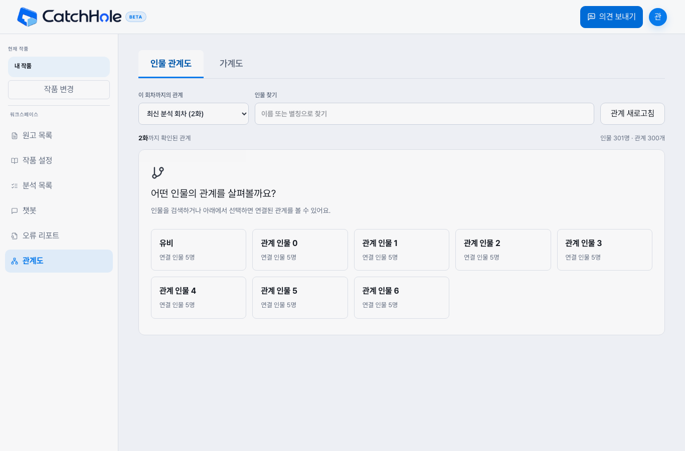
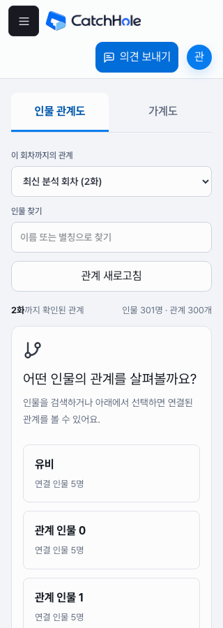
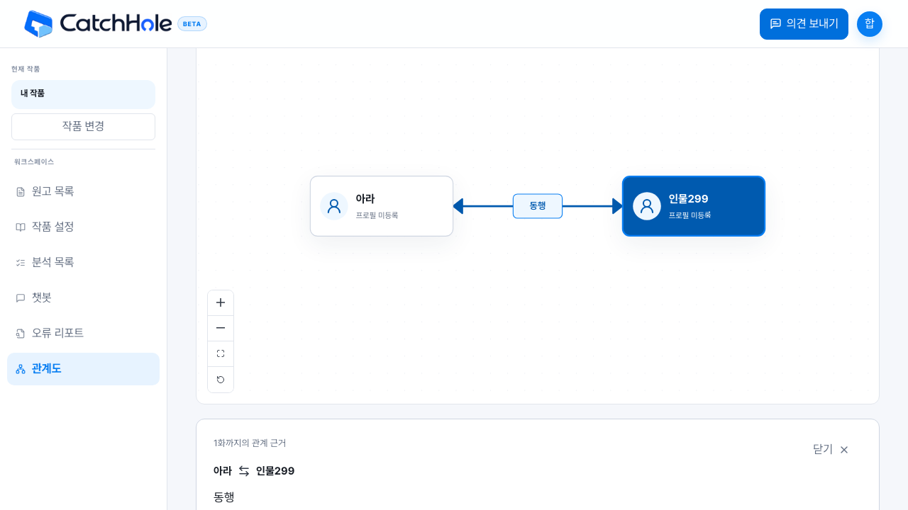

# GH412 관계도 탐색 검증

- 기준: 2026-11-10 격리 작업 브랜치, 합성 데이터. 운영 원고·분석은 변경하지 않았다.
- `npm run build`: 통과. 기존 번들 크기 경고 유지.
- `npm run lint`: 오류 0, 기존 Fast Refresh 경고 2.
- `npm run test:layout`: 77 통과, 선택 실행 1 생략.
- `GH412_FIXTURE_INPUT=/tmp/gh412-explorer-contract.json CATCHHOLE_E2E_PORT=18412 npx playwright test e2e/episode-relationships.spec.ts e2e/relationship-explorer-contract.spec.ts --workers=2`: 42 통과. 연속 검색·오류 재시도·인물 100명 경계 포함.

`GH412_FIXTURE_OUTPUT=/tmp/gh412-explorer-contract.json ./gradlew test --tests '*EpisodeRelationshipGraphPostgresIntegrationTest'`로 실제 PostgreSQL/Flyway와 Spring MVC 응답을 생성한다. 브라우저 계약 검증은 이 응답을 그대로 재생한다. 운영 서버나 실제 네트워크 왕복을 측정한 테스트는 아니다. 인증/잘못된 페이지/없는 회차의 상태 코드도 서버 테스트에서 확인한다.

브라우저에서는 큰 관계도의 선택 화면, 초기 표시 밖 인물·별칭 검색, 한글 조합 중 요청 억제, 직접 관계 100개 페이지, 종료 관계, URL 복원, 뒤로가기, 320px, 기존 정정 초안·403/404·503·방향·복수 관계를 검증한다. 완료 상태의 정기 조회가 없고 명시적 새로고침 후에도 이동한 카드 위치가 유지되는지 확인한다.

Pencil 활성 문서가 다른 작업 경로를 가리켜 `.pen` 동기화는 대기 중이다. `DESIGN.md`와 `design/PENCIL_MIGRATION.md`에 현재 UI 정책과 대기 사유를 기록했다.

## 배치 계산 상한 보완

로컬 Node에서 같은 합성 별 모양 관계망의 2회 예열 후 5회 평균을 측정했다. DOM·페인트·네트워크를 제외한 배치와 선 경로 계산만 포함한다. 기존 전체 보기 201명/200개는 3,909ms, 전체 보기 300명/299개는 17,240ms, 중심 보기 101명/100개는 1.67ms였다. 관계 수만으로는 큰 별 모양 구조를 거르지 못해 **관계 300개 또는 인물 100명 이상**에서 인물 선택으로 시작하도록 보완했다. 이 실험은 일반적인 화면 응답 시간이나 전체 성능 보장을 뜻하지 않는다.

## 리뷰 회귀 검증

기본 `nav=graph` 주소에서 인물을 고른 뒤 다음 페이지·새로고침·뒤로가기·가계도 전환과 복귀를 검증한다. 인물의 `relationPeoplePage`와 가계도의 `relationPage`를 분리해 기본 주소에서도 가계도로 잘못 전환되지 않으며 각 페이지 상태가 섞이지 않는다. 서버 검색 응답은 실제 OpenAPI로 생성한 공통 `PageResponsePerson`을 사용하며 마지막 페이지 뒤에서도 전체 개수를 유지한다.

리뷰 보완 후 인물 관계도 41개·실제 응답 계약 1개, 기존 가족 링크/페이지 4개, 기능 OFF의 URL 정리 4개가 통과했다. 빌드와 lint도 재확인했다.
